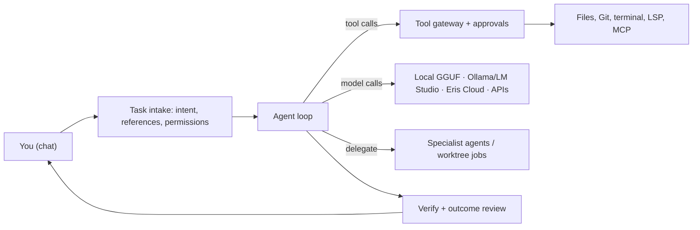

<p align="center">
  
</p>

<h1 align="center">Eris</h1>

<p align="center">
  <strong>The AI-first desktop IDE where an agent does the work and you stay in control.</strong><br>
  Open a project, describe the change, and review every hunk before you keep it.<br>
  Run it fully offline on your own models, or connect the cloud models you already pay for.
</p>

<p align="center">
  <a href="https://github.com/EricServices-Repo/Eris/releases/latest"><strong>Download for macOS and Windows</strong></a> ·
  <a href="https://ericservices-repo.github.io/Eris/">Documentation</a> ·
  <a href="docs/ERIS_USAGE.md">User guide</a> ·
  <a href="docs/ARCHITECTURE.md">Architecture</a>
</p>

---

## Why Eris

Most AI editors bolt a chat box onto an editor. Eris is built the other way around: a coding agent that reads your project, plans, edits, runs your checks and reports what it verified. Around it sits a full IDE, so you can inspect, steer and undo everything the agent does.

- **Your code, your models.** Use local GGUF models, Ollama or LM Studio on your own machine, and nothing leaves it. Or pick an OpenAI-compatible API, OpenRouter, or Eris Cloud. The model picker always shows where a turn runs.
- **An agent that finishes the job, and admits when it didn't.** Every request becomes a scoped task with explicit permissions. The agent verifies code changes (typecheck or tests) before it answers, and a second check reviews the answer against the evidence. Unfinished work is reported as unfinished.
- **Nothing lands without you.** Edits appear as hunks in the file they change, backed by checkpoints, with **Keep** and **Undo** on each. Shell commands, pushes and MCP calls ask for approval first.
- **Built for real projects.** Specialist agents and git-worktree background jobs. Project rules, memory, skills and MCP servers. Long-running work with stall detection, bounded recovery and live progress.

## Features

### Agentic chat

| | |
|---|---|
| **Ask and Agent modes** | **Ask** reads and explains without changing anything. **Agent** reads, edits, runs commands and verifies. |
| **Seven specialist roles** | **Agent** (the orchestrator), **Coder**, **Explainer**, **Reviewer**, **Plan**, **Verification** and **Fast**. **Auto** picks the role per message, or you pin one. Add your own in `.eris/agents.json`. |
| **Delegation** | The Agent hands sub-tasks to specialists. Inline children run in your workspace; background jobs run in their own git worktree for review and merge. Child authority never exceeds the parent's. |
| **Live progress** | Phases ("Understanding request", "Using workspace tools", "Running verification", …), tool cards, and a **Thinking** panel that shows the model's own reasoning for reasoning models. |
| **Context you control** | Attach files with `@` and skills with `/`. Inspect exactly which history and evidence were sent to the model. Pin or exclude earlier messages. |
| **Questions, not guesses** | When a request is ambiguous, the agent can ask you mid-run. The task timer pauses while you decide. |

### Models: local first, cloud when you want it

| Option | Runs on | Notes |
|---|---|---|
| **Local GGUF** | Your GPU or Apple Silicon (Metal), via `node-llama-cpp` | Search and download from Hugging Face in-app. Eris measures the context window it can actually allocate and packs the prompt to fit. |
| **Ollama, LM Studio** | Your machine (loopback) | Connect from Settings → Providers. Pull and remove Ollama models without leaving Eris. |
| **Eris Cloud** | Hosted by EricServic.es | Sign in and the models appear as `cloud:<model>`. Free includes 1M tokens per week; Pro is unlimited. |
| **OpenAI-compatible APIs** | Your provider | OpenAI, OpenRouter, Groq, Together, DeepSeek or any custom base URL. Native tool calling where supported. |

- **Auto (this computer only)** never sends code off your machine. **Auto (any connected model)** ranks every eligible model by capability tier, tool support, context size, your *prefer best / local / cheapest* setting, and measured outcomes.
- **Reasoning models** are first-class. Reasoning streams into its own panel and is never mistaken for the answer or for a tool call. Each connection can set the reasoning level and whether it's shown.
- **Recovery.** If a run stalls, Eris can switch to another eligible local model without redoing completed edits. A model you pinned is never swapped.

### A complete IDE

- **Monaco editor**: inline AI edit (⌘K), AI completion (Alt+\ then Tab), go to definition (F12) through the TypeScript language server, and diagnostics.
- **Review hunks** in place, with per-change checkpoints and undo.
- **Integrated terminal** (xterm.js), with agent commands running in the workspace directory.
- **Git**: stage, commit, branches and stash. Link a GitHub repository to sync, list and create pull requests.
- **Run & Debug**: Node launch configurations (`.eris/launch.json`) or any configured stdio DAP adapter.
- **Search** across files, **code map** and code index, and a **command palette** (⌘⇧P).
- **Image generation**: `/image <prompt>`, or let the agent create assets. Runs on local Diffusers models (SD-Turbo, SDXL-Turbo) or an Images API.

### Project knowledge

| Feature | Lives in |
|---|---|
| Always-on rules | `.eris/rules/*.md` |
| Project memory the agent maintains | `.eris/context.md` |
| Reusable skills | `.eris/skills/` and your user skills folder |
| Custom agents | `.eris/agents.json` |
| MCP servers | Settings → MCP |
| Conversation memory | Bounded RAM recall over a SQLite transcript, with an inspector, pins and exclusions |

### Safety by design

- **Scoped authority.** Each request carries a task contract. A code sample in chat doesn't authorize editing a file, and recalled text or a specialist's summary can't widen permissions.
- **Every tool call is gated.** The tool must be allowed for this task, the path must be inside the project, and a file must have been read, unchanged since, before it can be edited.
- **Approvals** for commands, pushes and MCP calls, with a per-workspace "Always allow" list. Workspace trust limits settings from untrusted folders.
- **Credentials stay in the main process**, in a local file or the OS vault. The sandboxed UI only knows whether a key exists.
- **Remote models don't get your history** unless you turn recall sharing on.

### Account and sync

Signing in with an [EricServic.es](https://www.ericservic.es) account syncs settings, projects, chats and skills across computers. Project files, model weights and API keys are not uploaded. Signing in also enables Eris Cloud. Without an account, everything else works.

## Get started

1. **Install.** Download from [Releases](https://github.com/EricServices-Repo/Eris/releases/latest).

   | Platform | Installer |
   |---|---|
   | macOS (Apple Silicon) | `Eris-<version>-mac-arm64.dmg` or `.zip` |
   | Windows (x64) | `Eris-<version>-win-x64-setup.exe` |

2. **Connect a model.** The welcome screen opens Settings → Models. Download a local model, point Eris at Ollama or LM Studio, sign in for Eris Cloud, or add an API key.
3. **Open a folder.** File → Link Folder as Workspace… (⌘O / Ctrl+O).
4. **Start a chat** (⌘L / Ctrl+L), switch to **Agent**, and describe the change.
5. **Review** the hunks in the editor and keep what you want.

Eris updates itself from this repository's releases. The [user guide](docs/ERIS_USAGE.md) covers everything else, including shortcuts.

## How it works



Eris is an Electron app with a sandboxed React renderer. A main process owns every decision and effect: task admission, routing, the agent loop, tool permissions, credentials and model selection. Separate workers hold the SQLite transcript and code index, the loaded GGUF model, and the image runtime, so heavy work never freezes the UI.

Details are in the [architecture overview](docs/ARCHITECTURE.md), [request execution](docs/design/REQUEST-EXECUTION.md), [model selection](docs/design/AUTO-MODEL-EXECUTION.md) and [conversation memory](docs/CONTEXT-MEMORY.md).

## Build from source

Requirements: Node.js 22 (as used in CI), and macOS or Windows to build the desktop app.

```bash
npm install
npm run dev          # run in development
npm run check        # typecheck, lint and the full Vitest suite
```

| Command | Result |
|---|---|
| `npm run start:app` | Build, then launch the unsigned macOS app from `dist/mac-arm64/Eris.app` |
| `npm run dist:mac` | Unsigned macOS app directory |
| `npm run dist:release:mac` | macOS `.dmg` and `.zip` |
| `npm run dist:release:win` | Windows setup `.exe` |
| `npm run start:dev-app` | **Eris-Dev**, the diagnostics app for capturing and replaying agent runs |

Build each platform on that platform, or let CI build both. Changes land on a branch and reach `main` through a pull request. A `v*` tag on an integrated version runs the [release workflow](.github/workflows/release.yml), which publishes the installers and update feeds. See the [GitHub workflow](docs/GITHUB-WORKFLOW.md).

The codebase is about 100,000 lines of TypeScript across `electron/` and `src/`, with about 210 Vitest test files.

## Documentation

The full documentation is at **[ericservices-repo.github.io/Eris](https://ericservices-repo.github.io/Eris/)**, and the source is in [`docs/`](docs/README.md).

## Feedback and security

- **Bugs and ideas:** Help → Send Feedback… in the app, or [open an issue](https://github.com/EricServices-Repo/Eris/issues).
- **Vulnerabilities:** report privately; see [SECURITY.md](SECURITY.md).

## License

[MIT](LICENSE)
