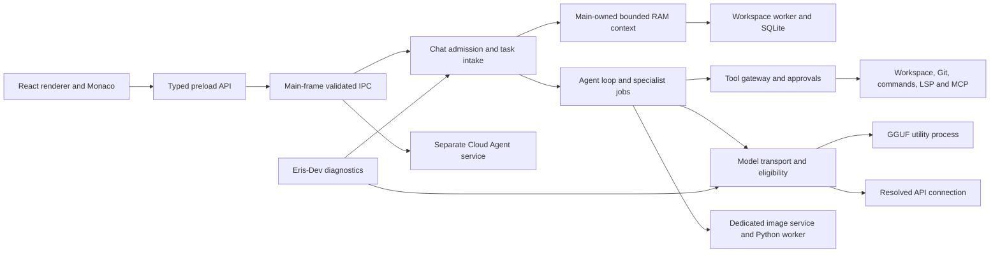

# Eris architecture

Reviewed against integrated `main` `0a54629` on 2026-11-01. Package version: **0.6.10**. The published `v0.6.10` tag is `f14e409`; the five subsequent handoff/RAM fixes in this source baseline require a later build to appear in an installed app.

This is the implemented system map. [Documentation index](README.md) identifies the deeper guides; [RAM target architecture](RAM-CONTEXT-ARCHITECTURE.md) and [Amendment 001](RAM-CONTEXT-AMENDMENT-001.md) explicitly separate remaining targets from shipped source. Historical review evidence is not a current backlog or live-model certification.

## Process boundaries and state ownership

- **Renderer:** interaction, virtualized chat, editor/document models, previews and approvals. It cannot grant itself task authority or directly inspect the RAM store.
- **Main:** validates senders/payloads, admits tasks, resolves authority/project identity, holds credentials, compiles prompts, owns RAM selection/evidence leases and coordinates effects.
- **Workspace worker:** canonical chats, source/control revisions, archive/history access, repository/index work through separate worker lanes. The RAM store itself is still main-owned.
- **Native runtime:** GGUF weights, measured context allocation, tokenization and run-local KV sessions. Normally an Electron utility process; an explicit in-process compatibility path remains.
- **Image worker:** a separately managed Python/Diffusers runtime and model catalog; it does not become a chat model.
- **Cloud Agent:** a separate Node service, deployment boundary, dependency tree and tool implementation.
- **Eris-Dev:** a separate Electron app/profile sharing production intake and agent code behind diagnostics adapters.

Sources: [main startup](../electron/main/index.ts), [window isolation](../electron/main/window.ts), [preload](../electron/preload/index.ts), [workspace worker](../electron/main/workspace-worker.ts), [model runtime](../electron/main/services/builtin-model.ts).

## Canonical contracts

`TaskContract` v2 separates requested artifact, destination, project applicability, acceptance criteria, obligations, effect constraints and effective authority. A code example in chat does not authorize editing a file. Recalled instructions or a specialist summary cannot widen permissions.

A conversation is durable history; a task is the authorized goal; a job/attempt is one execution; a model is the inference destination; an agent is a role and tool ceiling. These identities must remain separate in routing, status, persistence and debugging.

Child contracts now also carry `inherited` semantic requirements. Language/framework information, effect prohibitions, bounded explicit requirements/files and the top-level request excerpt survive delegation. Language conflicts are recorded instead of silently changing the parent's stack. Obligations, recommendations and follow-up/result state remain with the parent unless separately assigned.

Sources: [task contract](../src/shared/task-contract.ts), [task intake](../electron/main/services/task-intake.ts), [task interpretation](../src/shared/task-interpretation.ts).

## Chat → task → agent

1. Validate the main-window/frame sender, versioned bounded submission, workspace/thread association and attachments before task admission.
2. Admit the canonical request digest through task-owned queue/controller state. Same ID/content reattaches; conflicting content is rejected. Persist the current user source before inference.
3. Load canonical recent history in main. UI pagination does not enlarge a thread-bound submission; normal renderer submissions do not supply the authoritative transcript.
4. `planInitialChatTurn` creates the deterministic initial plan. `resolveChatTurnContract` resolves ambiguous meaning, replans when needed and saves a scoped task. Clear creative-writing requests without a file destination bypass edit routing.
5. Automatic semantic intake may use ready Lite as coordinator; the selected execution worker can be another eligible local model. Record a coordinator only when its semantic/routing result was actually used. Clear requests can skip model coordination.
6. Allocate history/recall against the selected model's input budget, bind applicable historical references and select optional RAM/archive evidence for the resolved project.
7. Lease that evidence in the request's `AsyncLocalStorage` evidence scope, then build messages and enter the agent loop.
8. Authorize each proposed tool effect, retain observations/checkpoints, verify completion and persist the visible assistant result before terminal delivery.
9. Release sessions, memory evidence and task-owned resources on success, failure or cancellation.

The generic answer path has no workspace effects. A short unexplained creative refusal receives one same-model repair using the existing conversation; repeated refusal remains incomplete. Explicit safety refusals are not a reason to model-shop.

Sources: [chat IPC](../electron/main/ipc/chat-stream.ts), [shared turn pipeline](../electron/main/services/chat-turn.ts), [resolver](../electron/main/services/task-resolver.ts), [job controller](../electron/main/services/chat-job-controller.ts), [agent loop](../electron/main/services/agent/loop.ts).

## Agent role versus execution-model policy

**Agent Auto** selects a role; the model picker separately exposes:

- **Fixed:** retain the chosen model. Explicit agent model overrides become fixed execution choices; an override conflicting with Auto-local fails visibly.
- **Auto-local:** native GGUFs and actual loopback model-server endpoints. Approved LAN recall endpoints remain remote for execution selection.
- **Auto-any:** eligible local and enabled configured remote models. Cloud Composer additionally requires the Agent/workspace path and compatible server contract.
- **Legacy `auto`:** follows the saved routing profile/cloud preference. Existing pins are not silently migrated.

`chooseExecutionModel` builds policy/resource/capability eligibility before telemetry/evaluation ranking. A ready Lite cannot bypass evaluation of installed fitting local workers. Unknown/non-fitting cold workers and non-chat models are excluded with reasons. Scores never admit a remote candidate excluded by Auto-local.

With sufficient fresh evidence, intent-specific real outcomes precede eval results. Otherwise task-specialization and residency heuristics provide a stable fallback; file size is a fit estimate, not a quality score. Evidence expires after 30 days and is versioned by app/runtime identity, weight identity or endpoint, context configuration and protocol. Unknown provider-side changes behind an unchanged remote ID remain undetectable. Declared/inferred capability is not a measured quality or latency result.

Sources: [routing](../electron/main/services/chat-router.ts), [selection](../electron/main/services/auto-model-policy.ts), [routing evidence](../electron/main/services/routing-evidence.ts), [execution design](design/AUTO-MODEL-EXECUTION.md).

## Agent → agent

Inline delegation is selected for chat-run identities (`jobId` beginning `chat:`); enabled custom specialists can participate. Inline children run sequentially in the same workspace with nested delegation disabled. Background children use inherited or separate worktrees and persistent job records.

Both modes now use `handoffMessages`: optional system briefing plus user subgoal. Required parent/subtask goals and inherited constraints live in the required task block. `delegate_to_agent.constraints` admits at most 12 constraints of 300 characters each, including inherited constraints. Overflow is refused, and an oversized required task fails compilation rather than losing a constraint. Summary/files/questions remain optional evidence with omission accounting; constraints written only in summary remain vulnerable to omission.

Neither child call site automatically receives or reselects the parent's `MemoryPrompt`. A briefing may contain derived recall, but is not a durable source-backed context envelope. Inline automatic children select for their own intent under the parent's execution policy; direct child/background/debug runners exclude the Cloud-only adapter. Child authority is intersected with the parent. Results distinguish observed changes/checks, unverified prose, incomplete/failed work and integration into another worktree.

Background evidence scopes are captured before enqueue/pump execution; unrelated jobs get fresh scopes. Parent cancellation stops the dependent subtree, refuses new children beneath stopping jobs and stops queued descendants. Discard waits for completion/cleanup up to 30 seconds; on timeout it retains the worktree and exposes `worktreeRetained`. Repeated discard calls join one operation. Merge refuses while descendants still run. A child with its own worktree keeps its work for review.

Still missing: persistent child evidence lineage after the parent lease ends/restart, original conversation-to-worktree identity mapping, complete bounded/versioned handoff envelopes, aggregate task-tree work/depth limits and source-backed result receipts. See #256, #262–265 and #267 in the [handoff review index](reviews/handoff-ram-issues-2026-11-01.md).

Sources: [handoff types](../src/shared/agent-orchestration.ts), [background lifecycle](../electron/main/services/background-agents.ts), [deep design](design/AGENT-HANDOFF-AND-RAM-CONTEXT.md).

## Agent → model and bounded recovery

All agent/intent/route/outcome/inline/compaction calls use `streamModelChat`. Diagnostics substitute scoped scripted/live adapters at that seam. `model-protocol.ts` validates complete tool exchanges and emits native function calls or text envelopes for the destination protocol.

Automatic recovery can change the actual model after no-progress, repeated empty/schema-format failures, verification failures or recoverable native/context failures. Attempted models are excluded and the existing two-adaptation budget bounds transitions. Recovery selects eligible local alternatives; it does not export already-derived local execution state to a remote model. Fixed choices, approval denials and safety refusals cannot trigger model shopping. Unavailable alternatives have explicit exclusion diagnostics.

`prepareModelTransition` rechecks admission, releases old KV, prepares the target through exclusive inference scheduling and serialized load/dispose, checks cancellation and reads measured capacity before rebuilding worker instructions. Task identity, authority, tool transcript, journal, action log, checkpoints and completed edits survive; a failed preparation does not commit the proposed worker.

Server preparation is followed by task-reference and recall validation before serialization. Native inference has an additional `prepareMessages` callback after allocation under the inference lease: revalidate, discard revoked session seeds, repack against measured capacity and report the actual payload. Required task/context that cannot fit fails explicitly.

The compiler uses native token counts when a loaded tokenizer is available, with bounded counting and labeled fallback. Cold/unavailable tokenizers and some provider/schema/history accounting remain estimated. The model capability record distinguishes measured allocation, runtime placement plan, server-observed/planned and configured ceilings. GPU fitting and allocation retry are safeguards, not live hardware certification.

Sources: [transport](../electron/main/services/chat-runtime.ts), [protocol](../electron/main/services/model-protocol.ts), [transition](../electron/main/services/agent/model-transition.ts), [recovery](../electron/main/services/agent/mid-run-adapt.ts), [measured compiler](../electron/main/services/agent/measured-context.ts), [capabilities](../electron/main/services/model-capabilities.ts).

## RAM, durable history and run evidence

Detailed RAM history remains a bounded main-process acceleration layer over SQLite. Namespace includes app/profile, canonical workspace identity and thread. Source/control revisions and stable source sequences protect hydration, rewind, replacement and cutoff behavior. Hydration/selection have admission, cancellation, foreground deadlines and pressure fallbacks. The lexical index, durable archive search, pins, decisions and typed working-state receipts are separate from the model's active window.

Current schema defaults are 128 MiB process, 32 MiB/thread, 25,000 messages, eight warm threads, 30-minute idle expiry, 150 ms foreground deadline, an **8,192-token recall ceiling**, and remote sharing off. The per-turn recall allocation starts at 15% of the input budget, bounded by settings and floors/caps; Agent history starts at 10%, chat history at 37.5%. Compiler/transport packing can omit optional items further. Neither logical bytes nor token estimates are exact process RSS.

Evidence leases are now request-scoped. Full derived-text withholding applies to the owning scope or named task, avoiding replacement of an unrelated request. Recognized recalled-item markers are still stripped across scopes when necessary. Dependent jobs inherit the scope while the lease lives; losing the scope or outliving/restarting after the lease leaves a remaining lineage gap.

Run tool output is journaled in admitted bounded chunks before prompt insertion. Caps are 32 MiB/run and 64 MiB globally. Append measures bytes/hashes without a full encoded copy, reserves before encoding, and releases on failure. Reads reserve decoded-string scratch; searches reserve additional redaction/lowercase scratch. `busy` means content is retained but cannot currently be materialized; `omitted` means unavailable. Compaction uses recoverable handles when possible, explicit omission otherwise, and optional source-referenced summaries. Journal storage is run-local, not durable after run end.

`context_search`/`context_read` provide bounded run/thread pull subject to scope, source validity, destination eligibility and call/run budgets. RAM recall, the journal, optional source retrieval, durable history, project `.eris/context.md`, compaction summaries and native KV remain distinct lifecycles. Multi-GiB automatic sizing, a dedicated off-heap memory process, durable journals, CPU embeddings and cross-turn KV parking remain targets.

Sources: [memory guide](CONTEXT-MEMORY.md), [store](../electron/main/services/context-memory-store.ts), [evidence scope](../electron/main/services/memory-dispatch.ts), [journal](../electron/main/services/agent/run-journal.ts), [context pull](../electron/main/services/agent/context-pull.ts).

## Tool effects, editor and persistence

The gateway enforces the task's scoped tool/effect ceiling and inspected-source freshness. File mutations use bounded reversible checkpoints and journals, preserve preimages, serialize overlapping operations and report applied-but-incomplete outcomes when receipt persistence fails. Pending diff review does not mean no disk effect occurred. Multiple operations are individually journaled, not one OS-atomic transaction.

Desktop tests/builds are trusted host code, with workspace trust, environment filtering, approval policy and owned descendant cleanup. A workspace working directory is not an OS sandbox. POSIX commands use owned process groups; Windows uses a build-prepared Job Object helper. Explicit isolated execution is refused when the desktop lacks an accepted isolated runner.

Monaco/document models own current unsaved editor text; stored tab snapshots are not authoritative buffers. Git review, LSP edits, optional DAP adapters, MCP processes and PTYs have separate capability/lifecycle boundaries. Credentials live in main under explicit file/vault policy; renderer APIs expose presence rather than stored values.

Sources: [gateway](../electron/main/services/agent/tool-gateway.ts), [mutation design](fixes/REC-15-checkpoint-reversal.md), [commands](../electron/main/services/shell-run.ts), [language/debug capabilities](changes/REC-36-capability-negotiation.md), [credential store](../electron/main/services/credential-store.ts).

## Images and Cloud

Image generation uses dedicated settings, managed PNG storage and a local Diffusers subprocess or configured Images API. Image weights are downloaded explicitly from Hugging Face, separately from chat models. A tool cannot choose arbitrary model endpoints or silently download weights. Local generation has host/device preflight, inference admission, cancellation, timeouts and MPS watermarks; see the [image guide](image-generation.md). These protect responsiveness without guaranteeing that every model fits every GPU.

Cloud inline requires a compatible task-contract capability. The repository server advertises `taskContractVersion: 1` while v2 qualification remains incomplete, so the desktop v2 path must not assume compatibility. Automatic startup fallback uses the eligible local pool; Fixed Full does not silently become Lite. An interrupted Cloud stream that began workspace work stops with preserved changes rather than replaying operations automatically.

Cloud commands use the separate Linux namespace/cgroup boundary, not desktop trust semantics. Deployment isolation, credentials, endpoint availability and signing remain operational facts requiring separate evidence. Repository stubs/configuration are not proof of production deployment.

Sources: [cloud service](../cloud-agent/README.md), [task policy](../cloud-agent/src/task-policy.ts), [cloud sandbox](../cloud-agent/src/job-sandbox.ts), [fleet contract](CLOUD_AGENT_FLEET.md).

## Eris-Dev, qualification and release

Eris-Dev supports capture-only inspection, opt-in pinned live-model question batches, stateful memory scenarios and budgeted quality scenarios. Capture is not inference; live execution is not an answer-quality oracle; a 10,000-question deterministic routing pass is not 10,000 real model answers. Independent question cases remain isolated unless a stateful scenario explicitly shares thread/task history. See [Eris-Dev](ERIS-DEV.md), [live runs](ERIS-DEV-LIVE-MODELS.md) and [diagnostics](DIAGNOSTICS-RUNS.md).

`npm run check` runs typecheck, lint and all Vitest suites. `build` gates on the agent profile; `build:dev-app` gates on the dev-app profile. Client renderer/worker, quality harness, context, recovery and packaged launch checks have separate scripts. Qualification profiles declare exclusions; source-linked scripted tests do not establish model quality, GPU OOM behavior, accessibility acceptance, deployment isolation or signed-update installation.

Work belongs on feature/rebuild branches with PRs to `main`. The branch-policy workflow accepts PRs to main; repository rulesets are external configuration and were not audited here. Release requires a clean exact `origin/main` checkout, an already-integrated version/changelog, and a new immutable tag. CI builds macOS DMG/ZIP and Windows Eris/Eris-Dev installers, records source/lock/asset provenance and attaches both production update feeds. Source changes require a new version/tag; explicit repair replaces only artifacts of the same immutable source.

The verified `v0.6.10` release workflow built from `f14e409`; this documentation baseline is newer. No test count in an earlier guide should be treated as a fresh execution result for the newer baseline.

Sources: [test profiles](../tests/qualification-profiles.json), [release script](../scripts/release.mjs), [release workflow](../.github/workflows/release.yml), [update guide](UPDATES.md), [workflow rules](GITHUB-WORKFLOW.md), [remaining work](RECOMMENDATIONS.md).
