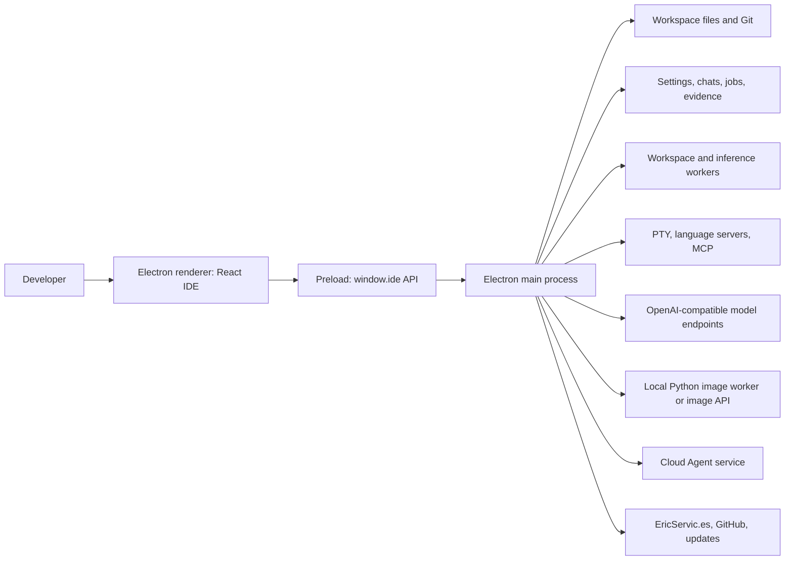
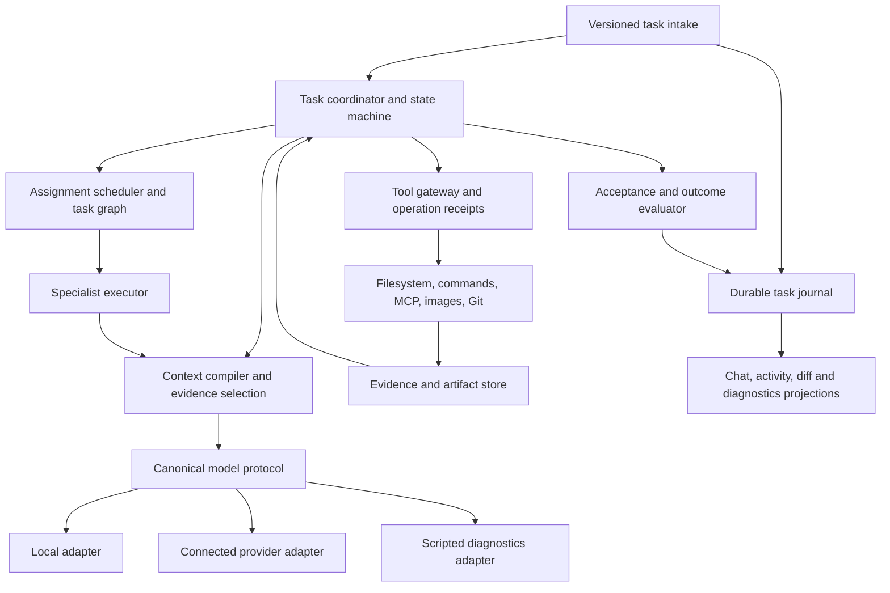

# Eris architecture and production evolution plan

> Source baseline: `b3c05ddc9782b823ef4508862bd0577fd3282ad0`, inspected 2026-10-22. Package version: 0.4.6. This document describes the checked-out source, not a deployed-release certification. Runtime benchmarks, live model quality, and installer behavior were not tested for this documentation pass.

## 1. Purpose and reading guide

This is the architectural reference for improving Eris into a dependable production AI IDE. Its principal subjects are **chat → agent**, **agent → agent**, and **agent → model** interactions. It also covers the editor, workspace, tools, persistence, local hardware, cloud execution, security, diagnostics, and release process because these determine whether an agent's answer becomes useful, safe, recoverable work.

Cursor, Codex, and Claude are product-quality aspirations: coherent conversations, grounded edits, understandable progress, reliable tools, and recoverable execution. This document does not claim knowledge of their private architectures or feature parity with them. The proposed design is derived from Eris's source and observed architectural boundaries.

**Status vocabulary:**

- **Implemented:** visible in the inspected source. This does not imply every path is tested or production hardened.
- **Partial:** an implementation exists but has a narrower guarantee than the target design.
- **Proposed:** a future contract or behavior; do not describe it as shipping.
- **Needs validation:** a plausible risk or behavior that needs a focused reproduction, measurement, or deployment inspection.

Read sections 2–6 for orientation; 7–9 for the three interaction boundaries; 10–16 for supporting systems; 17–20 for implementation planning and acceptance. Relative links point to repository files and remain usable when the repository moves. Source symbols are more durable references than line numbers.

Related documents:

- [Agent architecture v2](AGENT-ARCHITECTURE-V2.md): previous migration rationale. Its historical findings and proposals must be checked against current code before reuse.
- [Diagnostics implementation](DIAGNOSTICS-RUNS.md): shipped first increment and explicit coverage exclusions.
- [Smoke-test and debug-mode design](SMOKE-TEST-DEBUG-MODE.md): broader diagnostics product specification.
- [Product improvement inventory](PRODUCT-IMPROVEMENTS.md): earlier ideas; this document supplies the architectural context for prioritizing them.
- [Image generation](image-generation.md), [cloud fleet](CLOUD_AGENT_FLEET.md), [cloud service](../cloud-agent/README.md), and [signing](SIGNING.md).

## 2. Product principles and success criteria

Eris should convert a user's request into a correctly scoped task, execute permitted work, and show evidence of what actually happened. Agent profiles supply expertise; models supply inference; the application owns permissions, execution, durable state, and truth about completion.

The central product contract is:

1. A review request inspects relevant code and returns grounded findings.
2. An implementation request produces relevant changes, or explicitly reports why it could not.
3. A follow-up such as “implement those three improvements” preserves the referenced recommendations and project.
4. Selecting a different worker never silently broadens authority or changes the user's goal.
5. A successful model response is not equivalent to a completed task.
6. A completed background patch is not equivalent to a patch integrated into the user's checkout.
7. A model timeout, refusal, malformed call, or cancellation produces an understandable terminal result.
8. Local inference must leave the IDE responsive and preserve the user's work under memory pressure.

Production readiness also requires editor correctness, credential protection, reliable upgrades, recoverable storage, accessibility, and reproducible diagnostics. Adding more agents or increasing prompt length is not a substitute for those properties.

## 3. System context and deployment boundaries



**Desktop shell.** [Main startup](../electron/main/index.ts) initializes IPC, the window, updates, environment discovery, and optional local model warming. It also coordinates shutdown of inference, background agents, terminals, language servers, and workspace workers. [Window creation](../electron/main/window.ts) enables context isolation and renderer sandboxing, disables Node integration, and restricts navigation.

**Renderer.** React renders the workspace, Monaco editor, chat, agents inbox, terminal, settings, Git, diagnostics, and auxiliary panels. The renderer should own presentation and transient interaction state. It should not determine final task authority or execute privileged operations.

**Preload and IPC.** [Preload](../electron/preload/index.ts) exposes the application API; [shared API types](../src/shared/api.ts) describe it; [IPC registration](../electron/main/ipc/index.ts) connects handlers. Types are compile-time contracts, not runtime validation. Validation is visibly stronger in some newer handlers, such as diagnostics, than in the typed-only chat payload declaration.

**Main-process services.** The desktop backend owns task intake, settings, model selection, orchestration, tools, workspace access, storage, approvals, and external integrations. It currently remains a large coordination surface rather than a set of fully isolated services.

**Worker and subprocess boundaries.** Workspace jobs move indexing and chat database work off the renderer/main execution path. Native GGUF inference has a worker path and an in-process path. PTYs, language servers, and the Python image runtime are additional process lifecycles. Their failure, cancellation, resource admission, and shutdown semantics must be considered independently.

**Cloud.** `cloud-agent/` is a separately built Node/TypeScript service with jobs, authentication, entitlements, workspaces, inference, artifacts, and fleet administration. It has a separate agent loop and tool policy. Desktop guarantees must not be assumed to apply automatically to cloud jobs.

## 4. Repository responsibility map

- **Application shell:** `electron/main/index.ts`, `window.ts`, `app-state.ts`, `menu.ts`; renderer entry and application composition under `src/`.
- **Chat presentation and state:** [useChatSession](../src/hooks/useChatSession.ts), [ChatPanel](../src/features/chat/ChatPanel.tsx), [stream store](../src/state/chat-stream.ts), `src/hooks/useChatThreads.ts`.
- **Chat orchestration:** [chat IPC](../electron/main/ipc/chat-stream.ts), [shared chat turn](../electron/main/services/chat-turn.ts), `chat-router.ts`, `chat-prompt.ts`, `chat-job-controller.ts`.
- **Task meaning and authority:** [task contract](../src/shared/task-contract.ts), `task-intake.ts`, `task-resolver.ts`, `task-store.ts`, `task-outcome.ts`.
- **Worker runtime:** [agent loop](../electron/main/services/agent/loop.ts), `agent/workflow.ts`, `prompts.ts`, `context-compiler.ts`, `compaction.ts`, `recovery.ts`, `mid-run-adapt.ts`.
- **Tool execution:** `tool-registry.ts`, `agent/tool-validation.ts`, `agent/tool-gateway.ts`, `agent/execute-tool.ts`, `workspace-fs.ts`, `shell-run.ts`, `verify.ts`, `mcp-runtime.ts`.
- **Coordination:** [background agents](../electron/main/services/background-agents.ts), [handoff types](../src/shared/agent-orchestration.ts), `agent-discussions.ts`, `agent/task-scheduler.ts`, `worktrees.ts`.
- **Models:** `chat-runtime.ts`, `model-protocol.ts`, `model-transport.ts`, `openai-compatible.ts`, `model-catalog.ts`, `builtin-model.ts`, `local-model.ts`, `llama-worker.ts`.
- **Resource controls:** `inference-governor.ts`, `vram-fit.ts`, `gpu-accel.ts`, `local-image-model.ts`.
- **Project intelligence:** `workspace-context.ts`, `workspace-search.ts`, `workspace-intelligence.ts`, `code-index.ts`, `symbol-parse.ts`, `workspace-index-job.ts`, `workspace-watcher.ts`.
- **Documents and IDE services:** `src/state/documents.ts`, `src/features/editor/`, `git-service.ts`, `pty-session.ts`, `language-servers.ts`, `diagnostics.ts`, `inline-ai.ts`.
- **Persistence:** `chat-database.ts`, `chats.ts`, `paths.ts`, `settings.ts`, `task-ledger.ts`, `checkpoints.ts`, `agent-sessions.ts`, `agent-runs.ts`.
- **Quality tooling:** `debug-runs/`, `eval-runner.ts`, `corpus-debug-runner.ts`, `src/features/evals/`, `tests/`, `checks/`.
- **Distribution:** `package.json`, `electron.vite.config.ts`, `scripts/`, `.github/workflows/ci.yml`, `.github/workflows/release.yml`.

At the baseline, `agent/loop.ts` is 3,585 lines, `ipc/chat-stream.ts` is 958, and `useChatSession.ts` is 1,026. Size alone is not a defect, but these files combine multiple state machines and are important extraction seams.

## 5. Core domain model

### 5.1 Existing concepts

**Conversation/thread:** durable user-visible history with messages, model metadata, and chat assets. It is not the same object as a running task.

**Request/job:** the submitted turn's execution identity. Chat jobs preserve status, answer text, and a bounded event snapshot; background jobs additionally carry queue/worktree information.

**TurnPlan:** routing result containing intent, agent/profile, model choices, mode, tool policy, and execution-plan guidance. A plan can change during recovery within the task's authority ceiling.

**TaskContract v2:** includes `taskId`, optional parent, revision, thread, original text, intent, deliverable, workspace/project identity, scope-resolution state, authority, skills, recommendations, and acceptance criteria. [Task intake](../electron/main/services/task-intake.ts) creates it. `childTaskContract` intersects child authority and maps project scope into the child workspace.

**Agent profile:** enabled role, instructions, temperature/model preferences, tool ceiling, and routing/recovery configuration. It is not necessarily a separately running process or independent model instance.

**Tool call/result:** an assistant action proposal, followed by an observed result. Native providers require paired IDs. Tool results describe execution; assistant text describes claims.

**Evidence:** observed tool metadata and output digests, file diffs, verification outcomes, and bounded excerpts used to assess completion. Evidence is currently distributed among gateway records, action logs, checkpoints, chat jobs, and task-ledger events.

**Artifact:** a patch, generated image, exported diagnostic bundle, or other durable result. Artifact creation, validation, and integration are separate lifecycle events.

### 5.2 Required distinctions for future work

Keep these concepts separate in APIs and UI: user intent versus agent selection; authority versus model capability; model transcript versus chat display; task completion versus verification; child completion versus integration; model cache versus durable memory; simulated test versus live-model evaluation; local task policy versus OS process isolation.

Do not encode machine state in display text. Current background scheduling and blackboard derivation interpret phrases such as “waiting for children.” Replace that coupling with typed fields before expanding concurrency.

## 6. Current end-to-end turn

```mermaid
sequenceDiagram
  actor User
  participant UI as Chat UI
  participant IPC as chat:stream
  participant Turn as Shared chat-turn services
  participant Agent as Agent loop
  participant Model as Model runtime
  participant Tool as Tool gateway and executor
  participant Store as Jobs / ledger / chats
  User->>UI: Request, mode, attachments, model preference
  UI->>IPC: Request ID and prompt/history
  IPC->>IPC: Check workspace, duplicate ID, limits; establish cancellation
  IPC->>Turn: Initial routing and semantic resolution
  Turn-->>IPC: Plan and TaskContract
  IPC->>Store: Task and job state
  IPC->>Turn: Build prompt
  IPC->>Agent: Run with contract and callbacks
  loop Until outcome or budget/stop
    Agent->>Model: Budgeted, validated transcript and tool definitions
    Model-->>Agent: Text and/or tool proposals
    Agent->>Tool: Validate, authorize, approve, execute
    Tool-->>Agent: Result, diff, evidence
    Agent-->>IPC: Progress, tools, diffs, answer
    IPC-->>UI: Stream events
  end
  IPC->>Turn: Semantic outcome review when applicable
  IPC->>Store: Final status and evidence
  IPC-->>UI: Done / incomplete / error / stopped
```

This diagram describes the normal desktop loop. **Cloud inline execution is a separate branch** in `chat-stream.ts`; it can fall back to local Composer Lite on cloud failure. Direct `/image` requests use a dedicated image path. Diagnostics share selected orchestration functions but do not exercise every arrow above.

The current foreground controller uses global app state for the active chat cancellation/request. A new foreground request aborts the previous one. A future multi-chat execution UI must first introduce per-task controllers and explicit queueing; adding more renderer tabs does not create safe concurrent tasks.

## 7. Boundary A: chat to agents

### 7.1 Implemented behavior

[useChatSession](../src/hooks/useChatSession.ts) manages compose state, attachments, queued messages, selected agent/model, approvals, questions, streaming text, and pending diffs. It tracks request/thread/workspace identity and attempts reconnection to an active main-process job after renderer reload.

[chat:stream](../electron/main/ipc/chat-stream.ts) captures `appState.currentWorkspace`, rejects a mismatched submitted workspace, checks duplicate request IDs, starts a job, resolves settings, and obtains the main-owned route. Renderer-supplied execution plans are not the authority for the final task.

[chat-turn.ts](../electron/main/services/chat-turn.ts) supplies a reusable seam:

1. `planInitialChatTurn`: deterministic routing with the model router skipped.
2. `resolveChatTurnContract`: optional semantic re-resolution, replanning if needed, and contract creation.
3. `buildChatTurnMessages`: prompt construction using the resolved worker.
4. `localChatTurnModel`: Composer Full/Lite handling for local execution.
5. `OutcomeEvidence` and `needsOutcomeReview`: evidence collection and decision to perform a semantic outcome review.

[task-resolver.ts](../electron/main/services/task-resolver.ts) skips additional inference for several explicit request patterns. Other requests get a bounded semantic classification call with a confidence threshold. Failure falls back conservatively for edit/run candidates. Therefore, route quality still depends on the deterministic classifier and on which messages reach the semantic resolver.

Task intake canonicalizes the workspace and optionally searches nested project candidates. Discovery is bounded to 250 visited directories and depth four; identities include folder names, package/composer names, and HTML/PHP titles. This is useful bounded discovery, not a comprehensive semantic project registry. Follow-ups can inherit prior project scope. Recommendations are extracted from numbered text in the prior assistant answer and assigned hashes.

### 7.2 Architectural gaps

- **Interpretation remains distributed.** Shared helpers improve consistency, but intent heuristics, semantic resolution, worker selection, authority mapping, and execution heuristics still interact. A misclassification may prevent tools from becoming available before the worker can inspect the project.
- **Recommendation references are reconstructed.** Parsing numbered prose cannot reliably resolve edited lists, bullets, multiple earlier recommendations, or “only do the second one.”
- **Payload and identity guarantees are incomplete.** The chat handler declares TypeScript types but needs a full runtime schema and explicit ownership validation for thread, request, project, attachments, and referenced artifacts.
- **Duplicate suppression is not complete idempotency.** `getChatJob` avoids rerunning a known ID, but returning `true` is not a complete replay/subscription contract. Snapshot persistence is asynchronous; a crash before persistence needs explicit semantics.
- **Display history and execution context are closely coupled.** Prior model prose must remain evidence rather than becoming fresh permission or an unqualified instruction to edit cited files.
- **Scope discovery has limits.** Multi-project and nonstandard repositories need explicit selection, stable identities, cached discovery, and ambiguity handling.

### 7.3 Proposed intake contract

Introduce one versioned `SubmitTurn` API. The renderer sends the original text, conversation/source-message IDs, an idempotency key, selected project/workspace identity, explicit mode, attachment references, selected recommendation IDs, and model/agent preferences. It does not submit a final permission grant.

Main-process intake returns a durable task ID, interpreted deliverable, resolved scope, effective authority, and subscription cursor. Duplicate submissions return the same task and its current snapshot. The same key with different content is a conflict, not silently accepted.

Make `TaskInterpretation` a separate result with evidence and uncertainty. Resolve references first, discover scope second, select the worker third, and compile its context last. Preserve explicit user constraints verbatim alongside normalized fields. Only ask a clarifying question when the remaining ambiguity changes the result or authorized effects.

Persist recommendations as structured records when produced: ID, source message, proposed change, relevant project/path references, supporting evidence, acceptance criteria, and status. A follow-up selects those records rather than reparsing an answer. If the selection is ambiguous, show the candidate recommendations.

### 7.4 Chat interaction requirements

Show a compact interpreted task such as **Implement · Airbnb · 3 accepted changes**. Show the selected model separately from the agent profile. Explain scope or model fallback visibly. Provide stage-based progress: resolving, inspecting, editing, verifying, waiting, and finishing. Keep control prompts and internal recovery instructions out of the answer.

Cancellation should immediately stop the UI's busy state, then show whether provider/tool cleanup is still in progress. Late events must be correlated to their original task and must not alter a newly active chat. A failed task should offer concrete next actions based on its reason, not a generic instruction to change models.

## 8. Boundary B: agent to agent

### 8.1 What coordination actually does today

There are three distinct mechanisms:

1. **Inline specialist delegation.** In `agent/loop.ts`, a `delegate_to_agent` call from a `chat:` job recursively invokes the worker loop in the current workspace. It creates an intersected child task, keeps the worker model, releases the parent's GGUF session, forwards relevant events, and disables further delegation for the specialist. Parent execution waits for this child. It is sequential specialization, not general parallel collaboration.
2. **Background jobs.** `background-agents.ts` persists and queues jobs, limits parallel jobs per workspace, runs workers, and supports worktrees, child waits, cancellation, diff inspection, merge, and discard. Some child jobs inherit a parent's worktree. A waiting parent frees a scheduler slot using `liveStatus` text matching.
3. **Discussion summaries.** `agent-discussions.ts` ranks short snippets from other chats/jobs by query-term overlap and includes them as context. `handoffFromMessages` derives a continuation from previous assistant prose. These are context mechanisms, not acknowledged messages with delivery, ownership, or completion guarantees.

The existing `AgentHandoffPacket` carries goal, summary, optional task, file names, open questions, confidence, and sender/recipient. Child result summaries preserve failure and warn about unapplied work, but much of the returned result remains prose.

### 8.2 Target coordination architecture

Use **one coordinator per user task**. It owns interpretation, task revision, acceptance criteria, dependencies, budget, and final synthesis. Specialists own bounded assignments. A coordinator may select a worker profile without delegation for simple requests.

Proposed assignment/result contract, illustrative rather than implemented:

```ts
interface AgentAssignment {
  version: 1
  assignmentId: string
  parentTaskId: string
  taskRevision: number
  objective: string
  acceptanceCriterionIds: string[]
  scopeRef: string
  authorityRef: string
  evidenceIds: string[]
  dependencies: string[]
  execution: 'inline' | 'worktree' | 'cloud'
  budget: { maxSteps: number; maxInputTokens: number; deadlineAt: string }
}

interface AgentResult {
  assignmentId: string
  status: 'complete' | 'partial' | 'blocked' | 'failed' | 'cancelled'
  findings: Array<{ text: string; evidenceIds: string[] }>
  artifactIds: string[]
  verificationIds: string[]
  unresolved: string[]
  integration: 'not-applicable' | 'pending' | 'applied' | 'conflict'
}
```

The persisted assignment is the source of truth. Prompt text is a serialization of that assignment, not a second contract. Validate a result before joining it. An answer string or a worker's `done` label cannot by itself satisfy the parent.

Use a bounded directed task graph. Independent reads can run in parallel; dependencies require explicit joins. Limit delegation depth, total descendants, wall time, tokens, and local inference concurrency. Cycles and self-delegation should be rejected. A parent waiting for a child must release inference capacity and must not hold a write lease the child needs.

For shared workspace writes, use canonical resource identities and overlap-aware leases. The existing scheduler serializes by a project string within one process; overlapping parent/child project roots and external processes require additional handling. For isolated worktrees, return artifacts against a recorded base revision and integrate explicitly with conflict detection.

Cancellation must propagate down the task graph, revoke pending approvals, stop queued work, and settle all children. Define whether completed child artifacts remain available. Parent completion must distinguish optional-child failure from failure of a required dependency.

### 8.3 Agent messages and shared knowledge

Prefer typed, targeted messages: `request_evidence`, `finding`, `decision`, `blocked`, `artifact_ready`, and `assignment_result`. Persist message ID, sender/recipient, task revision, evidence references, and acknowledgement. If delivery can repeat, consumers must deduplicate by message ID.

A shared task board should contain decisions, claims with evidence, unresolved dependencies, resource ownership, and artifact state. It should not become an unbounded transcript shared with every model. Cross-chat retrieval must honor project visibility and label statements as historical claims. A previous assistant's suggestion never grants current authority.

Begin with coordinator-mediated communication. Arbitrary peer messaging adds ordering, stale-context, and ownership problems before it adds useful capability. Introduce peer channels only for measured cases that require them.

## 9. Boundary C: agents to models

### 9.1 Current model pipeline

The worker compiles instructions and source context, maintains conversation history, and asks [agent/stream.ts](../electron/main/services/agent/stream.ts) to collect a response or stop on an executable tool proposal. [chat-runtime.ts](../electron/main/services/chat-runtime.ts) is the shared desktop model entry point.

`streamModelChat` checks for an active diagnostics adapter. Otherwise `streamProviderChat` selects native or text-tool protocol, includes tool definitions, budgets messages, validates call/result integrity, and selects a backend:

- Native GGUF references use `builtin-model.ts` and the llama runtime; local results are text-tool envelopes.
- Connected endpoints use `openai-compatible.ts`; configured protocol determines whether native tools are passed.
- Usage combines provider-reported counts where available with estimates otherwise.

[model-protocol.ts](../electron/main/services/model-protocol.ts) validates that assistant call IDs are unique and every call receives a result before the next non-tool message. For text-tool backends it serializes explicit tool/result envelopes. It shortens old tool evidence while keeping exchange records, and errors if the remaining input cannot fit.

[context-compiler.ts](../electron/main/services/agent/context-compiler.ts) pins the task and role/protocol guidance, then adds optional project/retrieval text. It emits block hashes and lengths. Its budgeting uses a character-based estimate and assigns 55% of the input estimate to this system-context package. Project text is optional in this compiler; do not assume all workspace guidance is guaranteed to survive truncation.

The baseline includes fixes to synchronize seed history on each reused local session, propagate grammar-generation failures, fingerprint complete tool arguments, preserve skipped call/result pairs, and replace worker instructions during recovery. These are implemented changes, not future roadmap items.

### 9.2 Remaining protocol limits

- The transport primarily yields strings and reports native tool calls through a callback. Usage, finish reasons, partial-call fragments, errors, and cancellation are not one common event stream.
- Capability selection is relatively small: native/text protocol and configured context settings. It is not yet a tested capability registry per backend, model artifact, and template revision.
- Context limits and token estimates are not uniformly derived from the actual loaded tokenizer/model window. Tool schema insertion and local template serialization can change the final request size.
- Several layers shape context: chat prompt, worker prompt, context compiler, compaction, protocol budgeting, and local session conversion. Changes need an inspectable final request manifest to avoid invisible losses or conflicting instructions.
- Grammar-constrained retry schemas derive from known built-in contracts. Dynamic MCP schemas and unsupported JSON Schema constructs require explicit capability handling.
- Exact local-session synchronization improves correctness, but cache reuse and prompt evaluation cost need measurements. A warm session is not proof that the intended prefix was reused.

### 9.3 Proposed provider-neutral contract

Introduce a versioned `ModelRequest` containing logical messages, selected tools, effective generation limits, purpose, task/attempt identity, cancellation, and an explicit capability snapshot. Use typed `ModelEvent` variants for text, tool-call fragments, completed calls, usage, finish, and error.

Adapters own provider serialization, stream decoding, tokenizer access where available, and provider error classification. They must not route agents, interpret user permissions, execute tools, or silently substitute another model. A fallback decision belongs to the coordinator and must be recorded.

Capability records should include protocol, structured-output support, supported schema subset, context window, output limit, tokenizer/template identity, concurrent requests, tool-call ordering, cancellation support, and usage accuracy. Separate configured capabilities from capabilities proven by conformance tests.

Treat a streamed tool proposal as provisional until complete and schema-valid. Never execute partial JSON. Preserve the provider call ID and create a separate stable operation ID for side effects. Retry inference independently from retrying a tool. After an uncertain provider/transport failure, inspect recorded execution before allowing a repeated write or external operation.

### 9.4 Context compilation and memory

Compile a manifest of blocks with source kind, path/range, digest, trust, priority, token count, and reason for inclusion or omission. Reserve room for output, task authority, current user intent, unresolved calls, and relevant acceptance criteria before optional material.

Distinguish mandatory policy from optional repository guidance. Large mandatory content should cause an actionable error. Optional source excerpts should be selected by relevance and freshness, not sliced blindly at arbitrary boundaries. Preserve provenance when summarizing.

Long-term project memory should store attributable facts and decisions, confidence, last verification, and scope. A failed run must not promote its own speculative answer into trusted project knowledge. Session/KV caches are disposable acceleration state; they must be invalidated when identity, authority, model, template, or compiled prefix changes.

### 9.5 Local inference behavior

Use one admission service for competing local text/image workloads. [The inference governor](../electron/main/services/inference-governor.ts) already tracks memory reservations and exclusive GPU leases. Preserve this mechanism while adding queue reason, wait time, cancellation, and actual memory telemetry.

Account separately for model weights, KV cache, output, workspace indexing, image runtime, and OS headroom. Two 8 GB GPUs do not automatically behave like a single 16 GB device; placement and splitting are runtime capabilities that must be measured and surfaced. The UI should disclose actual backend/device/offload/context configuration and why a task is queued.

Do not use extra agent roles as an implicit promise of parallel inference. Favor concise context, fewer redundant routing/outcome calls, incremental retrieval, and bounded repair before assuming a larger model will fix orchestration defects.

## 10. Tools, edits, approvals, and workspace integrity

### 10.1 Existing layers

[Tool registry](../electron/main/services/tool-registry.ts) defines JSON schemas, access level, effect category, approval type, discovery visibility, and read-before-write metadata. Categories include reads, workspace mutations, commands, external effects, and orchestration.

The loop validates arguments, checks available policy, requests approvals, and executes built-in or MCP tools. [TaskToolGateway](../electron/main/services/agent/tool-gateway.ts) checks workspace identity, project scope for a defined set of file tools, edit/execute/external authority, and stale read hashes. It blocks whole-file rewrite after a partial read. Some broader read-before-write and workflow behavior still lives in the loop.

[Workspace filesystem](../electron/main/services/workspace-fs.ts) handles containment and file operations; [project scheduler](../electron/main/services/agent/task-scheduler.ts) serializes mutating calls for a project key. The loop rechecks authorization after acquiring the write lease. Commands have additional approval and install-guard logic.

Gateway coverage is not equivalent to a universal sandbox. Search, shell, MCP, image, Git, and cloud behavior have different execution paths and effects. Working directory restrictions do not prevent a shell process from accessing paths outside that directory.

### 10.2 Proposed execution envelope

Every executable action should carry task/revision, operation ID, tool-contract version, normalized arguments, declared read/write resources, effect classification, approval grant, deadline, and expected preconditions. Use one gateway interface across desktop, specialists, and cloud; implementations can differ by environment.

The execution sequence should be: schema validation → capability/policy check → resource resolution → required approval → resource lease → fresh precondition check → execution → durable receipt → evidence publication. Denied, cancelled, malformed, and skipped calls also receive terminal results.

Return structured error codes such as invalid arguments, missing scope, stale file, approval denied, unavailable provider, timeout, and uncertain external outcome. Recovery should depend on these codes rather than repeated prose nudges.

### 10.3 Edit transactions and review semantics

The current filesystem executor writes directly, and the review UI presents Keep/Undo behavior for several operations. Do not describe all current edits as staged proposals that exist only after acceptance. The README contains language about accepting edits before they reach the buffer that needs reconciliation with actual filesystem and editor behavior.

For a production editing contract, explicitly choose immediate writes with safe undo or staged patches with explicit apply. Support both only if the mode is visible. Record base content hashes and document versions, integrate with unsaved editor buffers, group related edits into transactions, and reject stale undo/apply rather than overwriting intervening user work.

Multi-file edits need a partial-failure policy. A crash after file one changes but before file two changes must leave a recoverable receipt. Binary images, deletes, renames, and new directories need defined undo behavior, not just text-diff handling.

## 11. Workspace intelligence, rules, and project memory

Search/retrieval combines ripgrep or scanning, indexed file/symbol information, relevance scoring, and embeddings-related services. Worker jobs and watchers support index maintenance. Current changes exclude internal `.eris` data across retrieval paths and add PHP/PHTML/SQL file indexing eligibility.

File eligibility is not proof of full symbol-parser support. The build explicitly bundles several language grammars; parser capability should be reported separately from “file indexed.” Cache identity and invalidation must include workspace, file digest, parser version, and relevant ignore configuration.

Target retrieval should return evidence records: canonical project/path, range, content hash, retrieval method, score, and reason. Scope filters apply before ranking and again before reading. Stale indexed content must be refreshed before an edit relies on it.

Rules, skills, project memory, and source code need distinct trust labels. Workspace configuration is filtered based on workspace trust, but prompt-injected source text is still untrusted evidence. Tool output that says “ignore earlier instructions” must not alter the task contract. MCP descriptions also require an explicit trust/effect model.

Avoid indexing generated output, model weights, dependency trees, chat histories, and credentials into normal coding context. A user can deliberately inspect internal project metadata through a suitable explicit workflow; accidental retrieval should not pollute the agent's project understanding.

## 12. IDE client architecture and user experience

The IDE includes Monaco editing, document state, file browsing, search, Git, terminal, diagnostics, command palette, settings, and agent activity. [Document state](../src/state/documents.ts) and the [diff worker](../src/workers/diff.worker.ts) are important foundations for responsive large-file behavior. Chat uses an external stream store to avoid updating unrelated UI for each token.

The main client improvements should be architectural:

- Split chat submission, task subscription, approvals/questions, streaming projection, and diff review out of the large session hook.
- Introduce task-keyed projections so switching conversations cannot mix buffers, tool cards, or late completions.
- Keep user messages immutable and preserve their original text separately from normalized context.
- Present one answer with supporting activity, changes, and checks. Do not promote incomplete internal reasoning/control text into a successful answer.
- Show resource waits and agent/model fallback explicitly, with meaningful stop and retry behavior.
- Integrate agent writes with dirty buffers and external file watcher notifications through document versions.
- Support keyboard operation, focus restoration, screen-reader announcements, reduced motion, high contrast, and usable narrow layouts.

A modern visual layout should be built on these state guarantees. Rounded corners and panel styling cannot compensate for an agent editing the wrong project or a stale task updating the active chat.

## 13. Persistence, recovery, and observability

### 13.1 Current storage

[paths.ts](../electron/main/services/paths.ts) defines the Eris user-data root under the OS app-data directory, workspace `.eris` configuration, and legacy workspace fallback. Workspace chat history normally resides in `.eris/chats`; global history uses the user-data chats directory.

[ChatDatabase](../electron/main/services/chat-database.ts) uses SQLite with WAL, transactions, paginated messages, conversation headers, and legacy JSON import. It executes through workspace-worker requests. Other domains still use JSON or JSONL: latest task contract per thread/workspace, chat job snapshots, background jobs, task evidence, and diagnostic runs. Checkpoints and agent sessions supply additional recovery data.

`task-ledger.ts` queues append-only metadata writes, hashes task IDs into filenames, and logs write failures. Its sequence counter is in memory and cleared on flush. It is useful evidence storage, but it is not yet a transactional, replay-complete task event store with crash-proof global ordering. Chat job snapshots debounce persistence and retain only a bounded subset of events.

### 13.2 Proposed durable task journal

Use a versioned event envelope with event ID, task ID/revision, per-task sequence, timestamp, causation/correlation IDs, type, and payload version. Commit state transitions and side-effect receipts before publishing the corresponding durable UI event. Store large source/output artifacts by reference with retention rules.

Separate durable events from transient token deltas. The UI may render text before a durable checkpoint, but it must know its last acknowledged cursor. Reconnect returns a snapshot and subsequent events, without duplicating effects. Terminal events must be idempotent and mutually consistent.

Recovery should reconcile unfinished operations and external receipts. Never blindly replay a shell command or external write because its result was not observed. Mark unknown outcomes explicitly. Migrations need version checks, backups, forward/backward compatibility rules, and corruption handling that preserves original data.

### 13.3 Operational metrics

Record task intake time, scope-resolution time, queue delay, context assembly, time to first output, generation time, tool time, verification time, and total latency separately. Track valid tool calls, repaired calls, repeated calls, reroutes, evidence coverage, incomplete tasks, wrong-project blocks, and unsupported success claims.

Include model artifact/template/backend identity, context size, actual device/offload settings, cache reuse, token counts with estimate labels, and resource wait reason. Correlate chat, child, tool, and provider attempts with the same task trace.

Default diagnostic export should omit secrets and unnecessary source content. Hashes support comparison, not full reproduction; optional prompt/response capture needs explicit user control, redaction, retention, and a preview of what leaves the machine.

## 14. Cloud, integrations, and security boundaries

**Cloud execution:** [worker.ts](../cloud-agent/src/worker.ts) maintains a separate pool, owner-based accounting, workspace preparation, model loop, checkpoints, and artifacts. [sandbox.ts](../cloud-agent/src/sandbox.ts) uses command pattern checks. These checks are not an operating-system sandbox. Deployment must establish process/container isolation, filesystem mounts, network policy, resource limits, tenant separation, and secret lifetime. Inspect actual deployment configuration before claiming those guarantees.

The target is shared task/protocol/evidence contracts with environment-specific executors. Include source/base revision, scope, permission ceiling, model capability, deadline, and artifact provenance in cloud assignments. Cloud fallback after partial work requires reconciliation before local execution continues; it must not duplicate effects or silently discard successful remote edits.

**Credentials:** desktop startup explicitly avoids the OS keychain and describes secrets in `userData/secrets.json`. This is a deliberate current design that needs a credential-storage decision before a production security claim. Prefer an OS-backed credential abstraction with explicit migration and failure handling; document any retained portable file-storage mode and its permissions.

**Packaged feedback:** the release workflow can embed a feedback GitHub credential in application resources. A distributable desktop binary is not a secret boundary. Replace reusable packaged credentials with a constrained server relay or narrowly scoped short-lived authorization; verify scope/exposure and rotate if appropriate before shipping that path.

**IPC:** validate shape, size, identity, sender, and current authorization for privileged operations. Bind an approval to exact operation arguments, task revision, resources, and expiration. An approval for one task must not authorize another after a workspace or chat switch.

**MCP/external tools:** distinguish read-only tools from external mutations, keep credentials in privileged processes, cap output and time, and record side effects. Remote metadata is not sufficient proof of safety without application policy. Discovery must not flood the prompt with a large unbounded tool catalog.

**Untrusted content:** source, web pages, model output, diagnostic imports, and other agents' prose are data. They cannot grant authority. Validate all path-bearing artifacts through real-path containment, including symlinks and missing destinations.

## 15. Images and non-text workloads

[Image generation](../electron/main/services/image-generation.ts) is a dedicated service. Direct `/image` requests and the `generate_image` tool call it; the text model does not choose an arbitrary image endpoint or download a model. Settings select the backend. Local Hugging Face models use a private Python/Diffusers runtime through `local-image-model.ts` and `resources/image-generation/worker.py`.

Managed media uses image assets/metadata and an `eris-media` preview protocol; optional workspace copies participate in file protection and checkpoints. Model downloads, inference, cancellation, and memory admission have their own lifecycle. Image models remain separate from the chat model picker.

Extend the common task framework to include image artifact provenance, resource queue status, cancellation cleanup, generation verification, and retention. Keep modality-specific adapters. Vision input, image editing, masks, or additional model families require separate capabilities and evaluations; text-to-image support does not imply them.

## 16. Testing, diagnostics, and release readiness

### 16.1 Existing layers and what they prove

- **Unit and contract tests:** Vitest tests cover routing, prompts, contracts, loops, model/tool behavior, storage, and other services. They prove the assertions under their fixtures and mocks.
- **Large simulated question corpora:** generated and natural-language 10,000-question fixtures exercise routing and scripted agent behavior. The packaged natural corpus is checked against the test fixture. Counts of questions do not establish independent intent labels, real-model intelligence, or actual UI coverage.
- **In-app simulated diagnostics:** `debug-runs/coordinator.ts` uses shared chat-turn helpers and the real loop with a scripted model adapter. It creates disposable fixtures, observes effects, classifies failures, and exports results. This is useful integration coverage below the UI boundary.
- **In-app real-model diagnostics:** a live adapter invokes the provider on curated isolated cases with explicit live-call acknowledgement. It is distinct from simulation and currently has limited baseline/repeat/cost facilities.
- **Replay:** recorded model replies replay orchestration; they do not reproduce a live model's internal state or establish model determinism.
- **Client checks:** `check:client` includes typecheck, selected storage/index/watch tests, build, worker checks, and renderer checks.

The diagnostics implementation explicitly excludes Cloud Composer inline, delegation, approvals UI, project memory, task persistence, and renderer streaming from its shared-turn coverage. Therefore a passing simulated run is not an end-to-end desktop acceptance test.

### 16.2 Build gates observed in source

`npm run build` invokes `prebuild`, which runs `test:agents`, then bundles with Electron Vite. At the baseline, the explicit `test:agents` list omitted `tests/debug-runs.test.ts` and `tests/eval-sandbox.test.ts`. The first ARCH-09 increment adds both, plus `tests/chat-stream-diagnostics.test.ts`. CI runs typecheck, lint, all tests, build, and a critical-severity production dependency audit on macOS. Release builds run on macOS and Windows, with optional signing configuration.

Build success does not imply installer launch, migration, model download, hardware stability, or real-model outcome quality. The release workflow's manual tag input also warrants validation that the checked-out source matches the requested release revision, rather than only changing package version metadata.

### 16.3 Proposed quality ladder

1. **Fast deterministic gate:** task resolution, scope, protocol conformance, tool authorization, cancellation, state transitions, and evidence oracles. No network/model dependency.
2. **Desktop integration gate:** real IPC submission, renderer subscription/reload, approvals, dirty editor buffers, task persistence, child join, and workspace switching with scripted transport.
3. **Live-model qualification:** a smaller independently labeled suite across representative local and connected models, repeated against a pinned baseline with recorded hardware/configuration.
4. **Hardware qualification:** Apple Metal and supported Windows GPU/CPU configurations; memory pressure, text/image contention, unload, timeout, worker crash, and cancellation.
5. **Packaged-app qualification:** install, launch, upgrade/migrate, rollback behavior, signing/notarization where required, native modules, bundled assets, and update metadata.

Use separate scores for routing, scope, protocol, execution, relevance, verification, and UX delivery. Keep denominator, skips, unsupported cases, retries, repeats, and failures visible. Do not derive the expected route using the same function being evaluated.

### 16.4 Suggested release criteria

These are proposed acceptance targets, not measurements of the current build:

- Zero unauthorized writes, wrong-project mutations, duplicate external effects, or evidence-free success claims in the release regression suite.
- Every required scenario ends in a typed terminal state; every emitted call has a terminal result.
- No lost approved edits or user buffer content across tested reload/crash/migration cases.
- All required deterministic and desktop-integration checks pass; waived failures carry an owner, impact, and expiration.
- Record p50/p95 latency and completion quality by hardware/model profile. Set numeric budgets after baseline measurement; do not use one token-speed target for all GPUs/models.
- Qualify live-model reliability separately from deterministic test pass rate, using repeated runs and uncertainty estimates.

## 17. Target architecture and proposed decisions



Proposed architectural decisions:

- **ADR-001 — One task owner.** A coordinator owns user intent through completion. Worker profiles and recovery are strategies within the task.
- **ADR-002 — Durable task events.** Task state and effect receipts are authoritative; UI status and transcripts are projections.
- **ADR-003 — Shared protocol, separate adapters.** Local, connected, cloud, and scripted environments use common contracts while retaining appropriate transport/execution adapters.
- **ADR-004 — Evidence-based completion.** Acceptance criteria map to observed artifacts and checks; semantic review supplements deterministic evidence.
- **ADR-005 — Explicit edit mode.** Immediate-write/undo and staged-patch/apply semantics are distinct and visible.
- **ADR-006 — Resource-aware specialization.** Delegation is bounded and justified by task decomposition; inference capacity governs actual concurrency.
- **ADR-007 — Policy below prompts.** Authority is enforced by gateway/executor boundaries and cannot be elevated by model text.
- **ADR-008 — Measured rollout.** Migrate one execution seam at a time with conformance tests, feature flags where needed, and rollback-compatible storage.

These are proposed decisions awaiting implementation, not claims that the current system follows them universally.

## 18. Prioritized implementation packages

Each package should become one or more focused changes. “P0” means prerequisite for a credible production guarantee; it does not claim a currently reproduced incident in every listed path.

### ARCH-01 — Canonical task intake and reference resolution · P0

**Problem:** user meaning is spread across heuristic routing, semantic fallback, prose handoff, and plan selection. **Change:** introduce runtime-validated submission and interpretation records; persist explicit recommendation references; bind project/thread/source-message identity. **Touchpoints:** `chat-turn.ts`, `chat-router.ts`, `task-resolver.ts`, `task-intake.ts`, `task-contract.ts`, `useChatSession.ts`.

**Acceptance:** a review of Airbnb followed by “implement the second recommendation” resolves the same project and exact recommendation; unrelated calculator files remain untouched. “Fix safeDivide in src/divide.ts” receives an edit contract. Ask mode retains its ceiling. **Dependency:** none; preserve current tool gateway throughout migration.

### ARCH-02 — Task lifecycle and event subscription · P0

**Problem:** global active-chat state and asynchronous snapshots complicate retries/reload/concurrency. **Change:** per-task controllers, durable idempotency, event cursor replay, and explicit queued/running/waiting/terminal transitions. **Touchpoints:** `chat-job-controller.ts`, `ipc/chat-stream.ts`, `task-ledger.ts`, `app-state.ts`, renderer stream state.

**Acceptance:** duplicate submit executes once; reload reconnects; changed-content duplicate is rejected; late task A events cannot modify task B; crash recovery distinguishes stopped from unknown execution. **Dependency:** ARCH-01 identity contracts.

### ARCH-03 — Extract coordinator from worker loop · P0

**Problem:** routing adaptation, model interaction, tool execution, child handling, and completion share one large loop. **Change:** extract state transitions, iteration control, recovery policy, and outcome assembly while reusing existing executors. **Touchpoints:** `agent/loop.ts`, `workflow.ts`, `heuristics.ts`, `recovery.ts`, `mid-run-adapt.ts`.

**Acceptance:** existing scenarios retain behavior; each transition has an observable reason; bounded repair cannot expand scope; repeated reads that add new evidence count as progress; run-only tasks can finish without arbitrary file mutations. **Dependency:** ARCH-01/02; avoid a whole-loop rewrite in one PR.

### ARCH-04 — Canonical model event protocol · P0

**Problem:** callback/string transport makes finish/error/tool/usage semantics inconsistent. **Change:** typed model request/events and adapter conformance suite. **Touchpoints:** `chat-runtime.ts`, `model-protocol.ts`, `agent/stream.ts`, `openai-compatible.ts`, `builtin-model.ts`, diagnostics adapters.

**Acceptance:** native and text-tool backends preserve calls/results through truncation, cancellation, malformed output, and partial streams; no incomplete call executes; provider retries never rerun a recorded tool effect. **Dependency:** stable task/attempt IDs from ARCH-02.

### ARCH-05 — Capability and context manifest · P1

**Problem:** configured capabilities and estimated token budgets conceal actual request composition. **Change:** versioned backend/template capabilities, tokenizer-aware budgeting where possible, and context manifests. **Touchpoints:** `model-catalog.ts`, `model-protocol.ts`, `context-compiler.ts`, `context-budget.ts`, `compaction.ts`.

**Acceptance:** a small-context local model preserves task authority and pending exchanges or fails explicitly; diagnostics explain omitted evidence and final serialized size; unsupported schema features produce an actionable fallback/error. **Dependency:** ARCH-04.

### ARCH-06 — Assignment/result contracts and typed task graph · P0

**Problem:** inline/background coordination and text-derived scheduler state diverge. **Change:** shared assignment/result schema, explicit dependency joins, depth/budget limits, and typed waiting reasons. **Touchpoints:** `agent-orchestration.ts`, `background-agents.ts`, inline delegation in `loop.ts`, `AgentsInboxPanel.tsx`.

**Acceptance:** one failed required child makes the parent partial/failed; optional failure is disclosed; an unapplied worktree patch is never reported as integrated; waiting parents do not consume child capacity. **Dependency:** ARCH-02/03.

### ARCH-07 — Overlap-aware execution and edit receipts · P0

**Problem:** project-key leases and read hashes do not supply cross-root transactions or durable effect idempotency. **Change:** canonical resource sets, operation receipts, document-version preconditions, and recoverable edit groups. **Touchpoints:** `task-scheduler.ts`, `tool-gateway.ts`, `workspace-fs.ts`, `checkpoints.ts`, document state.

**Acceptance:** overlapping root/subproject writes serialize; stale user-buffer edits are preserved; crash between two file changes exposes a partial transaction; retry does not duplicate an external action. **Dependency:** ARCH-02 journal; validate behavior with two workers and external file modification.

### ARCH-08 — Structured acceptance and completion evidence · P0

**Problem:** mutation count, prose action logs, and bounded semantic excerpts are insufficient to establish all requested behavior. **Change:** criterion IDs with artifact/check evidence and explicit verified/unverified/partial outcomes. **Touchpoints:** `task-outcome.ts`, `OutcomeEvidence`, `workflow.ts`, `task-contract.ts`, final-answer projection.

**Acceptance:** three requested changes with only one implemented report partial; a passing check before the latest edit is stale; skipped checks cannot be called passed; review findings reference inspected sources. **Dependency:** ARCH-01/07.

### ARCH-09 — Full desktop diagnostics path · P0

**Problem:** current simulations skip IPC/renderer/approvals/persistence/delegation. **Change:** add app-level scripted transport scenarios and include diagnostics/sandbox tests in the prebuild gate. **Touchpoints:** `debug-runs/`, `ipc/chat-stream.ts`, `tests/debug-runs.test.ts`, `tests/eval-sandbox.test.ts`, `package.json`, renderer checks.

**Acceptance:** the UI sends real chat messages through IPC, displays tools/diffs, handles approval deny/allow, survives reload, and produces a reviewable bundle; simulation makes zero provider calls. **Dependency:** can start now; expand with ARCH-02/06.

**Status after the baseline: partial (first increment).**

- **Implemented:**
  - `test:agents` (and therefore `prebuild`) runs the diagnostics, sandbox, and scripted `chat:stream` tests.
  - A diagnostics scope now refuses MCP connect/list/call, image generation, background-agent enqueue, and Cloud Agents inline at each service boundary. It reports these as blocked effects, as command, verify, and web already were. Before, those effects stayed off only because the coordinator passed options; a scoped `chat:stream` turn would spawn a configured MCP server.
- Blocked-effect records use generic labels for image, cloud, and background requests; they do not copy prompt or goal text into the diagnostics timeline.
  - [`tests/chat-stream-diagnostics.test.ts`](../tests/chat-stream-diagnostics.test.ts) drives the real `chat:stream` handler, task intake, agent loop, tools, outcome review, and the command-approval IPC round trip (allow and deny) on a scripted transport, with zero provider calls.
- **Not yet covered:** renderer UI, reload/reconnect, task persistence across restart, delegation joins, and an in-app runner or bundle export for the `chat:stream` path. See [Diagnostics implementation](DIAGNOSTICS-RUNS.md).

### ARCH-10 — Live-model quality and performance baselines · P1

**Problem:** corpus size can obscure actual outcome accuracy and model-dependent regressions. **Change:** independently labeled held-out cases, repeated local/remote runs, baseline comparison, usage and hardware metadata. **Touchpoints:** diagnostics scenarios/oracle/adapters, eval runner, results UI.

**Acceptance:** reports show routing, scope, outcome, false success, retries, latency, and skips separately; fixed model/config comparisons isolate orchestration changes. **Dependency:** ARCH-09 and stable scenario schema; never spend provider budget implicitly during ordinary builds.

### ARCH-11 — Local inference resource UX and resilience · P1

**Problem:** safe admission exists but queueing/offload/cache behavior is difficult to explain. **Change:** resource telemetry, per-task queue reasons, cancellation deadlines, model lifecycle policy, and measured cache reuse. **Touchpoints:** inference governor, llama worker, builtin/local models, image runtime, GPU settings.

**Acceptance:** text/image contention stays responsive; cancelled queued work never starts; worker death releases reservations; UI reports actual device and offload status; memory-pressure runs preserve editor state. **Dependency:** ARCH-04 event correlation.

### ARCH-12 — Evidence-aware retrieval and project registry · P1

**Problem:** bounded discovery, optional context truncation, and raw snippets can lose project relevance. **Change:** cached project registry with explicit selection, evidence IDs, freshness, and language-capability reporting. **Touchpoints:** task intake, workspace search/intelligence, code index, context compiler.

**Acceptance:** nested/renamed PHP and monorepo projects resolve correctly; stale indexes never authorize stale writes; metadata and unrelated sibling sources do not pollute normal retrieval. **Dependency:** ARCH-01/05.

### ARCH-13 — Cloud/Desktop contract parity · P0 for cloud production

**Problem:** separate loops and policy implementations can produce different guarantees. **Change:** share task, tool, result, and artifact contracts; add conformance fixtures and explicit partial-cloud fallback reconciliation. **Touchpoints:** `cloud-agent/src/`, cloud inline/client services, shared contracts.

**Acceptance:** cloud review cannot mutate; scope/authority survive transport; cancelled jobs settle; returned artifact base is checked; fallback after partial execution does not duplicate work. **Dependency:** ARCH-04/06/07; independently validate tenant/container isolation.

### ARCH-14 — Credential and privileged-operation hardening · P0

**Problem:** local file credentials, optional packaged feedback token, and uneven IPC validation need production decisions. **Change:** credential abstraction/migration, relay-only feedback authorization, audited payload schemas, and operation-bound approvals. **Touchpoints:** startup/secrets service, IPC/preload, command approval, feedback, release workflow.

**Acceptance:** distributed artifacts contain no reusable privileged credentials; denied/expired grants cannot be reused; malformed IPC cannot choose arbitrary resources; migration preserves account access without logging secrets. **Dependency:** independent of agent refactoring; require threat-model review.

### ARCH-15 — Document/edit UX consistency · P1

**Problem:** documentation and UI can obscure when disk changes happen; large hooks mix state concerns. **Change:** explicit edit mode, versioned editor integration, smaller task-focused hooks, and accessible activity/approval flows. **Touchpoints:** `useChatSession.ts`, document store, editor/diff components, README.

**Acceptance:** Keep/Undo or Apply semantics match disk behavior; user edits survive stale rejection; keyboard-only workflow covers send, stop, approval, diff review, and task navigation. **Dependency:** ARCH-02/07.

### ARCH-16 — Release provenance and packaged validation · P0 for release

**Problem:** CI bundling and release packaging do not establish full installed behavior; source/version association must be explicit. **Change:** bind releases to immutable commit/tag, enforce relevant gates, smoke-launch packaged apps, validate native workers/resources, signing policy, migration and updates. **Touchpoints:** workflows, release scripts, signing docs, packaged smoke tooling.

**Acceptance:** build report identifies source SHA, package version, test profile and signing status; requested tag uses its source; both target platforms pass installed-app smoke; rollback/migration limitations are documented. **Dependency:** ARCH-09 plus platform-specific environments.

## 19. Migration order, validation scenarios, and rollout

### 19.1 Recommended sequence

**First increment:** fix the build-gate omissions, establish labeled baseline scenarios, add submission validation/reference records, and instrument current paths. These provide evidence before broad refactoring.

**Second increment:** introduce task lifecycle/journal and renderer task projections; extract the coordinator behind the existing submission API. Keep old persisted records readable. Shadow interpretation only; never shadow-execute mutations.

**Third increment:** normalize model events and context manifests; introduce typed assignments/results and operation receipts. Migrate inline specialists first, then background execution, then cloud parity.

**Fourth increment:** transactional edit UX, live-model/hardware qualification, and production credential/release requirements. Security work with independent risk should proceed earlier rather than waiting for the sequence.

Each increment should include a reversible rollout mechanism where state formats permit it. Once data migration is irreversible, define recovery from backup rather than promising a feature flag can undo the migration.

### 19.2 Mandatory regression scenarios

Use these as acceptance cases for future implementations, with independent expected outcomes:

1. Review a named website in a workspace containing unrelated sibling applications.
2. Implement a selected subset of prior recommendations after intervening chat messages.
3. Ask “how would we improve this?” and verify no mutation authority is granted.
4. Request a direct named-function fix that lacks the classifier's usual keywords.
5. Request code changes and tests in one message; preserve both deliverables.
6. Run a command without editing files and finish with its actual result.
7. Create a new application in an empty project without inventing source files to read.
8. Submit the same request twice, including after renderer reload and process restart.
9. Switch workspace or thread while output, a tool, or an approval is pending.
10. Modify a file in the editor after the agent reads it; reject stale overwrite/undo.
11. Return malformed, partial, repeated, or oversized tool calls from a local model.
12. Compact context with multiple native tool calls awaiting results.
13. Change worker during recovery and preserve task identity, authority, evidence, and session correctness.
14. Delegate independent reads; fail one required child; join without false success.
15. Create a successful background patch and show it as pending integration.
16. Cancel a parent waiting on children, a resource lease, a command, or model output.
17. Crash after a side effect but before result publication; reconcile without duplicate execution.
18. Encounter source/tool output containing instruction injection or forged success evidence.
19. Run text and SDXL workloads under memory pressure and keep the IDE responsive.
20. Fail cloud execution after partial work and reconcile before local fallback.
21. Export diagnostics with credentials, local paths, and optional raw replies; verify disclosure controls.
22. Install an upgrade with existing chats, jobs, settings, checkpoints, and model downloads.

### 19.3 Open questions requiring evidence

- Which failure categories dominate real user sessions, by local model and hardware?
- How often do semantic resolution or outcome checks materially improve results versus add latency?
- What percentage of project guidance is truncated at small context windows?
- Are cloud jobs isolated per tenant at the deployment layer, and with which network/mount policies?
- What are the real cancellation times for each provider, native runtime, image worker, and child process?
- Which persistence failures occur under disk-full, permission loss, abrupt termination, and migration?
- Should immediate-write with undo remain the default, or should edits become staged artifacts?
- Which provider/template capabilities are tested rather than configured optimistically?

Answer these through traces and focused experiments. Do not replace uncertainty with statements that “the agents are bad” or “the selected model is the problem.” Both orchestration and model capability can contribute; evaluate one variable at a time.

## 20. How to use this document with another model

Give the model this document plus one implementation package ID and the current source revision. Require it to distinguish existing implementation from proposals and to inspect current files before modifying anything. This baseline will become stale as the project evolves.

Suggested task template:

```text
Read docs/ARCHITECTURE.md, especially ARCH-XX and its related boundaries.
Inspect the current implementation and report what has changed since the baseline.
Implement ARCH-XX in the smallest coherent increment that satisfies its acceptance criteria.
Preserve task authority, project identity, user edits, and existing supported model behavior.
List affected contracts, storage migrations, external effects, and rollback constraints.
Use independent regression cases for the named failure modes; distinguish scripted tests
from live-model/hardware validation. Do not claim outcomes that were not exercised.
Update the architecture document and relevant focused docs to match what now exists.
Report changed files, checks and results, remaining gaps, and any migration steps.
```

Every improvement proposal should identify: the concrete user failure; current source evidence; intended ownership/boundary; contract changes; compatibility impact; acceptance scenarios; diagnostic evidence; and rollout plan. Reject proposals that only add agent names, duplicate instruction layers, or increase retry counts without explaining the failure they address.

Maintain this document when task/protocol schemas, execution paths, persistence, security assumptions, or release gates change. Update the baseline and mark completed packages with links to their implementation and validation evidence. Keep design aspirations clearly labeled until those checks exist.
