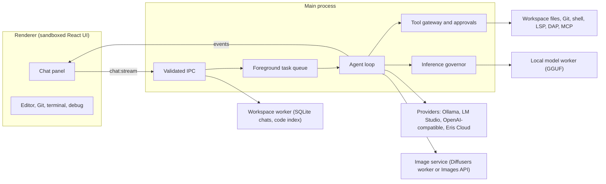

# Eris architecture

A map of how Eris is built and how a chat message becomes agent work. For request routing in depth, read [request resolution and execution](design/REQUEST-EXECUTION.md). For model choice, read [automatic model selection](design/AUTO-MODEL-EXECUTION.md). For memory, read [conversation memory](CONTEXT-MEMORY.md).

## Stack

Electron 44, React 18, Monaco, xterm.js and TypeScript throughout. Local inference uses `node-llama-cpp` 3.x in a utility process. Settings and IPC payloads are validated with Zod, and tests run on Vitest. The app ships for macOS (Apple Silicon) and Windows (x64).

## Processes and ownership

| Process | Owns |
|---|---|
| **Renderer** | What you see: chat, editor buffers, diff review and approvals. It is sandboxed and cannot grant itself permissions or read credentials. |
| **Main** | Everything that decides or acts: task admission, routing, the agent loop, tool permissions, credentials, model selection and the bounded RAM context store. |
| **Workspace worker** | The canonical chat transcript (SQLite) and the code index, on separate lanes. |
| **Local model worker** | One loaded GGUF model and its KV sessions, in an Electron utility process so inference can't freeze the UI. It runs one job at a time. |
| **Image worker** | A private Python/Diffusers runtime for local image models. It is never a chat model. |
| **Eris-Dev** | A separate diagnostics app that shares the production intake and agent code behind diagnostics adapters ([guide](ERIS-DEV.md)). |

Cloud Agents (a separately deployed agent worker) are retired. All agents run on the user's computer, and Eris Cloud is a hosted *model provider* (see [models](#models)).

## Life of a chat message

Everything starts in `ipcMain.handle('chat:stream')` in [`chat-stream.ts`](../electron/main/ipc/chat-stream.ts).

1. **Validate.** The message must come from the main window's top frame, parse against the submission schema, and belong to a thread in the current workspace.
2. **Admit.** `admitChatJob` writes a job record before any work starts. Sending the same `requestId` again reattaches instead of running twice.
3. **Queue.** `ForegroundTasks` is a first-in, first-out queue: one task runs at a time, and up to 50 can wait. A task leaves the queue only when its work function returns.
4. **Load history.** Main saves the user message and loads recent history itself. The renderer's copy of the transcript is never trusted as the source.
5. **Plan the turn.** `planInitialChatTurn` classifies intent (`answer`, `capability`, `explore`, `plan`, `edit`, `review`, `verify`, `run`), picks a role and a model, and sets a tool ceiling (`none`, `read`, `edit`, `full`). `resolveChatTurnContract` then binds references such as "those files" and builds the **TaskContract**: what was requested, where the result goes, and what the task may do.
6. **Prepare the model.** After intake, the model window is prepared. For a local GGUF model, `prepareContextBudget` loads it so the prompt is packed to the context that was actually allocated.
7. **Recall and build the prompt.** Relevant earlier conversation is selected within a token allowance, then the system instructions, history, open file and attachments are assembled.
8. **Run the agent loop** (below).
9. **Review the outcome.** For `review`, `plan`, `edit`, `verify` and `run`, a short second model call checks the answer against the evidence, with a 15-second deadline. Any verdict other than "supported" marks the run incomplete.
10. **Persist and finish.** Main saves the task result and the assistant reply, then sends `chat:done` with the saved reply (or `chat:error`).

The renderer receives typed events while the run is in progress:

- run state: `chat:phase`, `chat:status`, `chat:routed`, `chat:model` and `chat:task`;
- streamed text: `chat:thinking`, `chat:reasoning` and `chat:answer`;
- work done: `chat:tool`, `chat:diff`, `chat:checkpoint`, `chat:evidence` and `chat:delegation`;
- requests to the user: `chat:approval-request` and `chat:question-request`;
- `chat:terminal`, `chat:outcome`, and one terminal event.

Streamed text is batched every 40 ms. The model's own reasoning (`chat:reasoning`) is display-only. It is never part of the answer, never parsed for tool calls, and never sent back to a model.

The task block given to the model uses the `model-task/7` schema ([`context-compiler.ts`](../electron/main/services/agent/context-compiler.ts)). It keeps the *requested* work separate from the *effective* permissions, so a code example in chat doesn't authorize editing a file, and recalled text can't widen permissions.

## The agent loop

`runAgentWithWorkspaceTools` in [`agent/loop.ts`](../electron/main/services/agent/loop.ts) runs under a wall-clock deadline (`agent.maxRunMinutes`, 15 by default). The deadline pauses while the user is answering a question or an approval.

Each step:

1. **Compact** the working transcript if it is near the model's capacity. Old tool output is replaced by handles that the model can pull back with `context_read`.
2. **Call the model** with the tools visible for this step. Generation stops as soon as a complete tool call is parsed.
3. **Tool calls** pass through the task tool gateway, which checks that the tool is allowed and that a file was read before it is edited. They then go through the project write lock and, where required, user approval. Read-only tools can run in parallel.
4. **Text with no tool call** is checked as a finish. If the task still needs evidence or a change, the reply is rejected and the model is nudged back to tools. On local models, the next call can be constrained to valid tool-call JSON with a grammar.
5. **Finish.** If product code changed, a final verify runs (typecheck or tests) before the answer is written.

Stalls are bounded. After 6 steps without new evidence, or `agent.maxNoProgressSeconds` (180 by default) without progress, the loop gets one recovery: retrieve sources, switch model, or retry with guidance. If that fails, the task stops incomplete and reports the changes it kept. Model and agent switches share a budget of two. Cancellation never replays a tool effect.

## Agents and delegation

Roles are defined in [`resources/agents.json`](../resources/agents.json), and each project can add its own in `.eris/agents.json`.

| Role (id) | Tools | Purpose |
|---|---|---|
| **Agent** (`composer`) | full | Changes, builds and multi-step work; delegates when the task splits |
| **Coder** (`coder`) | edit | One assigned change, small diff |
| **Explainer** (`explainer`) | read | Explains how the project behaves |
| **Reviewer** (`reviewer`) | read | Bugs, risks and missing tests |
| **Plan** (`planner`) | read | A sequenced, workspace-grounded plan |
| **Verification** (`verifier`) | read | Adversarial verification of changes |
| **Fast** (`fast`) | read | Short lookups |

The orchestrator is shown as **Agent**. Its stored id stays `composer`, so existing overrides keep working.

`delegate_to_agent` starts a child task.

- **Inline children** (in a chat run) run one at a time in the same workspace, with nested delegation turned off.
- **Background children** run in their own git worktrees, with persistent job records.

A child's authority is the intersection of its assignment and its parent's. Required constraints travel in the child's task block: at most 12, of up to 300 characters each. A task tree is capped at depth 4, 16 agents, 600 steps and 60 minutes. Results come back as outcome receipts that separate observed changes, checks, unverified claims and failures.

## Models

Every model call goes through `streamModelChat` in [`chat-runtime.ts`](../electron/main/services/chat-runtime.ts). It checks what may be sent, packs the prompt to the model's budget, dispatches to a transport, and stops delivery on abort even if the provider ignores it.

| Destination | Transport | Notes |
|---|---|---|
| **Local GGUF** (`local:…`) | `node-llama-cpp` utility process | Downloaded from Hugging Face in Settings → Text Models. Only one model is loaded at a time. The inference governor grants one exclusive GPU job at a time and waits up to 120 s. |
| **Ollama, LM Studio** | Ollama native `/api/chat` or OpenAI-compatible | Loopback servers count as local for privacy and policy. Any number of Ollama servers can be connected; the first (id `ollama`) has its own settings card and receives model pulls. |
| **OpenAI-compatible APIs** | `/v1/chat/completions` (SSE) | OpenAI, OpenRouter, Groq, Together, DeepSeek or a custom base URL. API keys stay in main. |
| **Eris Cloud** (`cloud:<model>`) | OpenAI-compatible, `https://agents.ericservic.es/v1` | Hosted Ollama models for signed-in EricServic.es accounts, authenticated with the device token. Switched on automatically when the account offers it. |

### Ollama context windows

For Ollama, Eris reads each model's maximum window from `/api/show` and sends the window it budgets for as `num_ctx` on `/api/chat`. After every request it reads `/api/ps` (`size`, `size_vram`, `context_length`), and each connection's **Context window** setting (`contextFit`) decides what happens next ([`ollama-context-fit.ts`](../electron/main/services/ollama-context-fit.ts), [`ollama-runtime.ts`](../electron/main/services/ollama-runtime.ts)):

- **Fit to VRAM** (default): if part of the model spilled to the CPU, the next request uses the largest window that would have stayed in VRAM, down to the supported minimum of 512 tokens. The KV cache cost per token is measured from two loads at different windows, or estimated from `model_info` (`block_count`, `attention.head_count_kv`, key and value lengths, hybrid layers) and the connection's **KV cache type**. Only a measured spill at that minimum sets the minimum-context warning; a predicted reduction does not establish that the weights are too large.
- **Largest that fits**: after the first load, grows the window to what the VRAM budget holds, up to the model's maximum. The budget is the connection's **VRAM** setting, interpreted as the total across its assigned GPUs. For a loopback server without a declaration, Eris estimates the budget by adding the detected discrete and external GPUs, including smaller cards. Ollama owns placement across those GPUs. A server restricted to a subset of GPUs should declare that subset's total. Unified memory is counted once. A per-model window set by the user is never exceeded. If the plan spills, it is shrunk as above.
- **Exactly as set**: sends the requested window unchanged.

If Ollama refuses to load a window for lack of memory before any output, Eris halves it and retries once when the already packed prompt fits; otherwise the turn fails and names the window the next request will use. Prompt budgets and `num_ctx` both come from `ollamaRequestWindow`, so they always agree. Fitted windows are kept until the requested window or the connection's fit settings change, or **Re-measure windows** is pressed. Measured KV costs and their load samples carry the same settings signature, so changed cache or capacity settings start fresh measurements. Eris Cloud is never fitted.

The model picker offers a named model (Fixed), **Auto (this computer only)** and **Auto (any connected model)**. Auto ranks candidates by capability profile, the *Auto preference* setting (best, local or cheapest), measured outcomes and the loaded model; see [automatic model selection](design/AUTO-MODEL-EXECUTION.md).

Native tool calls are used where the protocol supports them, and text tool envelopes otherwise. Reasoning is read from `reasoning_content`/`reasoning` deltas, Ollama `message.thinking`, GGUF thought segments, or a leading `<think>` block. Each connection can set a reasoning level and whether reasoning is shown.

## Tools and permissions

Tools are defined in [`tool-registry.ts`](../electron/main/services/tool-registry.ts).

| Group | Tools |
|---|---|
| Read | `tree`, `list_dir`, `read_file`, `notebook_read`, `grep`, `glob`, `search_symbols`, `find_references`, `lsp`, `semantic_search`, `related_files`, `retrieve`, `git_status`, `git_diff`, `read_context`, `list_skills`, `read_skill` |
| Context | `context_search`, `context_read` |
| Web | `web_search`, `web_open` |
| Edit | `search_replace`, `apply_patch`, `write_file`, `notebook_edit`, `mkdir`, `delete_path`, `rename_path`, `generate_image`, `update_context`, `write_skill`, `git_stage`, `git_commit`, `git_stash` |
| Full | `run`, `git_sync` |
| Orchestration | `delegate_to_agent`, `await_children`, `ask_user` |
| Discovery | `search_tools`, `search_mcp_tools`, plus MCP tools (`mcp__…`) |

Permission layers, from widest to narrowest:

1. Chat mode (**Ask** or **Agent**) and the role's tool ceiling.
2. The TaskContract's authority for this request.
3. The tool gateway, on every call: is the tool allowed, is the path inside the project, and was the file read and not changed since.
4. Command approval (`agent.commandApproval`, `ask` by default). A short list of inspection commands runs without asking; other commands, pushes and MCP calls ask, and "Always allow" is remembered per workspace.
5. The project write lock, so two writers never overlap. It is released while an approval is pending.

File changes are checkpointed with their original contents, so Keep and Undo work per hunk. Commands run as trusted host code in the workspace directory, with owned process groups (POSIX) or a Job Object (Windows). The working directory is not an OS sandbox.

## Context and memory

| Store | Lifetime | Purpose |
|---|---|---|
| Chat transcript (SQLite) | Durable | The canonical conversation |
| RAM context | Process, bounded (128 MiB default) | Fast recall of earlier turns, selected per turn within a token allowance |
| Task store | Durable | What each turn requested and what changed, so "those files" and "what changed?" resolve |
| Run journal | One run | Full tool outputs, so compaction leaves handles instead of losing content |
| Project context (`.eris/context.md`) | Durable, per workspace | Notes the agent keeps about the project |
| Native KV session | One run | The prompt cache inside the local model |

Per turn, history gets about 10% of the input budget in Agent mode (37.5% for tool-free chat), and recall starts at 15%, capped at 8,192 tokens. Recall is not shared with remote models unless you turn that on. Details are in [conversation memory](CONTEXT-MEMORY.md).

## Limits

| Limit | Value | Where |
|---|---|---|
| Run wall clock | 15 min (`agent.maxRunMinutes`, 1–120) | `agent/loop.ts` |
| No progress | 180 s (`agent.maxNoProgressSeconds`, 30–1,800) | `agent/loop.ts` |
| Steps without new evidence | 6 | `MAX_STEPS_WITHOUT_EVIDENCE` |
| Inference lease wait | 120 s | `inference-governor.ts` |
| Local model first output | 180 s | `llama-worker-channel.ts` |
| Silence during generation | 90 s | `llama-worker-channel.ts` |
| Local reply cap | 16,384 tokens | `vram-fit.ts` |
| Outcome review | 15 s | `task-outcome.ts` |
| Semantic intent resolver | 1.5 s | `task-resolver.ts` |
| Shell command | 60 s default, 600 s max | `shell-run.ts` |
| MCP request | 30 s | `mcp-runtime.ts` |
| Git command | 20 s | `git-service.ts` |
| Grep | 15 s | `workspace-search.ts` |
| `ask_user` reply | 5 min | `user-question.ts` |
| Foreground queue | 50 waiting, 1 running | `foreground-tasks.ts` |
| Chat panel message queue | 3 | `ChatPanel.tsx` |
| Task tree | depth 4, 16 agents, 600 steps, 60 min | `agent-orchestration.ts` |

## Other subsystems

- **Settings**: defaults, then user (`settings.json` in the app data folder), then workspace (`.eris/settings.json`). Workspace rules live in `.eris/rules/`, and skills in `.eris/skills/` and the user skills folder.
- **Credentials**: held in main, in a local file or the OS vault ([`credential-store.ts`](../electron/main/services/credential-store.ts)). The renderer only learns whether a key exists.
- **Account and sync**: an EricServic.es sign-in syncs settings, projects, chats and skills, and enables Eris Cloud ([account sync](PROFILE-SYNC.md)).
- **Images**: a dedicated service with a local Diffusers worker or an Images API ([image generation](image-generation.md)).
- **Feedback**: redacted reports go through the EricServic.es relay and become GitHub issues ([feedback](FEEDBACK.md)).
- **Updates and release**: GitHub Releases feeds for macOS and Windows ([updates](UPDATES.md), [signing](SIGNING.md), [workflow](GITHUB-WORKFLOW.md)).
- **Diagnostics**: Eris-Dev, scripted replays and the quality harness ([diagnostics](DIAGNOSTICS-RUNS.md), [checks](../checks/README.md)).

## Where to look in the code

| Topic | File |
|---|---|
| Chat entry point, events and persistence | `electron/main/ipc/chat-stream.ts` |
| Queue and job records | `electron/main/services/foreground-tasks.ts`, `chat-job-controller.ts` |
| Turn planning and task contract | `electron/main/services/chat-turn.ts`, `chat-router.ts`, `task-intake.ts`, `task-resolver.ts` |
| Agent loop and helpers | `electron/main/services/agent/` (`loop.ts`, `stream.ts`, `compaction.ts`, `mid-run-adapt.ts`, `tool-gateway.ts`) |
| Model transport | `electron/main/services/chat-runtime.ts`, `model-protocol.ts`, `openai-compatible.ts`, `ollama-chat.ts` |
| Model selection and catalog | `electron/main/services/auto-model-policy.ts`, `model-catalog.ts` |
| Local runtime | `electron/main/services/builtin-model.ts`, `electron/main/llama-worker.ts`, `inference-governor.ts` |
| Tools | `electron/main/services/tool-registry.ts`, `agent/execute-tool.ts` |
| Chat UI | `src/hooks/useChatSession.ts`, `src/features/chat/` |
| Roles | `resources/agents.json` |
