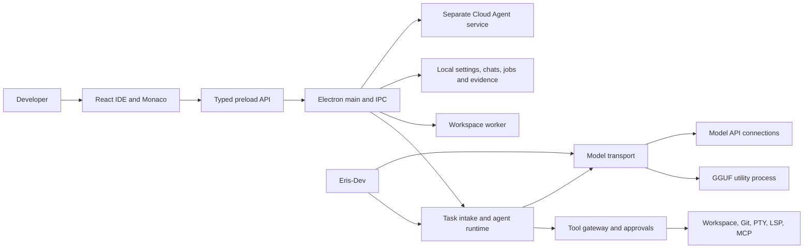
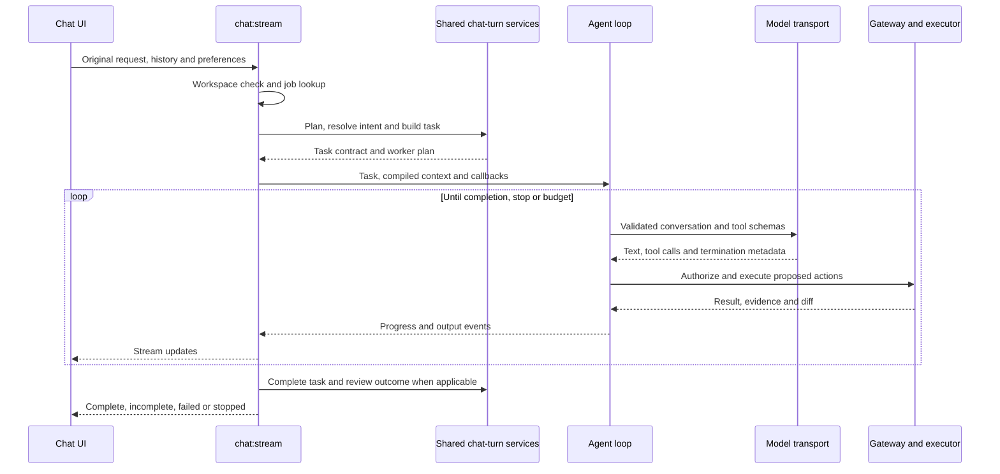

# Eris architecture

Reviewed 2026-10-24 against commit `6038e16dcdf58044bd5245294931005f3094e804`, package version **0.4.15**. Updated for the local `main` implementation following this source review of the desktop IDE, Eris-Dev, cloud worker, and delivery workflows. It is not a new live-model benchmark, penetration test, or installation certification.

This file describes the current implementation. [RECOMMENDATIONS.md](RECOMMENDATIONS.md) is the current prioritized implementation backlog. Historical AG, FR, MR, and ARCH review identifiers are evidence references, not an assertion that those findings remain open.

## System and process boundaries

The production app and Eris-Dev are separate Electron applications. The cloud agent is a separate Node service with its own worker loop and deployment. Shared types or prompts do not make these execution environments equivalent.

### Desktop shell and renderer

- [electron/main/index.ts](../electron/main/index.ts) owns startup and service shutdown; [window.ts](../electron/main/window.ts) creates the application window with `sandbox: true`, context isolation, and Node integration disabled. Navigation is restricted and external HTTP(S) links open through the OS.
- [electron/preload/index.ts](../electron/preload/index.ts) exposes the IDE API. [src/shared/api.ts](../src/shared/api.ts) supplies compile-time types. Each privileged handler still needs its own runtime validation and sender authorization.
- [src/hooks/useChatSession.ts](../src/hooks/useChatSession.ts) coordinates composing, streaming, approvals, questions, pending diffs, and reconnection. [src/state/chat-stream.ts](../src/state/chat-stream.ts) holds stream state; [src/state/documents.ts](../src/state/documents.ts) maintains the current editor buffer independently of tab snapshots.
- Workspace scanning/indexing and chat-database work have worker paths. PTYs, language servers, MCP subprocesses, native inference, and image inference each have separate resource and cancellation lifecycles.

The renderer owns interaction and presentation. Main owns task interpretation, effective authority, filesystem effects, credentials, and durable execution evidence.

## Core contracts

[TaskContract](../src/shared/task-contract.ts) version 2 separates the requested artifact, its destination, project applicability, effect constraints, obligations, and effective authority. A code example delivered in chat does not inherently permit editing a project. Generic advice does not inherently require project inspection.

- **Conversation:** durable user-facing message history.
- **Task:** interpreted user intent, selected project, constraints, obligations, and authority.
- **Job/attempt:** one execution of a task, with cancellation, model use, progress, and terminal state.
- **Tool observation:** an actual operation/result recorded independently of the model's claims.
- **Deliverable assessment:** checks for visible output defects; it is not an answer-quality grade.
- **Artifact:** a patch, image, export, or installer with a distinct creation, validation, and integration lifecycle.
- **Recommendation:** an object with stable identity and source, selected by later turns and accounted for individually.

[task-intake.ts](../electron/main/services/task-intake.ts) builds the contract. Project discovery is bounded to 250 visited directories and depth four. It uses folder names, manifests, and page titles as aliases. Follow-ups can inherit resolved project scope. Current recommendation selection prefers objects retained by the preceding task, with prose parsing as a legacy fallback; it no longer relies solely on numbered lists.

## Chat to task to agent

[chat-turn.ts](../electron/main/services/chat-turn.ts) is the shared seam for planning, intent resolution, task intake, prompt construction, model choice, and outcome evidence. Production IPC and diagnostics reuse it. [chat-router.ts](../electron/main/services/chat-router.ts), [task-resolver.ts](../electron/main/services/task-resolver.ts), and [execution-plan.ts](../electron/main/services/execution-plan.ts) retain distinct responsibilities; they must agree on the contract rather than independently infer permission from text.

[agent/loop.ts](../electron/main/services/agent/loop.ts) coordinates model steps, tool proposals, bounded repair, recovery, context refresh, delegation, and finalization. [agent/workflow.ts](../electron/main/services/agent/workflow.ts) describes execution requirements. [agent/final-answer.ts](../electron/main/services/agent/final-answer.ts) and [deliverable-checks.ts](../src/shared/deliverable-checks.ts) handle final output framing and visible defects.

Current safeguards include explicit effect constraints, component/verification obligations, generic-versus-project evidence requirements, deterministic invalid-tool repair, bounded recovery instructions, and evidence-aware completion. Recent tests cover protocol leakage, continuation of unfinished code, scope pronouns, recommendation accounting, and unsupported execution claims.

### Foreground lifecycle boundary

[chat-submission.ts](../electron/main/services/chat-submission.ts) validates versioned, bounded submissions, sender/thread/workspace associations and attachment paths before admission. Renderer-supplied legacy plans do not grant authority.

[foreground-tasks.ts](../electron/main/services/foreground-tasks.ts) queues foreground execution FIFO with task-owned controllers and cancellation ownership. Global app-state fields describe only the currently executing task; a new request does not abort it.

[chat-job-controller.ts](../electron/main/services/chat-job-controller.ts) syncs admission snapshots before acknowledgement, compares canonical request digests, indexes recovery by workspace/thread and surfaces storage failure. It retains bounded answer/event snapshots (240 events), 200 terminal tasks in memory and up to 500/30 days on disk. [chat-events.ts](../electron/main/services/chat-events.ts) owns event publication/replay and terminal transitions. Recovery is bounded snapshot replay, not an unlimited event journal. The renderer restores unfinished/unsaved terminal results and ignores duplicate terminal delivery.

## Agent to tool

[TaskToolGateway](../electron/main/services/agent/tool-gateway.ts) checks project scope, task effect authority, external effects, command restrictions, and file baselines. It records reads and blocks stale writes to inspected files; partial reads cannot authorize rewriting the whole file. [workspace-fs.ts](../electron/main/services/workspace-fs.ts) provides workspace path enforcement, while [command-approval.ts](../electron/main/services/command-approval.ts) and workspace trust control command approvals.

[agent/task-scheduler.ts](../electron/main/services/agent/task-scheduler.ts) serializes mutations across overlapping canonical roots, including parent projects and subprojects. This is implemented and should not remain listed as an unbuilt feature.

These controls are application policy. A shell process with a project `cwd` is not an OS filesystem or network sandbox. User-buffer concurrency, multiple-file transactions, external effects, and Git integration require their own receipts and conflict handling; a read hash does not make every effect atomic or reversible.

## Agent to agent

There are different coordination paths:

- Inline specialists run through the desktop worker runtime and inherit an intersected task authority ceiling.
- [background-agents.ts](../electron/main/services/background-agents.ts) schedules jobs and their children, stores activity, and manages worktree-backed results.
- [worktrees.ts](../electron/main/services/worktrees.ts) creates task branches from `HEAD`, optionally links `node_modules`, produces diffs, and merges branches.
- [agent-orchestration.ts](../src/shared/agent-orchestration.ts) describes handoff packets and summarizes required-child results.

The scheduler and blackboard use typed waiting reasons, independent of status wording. Parents release capacity while awaiting children and cannot complete successfully with failed required-child results.

Worktrees record their integration branch and base SHA at creation. Integration holds the project write lock and verifies the same branch/base plus a clean destination before merging. Receipts distinguish child edits applied to a shared parent worktree from a commit integrated into the destination branch; the inbox displays that distinction.

## Agent to model

[model-transport.ts](../electron/main/services/model-transport.ts) is shared by agent, routing, intent, outcome, inline, and compaction calls. It supplies diagnostics adapters through `AsyncLocalStorage`. [model-protocol.ts](../electron/main/services/model-protocol.ts) validates tool call/result pairing and compiles native tool messages or text envelopes. Native and API backends report termination metadata through [chat-runtime.ts](../electron/main/services/chat-runtime.ts).

[agent/context-compiler.ts](../electron/main/services/agent/context-compiler.ts) orders mandatory instructions and optional context and records inclusion/omission metadata. Task authority and complete tool exchanges must survive budgeting. Some budget paths still use character estimates, including `content.length / 3`; actual provider/native token counts are not universally available. [model-capabilities.ts](../electron/main/services/model-capabilities.ts) centralizes configured ceilings, output reserve and protocol metadata for transport/compaction. Usage records distinguish measured and estimated tokens. Configured context ceilings remain distinct from measured worker allocation; tokenizer/provider calibration is incomplete.

### Local GGUF inference

[builtin-model.ts](../electron/main/services/builtin-model.ts), [local-model.ts](../electron/main/services/local-model.ts), and [llama-worker.ts](../electron/main/llama-worker.ts) manage GGUF models and sessions. Native inference normally runs in an Electron utility process. [llama-worker-channel.ts](../electron/main/services/llama-worker-channel.ts) rejects waiting callers on worker error, exit, abort, and load deadline.

The current native runtime preserves structured history in one-shot and session paths, bounds reply reserve against effective context, and records stop reasons. Runtime worker failures propagate as `LocalModelWorkerError` instead of automatically loading a failing model into Electron main. An in-process compatibility path remains; do not describe all native execution as universally isolated.

[inference-governor.ts](../electron/main/services/inference-governor.ts), GPU/VRAM fitting, and the local image-model service coordinate resource admission. Scripted worker tests establish control-path behavior, not recovery under actual GPU OOM, native faults, or desktop memory pressure.

## Workspace, editor and persistence

Workspace context, retrieval, code indexing, watching, Git, language servers, terminals, and inline assistance are separate services under `electron/main/services/`. The editor's current content lives in its document model; code operating on stored tab text must use a fresh document snapshot.

Persistence uses several stores rather than a single task database: chats/chat database, settings, task store, task ledger, chat-job snapshots, checkpoints, sessions, agent runs, and background jobs. [task-ledger.ts](../electron/main/services/task-ledger.ts) writes metadata and hashes as JSONL; content snapshots remain in checkpoint storage. A metadata ledger is not a complete transactional replay journal.

[credential-store.ts](../electron/main/services/credential-store.ts) owns explicit local-file or OS-vault policy. Local reads do not invoke the vault. Synced atomic migration preserves unreadable legacy data; selecting the vault is an explicit user action that may prompt. Credential files use POSIX permissions or explicit Windows current-user ACLs. Renderer APIs return presence, never stored values, and filesystem IPC denies credential files. Eris-Dev uses the same abstraction. Real Windows ACL and vault-unlock behavior remain platform acceptance checks.

## Cloud execution

The [cloud-agent](../cloud-agent/README.md) service owns authentication, jobs, model inference, workspace materialization, events, artifacts, and optional GitHub PR creation. It is a separate implementation with a separate package lock and a smaller tool protocol.

The desktop requires a compatible `taskContractVersion` before v2 inline routing and explains local fallback. [task-policy.ts](../cloud-agent/src/task-policy.ts) now validates/persists v2 contracts and checks tool scope/effect permissions, readonly verification and publishing authority; resume cannot replace the original contract. Health explicitly remains at version 1 until full conformance, artifact-baseline and obligation accounting qualification. Artifact application errors fail the inline turn.

[job-sandbox.ts](../cloud-agent/src/job-sandbox.ts) runs Linux commands through bubblewrap namespaces and prlimit after joining a required delegated cgroup v2 subtree. Only the job/project workspace is mounted; network and service environment are excluded. Verification mounts it read-only. Aggregate CPU/memory/process limits, bounded tmpfs/files/output and wall deadlines apply; cancellation kills the whole cgroup. Missing namespaces, tools or delegation fail closed. The Docker image supplies tools, but deployment must supply working isolation/delegation; the production host was not changed or certified.

[workspace-paths.ts](../cloud-agent/src/workspace-paths.ts) rejects symlink components, absolute/traversal/drive paths and bounds reads before allocation. Tree/artifact traversal skips links. Git metadata is excluded from agent file tools; trusted clone/publish operations pass auth through a scoped Git environment and return fixed errors without credential-bearing command strings. The shell denylist is supplementary policy.

## Eris-Dev and diagnostics

[Eris-Dev](ERIS-DEV.md) uses application ID `app.eris.dev`, separate application data, and no production updater. It can capture requests with scripted replies or run opted-in [live-model batches](ERIS-DEV-LIVE-MODELS.md). It reuses production turn assembly and the worker loop inside a diagnostics scope with temporary workspaces and blocked host effects.

The current implementation provides stable question IDs, import preview, resume compatibility, atomic export, key-aware sanitization, context/tool manifests, selected-case inspection, per-call termination, elapsed/deadline/cancellation causes, complete streamed output capture, deliverable findings, and explicit exported/processed/total coverage.

REC-27 adds an Eris-Dev quality-suite adapter that calls the existing production capture/intake/runtime path. UI and maintained CLI bridge materialize synthetic isolated fixtures, reserve provider/output budgets, redact known credentials, preserve blocked effects and archive fixture/result digests. Saved reports support offline adjudication without new inference. Capability gaps remain not-exercised; capture does not establish answer correctness.

[DIAGNOSTICS-RUNS.md](DIAGNOSTICS-RUNS.md) documents the in-app diagnostics seam. Scripted adapters must make zero provider calls; live adapters exercise inference but still do not represent every production effect. Diagnostics block host commands, network effects, MCP, images, persistent delegation, and cloud execution at their service boundaries.

A runtime completion, invariant pass, or deliverable pass is not proof that an answer is correct. `answerQuality` remains explicitly `not-evaluated` in Eris-Dev results. Historical partial captures must not become whole-corpus quality claims. Independent artifact oracles, realistic multi-turn cases, repeated model comparisons, and actual desktop interaction tests remain necessary.

## Build, CI and release

[package.json](../package.json) and its lockfile are the version and dependency sources. `npm run build` first runs the `agents` qualification profile; `build:dev-app` runs the `dev-app` profile. [qualification-profiles.json](../tests/qualification-profiles.json) enumerates coverage and exclusions. General `npm test` covers additional application behavior.

[CI](../.github/workflows/ci.yml) runs typecheck, lint, tests, production build, and low-threshold audits for both dependency trees on macOS, plus an Eris-Dev Windows installer job. `check:client`, quality harness invariants, cloud typechecking, actual process recovery and packaged smoke checks are now CI steps. Packaged installation, real renderer interaction, live model answer quality, and all child-agent scheduling are not established by a green unit/build run.

[GitHub policy](GITHUB-WORKFLOW.md) uses `main` as the only integration/release branch. Direct pushes are allowed; task/release PRs also target `main`. The retired `dev` promotion/version rules have been removed from enforced workflows and release validation.

[scripts/release.mjs](../scripts/release.mjs) requires a clean checkout at the exact remote `main` tip for a no-bump release, then creates/pushes the tag and creates the release. It does not push branch commits. [release.yml](../.github/workflows/release.yml) builds macOS DMG/ZIP and Windows Eris/Eris-Dev NSIS installers, with both production updater feeds. Certificate configuration is optional; unsigned macOS builds use the manual-install fallback in [auto-update.ts](../electron/main/services/auto-update.ts).

[release-source.cjs](../scripts/release-source.cjs) resolves the tag to one immutable SHA before the matrix starts, validates committed package/lock versions and ancestry in main, then records per-platform source/tag/lock hashes, signing state, workflow identity and asset checksums. Existing assets can only be replaced with explicit repair_existing input; source changes require a new tag/version.

Feedback uses the server relay exclusively. No shared token is injected into the build; both builders exclude its legacy filename and run [check-packaged-secrets.cjs](../scripts/check-packaged-secrets.cjs) after packing, including a streaming scan of ASAR content. Historical release exposure/rotation has not been established.

## Current work boundary

The next fixes and acceptance criteria are maintained only in [RECOMMENDATIONS.md](RECOMMENDATIONS.md). Older review Markdown and superseded review/design backlogs have been removed. Historical JSON, JSONL, CSV, analyzer scripts, and ZIP evidence remain under `docs/reviews/` for reproducibility; their old findings are not automatically current defects.

Operational guides remain in this directory. Update this architecture description when a responsibility or boundary changes, and update recommendations only after checking the current source and its validation evidence. The implementation passed 841 deterministic tests, five quality-harness checks, typechecks, lint without errors, build, client fixtures, a packaged macOS smoke and a real Electron utility-process recovery probe. CI adds the client/quality/recovery/packaged gates. Real live-model quality, cloud deployment, GPU and signed-update acceptance remain separate checks described in recommendations.
