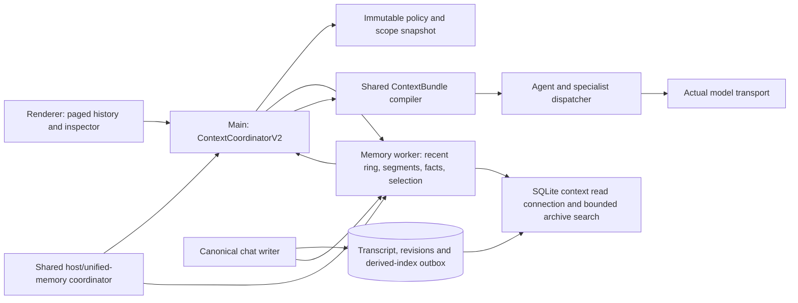

# Eris RAM, context and conversation-history architecture

- Design ID: ERIS-CONTEXT-002
- Status: implementation-ready target design; **not a claim that the target is already built**
- Design date: 2026-10-29
- Reviewed implementation: `37b3da2e2d8742766d1269754eef115d34ef465e`
- Primary audience: AI coding agents, architecture reviewers, performance engineers and maintainers
- Companion: [current implementation](CONTEXT-MEMORY.md), [system architecture](ARCHITECTURE.md)

## 1. How an AI must use this specification

This document describes the next architecture for the implementation introduced by PR #109. Read the current implementation before changing it. Names ending in `V2`, new schemas, API examples, limits and rollout phases below are **proposed contracts**, unless explicitly labeled current.

The words MUST, MUST NOT and SHOULD identify requirements. Performance figures are proposed acceptance targets, not measurements. The capacity examples are arithmetic estimates with stated assumptions. The prior 936-test result established deterministic/scripted behavior of the baseline; it did not establish the performance or live-model quality targets in this document.

An implementing AI must:

1. Identify the phase and requirement IDs it is implementing.
2. Inspect the listed source files and applicable repository instructions.
3. Preserve canonical transcript recovery, permissions and shared production/diagnostic behavior.
4. Implement one bounded phase at a time, keeping the existing path available until replacement qualifies.
5. Add semantic tests and measured evidence for the phase; never replace retrieval-quality checks with string-shape tests alone.
6. Update this document's implementation status and the current-behavior document after implementation.
7. Report implemented, deferred and blocked requirements separately.
8. Avoid treating a proposed interface or SQL outline here as code that already exists.

This request authorizes architecture documentation. It does not authorize silently implementing all proposed runtime changes.

For a small-context model, do not paste the entire specification into every task. Retrieve sections 1, 3 and 5 plus the selected MEM package, its dependencies and relevant design sections. Useful bundles are MEM-04 → sections 6–7/11/20/22; MEM-05 → 6–8/11; MEM-08 → 9/12/16; MEM-10 → 10/13/17; MEM-12 → 14–15/19; MEM-16 → 19/21/23. Preserve section/package IDs in the task prompt so omitted requirements remain discoverable. This document should itself be consumed through bounded context retrieval.

### 1.1 Navigation

- Sections 2–5: goals, source-confirmed baseline, gaps and invariants.
- Sections 6–9: process boundaries, memory budgets, representation and persistence.
- Sections 10–14: lifecycle, retrieval, conversational references, prompt composition and agents.
- Sections 15–19: validity, privacy, IPC, user experience and observability.
- Sections 20–24: performance targets, evaluation, failure behavior, migration and implementation tasks.
- Sections 25–28: AI handoff instructions, decision records, examples and external references.

## 2. Product outcome

A user should be able to discuss a project for thousands of turns and then ask about an earlier decision, an unfinished edit, a recommendation or a failed verification without restating the entire conversation.

The IDE should recall the correct source, distinguish current decisions from superseded ones, preserve uncertainty, and send enough evidence to the chosen model to produce a useful answer. It should do this without freezing typing, duplicating the transcript across processes, exhausting unified memory or feeding an ever-growing prompt to a small model.

The system has four different capacity problems:

1. **Durable history capacity:** how much conversation can be retained across restarts.
2. **RAM working-set capacity:** how much detailed history and indexing can stay resident efficiently.
3. **Retrieval coverage:** which portions of durable history remain searchable when raw text is no longer hot.
4. **Model input capacity:** how much selected context fits the actual backend request.

Increasing one does not automatically increase the others. A 100,000-message searchable archive does not require 100,000 raw messages in Electron main, and it does not mean sending those messages to the model.

### 2.1 Required user-visible improvements

- Old decisions remain findable after their raw messages leave RAM.
- Recent turns retain exact role order and important code details.
- “Implement the second recommendation” resolves to a stable recommendation identity or produces a precise clarification.
- A changed preference supersedes an earlier preference within the same scope without erasing history.
- A failed or stopped task cannot become a remembered completed task.
- Recalled facts expose provenance and freshness.
- Loading older UI pages cannot affect model history or submission size.
- Model switching does not leak local-only recalled data or reuse an incompatible inference cache.
- Memory pressure reduces optional recall before it damages editor responsiveness or active inference.

### 2.2 Non-goals for the initial target

- Training or fine-tuning a model from private chat history.
- Giving assistant prose the authority of a user instruction.
- Sharing facts between projects or users by default.
- Keeping every source file, image or model KV entry resident.
- Guaranteeing semantic correctness merely because a model saw more tokens.
- Loading an embedding model or another LLM whenever a message arrives.
- Using RAM as the only recovery source.
- Implementing an entire new agent loop as one rewrite.

## 3. Source-confirmed baseline

The following is current at the reviewed commit.

### 3.1 Canonical history and admission

`src/hooks/useChatSession.ts` submits the current message and thread ID with an empty history for normal thread-bound sends. Main validates the thread using a one-message read and appends a deterministic `${requestId}:user` record. Its returned canonical tail supplies at most 20 prior messages to the existing intake and prompt builder.

`electron/main/ipc/chat-stream.ts` persists the final assistant message before publishing terminal delivery. Main and renderer use `finalizePostedAnswer()` from `src/shared/posted-answer.ts`, including stopped and image-only cases. Main captures thinking, image references and specialist metadata for transcript persistence. These extra fields are excluded from the recall cache.

### 3.2 RAM cache

`electron/main/services/context-memory-store.ts` holds full cleaned `ChatMessage` objects in main. The cache uses profile/workspace/thread keys, monotonic revisions, generation tokens, logical byte estimates, count caps, idle expiry and LRU eviction.

Current defaults are 128 MiB globally, 32 MiB per conversation, 25,000 messages per conversation, eight warm conversations and a 30-minute idle period. Limits are conservative logical estimates, not hard RSS limits.

### 3.3 Hydration

`electron/main/services/context-memory.ts` hydrates at most two conversations concurrently. The dedicated context worker lane reads up to 500 rows and approximately 2 MB of serialized data per page. Pages carry a consistent transcript revision. Oversized rows are skipped with partial coverage. A foreground lookup retries an inconsistent/missing hydration once.

The current implementation may await the configured full hydration before selection. The ordinary recent-history fallback exists, but there is no short per-send recall deadline.

### 3.4 Selection and prompt compilation

Selection scans retained messages, tokenizes up to 24 ASCII-oriented query terms, scores matches/recency/salient user wording and retains up to 128 candidates. It yields every 128 records. It selects up to 24 fact excerpts and defaults to approximately 1,024 tokens of recall, using three characters per token.

The shared compiler includes required task/instructions first, then optional memory, project and retrieval blocks. It allocates 55% of the supplied input-token budget to this compiled system context. Optional blocks can be sliced to fit that character budget.

Historical excerpts do not enter deterministic task-authority construction. Existing durable typed prior-task recommendations and recent messages remain the intake source.

### 3.5 Controls and policy

The Context inspector can preview selection, pin notes, exclude sources, set an ordinal cutoff and reload RAM. Controls are durable, bounded and main-frame validated. Additional recall is local by default; non-native model requests require remote opt-in. A workspace cannot enable this setting while untrusted.

Project `.eris/context.md`, source retrieval caches, run-local compaction and native inference/KV sessions remain separate mechanisms. The RAM cache is not yet an allocated client of the inference governor.

## 4. Gaps the target design must close

These are architectural limitations inferred from source inspection, not newly measured production incidents.

### GAP-01: Large message counts do not imply large detailed capacity

The current logical formula is roughly `4 × serialized UTF-8 bytes + 512` per record. With 25,000 records averaging 2 KiB of content and approximately 200 bytes of serialized metadata, the estimate is about 226.6 MiB. A 32 MiB thread cap therefore retains roughly 3,500 such records, not 25,000. Exact counts vary with real content.

Oldest-first trimming removes old decisions as well as old discussion. Once a message leaves the RAM cache, the current selector does not search it on disk.

### GAP-02: Append and hydration do work proportional to existing history

A warm append constructs a map from all retained records, sorts the result and recomputes total bytes. Hydration repeatedly prepends pages. Allocation, serialization and container-copy costs grow with conversation size even when only one new message arrives.

### GAP-03: Query cost includes a full history scan

Each selection lowercases message strings and tests query words. Excluded sources are checked using an array membership operation for each row. Candidate ranking repeatedly sorts a bounded array after it reaches capacity. Bounds prevent unbounded growth, but the CPU work and temporary allocations remain avoidable.

### GAP-04: Cold recall can delay the foreground send

A cold conversation may load many pages before the selector runs. The worker request timeout is much longer than a desirable UI interaction deadline. Cancellation is checked between pages rather than providing a complete per-consumer deadline and queue-preemption protocol.

### GAP-05: Policy and storage configuration share one mutable store configuration

The baseline fences policy changes and reapplies the caller's configuration after asynchronous I/O. This prevents the tested cross-workspace sharing-policy race. It can still invalidate unrelated pending work when workspaces have different budgets or policies. Privacy should be immutable request data, while resource allocation should be a separately owned process policy.

### GAP-06: Facts are excerpts rather than durable semantic records

A message containing “always” is not necessarily a current requirement. Two contradictory constraints can both be selected. Numbered prose is classified as a recommendation, but stable recommendation batches, decisions, obligations and their supersession are not represented by this cache itself.

### GAP-07: Additional history is selected after task intake

Older RAM evidence can improve an answer but cannot reliably bind an ambiguous old recommendation before the current task is created. The target needs a restricted reference-binding stage that preserves current-user authority.

### GAP-08: The selection and sent context can differ

The selector reports selected IDs before the compiler truncates optional blocks. A selected memory item may never be fully sent. A single block-level digest cannot explain which fact was dropped or cut. Memory's current ordering can also crowd out fresh source evidence.

### GAP-09: Source validity is incomplete

Historical changed-file receipts have task identity and project root, but not a complete current-repository validity proof. Ordinary user/assistant messages lack per-statement scope and supersession. Ordinal cutoffs need explicit behavior after rewinds and replacements that reuse ordinal positions.

### GAP-10: RAM accounting does not cover all context-related residency

Transfer copies, pinned old snapshots, candidate strings, SQLite page caches, connection maps and renderer preview copies are not all governed by one admission contract. Worker heap limits alone would not solve this.

### GAP-11: Context-bearing diagnostic histories need isolation and replay

Independent Eris-Dev cases must stay independent. Stateful multi-turn evaluation should deliberately test the real history path, with reproducible retrieval decisions and actual sent messages.

## 5. Non-negotiable invariants

**INV-01 — Canonical source:** committed conversation storage owns message identity, ordering and revisions. The renderer is a paged view.

**INV-02 — Recoverability:** a cache miss, worker failure or process restart cannot erase a committed transcript. Derived structures are rebuildable.

**INV-03 — One authority boundary:** the latest user request and current task permissions own actions. Memory resolves references and supplies evidence; it cannot grant edit/run/network rights.

**INV-04 — Exact provenance:** every selected fact, summary and receipt points to a message/task/source revision and a bounded source span or structured artifact.

**INV-05 — Admission before allocation:** controlled allocations reserve bytes before they are created or transferred. Reservations release exactly once.

**INV-06 — Scope first:** profile, workspace, project, thread, branch/timeline and policy filtering occur before private text is materialized into a model-bound request.

**INV-07 — Coherent snapshot:** a selection uses one immutable revision vector or explicitly reports partial/unavailable coverage. It never silently mixes rewritten and current messages.

**INV-08 — No false completion:** conversation finalization preserves failed, stopped, incomplete and unverified states. Actual tool evidence is separate from assistant claims.

**INV-09 — Bounded foreground work:** the main event loop does not scan or serialize the whole conversation on send or append.

**INV-10 — Honest coverage:** retained, searchable, selected and actually sent counts are different fields. Complete RAM retention is not complete semantic recall.

**INV-11 — Remote ceiling:** every outbound model dispatch evaluates immutable policy and actual destination; backend changes cannot widen disclosure.

**INV-12 — Forget propagation:** exclusions, deletion and cutoffs invalidate all dependent caches, summaries, prompt bundles and pending selections.

**INV-13 — Single counted ownership:** a buffer is charged once to its current owner; simultaneous sender/receiver copies are charged twice until ownership transfer completes.

**INV-14 — No surprise inference:** deterministic context maintenance uses no GPU and does not swap the active text model to summarize history.

## 6. Process topology and component ownership

Main remains the **coordinator and policy authority**, but the target moves large raw history/index ownership and selection CPU into one memory worker. This refines the current implementation; it does not move authorization into a worker.



### 6.1 ContextCoordinatorV2, main

Owns namespace binding, foreground priority, immutable per-request policy, cancellation/deadlines, byte reservations, worker lifecycle, final evidence eligibility and transport disclosure checks. Holds compact manifests and handles; it does not keep a second complete raw-history map.

It validates renderer requests and prevents arbitrary-root IPC. It never waits indefinitely for memory recall before allowing a recent-history-only response.

### 6.2 Canonical chat writer, existing chat lane

Owns SQLite writes, identity deduplication, final reply persistence and monotonic revisions. It commits a lightweight context-change/outbox record in the same transaction as the canonical mutation. It does not block transcript durability on summary extraction, search indexing or cache warming.

### 6.3 Memory worker, existing context lane evolved

Owns recent messages, immutable raw-text segments, compact fact/reference metadata, exclusion sets and candidate selection. It owns one bounded read/search connection pool and reports its controlled memory usage and index watermark.

It receives no API keys, provider secrets, approval tickets or authority to execute workspace tools. It receives only the policy fields needed to select eligible evidence.

### 6.4 ContextBundle compiler, shared code

Consumes typed source items with provenance and finalizes model-sized context. It accounts for mandatory task/instructions, conversation, tool-call pairs, fresh source evidence and historical memory in one budget. Production, background agents and Eris-Dev use the same compiler contracts.

### 6.5 Renderer

Renders paged history and small previews. It does not own retrieval indexes, full transcript copies or model-facing history assembly. Inspector previews are capped and do not duplicate a 25,000-message cache into React state.

### 6.6 Worker-thread versus process isolation

A worker thread is the initial target because it fits the existing lane architecture. It isolates CPU scheduling and JS heaps, not the entire address space or all native failure modes. Do not describe it as a hard OOM sandbox.

If profiling shows large native/SQLite allocations or recovery requirements exceeding thread isolation, move the memory worker behind the same protocol into an Electron utility process. Benchmark IPC, packaging and crash recovery before changing the default. Keep the interface independent of this placement decision.

## 7. RAM budget architecture

### 7.1 Budget domains

Track four distinct values:

- `ownedBytes`: directly counted buffers plus calibrated container/string metadata owned by context components.
- `reservedBytes`: allocations admitted but not yet materialized, including transfers and decode scratch space.
- `pinnedBytes`: subset of owned bytes that cannot yet be evicted because a live snapshot references them; not an extra quantity to add twice.
- `observedProcessBytes`: OS/runtime measurements, including allocations outside this subsystem.

The controlled invariant is:

```text
sum(ownedBytes across context owners) + sum(reservedBytes) <= effectiveContextBudget
pinnedBytes <= ownedBytes
```

Do not compute usage as `heapUsed + external + arrayBuffers + rss`. These counters overlap or measure different domains. RSS is process-wide for Node worker threads; do not sum the same RSS once per thread. Runtime measurements are validation/pressure signals, not an exact per-object allocation ledger. See the official references in section 28.

### 7.2 Proposed automatic profiles

These are starting targets to benchmark on packaged macOS arm64 and Windows x64:

- An 8 GiB host: 64 MiB automatic context ceiling, one hydration, optional archive residency minimized.
- A 16 GiB host: 128 MiB ceiling, up to two hydrated foreground/recent conversations.
- A 32 GiB host: 256 MiB ceiling, up to two hydrations and a larger warm segment pool.
- A 64 GiB or larger host: 512 MiB maximum automatic ceiling, still bounded by measured headroom.

The existing user cap remains a ceiling. In automatic mode use the lower of that cap, the profile and the current safe headroom. Manual mode can choose another cap within schema limits, but cannot bypass critical-pressure admission.

Never impose a minimum allocation when safe headroom is zero. An 8 GiB machine running a large local model may have less room for history than a smaller model on the same hardware.

### 7.3 Illustrative 128 MiB allocation envelope

Use these as initial pool maxima inside one shared 128 MiB envelope, not as eight independent reservations that are always materialized:

- Main coordinator metadata and bounded manifests: 4 MiB.
- Exact recent-message text and metadata: 24 MiB, initially split between a 16 MiB worker recent ring and an 8 MiB renderer history-page cache. Both copies are charged while resident.
- Warm immutable raw-text segments: 48 MiB.
- Structured fact/reference metadata: 12 MiB.
- Worker search metadata and query caches, including bounded SQLite cache allowance: 16 MiB.
- Structured summaries and task-state projections: 8 MiB.
- In-flight transfer, decode and selection scratch reservations: 12 MiB.
- Renderer inspector previews: 4 MiB.

The maxima sum to 128 MiB. Pools may borrow unused capacity through the coordinator. Borrowing cannot consume reservations already promised to another operation. Fixed worker/runtime overhead is measured separately; it is not made free by excluding it from this accounting.

At a 64 MiB ceiling use 2/12/24/6/8/4/6/2 MiB for the same pools. At larger ceilings initially enlarge warm segments and search caches, not foreground transfer sizes or candidate limits.

### 7.4 Headroom and inference integration

Create a shared host-memory reservation interface used by context maintenance and the existing inference governor. Do not instantiate a separate governor inside each worker.

An initial conservative policy may use:

```text
headroom = max(0, measuredAvailableHostBytes
                  - platformSafetyReserve
                  - admittedFutureNativeAllocationsNotYetMaterialized)
effectiveContextBudget = min(userCap, autoProfileCap, floor(headroom * contextHeadroomShare))
```

Start `contextHeadroomShare` at 0.10 for experiments. This is a policy coefficient, not a universal safe constant. Tune it with real model-load and OS-pressure measurements.

Already materialized native model allocations are reflected in measured available memory; do not subtract them again as pending allocations. If the existing governor reports reservations without distinguishing pending versus materialized memory, first add that distinction or use an explicitly conservative mode and disclose the double-counting risk.

On Apple Silicon, host memory, Metal allocations, image models and text inference compete for unified memory. On Windows with dedicated GPUs, host RAM and each device's VRAM remain separate budgets. Two 8 GiB GPUs do not become a 16 GiB context-memory pool.

### 7.5 Pressure states

- **Normal:** hydrate recent segments, maintain indexes and admit limited idle derivation.
- **Constrained:** stop speculative warming, evict nonactive query caches/segments, reduce archive residency and summary work.
- **Critical:** cancel background hydration/derivation, release all evictable archive segments, serve exact recent turns plus eligible compact facts within the reduced budget.
- **Disabled by pressure:** no optional RAM recall is admitted; durable transcript access and user submission continue through the recent-history path.

Do not block typing or require user approval to evict reconstructible caches. Surface a compact reason in the inspector and diagnostic manifest.

Use hysteresis: reduce immediately on critical signals; grow only after at least three healthy samples across 30 seconds. Growth is at most 25% of the configured ceiling per 30-second interval. This avoids repeatedly loading and evicting the same history during model activity.

### 7.6 Reservation lifecycle

Every operation obtains a reservation before allocating. Tokens include owner, purpose, byte cap, expiry and cancellation identity. Ownership transfer moves the charge atomically; structured-clone copies require both sender and receiver reservations until acknowledgement releases the sender.

A hydration must reserve its page, decoded representation and installation delta before requesting the page. A selection must reserve its candidate/output arena before materializing source spans. A prompt bundle may not retain a hidden full-transcript snapshot while holding a tiny manifest charge.

Failure, abort, worker death and timeout all release reservations exactly once. A periodic reconciliation detects leaked tokens. Forced GC is not the normal resource-management strategy.

## 8. Efficient resident representation

### 8.1 Recent-turn ring

Implementation status and acceptance limits: [132 implementation notes](fixes/132-incremental-context-history.md).

Keep exact recent turns in a bounded ring/deque rather than rebuilding a map and sorted array on every append. Append is amortized O(1); duplicate lookup uses a bounded message-ID map. Byte counters update from the added/removed record delta.

Preserve chronological role order. A user message, assistant tool call and corresponding tool observation form an indivisible semantic unit for prompt assembly where the backend protocol requires it. Raw UI traces do not substitute for structured tool observations.

The recent-message count is a secondary ceiling. Byte capacity is authoritative. A single message larger than the ring budget is represented by bounded spans plus a durable source handle and an explicit truncation record.

### 8.2 Immutable warm segments

Seal older recent records into immutable UTF-8 text segments, initially 256 KiB to 1 MiB each. Keep a small append segment and compact offset metadata. Do not concatenate all segment text into one large JS string.

An illustrative segment header contains namespace handle, timeline epoch, first/last event sequence, canonical revision range, UTF-8 byte length, content digest and reference count. A record index stores message handle, role, source-byte offset/length and status flags. Exact object/header overhead must be measured; it is not assumed to be zero.

Use one owner per `ArrayBuffer`/`Uint8Array`. Ownership transfer is preferred to structured-cloning megabytes. Do not transfer pooled Node `Buffer` backing stores without verifying ownership and transfer semantics. SharedArrayBuffer is deferred until a concrete synchronization and deletion protocol is proven necessary.

At 25,000 records averaging 2 KiB of text plus an illustrative 200 bytes of compact metadata, the payload estimate is about 53.6 MiB before indexes, decode scratch space and runtime overhead. This is a capacity illustration, not a measured allocation guarantee. It explains why compact single-owner storage can preserve more detailed history than repeatedly materialized objects under the current conservative multiplier.

### 8.3 Text and token accounting

Track UTF-8 bytes for storage, Unicode code-point boundaries for safe source slicing, and tokenizer units for model capacity. They are different measures. JS string offsets are UTF-16 code units; APIs must declare offset units and convert deliberately.

Decode only selected spans into model-bound strings. Maintain optional cached token counts keyed by content digest, tokenizer identity and tokenizer version. Do not cache a single global token count for all models.

### 8.4 Facts and exclusions

Store compact metadata and source references for facts, rather than a second full copy of every message. Precompute normalized search terms once during incremental indexing. Use a `Set` or indexed durable relation for exclusions; avoid `N × excludedIds.length` work during selection.

Keep pins in a dedicated candidate lane. A large number of unrelated lexical hits must not evict an explicit pin before packing even considers it. Pinning preserves discoverability, not an unlimited right to consume the model window.

### 8.5 Snapshot handles and eviction

A snapshot references immutable segments and versioned metadata through handles. It does not clone the whole history. Reference counts prevent reclamation while selection is active; request deadlines bound how long those references survive.

Eviction order is: unused query results, speculative warm segments, inactive thread segments, recomputable summaries, then optional active-thread archive segments. Keep recent exact turns and small current user facts where possible. Durable search remains available when raw text leaves RAM.

If pinned snapshots consume the envelope, reject a new optional recall operation or fall back; never allocate outside the envelope while waiting for old references to release.

## 9. Durable source and index design

### 9.1 Canonical schema evolution

Preserve the existing SQLite transcript as the source during migration. Long term, normalize canonical message content and rendering metadata so context reads do not materialize giant reasoning/image-metadata JSON blobs just to retrieve message text.

A future canonical message record should expose message ID, namespace/thread identity, append-event sequence, timeline epoch, role, exact content, content digest, creation time and rendering metadata reference. Content is stored once canonically; images remain managed-media references.

Do not immediately remove the legacy JSON body. Dual-read compatibility, verified backfill and a supported rollback window precede retirement. Temporary migration duplication is measured and bounded, not described as free storage.

### 9.2 Revision vector

Use a revision vector rather than only one transcript integer:

```ts
type ContextRevisionV2 = {
  timelineEpoch: string // changes on rewind/replacement of the visible timeline
  transcriptRevision: number // monotonic committed transcript changes
  controlsRevision: number // pin/exclusion/cutoff changes
  factsRevision: number // structured derivations available
  indexWatermark: number // last canonical event indexed
  sourceSnapshotId?: string // workspace/branch/document dependency snapshot
}
```

Append-event sequence numbers are monotonic and are not reused after rewind. Display ordinals may be reused and therefore cannot be the only persistent cutoff identity. Existing `afterOrdinal` controls need an explicit migration to `(timelineEpoch, eventSequence)` semantics.

### 9.3 Derived structures

Add versioned relations for fact records, recommendation batches/items, obligations, summary segments, source dependencies, exclusion tombstones and index watermarks. All derived records include a derivation/schema version and supporting source IDs/digests.

A context-change outbox is committed with each canonical mutation. The memory worker applies it idempotently. A crash after transcript commit and before indexing produces an index watermark lag, not lost history. A startup reconciliation replays missing events.

### 9.4 Archive search without a raw-text replica

Implementation status and acceptance limits: [134 implementation notes](fixes/134-durable-context-archive.md).

Prefer a capability-probed SQLite FTS5 contentless index over a second unbounded in-memory inverted index. Index bounded message chunks and join candidate row IDs with scope/version metadata. Materialize exact source text only after candidates pass eligibility checks.

Store chunk offsets and source references outside the FTS index. The canonical transcript remains the source text. Contentless indexing/deletion behavior depends on the packaged SQLite version; probe required features and test delete/update paths. A supported fallback may use a worker-owned external-content design, but must document its canonical-content contract and avoid accidental full transcript copies.

Do not assume the development machine's Node SQLite build matches packaged Electron on either platform. Do not download/load arbitrary SQLite extensions to make a probe pass.

FTS5 BM25 scores sort with **lower** values indicating stronger matches. The application ranking adapter must normalize this deliberately; reversing it silently selects worse evidence. Bound query length, quote literal search terms and bind values. Never treat arbitrary user wording as trusted FTS query syntax.

### 9.5 SQLite and connection limits

One canonical writer remains separate from context reads. Bound the context worker's connection cache, initially four active workspace databases, and close least recently used idle connections only after statements and read transactions finish.

Account for configured SQLite page caches in the search pool. Use short read transactions per bounded page/query. Do not hold a read transaction open across model inference or a long hydration session. Measure WAL growth and checkpoint delay under indexing, chat writes and cancellation; do not place an unbounded checkpoint on the send path.

### 9.6 Large messages

Chunk large source messages for search instead of making the entire message disappear from recall because its raw JSON exceeds a page cap. Preserve language/code boundaries where possible. Start with 256–768 estimated-token chunks, at most 15% overlap, and an explicit maximum chunk count per source per indexing batch.

For a source too large for one batch, advance a durable chunk cursor and expose partial indexing coverage. Never silently discard the unindexed suffix or block subsequent messages forever. Selection can request a specific bounded source range even when the entire message is not hot.

## 10. Versioned records and service contracts

These are design contracts, not drop-in implementations. Keep durable identities independent from RAM offsets.

### 10.1 Namespace and request policy

```ts
type ContextNamespaceV2 = {
  profileId: string
  workspaceId: string | null
  projectId: string | null
  threadId: string
  timelineEpoch: string
}

type RecallPolicySnapshotV2 = {
  version: number
  policyHash: string
  enabled: boolean
  remoteRecallAllowed: boolean
  permittedNamespaces: readonly ContextNamespaceV2[]
  permittedDataClasses: readonly string[]
  controlsRevision: number
  privacyEpoch: number
}
```

Main creates this immutable snapshot from resolved settings, actual workspace identity and user controls. A worker cannot widen it. Main resolves the registered workspace identity together with canonical root and profile identity. Imported/copied `.eris` metadata cannot assert another registered workspace's namespace. Copying a project with the same stored thread IDs still produces an isolated namespace; an intentional move uses an explicit identity migration. Canonical path aliases may resolve to one registered workspace, but a newly registered workspace at a reused path must not inherit old private cache handles. Global cache-budget changes do not rewrite the policy of an already admitted request.

### 10.2 Source references and fact records

```ts
type ContextSourceRefV2 = {
  messageId?: string
  taskId?: string
  taskRevision?: number
  contentDigest: string
  byteStart?: number // UTF-8 offsets into canonical content
  byteEnd?: number
  eventSequence: number
  timelineEpoch: string
}

type ContextFactV2 = {
  id: string
  namespace: ContextNamespaceV2
  kind:
    | 'user-constraint'
    | 'user-preference'
    | 'decision'
    | 'recommendation'
    | 'obligation'
    | 'tool-receipt'
    | 'project-fact'
    | 'pin'
  state: 'active' | 'superseded' | 'disputed' | 'invalidated' | 'pending'
  claimOrigin: 'user' | 'assistant' | 'tool' | 'derived'
  verification: 'user-stated' | 'unverified' | 'observed-at-source'
  sourceRefs: readonly ContextSourceRefV2[]
  subjectKey?: string // scoped key, e.g. booking.currency
  supersedes?: readonly string[]
  dependencies?: readonly SourceDependencyV2[]
  derivationVersion: string
  lastConfirmedEvent?: number
}
```

A `subjectKey` is not invented with high confidence from arbitrary prose. Explicit structured user controls and deterministic application records can set it. Model-proposed extraction remains a derived suggestion until validated. Confidence is metadata about extraction, not proof of truth.

### 10.3 Current working state

```ts
type ThreadWorkingStateV2 = {
  objectiveSource: ContextSourceRefV2 | null
  activeDecisionIds: readonly string[]
  explicitConstraintIds: readonly string[]
  activeRecommendationBatchId: string | null
  selectedRecommendationIds: readonly string[]
  pendingObligationIds: readonly string[]
  unresolvedQuestionIds: readonly string[]
  lastTaskId: string | null
  lastTaskTerminal: 'done' | 'incomplete' | 'failed' | 'stopped' | null
  revision: ContextRevisionV2
}
```

This is a projection of source records. It is not a hidden new user instruction. A new request can close or replace the objective. The system must not force every later question to continue the previous coding task.

### 10.4 Recall service

```ts
type RecallRequestV2 = {
  requestId: string
  namespace: ContextNamespaceV2
  policy: RecallPolicySnapshotV2
  queryText: string
  explicitReferenceIds: readonly string[]
  excludeMessageIds: readonly string[]
  modelProfileId: string
  revisionFloor: ContextRevisionV2
  deadlineAtMonotonicMs: number
  maxCandidateBytes: number
  maxOutputTokens: number
}

type RecallResultV2 = {
  selectionId: string
  snapshotId: string
  revision: ContextRevisionV2
  items: readonly ContextEvidenceItemV2[]
  coverage: ContextCoverageV2
  fallbackReason?: string
  timing: { queueMs: number; searchMs: number; materializeMs: number }
}
```

Use a main-owned monotonic clock/deadline representation with an explicit conversion at a process boundary. Do not compare unrelated process clock origins without translating the budget. Cancellation belongs to the consumer request; it must not cancel another consumer's shared hydration.

### 10.5 Evidence and outbound bundle contracts

```ts
type ContextEvidenceItemV2 = {
  id: string
  kind: 'message-span' | 'fact' | 'summary' | 'task-receipt'
  namespace: ContextNamespaceV2
  sourceRefs: readonly ContextSourceRefV2[]
  content:
    | { kind: 'inline'; text: string; utf8Bytes: number }
    | { kind: 'source-handle'; handle: string; maxUtf8Bytes: number }
  trust: 'historical-evidence'
  verification: 'user-stated' | 'unverified' | 'observed-at-source'
  sensitivity: 'ordinary-private' | 'restricted' | 'secret-like'
  dependencies: readonly SourceDependencyV2[]
  selectedReason:
    | 'explicit-reference'
    | 'active-constraint'
    | 'recent'
    | 'lexical-match'
    | 'pending-work'
    | 'verified-source'
  semanticUnitId?: string
  tokenEstimate: { count: number; method: string; version: string }
}

type ContextBundleV2 = {
  bundleId: string
  requestId: string
  snapshotId: string
  policyHash: string
  revision: ContextRevisionV2
  destinationFingerprint: string
  messages: readonly { role: string; content: string }[]
  // Tool/protocol adapters extend the message envelope through a shared typed
  // discriminated union; the simplified content shape here is not that union.
  sentItems: readonly {
    itemId: string
    sourceRefs: readonly ContextSourceRefV2[]
    serializedMessageIndex: number
    tokenCount: number
    countMethod: 'measured-tokenizer' | 'estimated'
  }[]
  omittedItems: readonly {
    itemId: string
    reason:
      | 'policy'
      | 'scope'
      | 'stale'
      | 'duplicate'
      | 'budget'
      | 'deadline'
      | 'pressure'
      | 'source-unavailable'
  }[]
  serializedRequestDigest: string
}
```

Source handles are opaque, namespace-bound and revocable. They cannot be used to fetch arbitrary files or another profile's source. Materializing a handle reserves its declared bounded output before decode. `observed-at-source` records observation provenance; it does not mean that the claim remains valid today.

### 10.6 Coverage contract

```ts
type ContextCoverageV2 = {
  durable: { eventCount: number; throughEvent: number }
  rawResident: { messageCount: number; utf8Bytes: number; metadataBytes: number }
  searchable: { throughEvent: number; chunkCount: number; partial: boolean }
  filtered: { policy: number; scope: number; stale: number; superseded: number }
  pipeline: { hits: number; materialized: number; selected: number; actuallySent: number }
  omissions: readonly { reason: string; count: number }[]
}
```

Counters may count different units (messages, chunks or evidence items); field names and export schema must state the unit. An item-level source interval list is separately bounded and can be omitted from privacy-preserving metrics without changing the aggregate count.

`ContextCoverageV2` must distinguish:

- Durable transcript event range and total count.
- Raw RAM-retained range/count/bytes.
- Search-index watermark and indexed/skipped ranges.
- Scope/policy exclusions.
- Search hits, candidates materialized and selected evidence.
- Facts actually included in the final outbound bundle.
- Deadline, pressure, oversized-source and corruption omissions.

A `complete` label must name its dimension. “All 25,000 messages searchable through event X” is different from “all messages retained in RAM” or “all relevant facts recalled.” Semantic completeness is not inferred from a row count.

## 11. Lifecycle, concurrency and recovery

### 11.1 State machine

A thread cache moves through `absent → recent-ready → warming → searchable-ready`, with optional `partial`, `stale`, `evicting`, `disabled` and `failed-rebuildable` states. Recent-ready is enough to accept a chat message. Warming is not a foreground lock.

Separate cache state from transcript state. A database connection failure does not mark a user task completed or deleted. A worker crash does not change a transcript revision.

### 11.2 Opening a conversation

1. Read the bounded renderer page through the canonical chat lane.
2. Obtain the recent exact context units needed for the next turn.
3. Publish an initial coverage manifest.
4. Schedule worker hydration by priority: active thread, recently used thread, speculative thread.
5. Install immutable segments only after revision and reservation checks.
6. Search cold archive metadata without waiting for every raw segment to hydrate.

Opening several tabs must not start unbounded full-history loads. Use a bounded priority queue with coalescing by namespace and revision. Start with at most eight queued warm requests and two active hydrations; drop lowest-priority speculative requests first.

### 11.3 Sending a message

1. Validate and admit the current request.
2. Persist the deterministic user message and get the canonical event/revision.
3. Freeze scope and recall policy.
4. Read exact recent units and typed working state.
5. Resolve explicit/implicit historical references under section 13.
6. Start a bounded recall query; simultaneously prepare task-independent provider capabilities and static guidance where safe.
7. Finalize task interpretation using only approved intake inputs.
8. Join recall by its deadline; continue with recent/structured context if it is late.
9. Compile one budgeted bundle and record the actual sent manifest.
10. Dispatch to the actual model after a final policy/source-epoch check.

Tasks that need fresh project inspection still perform it. Faster history retrieval does not waive source reading before edits.

### 11.4 Appending and terminal delivery

The canonical writer commits one new record and one context-change event transactionally. The memory worker applies only the delta to its recent ring and derives/indexes older state asynchronously.

If the renderer retries an append, its deterministic ID maps to the committed record. It cannot overwrite canonical content with an older optimistic copy. If metadata enrichment is ever allowed, define an explicit merge/version contract rather than changing generic ID deduplication silently.

Final reply persistence retains the shared formatter and main-owned images/delegations. A context-index failure after the canonical reply commit does not turn the saved reply into an unsaved one; the index can catch up later. A canonical reply failure still produces the existing actionable chat error.

### 11.5 Rewind, replacement and deletion

Rewind creates a new timeline epoch and records the retained-prefix relationship. Uncommitted/removed suffix records are ineligible for the new timeline. Reference IDs into a removed suffix cannot bind silently.

Controls based on an old ordinal are migrated or explicitly scoped to the old epoch; a new message at a reused display position must not inherit a stale cutoff accidentally. Derivations supported only by removed messages are invalidated.

Deletion commits a namespace tombstone before cache cleanup can race an in-flight read. Pending results compare the tombstone/privacy epoch before installation and dispatch. Delete derived index entries, facts, summaries and query results. Backend prompt caches containing deleted content are released when the provider supports it; disclose limits for already-sent remote requests.

### 11.6 Shared hydration and cancellation

A shared hydration has its own cancellation identity and a bounded set of consumers. Cancelling one request detaches its waiter. The load can continue for a still-active inspector or chat consumer if policy/reservations remain valid.

A worker request carrying a deadline may stop before materialization. Cancellation acknowledged after completion still releases its output reservation. Late results are discarded by request ID, namespace, timeline, revision and policy epoch, not just by whichever request is currently visible in React.

### 11.7 Worker death and application shutdown

After worker death, fail pending optional recall requests with a typed rebuildable error, release their reservations and clear worker-owned handles. Start at most one replacement worker with bounded backoff. Do not restart in a tight crash loop.

On shutdown, stop new hydration, cancel derivations, drain canonical writes and close SQLite connections. Optional derived state may be rebuilt on next startup. Do not make the app wait for a multi-minute archive summary.

## 12. Retrieval quality pipeline

### 12.1 Candidate lanes

Retrieve independently from:

1. Explicit source/recommendation references.
2. Active user pins and current scoped constraints.
3. Typed working state, unresolved obligations and latest applicable decisions.
4. Exact recent conversational units.
5. Warm lexical archive matches.
6. Cold durable archive matches.
7. Fresh verified source/task receipts applicable to this task.
8. Optional semantic candidates, only after the deterministic system qualifies.

Each lane has bounded candidate count and bytes. A pin lane cannot be displaced before eligibility/packing by 128 high-frequency code matches. Conversely, irrelevant pins cannot consume every token available for the current question.

### 12.2 Incremental chunk and term preparation

At indexing time, normalize Unicode consistently, split code identifiers into original and component tokens, preserve paths/symbols and record exact source offsets. Do not lowercase and retokenize every retained message on every send.

Test `bookingConfirmation`, `booking_confirmation`, relative paths, punctuation, CJK text, accented words, emoji boundaries and code-only queries. Preserve original source text for citation; normalized tokens are search metadata only.

### 12.3 Eligibility before scoring

Before a candidate can be scored or materialized for outbound use, check:

- Profile/workspace/project/thread or explicit promotion scope.
- Current timeline and permitted source range.
- Exclusion/cutoff/deletion policy and privacy epoch.
- Source content digest or applicable dependency freshness.
- Superseded/disputed state.
- Sensitive-data classification and actual provider disclosure ceiling.

A cross-scope candidate is not a low-score result; it is ineligible. Apply the filter again at materialization/dispatch if source or privacy epochs changed.

### 12.4 Ranking

The first target combines normalized lexical relevance, exact-reference match, explicit user salience, scope fit, recency and verified source applicability. Ranking coefficients are versioned and benchmarked, not described as factual confidence.

An initial evaluation configuration can use:

```text
score = 0.40 * normalizedLexicalRelevance
      + 0.20 * currentTaskEntityMatch
      + 0.15 * explicitUserSalience
      + 0.10 * applicableSourceFreshness
      + 0.10 * recency
      + 0.05 * unresolvedWorkMatch
```

Explicit references and required current constraints receive their own admission rules rather than merely a large numeric score. Reject superseded/ineligible facts before ranking. Unknown freshness is not verified freshness. Do not compare raw BM25 values to cosine similarity without normalization/calibration.

### 12.5 Candidate limits and selection work

Start with at most 64 candidates from each of four archive/reference retrieval groups, then deduplicate into at most 256 candidates and 512 KiB of materialized source text per request. Grouping should preserve all lane types while maintaining this cap.

Use a bounded top-K heap or a single final sort of a bounded candidate set, not a full-history sort on every candidate insertion. Convert exclusions to a `Set` once per immutable controls version. Use bounded worker batches that yield/check cancellation by elapsed CPU time, initially every 2–5 ms rather than only a fixed record count.

Candidate caps are separate from prompt-item caps. Increasing the searchable archive must not increase candidate count or output size linearly.

### 12.6 Deduplication and diversity

Deduplicate by source digest/span and structured fact identity. Merge overlapping spans from one source when it saves tokens. Do not repeatedly include both an assistant's prose, its copied summary and the task receipt for the same claim unless they supply different evidence.

Apply a per-source cap and a diversity penalty for near-duplicate content. Retain the exact contradictory statement when explaining a conflict; deduplication must not erase a meaningful change of decision.

### 12.7 Fact supersession

For an explicit user correction in the same scope and subject, retain both source facts but mark the earlier one superseded. The active projection selects the latest unambiguous user decision. A newer assistant suggestion cannot supersede a user constraint.

If scope or subject identity is uncertain, mark a conflict/dispute and include a short conflict record or ask a targeted clarification when the answer depends on it. Do not fabricate a merged preference.

Example: “Use USD for the booking flow” followed by “Actually use EUR for this project” should normally select EUR in that project and retain the old USD decision as historical. A USD requirement from another project must not be rewritten.

### 12.8 Structured summaries

Prefer deterministic task/recommendation/obligation projections before prose summaries. A summary carries supporting source IDs/digests, derivation version, scope, timeline epoch, coverage range, omissions and verification state.

Use hierarchical summaries only when evidence shows they improve retrieval: message chunks → topic/episode summaries → a compact thread working-state view. Avoid recursively summarizing only earlier summaries without a path back to exact source messages.

Model-generated summaries run only in an admitted idle job with explicit local/remote policy. They do not load another model or compete with an active generation by default. Invalidate/rebuild a summary when any supporting source is forgotten, rewritten or deleted. Never let “not mentioned in the summary” mean “did not happen.”

### 12.9 Optional semantic retrieval

Add embeddings only if the lexical/structured benchmark misses material paraphrase cases and a measured quality gain justifies memory/latency. Keep the vector index on disk with a bounded RAM cache. Record embedding model/version/dimension and namespace every vector.

No embedding generation runs synchronously on send. If the embedding model is absent, busy or disallowed, the deterministic path remains fully functional. Embedding upgrades rebuild derived indexes without changing canonical transcript truth.

## 13. Chat intake and historical reference binding

The purpose of this stage is to improve Chat → Agent quality without giving old text authority.

### 13.1 Restricted input

Before task creation, intake may receive recent exact turns, typed prior-task artifacts and a `ReferenceBindingV2` result. It must not receive an arbitrary giant memory paragraph as a new instruction block.

```ts
type ReferenceBindingV2 = {
  requestedByMessageId: string
  relation: 'apply-items' | 'explain-item' | 'continue-task' | 'compare-decisions'
  artifactId: string
  selectedItemIds: readonly string[]
  supportingSources: readonly ContextSourceRefV2[]
  certainty: 'explicit' | 'unique-compatible-reference' | 'ambiguous'
  candidateArtifactIds: readonly string[]
}
```

### 13.2 Resolution rules

- An explicit artifact/item ID binds only if visible, eligible and present in the current timeline.
- “The second recommendation” may bind to a unique active recommendation batch of compatible scope.
- “Those changes” must not pick whichever old assistant message has the highest lexical score.
- If two plausible batches exist, ask which batch/items the user means before mutation.
- Do not declare a reference uniquely resolved from a stale index watermark when newer canonical review/task artifacts may exist. Read the bounded recent artifact state or report the binding as not yet resolved.
- A removed or excluded source produces an unresolved reference; it is not silently recovered from a summary.
- The current message must independently authorize the action. “What about item 2?” does not authorize editing item 2.
- Ask mode remains read-only even if the referenced recommendation says “edit the files.”

### 13.3 Interaction with remote privacy

A resolved old artifact can contain private historical text. Binding an ID does not bypass the remote disclosure policy. If the selected remote backend cannot receive the required older context under current policy, retain a local deterministic resolution and either ask the user to restate the needed details or use an explicitly approved recall setting. Do not hide the text inside the task contract to evade a memory-block filter.

### 13.4 Obligations and unfinished work

Convert selected recommendation IDs into independently tracked obligations only after the current user requests implementation. Each obligation records pending/in-progress/completed/failed/blocked/deferred state and supporting actual execution receipts.

A final assistant summary cannot close an obligation by saying “done” without the required evidence. Stopped work retains completed individual effects and pending obligations; resuming does not repeat confirmed effects automatically.

## 14. One prompt-budget and evidence compiler

### 14.1 Budget equation

Use the backend's effective context capacity and protocol overhead:

```text
inputBudget = effectiveContextWindow
            - outputReservation
            - protocolSafetyMargin
availableEvidence = inputBudget
                  - mandatoryTaskAndInstructions
                  - currentUserRequest
                  - admittedConversationAndToolUnits
                  - actualSerializedToolSchemas
```

Integrate with the existing model-capabilities/context-budget service so tools are not subtracted twice. If the service already returns an output-reserved or tool-adjusted prompt budget, consume that value with recorded accounting provenance; do not subtract output/tool reservations a second time.

Mandatory task/instructions either fit or cause an explicit pre-generation error. Optional memory cannot displace them. Fresh source evidence necessary for the requested edit must have an explicit reserved allocation rather than being starved by a preceding large memory block.

### 14.2 Tokenization

Use an available exact backend-compatible tokenizer; otherwise use a calibrated conservative estimate with a declared method and safety margin. Preserve actual usage returned by the backend separately from estimates. Three characters per token is the current heuristic, not a cross-language capacity guarantee.

Test dense code, minified JSON, CJK, long identifiers and Unicode. An estimator version belongs in cache keys and diagnostic exports. Stop before dispatch if required content cannot fit after final serialization.

### 14.3 Packing policy

Required obligations are: current request, task permissions and required protocol units. The compiler then packs current scoped constraints, relevant recent conversation, fresh project evidence, reference-bound artifacts and older evidence according to task applicability.

As an initial experiment, cap older historical memory at the minimum of its configured token ceiling, 15% of the effective input budget and the remaining optional allocation. This percentage is a tuning proposal, not a mandatory constant for all model sizes.

Select complete evidence items; if a source must be shortened, record a source-span truncation. Do not character-slice an arbitrary JSON object, tool-call pair or structured obligation mid-record. A shorter coherent excerpt is preferable to malformed context.

### 14.4 Deduplicate recent and recalled history

Pass the exact recent source IDs to recall. Older memory should not spend tokens repeating messages already included in the conversational tail. A fact projection may still be included if it adds a current supersession or obligation state absent from the raw recent messages.

Use source/digest identity, not text equality alone. Two identical user messages at different points can have different meaning and provenance.

### 14.5 Actually sent manifest

The compiler returns a `ContextBundleV2` containing the actual serialized messages and an item-level manifest. Record:

- Selected and sent item IDs separately.
- Omitted item ID/reason: policy, scope, stale source, duplicate, budget, deadline or pressure.
- Source span/digest and tokenizer accounting per included item.
- Snapshot/revision/policy hashes and actual destination identity.
- Required/optional classification and remaining input capacity.

The transport records the digest of the actual outgoing serialized request after provider adaptation. Eris-Dev comparisons use that manifest, not the pre-compilation candidate list.

## 15. Agent-to-agent and agent-to-model context

### 15.1 Specialist handoff packets

A specialist receives the current task contract, selected obligation IDs, bounded relevant facts, exact source handles and actual execution receipts needed for its assignment. Do not copy the full parent conversation or every recalled fact into every child prompt.

A handoff packet includes namespace/snapshot/policy identity, permitted source IDs, source validity and the parent authority ceiling. The receiving agent can request more evidence through the main-owned coordinator; it cannot browse another thread's memory directly.

### 15.2 Returning specialist results

Return typed findings, changed-file receipts, verification outcomes and unresolved questions. Mark narrative opinions as unverified. Deduplicate facts by source/artifact identity when the coordinator aggregates several specialists.

A child task that fails still returns any actual effects and verification failures. Parent memory must not store the entire child as successful because its final prose sounded positive.

### 15.3 Model switches and backend identity

Model dispatch uses a validated destination descriptor: provider/connection, resolved model revision, locality/capability provenance and tokenizer/protocol profile. Current `local:`/`builtin:` prefix behavior remains baseline compatibility; the target must not trust a user-controlled connection label saying “local.”

Recompile or reject a bundle when the selected backend has a smaller context, different protocol or stricter disclosure ceiling. Include model/tokenizer/protocol versions in prompt-cache keys. Never reuse a local-private bundle for remote recovery without reevaluating every item's policy.

### 15.4 KV and provider prompt caching

Cross-turn KV reuse is optional and follows correctness/measurement work. Cache identity includes model weights/revision, adapter, tokenizer, protocol, exact prefix digest, policy/timeline epochs and backend session ownership.

A useful recalled fact does not imply a reusable KV prefix. Dynamic task IDs, tool schemas and changed source evidence can invalidate prefixes. Retain KV only when its separately measured memory/prefill gain fits the inference budget and deletion/model-switch rules. Do not charge model KV as if it were a small conversation-fact buffer.

## 16. Freshness and invalidation

### 16.1 Source dependencies

```ts
type SourceDependencyV2 =
  | { kind: 'file'; canonicalPath: string; contentDigest: string; documentVersion?: number }
  | {
      kind: 'repository'
      repositoryId: string
      branch: string
      commit: string
      worktreeEpoch: number
    }
  | { kind: 'task'; taskId: string; revision: number; terminal: string }
  | { kind: 'message'; messageId: string; contentDigest: string; timelineEpoch: string }
```

Do not hash every project file synchronously on every send. Use editor/document versions and watcher invalidation as cheap leads, then compute digests for the small selected source set in a worker. An uncertain watcher state forces revalidation; it does not prove freshness.

### 16.2 Invalidation events

- File edit/save/rename/delete invalidates dependent source facts and verification receipts.
- Unsaved editor changes invalidate evidence tied only to the saved file digest when the current task sees that editor buffer.
- Branch/checkout/worktree changes invalidate repository-dependent evidence and selection caches.
- Transcript replacement/rewind changes the timeline and invalidates suffix-dependent derivations.
- Controls/privacy changes invalidate selections and downstream summary/prompt dependencies.
- Model/tokenizer/schema changes invalidate corresponding compiled/token-count caches.
- An expired TTL evicts a cache; it does not turn an unverified claim into a verified one.

### 16.3 Last responsible validation

Selections carry dependencies, but main/transport performs a final cheap epoch check before dispatch. If a selected source changed during compilation, discard/recompile the optional item or restart the bounded compilation once. Avoid an unbounded retry loop under active editing.

During a long-running agent turn, tool/source observations refresh the task's live evidence. Historical memory does not replace those observations.

## 17. Privacy, deletion and authority

The default boundary remains one profile/workspace/project/thread. Cross-thread project facts require explicit promotion with source provenance and an explicit scope. No automatic global user profile is inferred from unrelated conversations.

Separate three actions in settings/UI:

1. Keep a local RAM working set.
2. Derive/store local summaries or project facts.
3. Permit a particular class of older evidence to leave the machine for a model request.

Disabling one does not imply consent to the others. Trusted workspace configuration cannot silently raise a stronger user/profile-wide privacy ceiling in the target design. A user-owned opt-in is the maximum; workspace settings may restrict it further.

Secret heuristics are a convenience filter, not a proof of comprehensive detection. Derived facts, summaries, FTS chunks and exports inherit source sensitivity. Logs contain IDs, counters, timings and digests rather than raw recalled text by default.

A forget operation is a durable policy event, not just a Map deletion. Its dependency fanout invalidates derived summaries and candidates before new model dispatch. Existing transcript deletion and media-retention policy remain explicit separate operations. Do not promise to erase data already sent to an external provider or to zero every historical V8 allocation.

Private transcript/index files use existing private workspace/profile storage policy. An FTS index can contain recoverable terms even without stored source text; include it in retention, deletion and backup rules.

## 18. IPC, backpressure and user experience

### 18.1 Narrow worker operations

Evolve the existing workspace protocol with explicit operations for `open-context`, `apply-events`, `search-context`, `materialize-spans`, `release-snapshot`, `update-controls`, `pressure`, `inspect` and `shutdown`. Each request carries request/namespace/revision/policy identity and a byte/deadline limit.

Do not accept arbitrary SQL, file roots or model configuration from a worker/renderer request. Use schema validation at every privilege/process boundary. Inspector mutations carry an opaque namespace/snapshot handle and an expected controls revision; a stale dialog cannot write to a different workspace just because it has the same copied thread ID. A compare-and-swap conflict refreshes/retries the user action explicitly instead of silently overwriting newer controls. Bound error text and response metadata as well as successful content.

Initial protocol caps, all configurable only through validated application policy:

- Query text: 4,000 characters; explicit reference IDs: 32; permitted namespace descriptors: 8.
- Candidate IDs returned per search: 256; materialized candidate text: 512 KiB per selection.
- Included evidence items: at most 64 before the stricter token budget is applied.
- Direct source references per wire item: 32. Larger provenance uses a bounded opaque support-set handle with paged source navigation, not a giant JSON array.
- Inspector preview: at most 64 items and 256 KiB of excerpt text per response.
- Diagnostic event payload: at most 16 KiB without separately admitted optional raw-content capture.
- Worker error message: at most 2 KiB, with private source content excluded.

Durable reverse-dependency relations preserve the complete support set so forgetting a source can invalidate every dependent summary. A bounded wire handle must not erase dependency information. Validate span units/ranges, require a real canonical source identity and reject cyclic summary dependencies. Set a derivation depth ceiling, initially four, and rebuild from original source evidence rather than flattening an unbounded summary chain into a model prompt.

### 18.2 Transfer limits

Start target transfers at 256 KiB encoded per page and at most 1 MiB of decoded context per worker-to-main response, within an explicit reservation. These are proposed reductions from the current approximately 2 MB page ceiling; benchmark the latency/throughput tradeoff.

Use cursor continuation rather than a giant response. The queue has separate foreground search and background warm priorities. A low-priority 100,000-message hydrate cannot block a new small foreground selection behind dozens of already posted pages.

### 18.3 Inspector design

The inspector should distinguish exact recent turns, active facts, searchable archive and actually sent context. It should show effective versus configured RAM caps, pressure state, indexed coverage, selected/sent tokens and exclusion reasons.

Provide source navigation to the original message/task and a short explanation of why an item was selected. Pin, supersede, correct, exclude and promote-to-project are different operations. A user should not need to understand bytes, BM25 or revision vectors to correct a remembered preference.

Preview uses a sandboxed snapshot and the same selection/compiler logic. It must not mutate the live task or grant actions. Its displayed scope and destination must be explicit. If a preview becomes stale after editing or a policy change, show that state rather than implying it is still the actual sent bundle.

### 18.4 Chat history UX

Implementation status and acceptance limits: [143 implementation notes](fixes/143-bounded-renderer-history.md).

Use stable IDs and paged/virtualized rendering. Bound the renderer history-page cache to the 8 MiB share of the recent-text pool in the 128 MiB profile, not merely the number of DOM nodes. Evict offscreen pages with a stable scroll anchor and reloadable cursors. Sidebar thread lists retain metadata only, without hidden full message arrays for every conversation. Avoid retaining equivalent message arrays in multiple stores or closures. Searching visible messages and searching the durable archive are separate actions with clear coverage. Jumping to a search hit loads a bounded page around the original source, not every intervening page.

The composer and active task continue while optional memory is warming. Show memory degradation in the inspector/diagnostics; avoid adding verbose internal retrieval logs to every assistant reply. Explain a missing reference only when it materially blocks the requested action.

## 19. Observability and Eris-Dev

### 19.1 Metrics

Record bounded counters/histograms for:

- Controlled owned/reserved/pinned bytes by owner/pool.
- Effective/configured budget and pressure transitions.
- Recent/raw/searchable coverage and index watermark lag.
- Append delta cost, duplicate handling and outbox backlog.
- Warm lookup, cold search, materialization, compile and queue timings.
- Bytes transferred, copied, decoded and evicted.
- Candidate/selected/sent counts and estimated/measured tokens.
- Cache hits by exact key, stale-key rejection and source invalidation.
- Recall deadlines, cancellation latency, worker restart and fallback reasons.
- Structured reference ambiguity, conflict/supersession and obligation status.

Do not use thread IDs, source text, arbitrary query strings or file paths as unbounded metric labels. Use bounded categories and local trace IDs. Keep raw-content diagnostic capture opt-in and local unless export is explicitly requested.

### 19.2 Diagnostic event chain

Use one trace to connect `message-admitted → canonical-committed → policy-frozen → references-bound → recall-selected → context-compiled → transport-dispatched → task-terminal → assistant-committed`.

Each event references relevant revision/policy/bundle IDs. Event names and ordering should reflect the actual code path; do not publish a transport-dispatched event before the adapter accepts the request.

A test can compare selection and actual dispatch digests to detect a model/backend switch or truncation after selection. Hashes show identity, not the semantic correctness of the evidence.

### 19.3 Eris-Dev modes

Provide four explicit modes:

1. **Independent routing:** existing stateless question cases with fresh context per case.
2. **Stateful deterministic replay:** canonical transcript admission, cache/index updates, reference binding and scripted model/tool responses.
3. **Stateful live-model replay:** the same history pipeline with a selected actual model, recorded transport messages and provider usage.
4. **Pressure/fault replay:** controlled budgets, cancellation, worker exit, stale source events and recovery.

Each case declares whether it shares a namespace with preceding turns. The runner must not accidentally mix independent cases into one giant conversation or clear memory between turns in a test intended to measure recall.

### 19.4 Export schema

Each JSONL run record should contain schema version, run/case/conversation/turn IDs, corpus checksum, application commit, platform, model fingerprint, settings hash, namespace pseudonym, revision vector, policy hash, expected references/facts, retrieved IDs, actually sent IDs, omission reasons, timings, byte/token accounting, terminal state and evaluation results.

Raw prompts/responses are optional capture fields governed by policy. A no-content export must still support structural replay analysis. Never include credentials or executable approval state.

Live-model queues continue in batches of ten by default, with a bounded number of model requests in flight and resumable checkpoints. Repeating one case should not reset or corrupt a different conversation's history.

## 20. Performance and resource acceptance targets

These targets are proposed for the controlled harness, not statements about the current app. Publish platform-specific p50/p95/p99 and corpus/model conditions; do not hide slow Windows results inside a pooled average.

### 20.1 Harness conditions

Record app/Electron/Node/SQLite versions, CPU/RAM/GPU, power mode, build mode, storage type, background load, selected model, context window, tokenizer method and corpus hash. Use packaged/release-like builds for release gates; development builds may be diagnostic but are not substitutes.

Test 1,000, 10,000, 25,000 and 100,000 messages, with several size distributions: short chat, 2 KiB average coding turns, long code blocks, Unicode and oversized outliers. Stress archives may exceed RAM capacity deliberately. Record complete searchable coverage separately from the hot raw working set.

### 20.2 Initial timing gates

- Main-thread context coordination work: p95 below 4 ms per bounded step; no context-attributable main-thread task above 16 ms in the controlled normal-load run.
- Warm recall excluding model inference: p95 below 50 ms and p99 below 100 ms at a 25,000-message searchable history.
- Foreground optional-recall join: default 100 ms wall-time budget; late recall falls back rather than delaying indefinitely.
- First useful cold archive candidate batch: p95 below 150 ms on the defined SSD baseline. This may arrive after the ordinary 100 ms join; report the fallback instead of pretending the cold target guarantees inclusion.
- A turn explicitly dependent on a historical artifact may use a separate 250 ms binding budget before a precise clarification/fallback; it may not wait for an entire archive hydrate.
- Warm append metadata/cache update: p95 below 5 ms for a 2 KiB message, excluding canonical disk commit latency; cost should not grow proportionally with retained history size.
- Cancellation acknowledgement: p95 below 50 ms for worker retrieval/materialization and below 100 ms for detaching a waiter.
- Index watermark: reaches committed foreground history within 2 seconds after an idle, healthy append workload; overload exposes lag rather than violating canonical durability.

These are tuning gates. If supported hardware cannot meet them, report the measured result, find the bottleneck and explicitly revise the target with rationale; do not silently widen timeouts to make the test pass.

### 20.3 Memory gates

- Controlled owned plus reserved bytes never exceed the effective budget in deterministic admission tests.
- No linear increase in per-send retained objects as the number of completed sends grows at fixed history/budget.
- Pinned old snapshots release after their request/timeout; no leaked reservation/segment handle after cancellation or worker restart.
- Peak context-attributable process-private memory delta starts with a target of `1.6 × configured controlled budget + 32 MiB`, measured in a paired run with the same base workload and no model swap. Calibrate separately for macOS/Windows and report baseline variance.
- Inspector preview remains under its 4 MiB allocation envelope in the 128 MiB profile.
- Native inference/model-load pressure must not trigger unbounded context allocation; the context system degrades before entering a repeated load/evict loop.
- No product path depends on forced GC to enforce the controlled budget.

Private-memory/RSS measurements do not perfectly attribute native allocations. Include counter snapshots and allocation-ledger totals rather than claiming an exact byte-for-byte decomposition.

### 20.4 Complexity requirements

- New append: amortized O(1) ring/metadata operations plus indexing of the new content; no O(total messages) map reconstruction.
- Query: indexed candidate lookup plus bounded materialization/packing; no full retained-transcript scan in main.
- Exclusion lookup: expected O(1) in the loaded controls view or indexed durable lookup.
- Top-K selection: bounded heap/final bounded sort; candidate memory independent of archive length.
- Hydration assembly: append segments/pages once; no repeated prepend copies proportional to already loaded text.
- Eviction: bounded owner/LRU structures with no full transcript serialization.
- Snapshot acquisition: handle/refcount operations, not cloning all raw messages.

## 21. Context quality and regression evaluation

### 21.1 Deterministic ground truth first

Build curated multi-turn conversation fixtures with explicit expected source IDs, decision state, recommendation batches and obligation outcomes. Include distractor turns and near-identical facts from other scopes. Answer evaluation begins with whether the correct evidence was retrieved and sent, before judging model prose.

The 10,000-question coding corpus can supply distractors and domain coverage, but independent questions are not sufficient history tests. Construct stateful episodes with labeled dependencies, corrections and source versions.

### 21.2 Required scenario families

Assign stable fixture IDs and include at least the following families:

- **Q01:** A currency requirement buried near message 3 and recalled after 10,000 distractors.
- **Q02:** A late paragraph of a long code discussion containing the only relevant constraint.
- **Q03:** A cold, evicted message recalled through archive search rather than raw RAM.
- **Q04:** A same-thread explicit user correction superseding an earlier decision.
- **Q05:** Identical subject names in two projects with different requirements.
- **Q06:** Two plausible recommendation batches followed by “do the second one.”
- **Q07:** An explicit batch/item ID selecting a unique recommendation.
- **Q08:** Ask mode discussing an old edit recommendation without performing edits.
- **Q09:** A failed test receipt followed by an assistant saying “all tests passed.”
- **Q10:** A stopped task with two confirmed edits and three pending obligations.
- **Q11:** A file/branch change invalidating a prior successful verification.
- **Q12:** A forgotten source referenced by a summary and a query cache.
- **Q13:** Rewind and a new message reusing an old display ordinal.
- **Q14:** Unicode, CJK, paths and mixed identifier naming.
- **Q15:** A prompt-injection instruction embedded in recalled assistant/source text.
- **Q16:** Local-private memory followed by a remote recovery model switch.
- **Q17:** A tiny model context requiring item-level omissions without broken tool pairs.
- **Q18:** A huge source message progressing through partial chunk indexing.
- **Q19:** Concurrent workspace warm operations with opposite sharing policies.
- **Q20:** Worker failure between transcript commit, index update and selection.
- **Q21:** Image-only and stopped reply finalization matching durable and visible history.
- **Q22:** A background specialist requesting only permitted parent evidence.
- **Q23:** Ordinary recent messages duplicated by candidate recall.
- **Q24:** An oversized set of pins that still leaves essential task/evidence capacity.
- **Q25:** A generic unrelated question after a long coding task, without forced task continuation.
- **Q26:** A negative/correction containing “never” inside quoted source text.
- **Q27:** Controls changed while a candidate is materializing and before transport dispatch.
- **Q28:** Same logical thread ID in a different profile or copied workspace.
- **Q29:** Canonical reply storage fails while the model answer has already streamed.
- **Q30:** Index unavailable with recent exact history still sufficient to answer safely.

### 21.3 Initial quality gates

On the labeled deterministic benchmark target:

- At least 95% expected-critical-fact recall at K=16 in fixtures where the fact is eligible and searchable.
- At least 95% of eligible critical facts that fit the available evidence allocation must appear in the **actually sent** bundle, not only the pre-packing candidate list. Report budget-infeasible cases separately.
- At least 90% precision of selected relevant facts, with excluded/foreign-scope items counted as hard failures rather than ordinary false positives.
- At least 95% correct active-decision selection in unambiguous supersession fixtures.
- 100% correct explicit stable-ID reference binding in eligible fixtures.
- 100% clarification/no-mutation outcome for deliberately ambiguous mutation references.
- Zero tested privacy/scope/permission-boundary violations.
- Zero malformed tool-call/observation pairings caused by context packing.
- At most 10% duplicate historical-token share in the benchmark's final sent optional context.

Publish denominators, excluded fixtures and failure IDs. Zero observed violations in a finite suite is not proof of general immunity.

### 21.4 Paired live-model evaluation

Run the current baseline and target using the same frozen model/backend, prompt protocol, output cap, temperature/seed where supported, source state and conversation fixture. Keep models fixed so improvements cannot be attributed to a larger model.

Compare:

- Correct implementation/answer behavior against fixture-specific checks.
- Unnecessary clarification and unsafe/incorrect reference binding.
- Number of useful source reads, repeated tools and repeated edits.
- Unsupported success claims and unfinished-obligation accounting.
- Input tokens, measured prefill/first-token latency, generation latency and peak memory.
- Recovery after memory degradation and model-backend switches.

Use deterministic scripts for every build and a smaller stratified live-model set before a release. Broader 10,000-question live runs are resumable in batches of ten. Do not claim all 10,000 questions ran through a real model because a generator produced 10,000 simulated cases.

Select the target based on a measured quality/cost tradeoff. A correct extra 500 tokens can be worth its prefill cost; irrelevant extra 4,000 tokens is a regression even if recall-at-K increased.

## 22. Failure behavior

### 22.1 History/index unavailable

If a committed transcript can be read but the derived index fails, serve canonical recent turns and available eligible working state. Mark archive recall unavailable and schedule bounded repair. If the current action depends on an unresolved old artifact, ask a precise question rather than guessing.

If canonical message persistence fails, retain the existing error semantics. Never invent a cache-only committed history entry.

### 22.2 Deadline or pressure

Stop optional search/materialization at the deadline, release reservations and compile the remaining safe evidence. Record omitted lanes and the fallback reason. Do not kill an active generation merely because the archive cache is cold.

### 22.3 Corrupt derived records

Reject malformed/version-incompatible records, quarantine the derived partition and rebuild from canonical sources. Report coverage gaps. Do not treat an unparseable source as an empty fact or a successfully processed message.

### 22.4 New source or policy revision

Discard or revalidate a candidate/bundle at most once within the remaining request budget. Continuous changes lead to an explicit partial/changed-source result rather than a retry storm. A privacy epoch mismatch always excludes the item; availability is secondary to the disclosure ceiling.

### 22.5 Worker crash or global OOM risk

Release known reservations, mark handles dead and fall back. A worker thread does not guarantee protection from global OOM. Under repeated crashes disable optional archive work for the session and expose diagnostics; keep canonical history recoverable.

### 22.6 Summary/model service unavailable

Skip model-derived summaries and embeddings. Exact recent history, typed records and lexical archive retrieval remain supported. Do not replace a failed summary with invented facts.

## 23. Migration and rollout

### Phase A: Measurement and policy separation

Instrument the baseline without changing ranking. Separate immutable recall policy from mutable global resource configuration. Add per-request deadlines, exact-source exclusions and actual-sent manifest tracking. Establish platform baselines and schema capability probes.

Exit: old regression suite passes; pressure/deadline/privacy tests pass; baseline measurements and corpus hashes are checked in as benchmark artifacts without private content.

### Phase B: Incremental resident representation

Move raw selection work/ownership into the context worker; introduce recent ring, immutable segments, reservations and bounded connection ownership. Keep selection semantics equivalent initially. Replace O(N) append and prepend hydration assembly.

Exit: parity fixtures pass; controlled allocation ledger remains bounded; warm append/query/main-thread targets meet the initial gates or have reviewed measured exceptions.

### Phase C: Cold searchable history and typed working state

Add outbox/index watermarks, archive chunk search, typed decisions/recommendations/obligations and restricted reference binding. Ship behind a versioned setting/feature gate, with the baseline selector as fallback.

Exit: all deterministic quality/privacy gates pass; old raw messages remain findable after RAM eviction; migration/rollback and profile isolation qualify on both platforms.

### Phase D: Unified context bundle and user controls

Complete item-level packing, tokenizer accounting, freshness dependencies, actual-dispatch manifests, source navigation, correction/supersession controls and stateful Eris-Dev export.

Exit: same frozen-model A/B evaluation shows useful quality gains without unacceptable memory/latency regression. Inspector previews match actual sent evidence under identical snapshot/destination conditions.

### Phase E: Optional semantic/summary/KV optimization

Only after measured need, add idle summaries, embeddings or KV reuse as independently gated features. Each has its own memory policy, privacy contract and rollback switch.

Exit: an evaluation demonstrates incremental benefit beyond Phase D. Turning the feature off preserves all canonical history and deterministic capabilities.

### Migration safety rules

- Backfill in resumable batches with a committed cursor; never migrate all history synchronously at startup.
- Existing JSON/body rows remain readable until normalized storage qualifies.
- Derived-schema version changes rebuild derived partitions, not canonical conversations.
- A failed backfill does not prevent opening unaffected recent chats.
- Migrations record source revision and pause/restart when concurrent edits invalidate a batch.
- Rollback must understand which schema additions are ignorable and which canonical migrations require an explicit compatibility release.
- Do not switch canonical write formats before both Eris and Eris-Dev readers/builds are ready on macOS and Windows.

## 24. Implementation work packages for AI agents

Each package should be independently reviewable. Preserve existing behavior until the stated dependency and exit criteria are met.

### MEM-01 — Baseline instrumentation and benchmark corpus

Priority: P0. Dependencies: none. Files: `context-memory-store.ts`, `context-memory.ts`, `tests/context-memory*.test.ts`, new benchmark harness, qualification profiles.

Deliver pool/latency/copy counters, 1k/10k/25k/100k history fixtures, corpus checksums and platform metadata. Separate measured values from estimates. Acceptance: reproducible baseline artifacts and no raw private text in default metrics.

### MEM-02 — Immutable request policy and namespace descriptors

Priority: P0. Dependencies: MEM-01. Files: `src/shared/context-memory.ts`, `context-memory.ts`, IPC settings/chats, worker protocol and model dispatch.

Separate privacy/scope from the global store configuration; add revision/policy hashes and final destination checks. Acceptance: concurrent opposing workspace policies cannot widen either request's sharing ceiling; user-owned privacy ceilings cannot be raised by workspace settings.

### MEM-03 — Deadlines, consumer cancellation and prioritized queue

Priority: P0. Dependencies: MEM-02. Files: workspace worker client/protocol, context facade and stream admission.

Implement bounded foreground search and background hydration queues with per-consumer cancellation and stale-result rejection. Acceptance: a cancelled consumer does not abort another consumer's useful load; foreground optional recall falls back within its budget.

### MEM-04 — Shared memory admission and pressure integration

Priority: P0. Dependencies: MEM-01/02. Files: inference governor, new host-memory reservation service, context coordinator/worker, diagnostic schemas.

Introduce owned/reserved/pinned accounting, pressure states and hysteresis without counting already materialized native allocations twice. Acceptance: deterministic over-admission/fault tests show zero leaked reservations and no allocations beyond the controlled envelope.

### MEM-05 — Incremental recent ring and segment store

Priority: P1. Dependencies: MEM-03/04. Files: replacement worker-owned context store and protocol adapters.

Replace whole-history map rebuilds, sorts and repeated prepend copies. Track bytes incrementally and use snapshot handles. Acceptance: append cost remains approximately flat from 1k through 100k archived messages; output/recovery parity fixtures pass.

### MEM-06 — Canonical event sequence, timeline and controls versions

Priority: P0 for rewind correctness. Dependencies: MEM-02. Files: chat database, storage migration, control schemas and history rewind callers.

Add nonreused event sequence/timeline identity and controls revision/CAS semantics. Define migration of existing ordinal cutoffs. Acceptance: rewind, repeated IDs and concurrent control updates cannot revive excluded suffix facts or lose a user's newer control edit.

### MEM-07 — Outbox and bounded normalized context reads

Priority: P1. Dependencies: MEM-06. Files: chat database/writer, workspace worker, durable schema migrations.

Write context events transactionally with messages and add versioned, resumable bounded context reads. Acceptance: crash between commit and indexing recovers by replay; giant thinking metadata does not suppress searchable ordinary message content.

### MEM-08 — Capability-probed archive indexing

Priority: P1. Dependencies: MEM-03/07. Files: worker-owned archive search/index service, SQLite migrations, packaging checks.

Implement bounded chunk indexing, scope joins, watermark reporting and tested update/delete handling using packaged SQLite capabilities. Acceptance: a fact evicted from raw RAM is still found; stronger FTS BM25 matches are not reversed; unavailable FTS has an explicit supported fallback.

### MEM-09 — Provenance and fact-state projection

Priority: P1. Dependencies: MEM-06/07. Files: shared fact schemas, task store/outcome integration, worker derivation service.

Add source-backed user constraints, decisions, recommendation batches and obligations. Acceptance: assistant claims cannot supersede user facts or mark failed verification successful; every projection can be traced to canonical sources.

### MEM-10 — Restricted historical reference binding

Priority: P1. Dependencies: MEM-08/09. Files: chat-turn, task intake, task contract schemas, recommendation selection and diagnostic adapters.

Resolve eligible old artifact IDs before task creation without injecting arbitrary history into authority. Acceptance: explicit IDs bind; ambiguous mutation references ask; Ask mode and remote recall policy remain enforced.

### MEM-11 — Bounded ranking and deduplication

Priority: P1. Dependencies: MEM-05/08/09. Files: retrieval/ranking worker and quality harness.

Implement separate candidate lanes, Unicode/code tokenization, exclusion sets, bounded top-K and source-span deduplication. Acceptance: critical-fact/precision gates pass, candidate memory is independent of archive length and repeated recent history is not repacked.

### MEM-12 — Unified item-level compiler and tokenizer accounting

Priority: P1. Dependencies: MEM-02/10/11. Files: context compiler/budget, model capabilities/protocol adapters, worker prompts and answer-only loop.

Pack indivisible evidence/tool units with reserved fresh-source capacity and exact/calibrated token accounting. Acceptance: required instructions survive, optional item omissions are explicit and transport digests match actual sent manifests.

### MEM-13 — Source dependency invalidation

Priority: P1. Dependencies: MEM-09/12. Files: document store, workspace watcher, repository events, task evidence and context source dependency service.

Invalidate selected evidence using file/document/branch/task dependency epochs. Acceptance: unsaved edits, branch switches and changed tests make old verification ineligible as current proof without hashing the entire repository on send.

### MEM-14 — Specialist evidence handles and budgets

Priority: P2. Dependencies: MEM-02/10/12. Files: agent handoffs, background agents, task/evidence schemas and loop integration.

Pass only assignment-relevant facts and source handles; return typed partial/failed outcomes. Acceptance: a child cannot retrieve unrelated thread history, broaden parent authority or multiply full conversation copies per specialist.

### MEM-15 — Inspector corrections and control consistency

Priority: P1. Dependencies: MEM-06/09/12. Files: Context inspector, chats IPC/preload/API and settings UI.

Expose retained/searchable/sent coverage, source navigation, supersede/correct controls and effective pressure budgets. Use compare-and-swap controls updates and stale-preview identity. Acceptance: two inspector views cannot silently overwrite each other's newer controls; source correction invalidates downstream previews.

### MEM-16 — Eris-Dev stateful replay and exports

Priority: P1. Dependencies: MEM-10/12. Files: shared diagnostic service, Eris-Dev main/renderer and result schemas.

Implement isolated stateless versus deliberate stateful runs, actual-dispatch capture, resumable batch-of-ten live runs and context-quality exports. Acceptance: exported fixture can be replayed against the same snapshot and reveals exactly which expected facts were selected, omitted and sent.

### MEM-17 — Fault, pressure and platform qualification

Priority: P0 release gate. Dependencies: relevant preceding phases. Files: qualification profiles, worker/native check scripts and CI workflows.

Run deletion/rewind/cancel/policy races, worker exit, WAL/connection pressure, packaged SQLite compatibility/correctness advisories, low host headroom and packaging probes on macOS and Windows. Acceptance: release evidence names which scripted, packaged and real-hardware conditions actually ran.

### MEM-18 — Optional summary/semantic/KV experiments

Priority: P2, gated by evidence. Dependencies: Phase D accepted. Files: new optional derivation/vector/session adapters and model-pressure coordinator.

Implement each optimization separately with source dependencies, budget caps, privacy and disable/rollback behavior. Acceptance: paired evaluation shows incremental gain and the deterministic path continues to work when it is disabled.

## 25. AI implementation and review checklist

Before coding:

- Read the current-behavior document and the exact source/version being edited.
- Identify requirement/invariant IDs and a minimal work package.
- Confirm whether the change touches canonical data or rebuildable derived state.
- Define the process owner, byte owner, revision owner and authority owner.
- Specify failure/deadline behavior before adding a new asynchronous path.

During implementation:

- Keep current message IDs and main-before-terminal persistence semantics.
- Use explicit byte/count/deadline caps on both requests and replies.
- Maintain policy/source revision checks through model switching and specialization.
- Prefer incremental structures and handles over repeated raw-text copies.
- Never infer task success from assistant narrative alone.
- Never call an external model for indexing/summarization without its separate policy/admission path.

Before declaring done:

- Demonstrate semantic recall on cold and warm histories with expected source IDs.
- Test delete/rewind/controls change during every asynchronous boundary introduced.
- Verify actual outbound context, not only preselection snapshots.
- Run type checking, lint, applicable qualification tests and bundled worker/UI checks.
- Update architectural status, migration notes and measured performance artifacts.
- State whether live-model, native memory-pressure and both-platform packaged checks ran.

Suggested AI assignment prompt:

> Implement MEM-XX from `docs/RAM-CONTEXT-ARCHITECTURE.md`. Treat sections labeled target/proposed as requirements, not existing APIs. Read the current implementation and preserve INV-01 through INV-14. Implement only this package and its necessary dependencies already approved for the change. Add semantic/race/resource tests matching its acceptance criteria. Report exact source changes, migrations, measured results and remaining limitations. Do not expand tool authority, remote disclosure, canonical deletion semantics or model selection silently.

## 26. Architecture decisions and alternatives

### ADR-01: Worker-owned detailed text; main-owned coordination

Chosen target because main-thread responsiveness and one authority boundary matter more than keeping the largest Map in main. Keeping the current main-owned Map is the fallback during migration. A utility process is a measured follow-up if native isolation justifies the extra IPC/runtime cost.

### ADR-02: Searchable disk archive plus bounded RAM working set

Chosen because message counts and model windows grow differently. Raising the RAM cap alone still loses facts after eviction and competes with inference. A full in-memory vector database is not the initial solution.

### ADR-03: Structured records before model summaries

Chosen because stable recommendation IDs, task outcomes and user decisions have stronger deterministic provenance than free-form summaries. Summaries are optional derived aids, not canonical replacements.

### ADR-04: One actual-sent context manifest

Chosen because a selector's “selected” list can differ from the post-truncation/provider-adapted request. Per-item manifests enable debugging and quality evaluation without requiring raw prompts in every log.

### ADR-05: Privacy as immutable request data

Chosen because concurrent workspaces can have different policies. A global mutable store setting is a resource-management concern and cannot be the sole disclosure authority.

### ADR-06: Progressive qualification rather than one rewrite

Chosen to preserve a working canonical history path while resource ownership, indexing and semantic binding change. Each phase has a fallback and measurable exit gate.

## 27. Worked scenarios

### 27.1 Buried project decision

The user says at event 8: “All booking totals must use EUR.” The conversation grows to 25,000 messages. The source raw segment is evicted under pressure.

Archive indexing still references the exact source range. A currency query retrieves the eligible active decision and source span. The compiler includes its evidence within the historical budget and the actual-sent manifest records the source ID. The answer can cite or use EUR without loading every old message into main.

If the user later corrects this to CAD for the same project, the active decision changes to CAD. EUR remains historical and is not selected as the current requirement. If project identity differs, no cross-project supersession is inferred.

### 27.2 “Make those improvements” after several reviews

Two review batches exist: booking flow improvements and calculator accessibility improvements. A vague “make those improvements” cannot bind solely by lexical similarity or recency when both remain plausible.

The reference stage returns `ambiguous` with the two batch IDs. Intake asks which review/items the user intends before mutation. If the user chooses `booking-review/item-2`, the resulting task contains that stable selected obligation and the current user's edit authorization, with fresh source inspection still required.

### 27.3 Model pressure on an M4 machine

A text/image load is admitted against unified-memory headroom. Context receives a constrained/critical event, stops speculative hydration, releases cold raw segments and retains recent exact turns plus small eligible facts.

A new question uses the recent path and bounded durable search if its reservation/deadline permits. No context code attempts to fill a configured 128 MiB merely because that number appears in settings. Coverage and pressure degradation are visible; the user can still send and the transcript remains durable.

This scenario must be tested with actual supported model/hardware conditions before claiming lockup prevention. A mocked pressure event proves only the control path.

### 27.4 A local-to-remote recovery switch

A local model bundle includes private old code excerpts. The agent decides to recover using a remote backend. The dispatcher detects the new destination and recompiles against its disclosure ceiling.

If remote recall is disabled, all older private memory items and derived bindings containing that text are removed or the dependent action pauses for a precise user choice. The old local bundle and KV session are not reused. A trace explains the omission without logging the private text.

### 27.5 Forget during in-flight selection

A user excludes a source while a worker is materializing its candidate. Controls/privacy revision increments durably. The returning result carries the older revision and fails the final eligibility check. A summary supported by the same source is invalidated too. No newly dispatched request can include it through a stale query or summary cache.

The existing transcript may still display the message according to the user's chosen operation. Already-sent remote requests cannot be retroactively recalled.

## 28. Official technical references

These references support platform constraints; the design choices, budgets and targets above are Eris proposals. Check the APIs available in the packaged Electron/Node/SQLite versions before using a feature from newer documentation.

- [Node process memory accounting](https://nodejs.org/api/process.html#processmemoryusage): worker-thread RSS is process-wide; other reported fields relate to the calling isolate, and some categories overlap. Sampling is not exact per-cache ownership.
- [Node worker threads and transfers](https://nodejs.org/api/worker_threads.html): ownership transfer can avoid copies, while worker resource limits do not cover all external/ArrayBuffer allocation or guarantee protection from global OOM.
- [Electron process memory information](https://www.electronjs.org/docs/latest/api/process#processgetprocessmemoryinfo): use platform-appropriate memory metrics; macOS compressed memory makes resident-set interpretation different from private memory.
- [SQLite FTS5](https://www.sqlite.org/fts5.html): content/index options and tokenizer support must be capability checked; FTS5 BM25 assigns better matches lower numeric scores.
- [SQLite WAL behavior](https://www.sqlite.org/wal.html): reader/writer/checkpoint behavior informs bounded transactions and background index work.

Review date: 2026-10-29. Source code remains the authority for what Eris currently implements.
