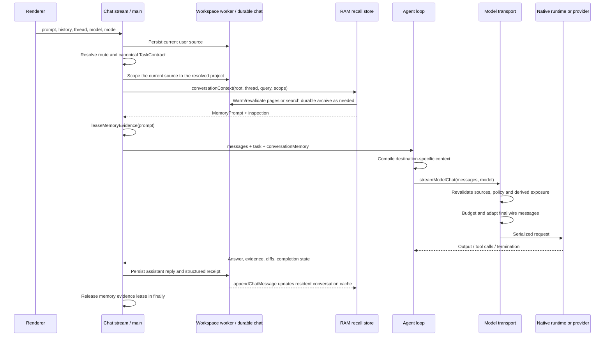

# Agent handoff and RAM context design

**Project:** Eris desktop IDE  
**Review date:** 2026-11-01  
**Source snapshot:** `d7a10fd` — Auto creative-chat and answer-repair changes, based on integrated v0.6.9 (`fbd91e8`).  
**Document status:** Implementation description, explicit limitations, and a separately labeled proposed next design. This document does not change runtime behavior or certify a live model.

## Source-version and publication notes

This is the preserved implementation review of `d7a10fd`, not a claim that every behavior below still describes latest main. Throughout this document, “current” refers to that source snapshot. Relative source links open the reader's checkout; use the pinned commit when comparing historical behavior.

Main `efcf7a1` already contains later connection-aware recall locality, Ollama window preparation, run-journal/context-pull tools, scaled context allocation, native tokenizer and placement work. In particular, section 6.3's native-only destination description is historical: later code recognizes loopback endpoints and explicit endpoint recall approval, independently of execution-locality policy.

[PR #280](https://github.com/EricServices-Repo/Eris/pull/280) adds automatic execution-model eligibility/ranking. [PR #281](https://github.com/EricServices-Repo/Eris/pull/281) adds coordinator/worker planning, bounded model-changing recovery and post-load dispatch validation/repacking. Those proposed changes supersede portions of sections 6, 7 and 12–13 when integrated. Their implementation document is included in that PR. Neither proposal should be assumed present in an installed binary.

The companion [handoff/RAM issue index](../reviews/handoff-ram-issues-2026-11-01.md) records the separately pinned follow-up audit and links its actionable GitHub tickets.

## 1. The central distinction

Eris has several different forms of context. They are not interchangeable, and they are not all handed to a delegated agent.

- **Durable conversation:** canonical chat messages and structured results stored through the workspace worker and chat database.
- **Recent chat history:** the recent conversation included in the current request. It is passed separately from optional RAM recall.
- **RAM recall store:** a bounded main-process cache of conversation rows, indexes, controls and derived facts. It is an acceleration and selection layer over durable history.
- **Selected recall:** a `MemoryPrompt` containing a small set of eligible historical excerpts for one request.
- **Task contract:** the current goal, interpretation, scope, authority and acceptance criteria. It controls what the agent may do; recalled text does not.
- **Agent handoff:** a structured coordinator-to-specialist assignment. It contains a task and a prose briefing, not the RAM store or a `MemoryPrompt`.
- **Worker transcript and compaction brief:** the current agent run's messages, tool observations and condensed progress. This is distinct from thread recall.
- **Native KV cache:** model-runtime state for a local session. It is not a durable conversation database and is not a shared semantic memory service.

**Current behavior:** the top-level chat selects RAM recall and passes it explicitly as `conversationMemory`. The inline and background specialist call sites do **not** pass that object or independently call `conversationContext`. A specialist receives its inherited task contract, its assignment and the handoff text. Relevant RAM-derived information reaches it only if represented in that text or other supplied evidence, subject to dispatch checks while a relevant evidence lease exists.

Source: [chat-stream.ts](../../electron/main/ipc/chat-stream.ts), [agent/loop.ts](../../electron/main/services/agent/loop.ts), [background-agents.ts](../../electron/main/services/background-agents.ts), [context-memory.ts](../../electron/main/services/context-memory.ts).

## 2. Runtime ownership and trust

### 2.1 Where each state lives

The renderer collects user input and displays messages. It does not own the main-process RAM recall store or directly give the native model access to memory addresses.

The main process owns chat orchestration, task contracts, `contextMemoryStore`, selected prompts, evidence leases, inference admission and dispatch accounting. The workspace worker performs canonical chat/database requests and archive operations. Local GGUF inference normally runs in a utility process; an in-process compatibility runtime also exists. Remote providers receive serialized messages through their provider transport.

A model sees text/tool structures assembled into a request. It does not read the RAM store directly. Sending to another model is therefore a new serialization and policy decision, even when both agents run inside the same desktop process.

### 2.2 Instruction and evidence hierarchy

`compileTaskContext` labels the task and Eris instructions as required authoritative/instruction blocks. Memory, project context and retrieval are evidence. The evidence text cannot expand the tool ceiling, change the selected project or replace the user's task.

The model-facing contract is derived from `TaskContract`; ledger-only details are not all copied to the model. The underlying contract retains the full scoped authority and trace data.

A prior assistant answer is not automatically observed truth. The recall selector labels ordinary assistant excerpts `unverified`; user statements are `user-stated`. Structured task receipts and evidence dependencies provide additional provenance for outcome claims.

Source: [agent/context-compiler.ts](../../electron/main/services/agent/context-compiler.ts), [task-intake.ts](../../electron/main/services/task-intake.ts), [context-memory-store.ts](../../electron/main/services/context-memory-store.ts).

## 3. Contracts passed through the pipeline

### 3.1 `MemoryPrompt`

The current type in [context-memory.ts](../../src/shared/context-memory.ts) contains:

```ts
type MemoryPrompt = {
  text: string
  manifest: MemoryManifest
  allowRemote: boolean
  namespace?: string
  items?: MemoryPromptItem[]
  evidenceToken?: string
  sourceVersion?: ContextHeader
}
```

`text` is rendered recall, not the entire conversation. `items` retain source identity, kind, ordinal, source span where available, the rendered line and optional evidence dependencies. `manifest` records coverage, selected/source IDs, omissions, recall tier and estimates. `evidenceToken` and `sourceVersion` support later revalidation.

`ContextHeader` contains revision, message count, source epoch, optional controls revision and optional derivation status. A revision/epoch mismatch means a retained snapshot cannot simply be trusted.

### 3.2 `AgentHandoffPacket`

[agent-orchestration.ts](../../src/shared/agent-orchestration.ts) defines:

```ts
interface AgentHandoffPacket {
  task?: TaskContract
  parentGoal?: string
  goal: string
  summary: string
  files?: string[]
  openQuestions?: string[]
  confidence?: number
  fromAgentId: string
  toAgentId: string
}
```

There is no `conversationMemory`, memory-item list, recall manifest, lease handle or durable source snapshot in this packet. `files` names leads; it does not copy those files into the child prompt. `confidence` is sender metadata, not independently verified correctness.

`formatHandoffForPrompt` renders the specialist identity, coordinator identity, parent request, assigned goal, task/scope/tool ceiling, summary, files, questions and confidence. It instructs the child to report to its coordinator rather than impersonate the final user-facing answer.

### 3.3 Compiled and dispatched context

`ContextBundle` records the task/namespace, estimated tokenization method, counts and per-item inclusion decisions. Per-item records use digests and positions rather than raw recalled source text.

`ContextDispatch` records what survived adaptation to the selected model. The difference matters: an item may be selected by recall, omitted by compilation, or removed before final provider dispatch. Selection is not proof of transmission.

Source: [context-dispatch.ts](../../electron/main/services/context-dispatch.ts), [agent/context-compiler.ts](../../electron/main/services/agent/context-compiler.ts).

## 4. Top-level chat: end-to-end sequence



### 4.1 Intake and recall ordering

The primary caller is [ipc/chat-stream.ts](../../electron/main/ipc/chat-stream.ts):

1. Persist the user message with a stable request-derived source ID; the path is designed to tolerate optimistic persistence using the same ID.
2. Resolve the turn and save its canonical task contract.
3. Associate the current user source with the task's resolved project.
4. When a thread and structured prompt are available, call `conversationContext` with the workspace root, thread, latest user text, project scope, current-user exclusion and IDs already covered by admitted recent history.
5. Save the returned prompt in the request-local `conversationMemory` variable, create an evidence lease and record `memory-selected` in the task ledger.
6. Build role/chat messages, then invoke the agent loop with that prompt explicitly supplied.

The current question is excluded from historical recall because it is already the active request. Complete recent sources are excluded from duplicate historical excerpts. The recent-history admission budgets used here are 6,000 characters in Agent mode and 24,000 in Ask mode; these are not model token limits.

A recall failure normally falls back to canonical recent history. User cancellation propagates instead of being silently converted into recall fallback.

## 5. RAM hydration, namespace and selection

### 5.1 Namespace identity

`memoryKey(root, thread)` hashes a JSON tuple containing:

- `userDataRoot()`;
- the workspace's resolved filesystem identity, or `null`;
- the registered workspace ID, or `null`;
- the thread ID.

This separates profiles/apps, workspaces and threads. A child worktree is not automatically the original conversation namespace. A future child recall design must explicitly map the original source workspace to the execution worktree; copying `sourceThreadId` alone is not that mapping.

### 5.2 Hydration and mutation consistency

`warmConversationMemory` uses profile settings for the process allocator and namespace settings for request-specific disclosure/scope/prompt limits. It shares pending loads per key and uses a hydration scheduler.

The loader reads a canonical header and memory controls, reserves memory before loading pages, and reads bounded worker pages. Pages are checked for compatible revision and source epoch. It tracks omitted metadata, partial coverage and corrupt records, yields between chunks, and rechecks the header before publishing the snapshot. A mixed or stale snapshot is abandoned rather than installed as complete history.

`appendChatMessage` writes through the worker and then calls `updateConversationMemory`. The store supports live overlap/incremental retention rather than assuming every append replaces the full transcript. Deletion and invalidation abort pending loads and clear the affected namespace.

The estimated transfer allowance is 4,000,000 bytes per worker page; the comment describes a page of at most 2 MB UTF-8 that can expand when decoded. These are accounting estimates, not a guarantee that JavaScript heap equals the logical ledger.

### 5.3 Selection algorithm

`ContextMemoryStore.select` reserves a scratch arena, pins the resident record snapshot, combines the caller's cancellation with a foreground deadline, and releases both in `finally`.

Selection uses lexical recall, not an LLM or a dense semantic embedding model:

1. Normalize a bounded query; only the first 8,192 query characters are analyzed.
2. Query postings for at most 24 terms, with at most 2,048 recent row IDs per term and 4,096 matched rows overall.
3. Add the most recent 256 salient rows and the latest 12 retained rows as candidates.
4. Exclude the current source, system rows, forgotten sources, rows before the clear boundary and rows outside the requested project scope.
5. Rank by term scores, salient-user bonus, unfinished-work bonus for continuation queries, and recency bonus. Keep a bounded top 128 ranked rows.
6. Avoid duplicate ordinary excerpts from sources already covered by complete recent history. Structured receipts can remain useful because they carry outcome state absent from prose.
7. Produce candidates for active/disputed decisions, user statements, previous answers/recommendations and structured task results. Sensitive-looking excerpts are skipped by a heuristic filter; that filter is not a complete data-loss-prevention system.
8. Consider eligible pins first, then ranked candidates. Use the configured prompt budget, whole-unit identity deduplication and bounded excerpts.

The selector renders at most 24 facts. Pins are limited to eight selected facts and half the recall-character budget. Individual rendered excerpts are capped at 1,200 characters. The initial row excerpt used for candidate generation can be up to 1,800 characters. Selection's simple character estimate is later checked by context compilation and transport budgeting.

The selector validates snapshot identity/generation after asynchronous work. If context changes during selection it returns unavailable context rather than publishing the stale selection.

Source: [context-memory-store.ts](../../electron/main/services/context-memory-store.ts), [context-recall-index.ts](../../electron/main/services/context-recall-index.ts), [recall-terms.ts](../../src/shared/recall-terms.ts).

### 5.4 Durable fallback and pressure tiers

The in-memory retained window is not the entire durable conversation. When coverage is partial, `conversationContext` can search the durable archive using a bounded temporary store, merge eligible results, and apply evidence filtering.

Under critical pressure it uses `recallWithoutRam`: acquire a bounded recovery reservation, read controls/header, search the archive where possible, select through a temporary bounded store, and fall back through durable history plus pins, pins, or recent canonical turns. Header/control versions must agree. Failure to access the archive does not automatically invalidate readable pins.

The ordinary archive path reserves 16,000,000 bytes or tries the bounded recovery allowance; the critical fallback uses the same 16,000,000-byte total recovery ceiling. This is a cap, not an unlimited per-agent emergency pool.

## 6. Agent to model: compiling and sending RAM recall

### 6.1 Answer-only path

The answer-only branch in [agent/loop.ts](../../electron/main/services/agent/loop.ts) compiles:

- the canonical task;
- tool-free task protocol;
- response contract and task plan;
- destination-eligible `conversationMemory`;
- prior system/project/conversation background.

It then appends non-system conversational messages. Generic creative requests remain answer-only and do not acquire edit authority merely because the surrounding app is an IDE.

### 6.2 Tool-worker path

`buildPreservedWorkerMessages` receives the same optional `conversationMemory`. It assembles shared instructions, workspace rules, active skills, custom role guidance, the current playbook and response contract. Project background and retrieval remain evidence. It compiles the system block and appends preserved conversational roles plus the active goal once.

Re-routing recompiles this context for the next worker model while retaining the canonical task and intersecting the next role's tool policy with that task. The destination gate is reevaluated for the new model rather than assuming the first model's eligibility remains valid.

### 6.3 Destination policy

`memoryForDestination` permits rendered recalled text for:

- native GGUF references recognized by `isNativeGgufRef`;
- the special simulated model only inside an active simulated diagnostics scope;
- other model destinations only when the prompt permits remote sharing.

When blocked, item metadata stays available for omission accounting but recalled text is withheld. A localhost OpenAI-compatible endpoint is not automatically treated as native/local by this predicate; the model reference and policy determine eligibility.

`shareWithRemoteModels` defaults to false. This policy governs the recalled-memory mechanism. It must not be described as a blanket promise that all recent user messages, attachments or independently supplied project context are withheld from a remotely selected model.

### 6.4 Context compiler budget

The compiler reserves 55% of its input-token budget for the assembled system context, using character/Unicode-aware estimation. Required task/instruction blocks must fit; it throws instead of silently cutting the task contract. Memory, project and retrieval blocks are optional and have inclusion/omission manifests.

When relevant current project evidence is present, the compiler orders required blocks first, then retrieval/project evidence, then historical memory. Historical memory is additionally capped to 40% of the remaining system-context allowance. This is intended to keep old conversation excerpts from displacing current source evidence.

Memory packing keeps whole rendered units that fit; it can skip a large item and retain a smaller later item. The compilation bundle is attached as internal metadata to the message for later accounting.

### 6.5 Last-boundary revalidation

Every `streamModelChat` call goes through `withEligibleMemory` before a live provider or diagnostics adapter receives the request. This includes agent steps, answer repair, compaction, rerouting and other callers using that transport.

For active leases it:

1. Rechecks the durable source header when a source version was recorded.
2. Clears/rewarms snapshots when revision, epoch, message count or controls revision changed.
3. Evaluates current enabled/disclosure settings; remote permission can narrow during a lease.
4. Revokes ineligible items and items whose evidence dependencies no longer match.
5. Removes the exact rendered memory units, including prefixes cut by earlier budget operations.
6. Records which items were actually exposed to a model.
7. Withholds potentially derived later messages when exposed private/revoked recall can no longer be sent to the destination.

Derived-output handling is conservative because there is no sentence-level lineage. Newly generated assistant messages, tool output and recompilations may all depend on previously exposed recall. For an incompatible derived cross-task recompilation, the dispatch code throws and asks for eligible sources to be rebuilt rather than transferring the child/review task blindly.

If revalidation revokes context for a native session, `streamModelChat` releases the local chat session so its seeded KV history cannot silently retain the removed text.

Source: [memory-dispatch.ts](../../electron/main/services/memory-dispatch.ts), [context-evidence.ts](../../electron/main/services/context-evidence.ts), [chat-runtime.ts](../../electron/main/services/chat-runtime.ts).

### 6.6 Final wire budgeting and serialization

`streamProviderChat` resolves current capabilities, accounts for tool schema costs, budgets the actual adapter representation and compiles messages for the selected protocol. Native tool-call/result IDs are validated; text-tool models receive envelopes instead.

`budgetModelMessages` preserves pinned system instructions and call/result structure. It shortens older tool evidence first, then narrower tool excerpts. It does not promise to fit an arbitrarily long conversation: when required instructions or the remaining conversation exceed the budget, it throws an actionable context-budget error rather than dropping arbitrary original intent.

The current capability calculation uses approximately 65% of the context ceiling for the prompt budget and up to 30% for reply reservation, subject to native reply ceilings. Provenance distinguishes measured allocation, runtime plan and configured ceiling. Most cross-provider accounting remains estimated rather than universally exact-tokenizer based.

Before a live provider request, internal `contextBundle` accounting is removed from the provider payload. Dispatch accounting retains hashes/counts and records which selected items actually survived adaptation.

### 6.7 Native model sessions and VRAM

The GGUF runtime loads the selected model, creates a context, and seeds structured message history. Worker sessions use keys such as `gguf:<jobId>`; specialist jobs use distinct IDs. Before inline delegation, compaction or rerouting, the parent releases its current GGUF session where the loop requires reseeding.

`messagesToLlamaHistory` maps system/user/assistant roles into native history. Reused sessions synchronize seed messages with `setChatHistory`; the KV cache does not replace the authoritative transcript. One-shot calls use structured history too.

VRAM context allocation can retry smaller windows after memory errors. Measured context size is recorded after load. **Remaining gap:** the first cold-load request can already have been budgeted against a larger plan before that measured allocation exists. RAM recall limits do not solve this ordering problem.

Source: [builtin-model.ts](../../electron/main/services/builtin-model.ts), [llama-worker.ts](../../electron/main/llama-worker.ts), [llama-session.ts](../../src/shared/llama-session.ts), [model-capabilities.ts](../../electron/main/services/model-capabilities.ts), [model-protocol.ts](../../electron/main/services/model-protocol.ts).

## 7. Agent to agent: inline specialists

```mermaid
sequenceDiagram
    participant Parent as Coordinator loop
    participant Contract as Child contract builder
    participant Child as Inline specialist loop
    participant Dispatch as Model dispatch
    Parent->>Parent: Parse delegate_to_agent(goal, summary, files, questions)
    Parent->>Contract: childTaskContract(parent, specialist plan, goal)
    Contract-->>Parent: Scoped child task with intersected authority
    Parent->>Parent: Release parent native session
    Parent->>Child: Child task + system handoff + user goal
    Note over Parent,Child: No conversationMemory argument is passed
    Child->>Dispatch: Compile child context and call selected model
    Dispatch->>Dispatch: Apply active evidence-lease policies
    Child-->>Parent: Answer, tools, diffs, incomplete state
    Parent->>Parent: Record done/unverified/failed/cancelled outcome
    Parent->>Parent: Append tool result; continue coordinator work
```

### 7.1 Dispatch and authority

The implementation chooses inline delegation when `options.jobId?.startsWith('chat:')` is true, after validating the target. This is a chat-run identity check, not a hard-coded whitelist of built-in agent IDs. Enabled custom agents can also reach this branch. It validates required fields and agent availability, refuses nested delegation when `allowDelegate` is false, plans the specialist, constructs a child task and intersects authority.

`childTaskContract`:

- assigns a new task ID and records `parentTaskId`;
- changes the child's original text and deliverable to the assigned subgoal;
- maps the parent's project-relative root into the child's execution workspace and rejects an escaping root;
- intersects tool levels with the parent;
- bounds edit, execution and external-effect permissions by the parent;
- removes the parent's continuation/result state and creates child acceptance criteria.

The inline branch sets both child chat/tools model fields to the current worker model. It is not an independent automatic model-choice request for every specialist. It passes approval callbacks and the cancellation signal, uses the current workspace, disables further child delegation, and reuses the MCP runtime.

### 7.2 What the child receives from RAM

The call supplies a system message rendered from the handoff packet and a user message containing the subgoal. It does **not** pass `options.conversationMemory`, call `conversationContext`, or grant direct access to the parent's RAM rows.

The coordinator's prose summary may restate recalled facts, but that is not equivalent to a typed recall transfer. Source IDs, item eligibility and coverage are not carried in a dedicated memory envelope. In this inline branch, the handoff's system text is treated as project/conversation background by subsequent compilation and can lose detail under optional-context budgets.

An active parent's process-local evidence lease can still restrict a child model call at `streamModelChat`, particularly when derived private context is transferred to a different destination/task. This is a dispatch restriction, not automatic child recall.

### 7.3 Returning results

The coordinator consumes child events directly:

- diffs update its changed-file tracking and invalidate prior verification as needed;
- tool observations become evidence summaries;
- an incomplete child is not recorded as successful fulfillment;
- nonempty prose without tool evidence is explicitly labeled unverified;
- failure/cancellation remains visible in delegation outcomes.

The result is returned as a tool observation to the parent worker. A child answer is not automatically persisted as a separate conversational RAM fact during this inline call. The final parent reply can later persist delegation details and a structured task receipt through the ordinary chat-save path.

Source: [agent/loop.ts](../../electron/main/services/agent/loop.ts), [task-intake.ts](../../electron/main/services/task-intake.ts), [agent-orchestration.ts](../../src/shared/agent-orchestration.ts).

## 8. Agent to agent: background delegation

The fallback delegation branch invokes `onDelegate`, which the chat/background runner uses to enqueue a background job. `delegateFromAgent` records a parent ID, source thread ID, model, agent ID, handoff, claim and worktree-inheritance choice.

A job may run in an inherited parent worktree or a newly prepared worktree. When execution begins it creates a child contract from `job.handoff.task` if available; otherwise it creates a new contract. The rendered handoff is prepended to the job goal in the input user message. This differs from the inline branch, which puts the handoff in a system message. The loop takes its canonical goal from the supplied child task; the larger user message can remain in conversation history when it does not exactly equal that goal. It is not a typed recall block.

The background runner likewise does not supply `conversationMemory` or initiate a fresh `conversationContext`/`leaseMemoryEvidence` for that source thread at the call site. `sourceThreadId` is association metadata, not a guarantee that prior chat RAM is recalled.

Queue acceptance is not task completion. `awaitChildJobs` and result-summary logic report required-child outcomes. Missing/failed results remain unresolved. Results from a separate worktree must be inspected/applied before the coordinator claims they changed the user's active workspace.

**Lifecycle limit:** a background child can outlive the top-level chat request. The parent's evidence lease is released when that chat's `finally` runs. A persisted prose handoff is not itself a persistent evidence lease or a complete derivation graph. Do not claim that the current code universally revalidates every RAM-derived sentence in an asynchronous handoff after the original lease ends.

Source: [background-agents.ts](../../electron/main/services/background-agents.ts), [agent-orchestration.ts](../../src/shared/agent-orchestration.ts), [memory-dispatch.ts](../../electron/main/services/memory-dispatch.ts).

## 9. Compaction and answer repair

### 9.1 Worker compaction

The loop can compact its active worker transcript separately from the RAM conversation store. It keeps the system context, builds a resume message, and retains a recent tail without splitting assistant tool calls from their results.

The progress brief is generated from the compacted middle plus the goal/action log/files and prior brief, or from a deterministic fallback. The summarizer input is bounded, weighted toward newer messages and reports omitted/shortened coverage. Reference validation failures can force the local fallback. Model-based summarization still uses the common transport and its active memory checks.

After replacing the transcript, the loop releases the GGUF session so the new transcript is reseeded. Compaction does not expand RAM retention, restore forgotten history or convert unverified old assistant claims into observations.

### 9.2 Answer repair in this snapshot

`finalizeAnswer` now preserves original system blocks and conversation roles when repairing protocol output or a qualifying unexplained creative refusal. It appends the current goal once and retains its presentation audit. Creative recovery is bounded; repeated unexplained rejection remains incomplete. Explicit safety refusals are not retried by this specific mechanism.

This code is part of source snapshot `d7a10fd`. It must not be assumed present in an installed v0.6.9 binary simply because the documentation is being read from this branch.

## 10. Memory pressure, retention and defaults

The process governor accounts for native/model reservations together with optional context memory. The RAM store exposes estimated owned, reserved and pinned bytes; these are not the operating system's exact RSS or heap readings. Renderer-retained history is charged separately into the shared envelope.

Normal/constrained pressure reduces the optional store allowance. Critical pressure sets the ordinary allowance to zero and aborts pending hydration, while the separately bounded recovery path can still try durable recall/pins. macOS sampling includes reclaimable counters and OS pressure; ordinary platform free-memory readings remain a fallback. Already-resident model allocations and pending native allocations are distinguished to avoid charging the same loaded weights as a new allocation on every generation.

Defaults from `ContextMemorySettingsSchema`:

- Enabled: true.
- Process memory ceiling: 128 MiB; schema range 16–512 MiB.
- Per-thread ceiling: 32 MiB; range 4–128 MiB.
- Retained message cap: 25,000; range 500–100,000.
- Warm threads: eight; range one–16.
- Idle expiry: 30 minutes; range one–120.
- Foreground recall deadline: 150 ms; range 25–2,000 ms.
- Optional recall prompt budget: 1,024 estimated tokens; range 128–4,096.
- Share recalled memory with remote models: false.

These are schema defaults, not a statement that a user's saved configuration has those values. The active pressure allowance can be lower than configured retention. A 100,000-message durable conversation does not imply all messages are retained in RAM or sent to a model.

## 11. Persistence, observability and inspection

Assistant persistence records the visible answer, model/agent identity, delegation details, assets and a `contextResult` containing task ID, terminal state, working-state snapshot, evidence dependencies, project root and bounded changed-file list. The worker commit then refreshes the RAM cache.

The ledger can record `route-decision`, `memory-selected`, `context-compiled`, `memory-revoked`, `derived-context-withheld`, delegation outcomes and answer-presentation/repair events. A context compilation manifest is not equivalent to a final outbound dispatch record.

`context-dispatch.ts` keeps bounded latest-dispatch and compiler-snapshot caches. It retains at most 64 latest namespace dispatch entries and eight compiler snapshots with a two-minute lifetime; recalled memory is excluded from the compiler snapshot cache. Preview recompiles a matching task snapshot when possible and otherwise labels itself an estimate. This is separate from durable conversation storage.

Useful inspection questions:

1. Was a task resolved for the correct thread/project and destination?
2. Did recall return complete, partial, unavailable or disabled coverage?
3. Which source IDs were selected, and which were already covered by recent history?
4. Which items survived the compiler and final transport?
5. Was a destination-policy or source-revocation decision responsible for omission?
6. Did the child receive a packet only, or a newly selected memory prompt? In current delegation call sites the answer is packet only.
7. Was the model context measured or only planned at dispatch time?
8. Did the job finish, merely queue a child, or return an unverified claim?

## 12. Current limitations that affect design decisions

1. **No automatic child recall.** Neither delegation call site directly forwards/reselects the parent's `MemoryPrompt`.
2. **Untyped handoff prose.** Inline handoff text competes with optional project context. Background handoff text is supplied in a user message and is subject to transcript/compaction and final-wire limits instead. Neither form is a required typed memory transfer.
3. **No complete persistent derivation lineage.** Active dispatch leases conservatively protect exposure, but are not a universal source graph spanning every persisted asynchronous job.
4. **Cold-load capacity ordering.** The first request can be compiled before actual native context size is known.
5. **Estimated tokens and memory bytes.** Declared capabilities do not make every estimate a native tokenizer or exact allocator measurement.
6. **Bounded lexical recall.** Relevant paraphrases may not match; retention and candidate caps intentionally limit the search space.
7. **Prompt-only evidence is not tool observation.** A summary or previous answer cannot prove a file changed or a check passed.
8. **Scripted tests do not certify live quality.** Passing contract tests does not prove coherent storytelling or correct multi-agent implementation on a real model.

## 13. Proposed next design — not implemented

The following describes a production-oriented extension, not the behavior of `d7a10fd`.

### 13.1 A typed child context envelope

Add a small persisted envelope to the handoff: original source workspace/thread IDs, parent/child task IDs, source/header/control versions, relevant memory-item IDs, parent constraints, permitted destination classes, provenance and omitted-evidence coverage. Do not serialize the entire RAM store, bearer credentials or a raw evidence lease into a background job.

Parent constraints and scoped authority must be separate from evidence. The child cannot promote a recalled quotation or summary to an instruction. The execution worktree/project mapping must be explicit and validated.

### 13.2 Reselect and lease for each child

At child start:

1. Validate the parent task and source/execution workspace mapping.
2. Read current canonical header and current memory controls.
3. Select context for the child subgoal from the original source namespace; intersect policy with the parent's disclosure constraints.
4. Create a child-owned evidence lease lasting until child completion, cancellation or failure.
5. Compile a bounded handoff block plus selected evidence for the actual child model.
6. Record omitted source coverage and block/request missing evidence when a required parent constraint cannot fit.

A background restart must repeat these steps. A queued job must not rely on an already-released parent lease.

### 13.3 Receipt-based return context

Return a typed receipt containing status, source references, tool observations, changed files, verification results and unresolved questions. Preserve the distinction between observed, user-stated and unverified material. The parent should integrate facts from that receipt rather than treating every sentence in the child summary as verified.

Attach derivation references before persisting a child/parent result, so later deletion, source edits or disclosure changes can invalidate derived evidence across asynchronous lifetimes.

### 13.4 Load before final native budgeting

For native models, obtain measured context allocation before final message compilation. Re-run destination filtering and budgeting after load/recovery. Fail explicitly when required task/constraint content cannot fit, and report which optional evidence was omitted. KV reuse must remain an optimization over reseedable canonical messages.

### 13.5 Qualification requirements

Use both deterministic and opt-in live cases:

- parent recalls a fact outside recent history; child needs that exact fact;
- child receives only task-relevant recall, with cross-project sources excluded;
- parent is cancelled while a background child continues;
- a pin is edited/forgotten while a child is queued or generating;
- local-only recall is followed by a remote reroute or remote reviewer;
- a dependent source file changes before final dispatch;
- critical pressure evicts RAM but durable/pinned fallback remains bounded;
- a cold model allocates less context than the plan;
- worker compaction/recreation reseeds without stale private text;
- a child returns prose claiming changes without tool evidence;
- a story request and follow-up retain characters/tone without acquiring workspace effects.

Live reports should capture the exact source SHA, model/runtime identity, resolved task, selected/omitted source IDs, dispatch manifest, actual completion state and measured resource data where available. Do not label deterministic simulation as hardware/live-model certification.

## 14. Code and test reading map

For the shortest faithful walkthrough, read these in order:

1. [ipc/chat-stream.ts](../../electron/main/ipc/chat-stream.ts): request intake, selection/lease, loop call, final persistence/release.
2. [context-memory.ts](../../electron/main/services/context-memory.ts): namespace, hydration, recall, archive/pressure fallback.
3. [context-memory-store.ts](../../electron/main/services/context-memory-store.ts): retention, reservations, indexes, selection and manifests.
4. [src/shared/context-memory.ts](../../src/shared/context-memory.ts): policy and memory/dispatch contracts.
5. [agent/context-compiler.ts](../../electron/main/services/agent/context-compiler.ts): trust, destination gate, system budgeting and accounting.
6. [agent/prompts.ts](../../electron/main/services/agent/prompts.ts): worker context construction.
7. [agent/loop.ts](../../electron/main/services/agent/loop.ts): answer/tool branches, inline delegation, compaction and result integration.
8. [task-intake.ts](../../electron/main/services/task-intake.ts): child task authority/scope inheritance.
9. [src/shared/agent-orchestration.ts](../../src/shared/agent-orchestration.ts): handoff packet and result formatting.
10. [background-agents.ts](../../electron/main/services/background-agents.ts): queued delegation and worktree execution.
11. [memory-dispatch.ts](../../electron/main/services/memory-dispatch.ts): source/policy revalidation, revocation and exposure/derived-context handling.
12. [chat-runtime.ts](../../electron/main/services/chat-runtime.ts), [model-protocol.ts](../../electron/main/services/model-protocol.ts): final filtering, budgeting and provider serialization.
13. [builtin-model.ts](../../electron/main/services/builtin-model.ts), [llama-worker.ts](../../electron/main/llama-worker.ts), [src/shared/llama-session.ts](../../src/shared/llama-session.ts): native load/context/session behavior.
14. [context-dispatch.ts](../../electron/main/services/context-dispatch.ts): preview and actual-send accounting.

Relevant executable specifications include [agent-context.test.ts](../../tests/agent-context.test.ts), [agent-conversation.test.ts](../../tests/agent-conversation.test.ts), [agent-orchestration.test.ts](../../tests/agent-orchestration.test.ts), [memory-dispatch.test.ts](../../tests/memory-dispatch.test.ts), [context-dispatch.test.ts](../../tests/context-dispatch.test.ts), [context-critical-pressure.test.ts](../../tests/context-critical-pressure.test.ts), [model-context-allocation.test.ts](../../tests/model-context-allocation.test.ts), [agent-sessions.test.ts](../../tests/agent-sessions.test.ts) and [agent-creative-chat.test.ts](../../tests/agent-creative-chat.test.ts).


## 15. Worked example: parent recalls a booking constraint

Assume the durable thread contains the user's pinned instruction “Booking prices use GBP,” the selected parent request is to finish booking confirmation, and the pin is admitted within the current recall budget.

1. The current user request is saved and the booking project's task scope is resolved.
2. `conversationContext` loads the thread's controls and eligible sources. The admitted pin is rendered as a marked `pinned` memory item with a source identity.
3. The top-level request leases that item and passes `conversationMemory` to the coordinator loop.
4. For a native model, `memoryForDestination` can admit the text. For a remote model with sharing disabled, the text is omitted and the bundle explains the destination-policy omission.
5. The coordinator reads the admitted context, edits the booking feature and calls `delegate_to_agent` with goal “Review the booking confirmation change.”
6. The child task inherits the booking scope and cannot exceed the coordinator's authority. A reviewer retains a non-editing ceiling.
7. If the coordinator's handoff summary says “Keep displayed prices in GBP,” the reviewer can receive that sentence as handoff text. If the coordinator omits it, the inline call does not automatically reselect the pin from RAM. The child's source inspection may still discover the currency in files, but RAM inheritance cannot be assumed.
8. The reviewer reports findings and tool evidence. The coordinator integrates the result, verifies as appropriate and posts the user-facing answer.
9. The parent reply and its structured result/delegations are saved to canonical chat, which updates the RAM cache. Later recall can select eligible material from that saved result; this is a new selection, not permanent model memory.
10. The parent's evidence lease ends when the request exits. Any background work still running needs its own future lifecycle/provenance mechanism for the guarantees described in section 13.

This example illustrates a current limitation, not permission to paste local-only memory into any destination. Active dispatch checks still apply, and a handoff summary cannot override user privacy settings or task authority.
