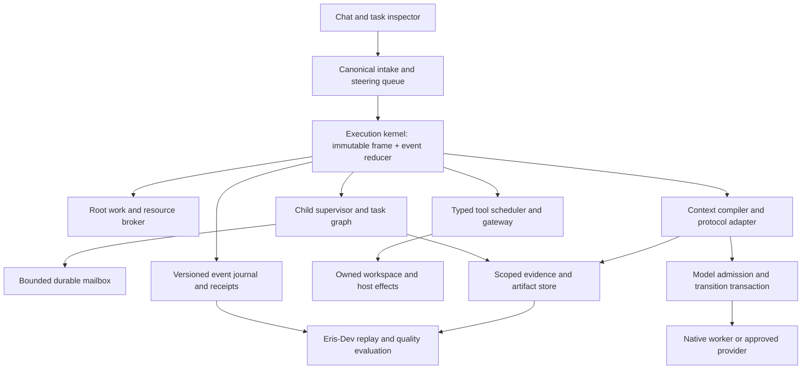
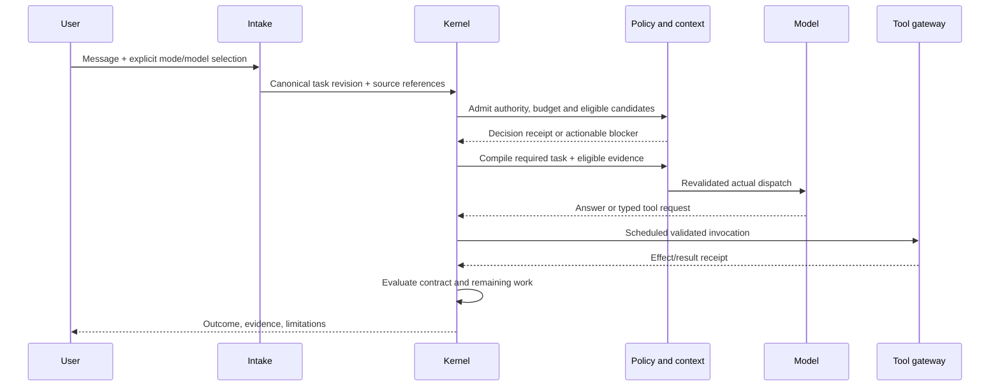

# Eris agent-runtime enhancement architecture

**Status:** proposed architecture and implementation backlog; no runtime changes made by this review.

**Reviewed:** 2026-11-01. **Eris source baseline:** `0a54629d0ea74fdb68680c6ae431246267e8229c`, package `0.6.10`. **Reference baseline:** `tanbiralam/claude-code` at `6f6f12b37f529488b10e53928dd5508bb93535c7` (2026-05-06).

## 1. Purpose and review boundaries

This document translates inspected agent-runtime patterns into an Eris-specific architecture. It is intended for coding agents and maintainers implementing improvements in small, verifiable changes. The central objective is reliable execution of the user's actual request: preserve intent, delegate bounded work, send eligible context to an appropriate model, execute authorized tools, and report outcomes backed by evidence.

The review examined the reference repository's recursive tree, README, build configuration and approximately 45 selected source files around query orchestration, tool execution, subagents, task messaging, memory and compaction. It also examined Eris's current implementation and updated architecture guides. This is a bounded static review, not a complete audit of either repository. Neither reference code nor its dependencies were executed. No live model quality, latency, GPU safety or packaged application results are claimed.

The reference README describes reconstructed source with substituted internal dependencies. Some inspected modules contain substantive implementations; others are stubs. For example, `src/query/transitions.ts` supplies placeholder transition interfaces, while query state and control flow live elsewhere. A pure replayable reducer proposed here is an original Eris design, not an implemented feature proved by that stub. Feature flags and unavailable dependencies also mean a source path does not establish that a feature works in a runnable build. [Reference provenance](https://github.com/tanbiralam/claude-code/blob/6f6f12b37f529488b10e53928dd5508bb93535c7/README.md), [transition stub](https://github.com/tanbiralam/claude-code/blob/6f6f12b37f529488b10e53928dd5508bb93535c7/src/query/transitions.ts).

The Eris package version is insufficient provenance: published `v0.6.10` points to older source `f14e409`, while the reviewed checkout includes later context and cancellation fixes. Every implementation PR and diagnostic export must record the source SHA and schema versions. This proposal neither moves a release tag nor assumes a user's installed binary contains the reviewed fixes.

### 1.1 Highest-value changes

1. Extract a replayable execution kernel from the large orchestration loop, retaining existing completion and permission gates.
2. Give each task tree a shared work/resource budget, durable scoped evidence ownership and explicit cancellation semantics.
3. Unify tool invocation, scheduling and result receipts so interrupted or retried work cannot silently become duplicate edits or fabricated evidence.
4. Introduce bounded agent messages and versioned handoff/return contracts, with fresh validation on resume and model changes.
5. Connect Eris-Dev to exact dispatched requests, effect receipts and deterministic replay; use paired live evaluations to measure whether model routing and prompts actually improve outcomes.

These are architectural packages, not claims that changing prompts alone will improve a weak model. Better orchestration can remove wrong instructions, lost context and wasted loops. It cannot guarantee that every model completes every task.

### 1.2 Reading order and implementation discipline

Read Sections 2–5 before selecting a package. Section 6 contains 40 individually scoped work packages. Sections 7–11 define persistence, resource limits, testing, rollout and acceptance. The companion JSON is an index of the same packages; this Markdown is the normative design narrative.

Labels used below:

- **Existing:** supported by the reviewed Eris code; preserve it.
- **Reference:** an inspected implementation pattern at the pinned external source.
- **Proposal:** a new contract or change for Eris, requiring implementation and qualification.
- **Acceptance debt:** code exists, but broader lifecycle or hardware evidence remains incomplete.

Do not convert every proposal into a duplicate GitHub issue. Reconcile existing issue IDs, source changes and executable acceptance first. A package can require several PRs, and one existing issue can cover only part of a package.

## 2. Eris foundations that should remain

### 2.1 Chat, routing and execution

[Chat intake](../../electron/main/ipc/chat-stream.ts) already creates structured plans and task contracts. [The agent workflow](../../electron/main/services/agent/workflow.ts) enforces observable completion conditions; an edit request cannot be satisfied solely by listing suggestions. [The agent loop](../../electron/main/services/agent/loop.ts) combines tools, recovery, context and model transport. Its roughly 4,474 lines at this baseline indicate a difficult orchestration boundary, not proof that every branch is defective.

[Automatic model policy](../../electron/main/services/auto-model-policy.ts) already filters eligibility before ranking. Auto-local enforces local execution eligibility; Fixed pins execution; Lite can coordinate an actual worker handoff. Recovery is bounded and can choose a different eligible local model. Model identity, telemetry freshness and declared capabilities already participate in routing. Do not reintroduce name-only selection or send local-only context to a remote model because its score is higher.

[Model transitions](../../electron/main/services/agent/model-transition.ts) already prepare resource-safe changes, preserve task identity and avoid replaying completed edits. Final dispatch checks and measured native preparation already exist. The proposal extends their transaction records and acceptance coverage rather than replacing them with a second selector.

### 2.2 Tools and effects

[Tool registry](../../electron/main/services/tool-registry.ts), [gateway](../../electron/main/services/agent/tool-gateway.ts) and protocol validation already enforce structured inputs, authority and tool/result pairing. Deferred tool discovery already exists. The loop can parallelize an entirely read-safe batch with a cap of four; mixed batches currently fall back to serial execution. [Project scheduling](../../electron/main/services/agent/task-scheduler.ts) serializes overlapping canonical project roots. Mutation checkpoints, freshness checks and owned host commands are established boundaries.

The proposed scheduler must preserve those rules. A declaration that a tool is read-only is not sufficient to grant concurrency if the implementation calls a stateful provider, consumes a shared GPU or reads a changing workspace snapshot.

### 2.3 RAM, evidence and children

[RAM context](../../electron/main/services/context-memory.ts) and [store](../../electron/main/services/context-memory-store.ts) implement bounded recall over durable conversation history. RAM recall, canonical chat, run journals, task contracts and native KV are separate resources. A child does not automatically inherit the parent's `MemoryPrompt` or RAM contents.

The current source includes request-owned evidence scopes, bounded inherited requirements, protected handoff constraints, dependent-child cancellation and pre-admitted run-journal allocations. These fixes must survive refactoring. Remaining work includes durable child provenance beyond the parent lease, aggregate tree budgets, source-backed child handles and replay of the complete multiagent lifecycle. [Detailed current handoff](AGENT-HANDOFF-AND-RAM-CONTEXT.md), [current model execution](AUTO-MODEL-EXECUTION.md), [RAM target architecture](../RAM-CONTEXT-ARCHITECTURE.md).

### 2.4 Diagnostics

[Eris-Dev capture](../../electron/dev/capture.ts), [live runs](../../electron/dev/runs.ts), [scenario adapter](../../electron/dev/scenario-adapter.ts), [memory replay](../../electron/dev/memory-replay.ts) and [quality runs](../../electron/dev/quality-runs.ts) already distinguish simulated requests from real inference. Batches of ten and bounded concurrency are useful existing controls. The current live adapter's model pinning means it cannot, by itself, establish that production Auto selected the correct worker. Common-transport capture also does not prove byte-for-byte identity with every final provider/native representation.

## 3. Reference patterns and adaptation boundaries

The following catalog identifies inspected source, not a recommendation to transplant modules. Pinned links are retained so another coding agent can verify the observation.

### S01. Query state, immutable config and explicit dependencies

The query path separates stable configuration from evolving execution state; the engine owns session-level behavior. Eris should adopt explicit ownership and deterministic seams while preserving its own task contracts.

[src/query.ts](https://github.com/tanbiralam/claude-code/blob/6f6f12b37f529488b10e53928dd5508bb93535c7/src/query.ts), [src/query/config.ts](https://github.com/tanbiralam/claude-code/blob/6f6f12b37f529488b10e53928dd5508bb93535c7/src/query/config.ts), [src/query/deps.ts](https://github.com/tanbiralam/claude-code/blob/6f6f12b37f529488b10e53928dd5508bb93535c7/src/query/deps.ts), [src/QueryEngine.ts](https://github.com/tanbiralam/claude-code/blob/6f6f12b37f529488b10e53928dd5508bb93535c7/src/QueryEngine.ts).

### S02. Typed tool lifecycle

Tool definitions describe schemas, validation, permissions and interruption/concurrency traits. Eris should extend its current registry, with fail-closed host policy remaining authoritative.

[src/Tool.ts](https://github.com/tanbiralam/claude-code/blob/6f6f12b37f529488b10e53928dd5508bb93535c7/src/Tool.ts), [src/services/tools/toolExecution.ts](https://github.com/tanbiralam/claude-code/blob/6f6f12b37f529488b10e53928dd5508bb93535c7/src/services/tools/toolExecution.ts).

### S03. Batch and streaming scheduling

Consecutive safe calls can execute concurrently; streaming execution tracks queued through yielded states. One inspected streaming path does not support concurrent context modifiers, so deterministic merging still needs an explicit Eris design.

[src/services/tools/toolOrchestration.ts](https://github.com/tanbiralam/claude-code/blob/6f6f12b37f529488b10e53928dd5508bb93535c7/src/services/tools/toolOrchestration.ts), [src/services/tools/StreamingToolExecutor.ts](https://github.com/tanbiralam/claude-code/blob/6f6f12b37f529488b10e53928dd5508bb93535c7/src/services/tools/StreamingToolExecutor.ts).

### S04. Subagent creation and context

Execution context and agent identity are explicit. Full transcript forks and detached asynchronous controllers are not appropriate defaults for Eris scoped local execution.

[src/tools/AgentTool/runAgent.ts](https://github.com/tanbiralam/claude-code/blob/6f6f12b37f529488b10e53928dd5508bb93535c7/src/tools/AgentTool/runAgent.ts), [src/tools/AgentTool/forkSubagent.ts](https://github.com/tanbiralam/claude-code/blob/6f6f12b37f529488b10e53928dd5508bb93535c7/src/tools/AgentTool/forkSubagent.ts).

### S05. Resume and role memory

Resume reconstructs selected execution state; agent memory snapshots have their own lifecycle. Eris must independently revalidate source access, authority and worktree identity.

[src/tools/AgentTool/resumeAgent.ts](https://github.com/tanbiralam/claude-code/blob/6f6f12b37f529488b10e53928dd5508bb93535c7/src/tools/AgentTool/resumeAgent.ts), [src/tools/AgentTool/agentMemorySnapshot.ts](https://github.com/tanbiralam/claude-code/blob/6f6f12b37f529488b10e53928dd5508bb93535c7/src/tools/AgentTool/agentMemorySnapshot.ts).

### S06. Agent messages and durable mailbox

Recipient state, shutdown and plan messages have typed paths; mailbox writes coordinate access. Eris should use its durable-store conventions, bounded delivery and cancellation ownership.

[src/tools/SendMessageTool/SendMessageTool.ts](https://github.com/tanbiralam/claude-code/blob/6f6f12b37f529488b10e53928dd5508bb93535c7/src/tools/SendMessageTool/SendMessageTool.ts), [src/utils/teammateMailbox.ts](https://github.com/tanbiralam/claude-code/blob/6f6f12b37f529488b10e53928dd5508bb93535c7/src/utils/teammateMailbox.ts).

### S07. Tasks and steering

Task ownership/dependencies and prioritized queued messages are distinct concerns. Eris should connect their lifecycles without treating a message or status string as proof of a completed effect.

[src/utils/tasks.ts](https://github.com/tanbiralam/claude-code/blob/6f6f12b37f529488b10e53928dd5508bb93535c7/src/utils/tasks.ts), [src/tools/TaskUpdateTool/TaskUpdateTool.ts](https://github.com/tanbiralam/claude-code/blob/6f6f12b37f529488b10e53928dd5508bb93535c7/src/tools/TaskUpdateTool/TaskUpdateTool.ts), [src/utils/messageQueueManager.ts](https://github.com/tanbiralam/claude-code/blob/6f6f12b37f529488b10e53928dd5508bb93535c7/src/utils/messageQueueManager.ts).

### S08. Oversized tool results

Oversized output can become a persisted reference, with replacement state reused on resume. Eris needs bounded content admission and source-aware handles rather than unbounded transcript copies.

[src/utils/toolResultStorage.ts](https://github.com/tanbiralam/claude-code/blob/6f6f12b37f529488b10e53928dd5508bb93535c7/src/utils/toolResultStorage.ts).

### S09. Compaction boundaries

Compaction and grouping preserve useful query boundaries. Eris needs its own pending-tool and provenance invariants across native and text protocols.

[src/services/compact/microCompact.ts](https://github.com/tanbiralam/claude-code/blob/6f6f12b37f529488b10e53928dd5508bb93535c7/src/services/compact/microCompact.ts), [src/services/compact/autoCompact.ts](https://github.com/tanbiralam/claude-code/blob/6f6f12b37f529488b10e53928dd5508bb93535c7/src/services/compact/autoCompact.ts), [src/services/compact/grouping.ts](https://github.com/tanbiralam/claude-code/blob/6f6f12b37f529488b10e53928dd5508bb93535c7/src/services/compact/grouping.ts).

### S10. Cache attribution

Prompt/schema stability and cache-break attribution are explicit concerns. Provider cache observations must remain separate from Eris native KV measurements and permissions.

[src/services/api/promptCacheBreakDetection.ts](https://github.com/tanbiralam/claude-code/blob/6f6f12b37f529488b10e53928dd5508bb93535c7/src/services/api/promptCacheBreakDetection.ts), [src/utils/toolSchemaCache.ts](https://github.com/tanbiralam/claude-code/blob/6f6f12b37f529488b10e53928dd5508bb93535c7/src/utils/toolSchemaCache.ts).

### S11. Retries and stop conditions

Retries, stop hooks and token budgets are separate controls. Eris should use finite recovery and evidence-based progress, without treating token consumption as task completion.

[src/services/api/withRetry.ts](https://github.com/tanbiralam/claude-code/blob/6f6f12b37f529488b10e53928dd5508bb93535c7/src/services/api/withRetry.ts), [src/query/stopHooks.ts](https://github.com/tanbiralam/claude-code/blob/6f6f12b37f529488b10e53928dd5508bb93535c7/src/query/stopHooks.ts), [src/query/tokenBudget.ts](https://github.com/tanbiralam/claude-code/blob/6f6f12b37f529488b10e53928dd5508bb93535c7/src/query/tokenBudget.ts).

### S12. Trace and file evidence

Attribution, bounded file-state caching and structured tool errors offer useful design patterns. Trace context must not become an authority token.

[src/utils/agentContext.ts](https://github.com/tanbiralam/claude-code/blob/6f6f12b37f529488b10e53928dd5508bb93535c7/src/utils/agentContext.ts), [src/utils/fileStateCache.ts](https://github.com/tanbiralam/claude-code/blob/6f6f12b37f529488b10e53928dd5508bb93535c7/src/utils/fileStateCache.ts), [src/utils/toolErrors.ts](https://github.com/tanbiralam/claude-code/blob/6f6f12b37f529488b10e53928dd5508bb93535c7/src/utils/toolErrors.ts).

### S13. Scoped context and memory selection

Static conversation context and relevance selection have separate paths. Eris should maintain freshness and locality; a model-based selector must not create an implicit remote request.

[src/context.ts](https://github.com/tanbiralam/claude-code/blob/6f6f12b37f529488b10e53928dd5508bb93535c7/src/context.ts), [src/memdir/findRelevantMemories.ts](https://github.com/tanbiralam/claude-code/blob/6f6f12b37f529488b10e53928dd5508bb93535c7/src/memdir/findRelevantMemories.ts).

### S14. Plan, verification and extension events

Planning, verification and lifecycle extension points are explicit. Eris should bind approvals to exact revisions and keep verification bounded and evidence-backed.

[src/tools/EnterPlanModeTool/EnterPlanModeTool.ts](https://github.com/tanbiralam/claude-code/blob/6f6f12b37f529488b10e53928dd5508bb93535c7/src/tools/EnterPlanModeTool/EnterPlanModeTool.ts), [src/tools/AgentTool/built-in/verificationAgent.ts](https://github.com/tanbiralam/claude-code/blob/6f6f12b37f529488b10e53928dd5508bb93535c7/src/tools/AgentTool/built-in/verificationAgent.ts), [src/utils/hooks/hookEvents.ts](https://github.com/tanbiralam/claude-code/blob/6f6f12b37f529488b10e53928dd5508bb93535c7/src/utils/hooks/hookEvents.ts).

## 4. Target architecture

### 4.1 Component responsibilities



The kernel is a logical orchestration module in the main process initially. Do not simultaneously move it to a new process, replace persistence and change routing behavior. Native inference remains in its existing runtime boundary; workspace/database work remains with its current owners. An off-heap context process is a separate measured optimization, not a prerequisite for correct handoff.

The reducer accepts a state and a validated event and returns a next state plus commands. Commands are requests to effect adapters; they cannot directly mutate a workspace. Adapters report receipts as subsequent events. Existing `AgentWorkflow` remains the outcome gate during migration and can later become a composed reducer. Keep the UI timeline as a projection, not the only authoritative execution state.

### 4.2 Proposed execution contracts

The following TypeScript describes target shapes, not existing APIs or copy-paste-ready production code. IDs are opaque, serialized forms are versioned, and ingress validation uses exhaustive discriminated unions. Numeric counters are nonnegative safe integers. Persisted data is validated before being trusted.

```ts
type ExecutionFrameV1 = Readonly<{
  version: 1
  runId: string
  rootTaskId: string
  taskId: string
  parentTaskId?: string
  taskRevision: number
  sourceConversation: { namespaceId: string; threadId: string; sourceEpoch: number }
  executionWorkspace: { workspaceId: string; canonicalRootId: string; worktreeId?: string }
  authorityRef: { id: string; revision: number; digest: string }
  policyRef: { id: string; revision: number }
  modelPolicy: 'fixed' | 'auto-local' | 'auto-any'
  fixedModelIdentity?: string
  budgetLeaseId: string
  evidenceLeaseIds: readonly string[]
  promptProfileRevision: string
  toolSchemaEpoch: string
}>

type KernelEventV1 =
  | { version: 1; kind: 'request.accepted'; seq: number; frame: ExecutionFrameV1 }
  | { version: 1; kind: 'tool.receipt'; seq: number; invocationId: string; receiptId: string }
  | { version: 1; kind: 'model.failed'; seq: number; failureId: string }
  | { version: 1; kind: 'steering.received'; seq: number; messageId: string }
  | { version: 1; kind: 'child.returned'; seq: number; taskId: string; receiptId: string }
  | { version: 1; kind: 'stop.requested'; seq: number; subtreeRoot: string }
// Production unions also cover admission, model/tool start/end, approvals,
// persistence, compaction, integration, verification and terminal outcomes.

type KernelDecision = Readonly<{
  nextState: KernelState
  commands: readonly EffectCommand[]
  expectedStateRevision: number
}>
```

`KernelState`, `EffectCommand` and the omitted union branches must be specified together in R01. A timestamp, random ID or model result is an injected event, never a hidden reducer read. A repeated event ID is ignored only when its payload digest matches; a collision is a corruption signal. Sequence numbers belong to a single run, while parent/child correlation is explicit.

Trace identity is for attribution. Authority is a separately validated reference, resolved at every effect or dispatch boundary. Do not encode a renderer-provided filesystem path or role name as sufficient permission. A context handle is not a capability to run a command.

### 4.3 Chat to agent



A story request is an answer task unless the user asks to create or edit a file. A code review remains non-mutating unless the user requests implementation. “Add those improvements” binds to the relevant structured recommendation set and source conversation; it does not inherit arbitrary text from another project or a nearby worker transcript. If the reference is ambiguous, request the smallest missing clarification while preserving useful completed inspection.

An Auto role choice and model policy are separate decisions. A semantic coordinator may suggest a role; the host remains responsible for task authority, available model admission, tool ceilings and delivery. Do not run a second coordinator call when deterministic intake already resolved an unambiguous request.

### 4.4 Agent to agent

A parent creates a bounded handoff, not a new unrestricted chat. The supervisor admits the child against the root budget, descendant limits, workspace state, source leases and model policy. It persists the assignment before acknowledging durable acceptance. Inline execution uses the same envelope and receipts as background execution; the only difference is scheduling and lifetime.

Children receive the goal, required constraints, allowed effects, acceptance conditions and authorized evidence handles. They do not receive the entire parent transcript by default. A mailbox message can add evidence or ask for clarification, but it cannot expand authority or replace the canonical task. Changes requiring new authority return to the host/user decision path.

A child returns a typed receipt with observed facts, artifact/effect references, verification, unresolved questions and explicit limitations. The parent checks source and workspace versions before integration. Child prose is useful explanation; only validated receipts can satisfy completion criteria. Stopped children cannot be revived merely because a late message arrives.

### 4.5 Agent to model and RAM

A model sees a serialized request, not direct RAM access. Compile required task and authority blocks first, then eligible history, source evidence and tool output within the measured budget. Preserve provenance outside model prose. Keep canonical conversation unchanged when selecting a smaller context window or switching models.

Admission has two stages: estimate before loading, then measure after acquiring the actual runtime allocation. Before dispatch, re-resolve source epochs, privacy controls, tool eligibility and model destination. Recompile if an optional source changed; block if an essential approved source became unavailable. Existing late validation is the starting point.

When switching, record `proposed → preparing → prepared → committed` or `failed`; keep task/effect identity stable. A failed preparation cannot be reported as a successful worker handoff. For native sessions, invalidate KV when required source material was revoked. The transition and actual dispatch receipts identify precisely which model and context revision produced each response.

## 5. Invariants for every implementation package

1. **Intent:** the canonical task and explicit user selections outrank inferred roles, recalled text and child suggestions.
2. **Authority:** effective child/tool rights are the intersection of host policy, current parent authority, task scope and current approval; no descendant broadening.
3. **Locality:** Auto-local is enforced before scoring and again at dispatch. Approved LAN recall does not make a LAN model local.
4. **Evidence:** derived claims retain source dependencies. Forget/revoke controls apply through descendants, compaction, artifacts, resume and model changes.
5. **Effects:** cancellation is not proof that an already-started command made no changes. Unknown effects require reconciliation before replay.
6. **Completion:** a status update or fluent answer cannot substitute for required edits, artifact checks or verification.
7. **Boundedness:** root budgets account for retries, delegates, hooks, messages, retrieval, inference and retained artifacts. Child budgets cannot create new work from nothing.
8. **Durability:** an accepted durable task/message has a persisted receipt. RAM and fire-and-forget writes cannot prove crash recovery.
9. **Ordering:** deterministic context merging and causal sequence preserve native tool/result pairing and workspace freshness.
10. **Resource safety:** separate logical retained bytes, actual process memory, model weights, KV and transient allocation. The same bytes cannot be reserved independently by every descendant.
11. **Diagnostics:** inspector projections are redacted by default and distinguish estimates, simulations, actual dispatch and independently verified outcomes.
12. **Migration:** existing completion, permission, recall and resource tests continue passing before a new runtime path is enabled.

## 6. Detailed enhancement packages

Priority P1 means reliability or a prerequisite for the proposed runtime. P2 means a capability/optimization that can follow foundational work. “Before enablement” gates apply to the new capability; they are not an assertion of an unverified current production outage. Dependencies refer to package IDs and need not imply separate serial PRs for every small type change.

### R01. Replayable execution kernel

**Priority:** P1. **Dependencies:** none. **Reference:** S01.

**Current boundary.** The loop already coordinates execution and AgentWorkflow already gates outcomes; they should remain the behavioral baseline.

**Proposed change.** Extract a pure event reducer in stages: admission/routing first, tool batches second, recovery/termination last. Effects run through explicit adapters and return immutable receipts. Preserve the current workflow as a composed completion gate. Persist event schema and reducer revision; maintain a state projection rather than serializing class instances. Start with shadow decisions on scripted runs, comparing commands without executing a second time. Do not rewrite the 4,474-line loop in one PR.

**Primary existing owners:** [loop.ts](../../electron/main/services/agent/loop.ts), [workflow.ts](../../electron/main/services/agent/workflow.ts). New types/modules should be colocated with these owners and named in the implementation PR.

**Acceptance and failure cases.** Given identical initial state and ordered events, the reducer emits identical commands and final state. Fault injection before/after every adapter response does not repeat acknowledged edits. Legacy and kernel paths agree on existing story, review, edit and recovery fixtures.

### R02. Immutable execution frame and dependency ownership

**Priority:** P1. **Dependencies:** R01. **Reference:** S01, S12.

**Current boundary.** Current task contracts, trace fields and request-scoped evidence exist, but ownership is distributed across intake, loop and background runners.

**Proposed change.** Create a versioned execution frame shared by all entry points. Separate source conversation namespace from execution worktree, trace attribution from authority, and immutable policy revisions from mutable progress. Inject clock, IDs, persistence, transport, resource admission and source resolvers. Copy frames structurally without deep-copying source content. Resolve revocable capability references at boundaries rather than assuming an immutable frame makes permissions permanent.

**Primary existing owners:** [chat-stream.ts](../../electron/main/ipc/chat-stream.ts), [loop.ts](../../electron/main/services/agent/loop.ts), [background-agents.ts](../../electron/main/services/background-agents.ts), [task-contract.ts](../../src/shared/task-contract.ts). New types/modules should be colocated with these owners and named in the implementation PR.

**Issue alignment:** #263; retain the integrated #255 request-scope fix.

**Acceptance and failure cases.** Inline and background children receive equivalent task/source identity. Two simultaneous conversations cannot exchange scoped evidence. Replaying with a fixed clock/ID source yields the same decisions; renderer-supplied frame fields cannot manufacture host authority.

### R03. Root task-tree work and resource budget broker

**Priority:** P1. **Dependencies:** R01, R02. **Reference:** S04, S07.

**Current boundary.** Individual adaptations, context allocations and journals are bounded, but aggregate descendant work remains a separate gap.

**Proposed change.** Admit one root budget with subdivided reservations for active children, model requests, tool calls, retained bytes, wall time and optional remote spend. Reserve before spawning/loading/encoding, refund only unused reservations, and reconcile actual usage once. Add ancestor detection, depth limits, active-child limits and total task limits. Pending approvals release GPU leases. Distinguish elapsed time from compute time so a user waiting to approve does not silently consume an inference budget. Fair scheduling prevents one chat tree from starving unrelated chats.

**Primary existing owners:** [loop.ts](../../electron/main/services/agent/loop.ts), [background-agents.ts](../../electron/main/services/background-agents.ts), [context-memory-store.ts](../../electron/main/services/context-memory-store.ts). New types/modules should be colocated with these owners and named in the implementation PR.

**Issue alignment:** #262; integrate existing journal reservations rather than bypassing #266.

**Acceptance and failure cases.** A delegating cycle and a fan-out burst terminate at admission with a useful budget receipt. Concurrent descendants cannot oversubscribe the root reservation. Stop/crash releases leases idempotently; measured usage cannot underflow or count twice.

### R04. Typed failure and evidence-based recovery policy

**Priority:** P1. **Dependencies:** R01, R03. **Reference:** S01, S11.

**Current boundary.** Eris has bounded adaptations, attempted-model tracking and protections against shopping around refusals.

**Proposed change.** Centralize failure categories: invalid request, unsupported protocol, transient provider, resource pressure, cancellation, permission/safety refusal, stale evidence, no progress and verification failure. Each category has finite permitted next actions and a user-facing explanation. Progress is new relevant evidence, meaningful task state, an actual effect or a resolved blocker; rewording a plan, spending tokens and repeating tree calls do not qualify. Maintain a root recovery ledger so switching role or model cannot reset the retry budget.

**Primary existing owners:** [loop.ts](../../electron/main/services/agent/loop.ts), [mid-run-adapt.ts](../../electron/main/services/agent/mid-run-adapt.ts), [auto-model-policy.ts](../../electron/main/services/auto-model-policy.ts). New types/modules should be colocated with these owners and named in the implementation PR.

**Acceptance and failure cases.** A refusal never triggers alternate-model shopping. Repeated formatting failures can select an eligible alternative once within the existing adaptation limit. Long useful inspection is not cut off solely by step count, while repeated identical observations terminate with exact unfinished work.

### R05. Canonical intake and ambiguity receipts

**Priority:** P1. **Dependencies:** R02. **Reference:** S01, S07.

**Current boundary.** Intake already uses structured task interpretation, and recent fixes distinguish creative answers from coding work.

**Proposed change.** Persist a small interpretation receipt containing original message identity, resolved follow-up references, deliverable, destination, scope, authority and why a clarification is required. Resolve “those changes” against typed recommendation IDs and the relevant conversation revision, not arbitrary recent assistant text. Preserve user corrections as new task revisions with explicit supersession. Ask only when alternative interpretations change effects or destination; useful authorized inspection can continue while waiting.

**Primary existing owners:** [chat-stream.ts](../../electron/main/ipc/chat-stream.ts), [task-intake.ts](../../electron/main/services/task-intake.ts), [task-interpretation.ts](../../src/shared/task-interpretation.ts), [task-contract.ts](../../src/shared/task-contract.ts). New types/modules should be colocated with these owners and named in the implementation PR.

**Acceptance and failure cases.** Test story-in-chat, story-to-file, review-only, implement-follow-up, project switch and contradictory explicit instructions. “Review the AirBNB project” cannot mutate a calculator file merely because it is first in a directory listing. Ambiguity receipts show the unresolved source reference.

### R06. Priority steering queue with explicit safe points

**Priority:** P1. **Dependencies:** R01, R05. **Reference:** S07.

**Current boundary.** The client already supports queued user messages; this proposal adds orchestration semantics rather than another basic queue.

**Proposed change.** Use typed messages for cancel, correction, clarification answer, additional task and ordinary continuation. Define precedence: cancellation first, authority-narrowing correction next, then causal FIFO within a task revision. Deliver at model/tool safe points; never inject a new user instruction into a half-parsed native tool call. Bound queue bytes/count and report backpressure. A steering acknowledgement records which task revision incorporated it. Interrupting a model stream and interrupting an owned command are separate operations.

**Primary existing owners:** [chat-job-controller.ts](../../electron/main/services/chat-job-controller.ts), [chat-stream.ts](../../electron/main/ipc/chat-stream.ts), [chat-jobs.ts](../../src/shared/chat-jobs.ts). New types/modules should be colocated with these owners and named in the implementation PR.

**Acceptance and failure cases.** Send a correction during generation, tool parsing, approval wait and child execution. It applies once at the next valid boundary, cannot be lost behind a completed turn, and cannot authorize replay of an already-started effect. Cancellation outranks queued continuations.

### R07. Versioned reviewable plan artifacts

**Priority:** P2. **Dependencies:** R05, R06. **Reference:** S14.

**Current boundary.** Eris already creates turn plans and task contracts; a durable user-reviewable plan is a separate product contract.

**Proposed change.** Promote complex plans to versioned artifacts with target scope, intended effects, dependencies, risk-relevant commands and acceptance checks. Bind approval to plan digest, task revision, workspace identity and authority ceiling. A new plan revision invalidates only affected approval scopes. Keep simple requests fast: no mandatory planning screen for a straightforward authorized edit. Distinguish a planning-only deliverable from an executable plan approved for implementation.

**Primary existing owners:** [task-intake.ts](../../electron/main/services/task-intake.ts), [task-contract.ts](../../src/shared/task-contract.ts), [workflow.ts](../../electron/main/services/agent/workflow.ts). New types/modules should be colocated with these owners and named in the implementation PR.

**Acceptance and failure cases.** Editing an approved target/command invalidates its approval. A prose rewrite without effect changes does not unnecessarily restart work. A plan-only request completes without mutation; “implement this plan” resolves the precise revision and keeps its verification criteria.

### R08. One role/model policy precedence trace

**Priority:** P1. **Dependencies:** R02. **Reference:** S04, S12.

**Current boundary.** Fixed, Auto-local, Auto-any, explicit per-agent pins and coordinator/worker separation already exist.

**Proposed change.** Expose one structured precedence resolver used by top-level, inline, background, recovery and debug paths. Record inherited policy, explicit override, admitted candidates, exclusion reasons and actual execution selection. Role selection cannot change a fixed model or locality ceiling. An explicit incompatible child pin produces a blocker with a suggested correction. Keep existing centralized candidate filtering; remove only duplicated interpretation at call sites after parity tests.

**Primary existing owners:** [auto-model-policy.ts](../../electron/main/services/auto-model-policy.ts), [loop.ts](../../electron/main/services/agent/loop.ts), [background-agents.ts](../../electron/main/services/background-agents.ts), [runs.ts](../../electron/dev/runs.ts). New types/modules should be colocated with these owners and named in the implementation PR.

**Issue alignment:** #268–274 are integrated; this is consistency/inspection and broader acceptance, not reopening the original fixes.

**Acceptance and failure cases.** Use a cross-product of parent policies, child overrides, native/loopback/LAN/provider destinations and recovery states. All entry points make the same eligibility decision. A model that coordinated but did not execute is never shown as the worker.

### R09. Typed tool lifecycle and resource traits

**Priority:** P1. **Dependencies:** R02. **Reference:** S02.

**Current boundary.** The registry already defines schemas, tool access, effects, approval and discovery traits.

**Proposed change.** Extend definitions with output validation, interrupt behavior, idempotency class, resource classes, result schema revision and context-modifier policy. Separate pure reads, snapshot reads, mutations, external effects and shared-runtime work. Traits are host-owned declarations verified against actual adapters. Normalize legacy tools through an adapter so the gateway remains the only effect admission path. Default unknown tools/traits to conservative serial scheduling and denied unsupported effects.

**Primary existing owners:** [tool-registry.ts](../../electron/main/services/tool-registry.ts), [tool-gateway.ts](../../electron/main/services/agent/tool-gateway.ts). New types/modules should be colocated with these owners and named in the implementation PR.

**Acceptance and failure cases.** Registry conformance checks cover every registered tool. Invalid outputs become structured failures before entering model context. A tool falsely declaring read-only cannot bypass a host mutation capability check. Existing deferred discovery and validation continue working.

### R10. Unified mixed-batch scheduler and effect barriers

**Priority:** P1. **Dependencies:** R03, R09. **Reference:** S03.

**Current boundary.** The loop parallelizes wholly read-safe batches with cap four; mixed batches are serial. Workspace write locking already exists.

**Proposed change.** Partition a complete tool batch into consecutive concurrency-safe groups separated by effect barriers. Preserve model call order for deterministic context/result application even if reads finish out of order. Use declared resource traits and canonical workspace scope to decide overlap. Keep native inference exclusive where required. Do not reorder a read across a preceding write or start tools from incomplete arguments. Introduce a single scheduler shared by streaming and non-streaming paths.

**Primary existing owners:** [loop.ts](../../electron/main/services/agent/loop.ts), [task-scheduler.ts](../../electron/main/services/agent/task-scheduler.ts), [tool-gateway.ts](../../electron/main/services/agent/tool-gateway.ts). New types/modules should be colocated with these owners and named in the implementation PR.

**Acceptance and failure cases.** A read/read/write/read batch executes two reads concurrently, then a write, then a fresh read. Slow first reads cannot reorder prompt evidence. Mutation failure blocks dependent calls; independent read failure does not strand terminal receipts. Peak safe-read concurrency stays within the configured cap.

### R11. Terminal tool receipts and uncertain-effect reconciliation

**Priority:** P1. **Dependencies:** R10. **Reference:** S01, S03.

**Current boundary.** Native tool/result pairing and owned-command cancellation already exist, but kernel extraction needs an explicit terminal contract.

**Proposed change.** Every accepted invocation reaches exactly one logical terminal state: succeeded, failed, cancelled-before-start, interrupted-with-known-effects, or uncertain. Record parse/validation failures without claiming an effect began. If cancellation occurs after a host command started, reconcile the workspace/checkpoint and command ownership before any retry. Produce protocol-valid terminal results for outstanding tool IDs without fabricating successful observations. Terminal receipt persistence and tool result rendering are separate steps.

**Primary existing owners:** [loop.ts](../../electron/main/services/agent/loop.ts), [tool-gateway.ts](../../electron/main/services/agent/tool-gateway.ts), [shell-run.ts](../../electron/main/services/shell-run.ts). New types/modules should be colocated with these owners and named in the implementation PR.

**Acceptance and failure cases.** Abort before admission, during a read, during a write, after command exit and before receipt commit. No tool ID is orphaned in a resumed model request. Unknown command effects never trigger blind retry; duplicate terminal events are idempotent or rejected on digest mismatch.

### R12. Structured tool outputs and actionable schema feedback

**Priority:** P1. **Dependencies:** R09, R11. **Reference:** S02, S12.

**Current boundary.** Tool input validation and text results are established; richer output semantics can improve recovery and evaluation.

**Proposed change.** Introduce a result envelope with status, schema version, bounded summary, evidence/artifact references, effect receipt, structured error code and retryability. Field errors carry JSON paths and expected types without echoing secrets or megabytes of input. Keep human-readable results as projections from the envelope. Distinguish empty successful search results from invalid searches, resource rejection and unavailable files. Model repair instructions are short and specific to the failed schema.

**Primary existing owners:** [tool-registry.ts](../../electron/main/services/tool-registry.ts), [tool-validation.ts](../../electron/main/services/agent/tool-validation.ts), [loop.ts](../../electron/main/services/agent/loop.ts). New types/modules should be colocated with these owners and named in the implementation PR.

**Acceptance and failure cases.** Wrong argument type, unknown property, missing required field, empty result and output-validation failure produce different machine-readable records. Repair cannot broaden tool scope. Native/text adapters render equivalent semantic results and preserve original invocation identity.

### R13. Deferred discovery and schema revision epochs

**Priority:** P2. **Dependencies:** R09, R10. **Reference:** S02, S10.

**Current boundary.** Eris already searches/discovers tools; rebuilding discovery from scratch would add complexity without addressing the gap.

**Proposed change.** Cache canonical schema bytes by registry revision, tool implementation version, protocol adapter and prompt profile. Keep dynamic eligibility and permissions outside that cache. Discovery returns stable IDs and schema hashes; invocation rechecks current availability. Invalidate schema epochs on extension changes and record them in dispatch receipts. Avoid presenting dozens of irrelevant tool descriptions to a small local model. Schema omission is an optimization, never a grant or denial of authority by itself.

**Primary existing owners:** [tool-registry.ts](../../electron/main/services/tool-registry.ts), [loop.ts](../../electron/main/services/agent/loop.ts). New types/modules should be colocated with these owners and named in the implementation PR.

**Acceptance and failure cases.** Disabling a tool after discovery prevents execution despite a cached schema. Identical registries yield identical bytes. A schema revision cannot reuse an incompatible tool call. Deferred-tool tasks retain their ability to discover the correct tool under a small context budget.

### R14. Bounded approval capability leases

**Priority:** P1. **Dependencies:** R09, R12. **Reference:** S02, S06.

**Current boundary.** Current gateway/host approvals and canonical scope checks must remain authoritative.

**Proposed change.** Represent an approval as a host-owned lease bound to canonical resource, tool identity, normalized argument digest, task/plan revision, current policy and expiry. Revalidate after waits and before execution. Prevent time-of-check/time-of-use drift by checking current canonical paths and implementation-specific preconditions. A child can use an approval only within an explicitly delegated subset; a role name or inherited transcript statement cannot manufacture one. Revocation invalidates future effects without falsely undoing completed work.

**Primary existing owners:** [tool-gateway.ts](../../electron/main/services/agent/tool-gateway.ts), [tool-validation.ts](../../electron/main/services/agent/tool-validation.ts), [task-contract.ts](../../src/shared/task-contract.ts). New types/modules should be colocated with these owners and named in the implementation PR.

**Acceptance and failure cases.** Change arguments, symlink target, worktree, plan revision or policy while waiting for approval. The stale lease cannot authorize the new effect. Duplicate approval delivery does not execute twice. Denied approvals remain denied across role/model recovery.

### R15. Shared immutable file-evidence handles

**Priority:** P2. **Dependencies:** R12, R14. **Reference:** S12.

**Current boundary.** Freshness and partial-read protections exist; avoid replacing them with a broad mutable file cache.

**Proposed change.** Add bounded immutable file snapshots keyed by canonical workspace identity, content digest and observed span. Handles retain complete/partial status and source policy dependencies. Share snapshot storage across descendants while tracking per-owner logical retention separately. Writes require a valid current read precondition, not merely any cached file with the same relative path. Evict unleased snapshots through the memory broker and report unavailable evidence rather than pretending an old read was fresh.

**Primary existing owners:** [loop.ts](../../electron/main/services/agent/loop.ts), [context-memory-store.ts](../../electron/main/services/context-memory-store.ts), [tool-gateway.ts](../../electron/main/services/agent/tool-gateway.ts). New types/modules should be colocated with these owners and named in the implementation PR.

**Acceptance and failure cases.** Two children share one immutable snapshot allocation. A partial read cannot satisfy whole-file rewrite freshness. Changing a file or switching to another worktree invalidates the relevant mutation precondition. Eviction preserves active leases and never crosses conversation privacy scope.

### R16. Durable bounded tool artifacts

**Priority:** P1. **Dependencies:** R03, R12. **Reference:** S08.

**Current boundary.** Run journals already reserve before encoding and enforce byte limits, but recoverable handles remain run-local rather than a full durable artifact service.

**Proposed change.** Persist large tool outputs as admitted, content-addressed artifacts with tenant/workspace scope, provenance, checksum, media type, expiry and bounded retrieval ranges. Use atomic temporary-write/rename plus metadata commit and orphan cleanup. Deduplication must not expose whether another private conversation has identical content. Preserve current busy-versus-omitted distinctions and UTF-safe chunking. Reserve transient encoding/search buffers before work; retaining a small handle cannot justify an unbounded decoded payload.

**Primary existing owners:** [run-journal.ts](../../electron/main/services/agent/run-journal.ts), [context-memory-store.ts](../../electron/main/services/context-memory-store.ts), [context-pull.ts](../../electron/main/services/agent/context-pull.ts). New types/modules should be colocated with these owners and named in the implementation PR.

**Issue alignment:** #225; extend #266 admission semantics.

**Acceptance and failure cases.** Crash at each file/metadata boundary; resume either finds a verified artifact or an explicit unavailable record. Oversized output is rejected before allocating beyond the lease. Corrupt checksum, missing file, expired source and disk-full cases do not fabricate tool evidence.

### R17. Artifact and verification completion receipts

**Priority:** P1. **Dependencies:** R07, R12, R16. **Reference:** S07, S14.

**Current boundary.** AgentWorkflow already requires evidence and mutation for relevant tasks; richer receipts should strengthen that gate.

**Proposed change.** Bind completion claims to canonical task revision, effect receipts, artifact digests, verification command/results and current workspace revision. Separate “command exited zero” from “acceptance met”; a test run before the final edit cannot verify the final diff. Support explicit skipped/unsupported verification with a reason and visible limitations. For answer-only work use a task-appropriate outcome contract rather than demanding pointless filesystem mutation.

**Primary existing owners:** [workflow.ts](../../electron/main/services/agent/workflow.ts), [loop.ts](../../electron/main/services/agent/loop.ts), [task-contract.ts](../../src/shared/task-contract.ts). New types/modules should be colocated with these owners and named in the implementation PR.

**Acceptance and failure cases.** An edit followed by passing tests and another edit is no longer verified. A child claiming completion without cited artifacts cannot satisfy parent acceptance. Stories finish without workspace tools; coding requests cannot finish with suggestions only. Failed verification preserves changes and reports exact remaining criteria.

### R18. Versioned scoped handoff envelope

**Priority:** P1. **Dependencies:** R02, R03, R16. **Reference:** S04, S05.

**Current boundary.** Inline/background handoff messages now share required task fields and bounded constraints; they do not transfer the RAM store.

**Proposed change.** Extend the existing packet into a versioned envelope containing task revision, source namespace, execution workspace, authority ceiling, root budget lease, required constraints, acceptance criteria, evidence handles, dependencies and return schema. Store required fields structurally; optional prose summaries are independently cuttable. Admission measures the rendered envelope against the selected model window and rejects missing required information rather than silently truncating constraints. Unknown major versions fail with a compatibility error.

**Primary existing owners:** [agent-orchestration.ts](../../src/shared/agent-orchestration.ts), [loop.ts](../../electron/main/services/agent/loop.ts), [background-agents.ts](../../electron/main/services/background-agents.ts). New types/modules should be colocated with these owners and named in the implementation PR.

**Issue alignment:** #151, #263, #265; preserve integrated #257/#258 bounds.

**Acceptance and failure cases.** Inline/background serialization is semantically equivalent. Small windows retain every required constraint or produce explicit admission failure. Parent recommendations unrelated to the child remain excluded. Unsupported envelope versions cannot become unrestricted natural-language tasks.

### R19. Persistent derivation and source-revocation leases

**Priority:** P1. **Dependencies:** R16, R18. **Reference:** S04, S05, S08.

**Current boundary.** Request-owned evidence scopes prevent cross-request lease mixing; persistent child lineage after the parent lease ends remains unresolved.

**Proposed change.** Persist a derivation graph connecting source conversation records/epochs, derived summaries, artifacts, handoffs and child results. Child leases reference approved source subsets and survive only for an explicitly authorized lifetime. Forget/revoke increments a source epoch and invalidates dependent dispatch, resume and export. A conservative implementation withholds derived content when precise dependency attribution is missing. Do not persist raw memory text merely to make an ephemeral privacy scope durable.

**Primary existing owners:** [context-memory.ts](../../electron/main/services/context-memory.ts), [context-memory-store.ts](../../electron/main/services/context-memory-store.ts), [background-agents.ts](../../electron/main/services/background-agents.ts). New types/modules should be colocated with these owners and named in the implementation PR.

**Issue alignment:** #256; preserve #255 and existing final-dispatch validation.

**Acceptance and failure cases.** Revoke a source after spawning, during model loading, after the parent ends and across restart. Neither child resume nor model switching dispatches the revoked derivative. Unrelated tasks retain eligible evidence. A missing dependency graph fails closed without suppressing unrelated non-derived user instructions.

### R20. Bounded typed agent mailbox

**Priority:** P2. **Dependencies:** R03, R18, R19. **Reference:** S06, S07.

**Current boundary.** Background jobs and child results exist; peer messaging should be added as a controlled capability, not an unrestricted shared chat.

**Proposed change.** Use typed messages for evidence, question, answer, task-state, integration-conflict and shutdown. Address stable task IDs and generations, never display names. Persist bounded messages with deduplication IDs, causal sequence, source dependencies, deadline and acknowledgement state. Deliver at safe points after resolving current recipient state and authority. At-least-once delivery requires idempotent consumption; message receipt does not imply task completion. Broadcast is opt-in and charges the root budget per recipient.

**Primary existing owners:** [background-agents.ts](../../electron/main/services/background-agents.ts), [background-agents.ts](../../src/shared/background-agents.ts), [agent-orchestration.ts](../../src/shared/agent-orchestration.ts). New types/modules should be colocated with these owners and named in the implementation PR.

**Acceptance and failure cases.** Duplicate delivery is consumed once; cancelled/completed recipients reject late execution requests. Stop wins over a queued message. Expired questions do not block forever. An evidence message revoked before delivery is withheld. Mailbox bytes and fan-out cannot exceed admitted limits.

### R21. Task dependency graph and atomic ownership

**Priority:** P2. **Dependencies:** R03, R17, R18. **Reference:** S07.

**Current boundary.** Current child supervision is a foundation, but dependency/claim semantics should not be encoded only in prompts.

**Proposed change.** Persist tasks with dependency edges, status revision, owner generation and acceptance receipt. Claim using compare-and-swap; validate no ancestor cycles before committing edges. A dependency is satisfied by an accepted completion receipt, not a natural-language status message. Distinguish task complete from integrated into the parent workspace. Detect abandoned owners on restart and return work to a recoverable state only after effect reconciliation.

**Primary existing owners:** [background-agents.ts](../../electron/main/services/background-agents.ts), [background-agents.ts](../../src/shared/background-agents.ts). New types/modules should be colocated with these owners and named in the implementation PR.

**Issue alignment:** #262; graph-wide work accounting is shared with R03.

**Acceptance and failure cases.** Two workers racing to claim produce one owner. Cyclic and missing dependencies are rejected. A completed child with an unintegrated diff cannot unblock a task requiring the integrated artifact. Crash recovery cannot silently create a second active owner.

### R22. Durable child snapshots and fresh resume admission

**Priority:** P1. **Dependencies:** R11, R16, R18, R19. **Reference:** S05.

**Current boundary.** Transcripts and background jobs provide useful state; durable safe resume requires all ownership boundaries to agree.

**Proposed change.** Checkpoint child task/envelope revision, event sequence, protocol state, artifact references, source leases, model policy and worktree identity. On resume validate schema compatibility, source epochs, current authority, model eligibility, effect reconciliation and remaining root budget. If an expected worktree disappeared, block or request an explicitly scoped recovery; never fall back silently to the parent cwd. Resuming a transcript does not resurrect expired approvals or bypass current tool policy.

**Primary existing owners:** [background-agents.ts](../../electron/main/services/background-agents.ts), [chat-job-controller.ts](../../electron/main/services/chat-job-controller.ts), [loop.ts](../../electron/main/services/agent/loop.ts). New types/modules should be colocated with these owners and named in the implementation PR.

**Acceptance and failure cases.** Restart after a child write, during approval, during native tool output and during compaction. Each produces either safe continued execution or an actionable blocker. Missing worktree and revoked source tests must prove no mutation occurs in the parent or another project.

### R23. Worktree ownership and conflict-aware integration

**Priority:** P1. **Dependencies:** R15, R21, R22. **Reference:** S04, S05.

**Current boundary.** Eris already isolates background worktrees, blocks unsafe merge/discard and cancels dependent subtrees.

**Proposed change.** Represent worktree ownership, active operations, base commit, changed paths and cleanup state explicitly. Integrate only settled child effects against the expected base; surface conflicts as structured artifacts. Keep filesystem cleanup failure visible and retryable instead of declaring successful discard after a failed removal. Preserve the existing wait-and-retain behavior for unfinished work. Do not weaken root-scope project locking until fine-grained alternatives have equivalent safety tests.

**Primary existing owners:** [background-agents.ts](../../electron/main/services/background-agents.ts), [task-scheduler.ts](../../electron/main/services/agent/task-scheduler.ts). New types/modules should be colocated with these owners and named in the implementation PR.

**Issue alignment:** Preserve #261; integration ownership complements #262/#263.

**Acceptance and failure cases.** Discard with a still-running descendant retains the worktree. Permission-denied cleanup is reported as retained/cleanup-failed. Concurrent parent edits cause a conflict receipt rather than overwrite. A merge with an active descendant is refused and leaves all user work intact.

### R24. Source-backed child return receipts

**Priority:** P1. **Dependencies:** R17, R18, R19. **Reference:** S04, S07, S14.

**Current boundary.** Parent integration can use child summaries, but complete source-backed return evidence remains an open handoff requirement.

**Proposed change.** Define a return envelope with task/envelope revision, outcome, observed facts, source dependencies, effect/artifact IDs, verification and unresolved questions. Validate it through host adapters before the parent treats it as evidence. Only scoped referenced material is pulled into the parent prompt. A child cannot declare an absent file or unexecuted test true by writing a convincing summary. Mark unsupported claims unverified and retain useful verified portions when safe.

**Primary existing owners:** [agent-orchestration.ts](../../src/shared/agent-orchestration.ts), [background-agents.ts](../../electron/main/services/background-agents.ts), [workflow.ts](../../electron/main/services/agent/workflow.ts). New types/modules should be colocated with these owners and named in the implementation PR.

**Issue alignment:** #264; connect to R17 rather than a second completion system.

**Acceptance and failure cases.** Inject hallucinated paths, stale digests, test names without command receipts and revoked sources. The parent cannot claim verified completion from them. A valid partial receipt transfers observed work and exact remaining acceptance criteria without resetting task identity.

### R25. User-approved scoped role memory

**Priority:** P2. **Dependencies:** R19, R24. **Reference:** S05, S13.

**Current boundary.** Conversation recall and project-memory facilities exist; role memory is a separate, explicitly approved reuse policy.

**Proposed change.** Allow promoting validated recurring project facts to scoped role memory with source receipts, review state, expiry and scope. Separate user preferences from inferred conventions and successful task patterns. Proposed updates are compared and reviewed; agents cannot silently turn prior prose into permanent instructions. Store memory snapshots independently of model identity so replacing a model does not grant broader access. Forget/revoke propagates through the same derivation graph.

**Primary existing owners:** [project-memory.ts](../../electron/main/services/project-memory.ts), [context-memory.ts](../../electron/main/services/context-memory.ts), [context-evidence.ts](../../src/shared/context-evidence.ts). New types/modules should be colocated with these owners and named in the implementation PR.

**Issue alignment:** #152; related source-backed summary work #150.

**Acceptance and failure cases.** A test-only assumption is never promoted automatically. Approved project facts are unavailable in another project without explicit permission. Changed source or user revocation invalidates a role snapshot. Old model output remains unverified until supported by current evidence.

### R26. Stable prompt prefixes and explicit schema epochs

**Priority:** P2. **Dependencies:** R02, R09, R13. **Reference:** S04, S10.

**Current boundary.** Task compilation and model-specific preparation exist; stable prefix work remains an optimization target.

**Proposed change.** Define canonical blocks: stable host instructions/profile, stable tool schema, current task authority, then variable evidence/history. Keep timestamps, volatile status and routing diagnostics out of reusable prefix blocks where protocol allows. Hash stable rendered bytes and schema/profile revisions. Permission changes invalidate dispatch eligibility even when schema bytes are unchanged. Prefix stability cannot justify including an unauthorized parent transcript in a child request.

**Primary existing owners:** [context-compiler.ts](../../electron/main/services/agent/context-compiler.ts), [loop.ts](../../electron/main/services/agent/loop.ts). New types/modules should be colocated with these owners and named in the implementation PR.

**Issue alignment:** #232; parked KV/session reuse #233 is a separate qualified optimization.

**Acceptance and failure cases.** Two equivalent turns with unchanged schemas produce identical prefix bytes. Revoking a tool still blocks invocation. Native and provider adapters report their actual prefix representation separately. Small local model tests compare correctness and prefill costs before enabling new ordering.

### R27. Provider-cache and native-KV attribution

**Priority:** P2. **Dependencies:** R26. **Reference:** S10.

**Current boundary.** Eris exposes usage and native context decisions, but a unified cache-miss explanation must preserve backend differences.

**Proposed change.** Record provider-reported cache tokens separately from native session reuse, seeded tokens and measured prefill. Attribute changes to model identity, schema/profile epoch, source revocation, compaction, context-window change or eviction. Use digests and counters by default; do not retain raw prompts merely for a cache chart. An unexplained miss is a diagnostic observation, not proof of provider failure or permission leakage.

**Primary existing owners:** [model-transition.ts](../../electron/main/services/agent/model-transition.ts), [context-dispatch.ts](../../electron/main/services/context-dispatch.ts), [agent-telemetry.ts](../../src/shared/agent-telemetry.ts). New types/modules should be colocated with these owners and named in the implementation PR.

**Acceptance and failure cases.** Forced schema/source/model changes produce the expected invalidation reason. A provider without cache metrics yields unknown rather than zero. Native reuse cannot appear as provider cache savings. Trace export remains useful with prompt bodies redacted.

### R28. Compaction at protocol-safe causal boundaries

**Priority:** P1. **Dependencies:** R11, R16, R26. **Reference:** S08, S09.

**Current boundary.** Context packing, recoverable journal handles and compaction already exist; transitions and durable resume require stronger boundary records.

**Proposed change.** Compact complete API rounds and tool result groups, preserving pending tool calls and required task/authority blocks. Replace large outputs with validated artifact handles and source-backed summaries, recording exactly which ranges were superseded. Apply a cooldown/attempt ledger to failed compaction so retrying a model request does not trigger recursive compaction loops. If required content alone exceeds the measured window, return explicit infeasibility rather than accepting silent overage.

**Primary existing owners:** [context-compiler.ts](../../electron/main/services/agent/context-compiler.ts), [loop.ts](../../electron/main/services/agent/loop.ts), [run-journal.ts](../../electron/main/services/agent/run-journal.ts). New types/modules should be colocated with these owners and named in the implementation PR.

**Issue alignment:** #150 source-backed summaries; preserve #258 required constraints.

**Acceptance and failure cases.** Interleave streaming assistant segments, parallel tool results, a model switch and restart. The next payload remains protocol-valid and every summarized claim can resolve its source or is marked unavailable. Required constraints survive tight budgets; compaction failure has finite recovery.

### R29. Contextual recall queries and budgeted prefetch

**Priority:** P2. **Dependencies:** R03, R05, R19. **Reference:** S13.

**Current boundary.** RAM recall already exists with a bounded selection deadline and context allocation; better retrieval does not require copying entire history.

**Proposed change.** Build a deterministic recall query from the current task, resolved follow-up references, active files, explicit entities and recent unresolved decisions. Prefetch only likely eligible source handles during idle periods under a separate low-priority reservation. Cancel stale prefetch on task/source revision change. Do not silently call a paid remote relevance model or load an embedding model into an occupied GPU. Treat semantic ranking as an optional separately measured extension.

**Primary existing owners:** [context-memory.ts](../../electron/main/services/context-memory.ts), [context-memory-store.ts](../../electron/main/services/context-memory-store.ts), [context-pull.ts](../../electron/main/services/agent/context-pull.ts). New types/modules should be colocated with these owners and named in the implementation PR.

**Issue alignment:** #235; CPU embeddings #234 remain separate.

**Acceptance and failure cases.** Follow-up references retrieve the intended decision rather than unrelated lexical matches. New source controls cancel pending prefetch. No hidden remote traffic occurs under Local policy. Latency measurements include prefetch CPU/IO and distinguish cache hits from improved retrieval relevance.

### R30. Measured capability qualification registry

**Priority:** P1. **Dependencies:** R04, R09, R12. **Reference:** S02, S11.

**Current boundary.** Auto already uses declared capability restrictions, heuristics, versioned telemetry and evaluation results; stronger measurement should extend them.

**Proposed change.** Qualify exact model/runtime/protocol/context fingerprints for structured tools, follow-up resolution, review, edit, creative response and long-context evidence. Keep confidence, sample count, freshness and failure categories. Rank only eligible candidates; model size, popularity and a single passing sample are not quality proof. Separate user-visible reliability from load cost and prefill latency. Quarantine repeatedly malformed protocols without permanently banning unrelated capabilities.

**Primary existing owners:** [auto-model-policy.ts](../../electron/main/services/auto-model-policy.ts), [agent-telemetry.ts](../../src/shared/agent-telemetry.ts), [quality-runs.ts](../../electron/dev/quality-runs.ts). New types/modules should be colocated with these owners and named in the implementation PR.

**Issue alignment:** Follow-on to integrated #272; reuse existing telemetry/fingerprint mechanisms.

**Acceptance and failure cases.** Replacing weights or changing protocol invalidates qualification. A model strong at stories but weak at tools can answer an eligible story without becoming the default coding worker. Stale/low-confidence scores fall back deterministically. Missing data never grants remote eligibility.

### R31. Purpose-specific model and protocol profiles

**Priority:** P2. **Dependencies:** R02, R30. **Reference:** S02, S04, S14.

**Current boundary.** The loop already adapts protocols and context for selected workers; profile quality needs controlled evaluation.

**Proposed change.** Version compact profiles for coordinator, answer, inspect, edit and verification tasks, with model-family/protocol adaptations where measured. Share one authoritative task contract; do not maintain contradictory role prompts. A read-only review profile cannot contain an edit playbook demanding mutations. Keep tool examples small and syntactically valid for the actual adapter. Record profile revision in dispatch and qualify changes on the same fixture/model set.

**Primary existing owners:** [loop.ts](../../electron/main/services/agent/loop.ts), [context-compiler.ts](../../electron/main/services/agent/context-compiler.ts), [agent-contract.ts](../../src/shared/agent-contract.ts). New types/modules should be colocated with these owners and named in the implementation PR.

**Acceptance and failure cases.** Assert no instruction contradictions across role, task authority and tool ceiling. Compare quality with a stable baseline and evaluator. Native and text-tool variants produce equivalent effects. A profile update cannot silently broaden authority or invalidate Fixed selection.

### R32. Bounded provider retries and circuit breakers

**Priority:** P1. **Dependencies:** R03, R04, R11. **Reference:** S11.

**Current boundary.** Transport failures and model recovery exist, but retries need one ownership policy across request, stream and task layers.

**Proposed change.** Classify retryable transport errors separately from task failures. Use bounded attempts, capped jittered backoff, total elapsed budget, cancellation and provider-directed delay where supported. A partial stream or external effect requires reconciliation, not automatic replay. Circuits are scoped to endpoint/runtime fingerprint and failure class; permission/refusal errors never open a model-shopping path. Surface whether the app is backing off, changing an eligible worker or blocked.

**Primary existing owners:** [openai-compatible.ts](../../electron/main/services/openai-compatible.ts), [loop.ts](../../electron/main/services/agent/loop.ts), [auto-model-policy.ts](../../electron/main/services/auto-model-policy.ts). New types/modules should be colocated with these owners and named in the implementation PR.

**Acceptance and failure cases.** Inject connection reset before headers, rate limiting, partial output, malformed JSON and cancellation during backoff. Attempts consume one root ledger and cannot multiply across layers. A retry storm from several children stays inside the endpoint and root budgets.

### R33. Model transition transaction receipts

**Priority:** P1. **Dependencies:** R19, R26, R30, R32. **Reference:** S01, S10.

**Current boundary.** Transitions already release old KV, prepare the target under resource admission and recompile against measured capacity.

**Proposed change.** Add a durable transition receipt linking previous/target fingerprints, reason, policy revision, source validation, resource reservation, protocol/profile changes and actual commit. Source revocation during target loading invalidates seeded KV and recomputes the payload. Preserve completed effects and pending task obligations across failures. Reject a transition that would need broader locality or authority. A failed load may leave no resident model, so rollback means consistent task state rather than promising the old worker remains loaded.

**Primary existing owners:** [model-transition.ts](../../electron/main/services/agent/model-transition.ts), [context-dispatch.ts](../../electron/main/services/context-dispatch.ts), [loop.ts](../../electron/main/services/agent/loop.ts). New types/modules should be colocated with these owners and named in the implementation PR.

**Issue alignment:** #274 implemented foundation; reconcile #259/#260 acceptance with existing late-dispatch guards.

**Acceptance and failure cases.** Fail before load, after old-session release, during measured allocation and just before commit. No receipt reports success without actual target dispatch. Earlier edits are not replayed. Revoke evidence during loading and verify the final native/provider payload excludes it.

### R34. Typed bounded extension lifecycle events

**Priority:** P2. **Dependencies:** R03, R09, R14. **Reference:** S14.

**Current boundary.** The registry and host authority checks provide a suitable boundary; arbitrary lifecycle scripts would create another uncontrolled agent system.

**Proposed change.** Introduce opt-in before/after tool, approval, compaction, task completion and session events with typed inputs and outputs. Default to observational hooks. Any effectful extension must declare capabilities, inherit task ceilings and pass the same gateway, cancellation and root accounting. Bound time, returned bytes, invocations and recursion; hooks cannot trigger themselves indefinitely or grant new authority. Record implementation/version and decisions in the event journal.

**Primary existing owners:** [tool-registry.ts](../../electron/main/services/tool-registry.ts), [tool-gateway.ts](../../electron/main/services/agent/tool-gateway.ts), [workflow.ts](../../electron/main/services/agent/workflow.ts). New types/modules should be colocated with these owners and named in the implementation PR.

**Acceptance and failure cases.** A hanging hook times out without freezing the UI. A completion hook that continually blocks cannot cause infinite retries. A hook cannot run shell/network effects under a read-only task. Disabling an extension revokes future invocations despite cached schemas.

### R35. Finite independent completion validators

**Priority:** P1. **Dependencies:** R04, R17, R24, R34. **Reference:** S11, S14.

**Current boundary.** Current workflow checks are deterministic and valuable; an independent verifier should supplement them, not replace them with model opinion.

**Proposed change.** Allow task-specific validators for required artifacts, diff scope, build/test receipts and source-backed response claims. Run cheap deterministic validators first. Optional verifier agents get read-only bounded envelopes and cannot approve their own unsupported assertions. A rejected completion returns finite actionable criteria and consumes root recovery budget. Keep “unable to verify” separate from “verified false”; neither may be rendered as success.

**Primary existing owners:** [workflow.ts](../../electron/main/services/agent/workflow.ts), [loop.ts](../../electron/main/services/agent/loop.ts), [quality-adapter.ts](../../electron/dev/quality-adapter.ts). New types/modules should be colocated with these owners and named in the implementation PR.

**Acceptance and failure cases.** Inject a verifier that always rejects, a stale test receipt, a fabricated file and a valid creative answer. No infinite continuation occurs; real acceptance criteria determine the outcome. Independent evaluation identifies repeated routing/prompt regressions without using the producing model as the only judge.

### R36. Task activity, handoff and approval inspectors

**Priority:** P2. **Dependencies:** R06, R20, R21, R24. **Reference:** S06, S07.

**Current boundary.** Typed timeline phases already exist; the interface should project richer receipts instead of adding more unstructured status chatter.

**Proposed change.** Present one clear task state, current worker/model, last meaningful evidence, active approval and remaining blocker. Expand to inspect child tree, source handles, budget charges and transition reasons. Separate assistant answer from execution log. Show pending versus acknowledged steering and explain why a task is waiting. Errors should name the failed boundary and recovery action rather than display raw internal prompts or a generic stuck message.

**Primary existing owners:** [task-timeline.ts](../../src/shared/task-timeline.ts), [background-agents.ts](../../src/shared/background-agents.ts), [chat-jobs.ts](../../src/shared/chat-jobs.ts). New types/modules should be colocated with these owners and named in the implementation PR.

**Acceptance and failure cases.** Usability fixtures cover long inference, approval wait, child failure, model load, incomplete edit and successful answer. Every visible status maps to an actual event/receipt. Stopped tasks do not display active spinners; redacted traces never expose private source text in collapsed labels.

### R37. Actual-wire correlation and redacted trace exports

**Priority:** P1. **Dependencies:** R02, R11, R12, R19. **Reference:** S10, S12.

**Current boundary.** Eris-Dev captures the common transport boundary; final provider/native adaptation and real effect correlation need explicit receipts.

**Proposed change.** Assign correlation IDs from user message through task, child, model request, tool invocation, checkpoint and result. Capture structural metadata and payload digests at the final dispatch boundary; optionally retain user-approved redacted bodies. Record source/model/runtime, policies, profiles, schema epochs, admitted/measured context, omissions, timing and terminal states. Failed preparation produces an attempted-dispatch record, never a fake sent request. Export privacy review and revocation rules apply to derived traces.

**Primary existing owners:** [capture.ts](../../electron/dev/capture.ts), [context-dispatch.ts](../../electron/main/services/context-dispatch.ts), [loop.ts](../../electron/main/services/agent/loop.ts), [agent-telemetry.ts](../../src/shared/agent-telemetry.ts). New types/modules should be colocated with these owners and named in the implementation PR.

**Issue alignment:** #267; existing late-dispatch tests are a starting point, not full replay proof.

**Acceptance and failure cases.** Compare captured digest/manifest to the exact adapter payload in native and server tests. A dispatch prevented by revocation remains distinguishable from a model response failure. Exporting with redaction retains enough causal structure to reproduce orchestration while excluding secret/path/body fields according to policy.

### R38. Deterministic counterfactual and fault replay

**Priority:** P1. **Dependencies:** R01, R37. **Reference:** S01, S12.

**Current boundary.** Scripted transports and stateful scenarios already exist; deterministic reducer/event seams enable deeper reproduction.

**Proposed change.** Replay normalized events and effect receipts with a fixed clock, IDs and recorded resource decisions. Provide fault schedules at admission, dispatch, tool execution, persistence, cancellation and resume. Counterfactual mode compares a proposed policy/profile against a baseline without executing recorded effects twice. External model outputs are recordings in deterministic mode; actual re-inference is labeled separately. Stop replay if required evidence is unavailable rather than substituting invented content.

**Primary existing owners:** [scenario-adapter.ts](../../electron/dev/scenario-adapter.ts), [memory-replay.ts](../../electron/dev/memory-replay.ts), [snapshot.ts](../../electron/dev/snapshot.ts), [loop.ts](../../electron/main/services/agent/loop.ts). New types/modules should be colocated with these owners and named in the implementation PR.

**Issue alignment:** #267 end-to-end RAM/agent replay.

**Acceptance and failure cases.** The same fixture has stable decisions across runs. Branching a replay cannot mutate the original workspace. A trace missing final payload/source identity is marked partially reproducible. Native tool pairing, child cancellation and post-edit verification survive randomized fault schedules.

### R39. Paired live model and policy qualification

**Priority:** P1. **Dependencies:** R30, R37, R38. **Reference:** S01, S12.

**Current boundary.** Existing Eris-Dev live runs, batches of ten and independent quality adapters provide the starting point.

**Proposed change.** Add explicit modes: request capture, scripted replay, pinned-model live and production-policy live. The last mode must exercise actual Auto selection rather than transport pinning. Run paired baseline/candidate tasks with isolated workspaces and matched model/runtime/context fingerprints; record processed/total counts, skips and failures. Use task-specific artifact checks plus independent rubric grading. Keep concurrency one initially for local GPU inference and pause between batches on pressure or user stop. Save resumable batch receipts.

**Primary existing owners:** [runs.ts](../../electron/dev/runs.ts), [batches.ts](../../electron/dev/batches.ts), [quality-runs.ts](../../electron/dev/quality-runs.ts), [scenario-adapter.ts](../../electron/dev/scenario-adapter.ts). New types/modules should be colocated with these owners and named in the implementation PR.

**Issue alignment:** #267; extend existing live-model and scenario capabilities.

**Acceptance and failure cases.** A 10,000-question import is never reported as 10,000 live answers unless all completed receipts exist. Interrupted batches resume without duplicate edits or unbounded spending. Compare Auto candidate exclusions, selected worker, actual payload and independently graded artifact—not only answer fluency.

### R40. Layered migration and release qualification

**Priority:** P1. **Dependencies:** R35, R39. **Reference:** S01, S03, S12.

**Current boundary.** Build qualification, smoke tests and release provenance already exist; architectural changes need layered gates rather than only a larger question corpus.

**Proposed change.** Gate each new boundary with reducer/contract tests, adapter integration, deterministic scenarios and targeted live qualification. Keep package-specific feature flags and a rollback path to the legacy implementation until parity is established. Separate source test success, packaged launch, OS command ownership, GPU measurement and answer quality. Release provenance lists which runtime path and schema versions were enabled. Do not enable every new package simultaneously or claim hardware safety from mocked memory counters.

**Primary existing owners:** [run-qualification.mjs](../../scripts/run-qualification.mjs), [README.md](../../checks/README.md), [README.md](../../checks/quality/README.md), [runs.ts](../../electron/dev/runs.ts). New types/modules should be colocated with these owners and named in the implementation PR.

**Acceptance and failure cases.** CI rejects contract/schema incompatibility and deterministic regression. macOS/Windows packaged checks exercise cancellation, restart, model discovery and pressure handling. Hardware/live reports include exact fingerprints and coverage. Rollback reads compatible durable records or stops with a supported migration message.

## 7. Proposed durable contracts and storage design

### 7.1 Handoff, source handle and child receipt

These shapes supplement the existing task contract; they do not create a second source of authority. Use opaque IDs and resolve paths only through the owning host service.

```ts
type SourceHandleV1 = {
  version: 1
  id: string
  ownerNamespaceId: string
  sourceIds: string[]
  sourceEpoch: number
  contentDigest: string
  kind: 'conversation-span' | 'file-span' | 'tool-artifact' | 'derived-summary'
  span?: { offset: number; length: number; unit: 'utf8-byte' | 'line' }
  completeness: 'complete' | 'partial'
  leaseId: string
  expiresAt?: string
}

type HandoffEnvelopeV1 = {
  version: 1
  envelopeId: string
  frame: ExecutionFrameV1
  goal: string
  requiredConstraints: Array<{ id: string; text: string; origin: string }>
  acceptance: Array<{ id: string; kind: string; parameters: unknown }>
  sourceHandles: SourceHandleV1[]
  dependencyTaskIds: string[]
  optionalBrief?: string
  returnSchemaRevision: string
}

type ChildReturnV1 = {
  version: 1
  taskId: string
  envelopeId: string
  taskRevision: number
  outcome: 'complete' | 'partial' | 'blocked' | 'cancelled' | 'failed'
  observedFactRefs: string[]
  artifactRefs: string[]
  effectReceiptRefs: string[]
  verificationReceiptRefs: string[]
  unresolvedAcceptanceIds: string[]
  sourceDependencies: Array<{ sourceId: string; epoch: number }>
  limitations: string[]
}
```

`acceptance.parameters` needs a validated discriminated schema for each supported criterion before production use; arbitrary JSON is not an executable validator. Reject unknown acceptance kinds rather than treating them as satisfied. A model can propose a return envelope, but the host fills/verifies receipt references and source dependencies from observed execution.

Do not insert entire serialized host records into the prompt. Render only necessary model-facing fields, preserving required constraints and scope. Keep approval tokens, raw canonical paths, control metadata and unrelated conversation identities outside the model payload. Handles are resolved through an authorized pull API with range/byte limits and an auditable omission reason.

### 7.2 Tool invocation and result receipts

An invocation identity is created before scheduling and survives transport recovery. Bind it to task revision, tool/schema revision, normalized input digest, effect classification and authority/approval revision. Track scheduling and effects separately:

- `validated`: arguments and current tool eligibility passed; no effect claimed.
- `admitted`: resource reservation and authorization established.
- `started`: owning adapter confirms work began.
- `terminal`: receipt describes known result/effects or uncertainty.
- `presented`: a protocol projection was delivered to the model.

A crash after `started` and before `terminal` is not a retryable clean failure. Reconcile operation-specific evidence: file hashes/checkpoint, owned command status, external idempotency key or explicit user review. A unique database constraint can prevent duplicate receipt records, but cannot provide exactly-once execution of a shell command or third-party API across process crashes.

Store bounded structured errors independently of model-rendered text. Retaining an error stack is optional diagnostics policy; it must not expose credentials. Unsupported result schemas fail before the parent model consumes an apparently successful observation.

### 7.3 Mailbox transaction design

Use Eris's existing durable database ownership conventions. The following are proposed logical entities, not a claim that these tables currently exist:

- `execution_runs`: run/root/task IDs, schema revision, policy/frame digest, last committed event sequence and terminal state.
- `execution_events`: `(run_id, sequence)` primary identity, event ID/digest, type, payload reference and causal parent reference.
- `task_nodes` and `task_edges`: generation/owner/status revisions, dependencies and accepted completion/integration receipts.
- `agent_messages`: message ID, sender/recipient task generation, bounded payload reference, source dependencies, expiry, delivery/ack state.
- `effect_invocations`: invocation identity, input digest, capability lease reference, lifecycle, terminal receipt.
- `source_derivations` and `source_leases`: source epoch/dependency links, owner and revocation state.
- `artifact_metadata`: scoped digest, byte size, storage location ID, references, retention and integrity state.
- `event_outbox`: notifications to publish after a database transaction commits.

A sender transaction checks current task generations, cancellation, root budget and mailbox quota, inserts a unique message plus outbox notification, then commits. A receiver claims delivery with a compare-and-swap revision. Consuming the message and recording the new execution event happen transactionally before an acknowledgement. After a crash, unacknowledged messages can be delivered again; handlers must deduplicate by message ID and payload digest.

Filesystem artifacts require a separate atomicity protocol: reserve, write temporary content, verify checksum, finalize file, commit metadata/reference, release reservation. On restart, reconcile uncommitted temporary files and metadata with missing content. Do not hold a database transaction while waiting for a model, user approval, host command or filesystem scan. Periodic cleanup uses bounded batches and respects active source leases.

Revocation and recipient admission must be rechecked when a message is consumed, not only when sent. A reference to an older epoch is withheld even if the mailbox row was valid when inserted. A message cannot automatically resume a retired task generation. An explicit resume command creates a fresh admitted generation linked to the old one.

### 7.4 Durability and retention levels

Expose explicit levels: ephemeral RAM projection, persisted diagnostic metadata, resumable execution state and retained user artifact. A user choosing diagnostics retention must not silently retain all raw source text indefinitely. Revoking a source should remove or withhold sensitive derived material while retaining minimal non-content audit facts needed to explain that evidence became unavailable.

Define schema migration before enabling resume. Preserve old decoders for supported versions; do not deserialize arbitrary stored objects into executable code. If an old frame cannot be safely upgraded, show a non-executing recovery view with completed artifacts and a reason for blocked continuation.

## 8. Resource and performance design

### 8.1 Shared accounting

RAM allocation is not model context capacity, and native KV is not conversation memory. Maintain separate counters/reservations for source cache bytes, journal/artifact working sets, prompt serialization, native weight residency, KV allocation, decoded output, and child/mailbox metadata. Report logical retention and process RSS separately; on unified-memory systems also report available host pressure signals and runtime allocation observations.

Share immutable artifacts/snapshots physically while charging retention to owners. Deleting one conversation's handle cannot delete content still validly leased by another owner; it must still revoke that conversation's access. Cross-scope deduplication must not create an existence or content oracle.

Before a large tool output is encoded, reserve for worst-case transient expansion as well as retained content. Existing journal admission already follows this principle; use it consistently rather than adding a durable store that allocates first and rejects later. If admission is busy, return retry/backpressure metadata. If retention is denied, record omission. Neither state is successful evidence capture.

### 8.2 Initial proposed operational limits

The following are engineering starting points for the new capabilities, not current settings, benchmarked optimal values or a request to overwrite existing memory defaults:

- Native local inference: retain the existing exclusive scheduling model until hardware-specific parallelism is qualified. Two visible agents do not imply two model loads or two simultaneous KV allocations.
- Read-safe tools: preserve current cap four initially, then tune only with latency/IO measurements. Resource classes may reduce effective concurrency below four.
- New task-tree admission: initially maximum depth three, four active children and 24 total task nodes per root. Make these host policy settings; test whether real project tasks need different limits.
- Mailbox: initially 64 queued messages per recipient, 8 KiB rendered text per message and 1 MiB aggregate root mailbox payload; larger evidence travels by artifact handles. Limit broadcast recipients through the same root budget.
- Extension events: initially two seconds for observational synchronous hooks, one bounded attempt per event and a small output cap. Long-running approved workflows should be supervised tasks, not hidden hooks.
- Live Eris-Dev: preserve batches of ten, one local inference request at a time, explicit processed/total receipts, pause on pressure and resumable checkpoints between cases.
- Trace bodies: off by default; retain structural metadata and digests under bounded policy. Raw request capture requires explicit user choice and source-compatible retention.

These limits need validation against real workloads. Do not hard-code them into prompts as model instructions; host admission must enforce them. Current RAM defaults, including the recall token ceiling, are documented separately in [conversation memory](../CONTEXT-MEMORY.md). Changing global memory sizing is a distinct experiment.

### 8.3 GPU and unified-memory constraints

A 4060-class 8 GB GPU and a second 8 GB device do not automatically form one 16 GB allocation pool. Routing must use measured runtime placement and allocation, not add device capacities. On Apple unified memory, weights, KV, image generation, app processes and transient buffers compete for host resources. Avoid starting image generation, embeddings or another native model in parallel with a large chat allocation unless the existing resource admission can prove safe headroom.

For a cold model, predict fit conservatively, prepare under the inference lease, then pack the actual request against measured capacity. If the context shrinks, optional evidence is reduced with explicit omissions; required task/constraint content is never silently dropped. Stop/cancel must remain responsive while loading or waiting for admission. A model that is available on disk is not necessarily ready to run with the requested context.

### 8.4 Performance measurement plan

Measure p50/p95 intake-to-admission, queue wait, model load, first token, prefill, generation, tool scheduling, artifact IO and final verification. Split cold/warm, native/provider, context lengths and hardware profiles. Record retained bytes, peak transient allocation, process RSS/pressure and UI event-loop responsiveness. Quality measurements include correct task interpretation, appropriate tool use, actual artifact completion, preservation of constraints and unnecessary recovery rate.

Do not promise a percentage improvement without comparable data. A shorter prompt can reduce prefill and still reduce task success; faster completion with an incomplete diff is a regression. New caching/prefetch features must show their CPU/IO cost, invalidation correctness and answer-quality effect, not only hit rate.

## 9. Qualification and regression design

### 9.1 Deterministic suites

Use existing test entry points and qualification profiles; add targeted tests alongside the owning boundary. Do not replace them with one enormous integration test. Extend the current suites around [model switching](../../tests/model-switching.test.ts), [memory dispatch](../../tests/memory-dispatch.test.ts), [context evidence](../../tests/context-evidence.test.ts), [run journals](../../tests/run-journal.test.ts), [handoff constraints](../../tests/handoff-constraints.test.ts) and [Auto policy](../../tests/auto-model-policy.test.ts).

Required scenario families:

1. **Intent and authority:** chat story, write story to file, review-only, implement prior recommendations, explicit model pin, Auto-local with a remote candidate scoring highest, unrelated workspace file near the top of the tree.
2. **Follow-up context:** “do those changes,” correction during generation, project switch, ambiguous recommendation reference, stale source conversation revision, deliberately injected instructions inside recalled tool output.
3. **Tools:** malformed native/text arguments, missing schema fields, unknown tool, empty successful search, read/read/write/read ordering, stale partial read, output validation failure and oversized result before admission.
4. **Cancellation:** before model load, during allocation, during stream, after tool start, during approval, in descendant work, during artifact persistence and while discard waits for settlement.
5. **Child lifecycle:** depth/cycle/fan-out rejection, duplicate claim, typed mailbox redelivery, expired question, late shutdown, missing worktree, interrupted integration and cleanup failure.
6. **Source controls:** forget after selection, during native load, after parent lease end, before child resume, during model switch and before diagnostic export. Include unrelated simultaneous source leases to prove isolation.
7. **Protocol/context:** pending tool calls during compaction, streaming interleaving, required blocks larger than context, schema/profile change mid-run and post-load measured context smaller than estimate.
8. **Persistence:** disk full, checksum mismatch, missing artifact, crash before/after event commit, duplicate event ID with different payload and unsupported schema migration.
9. **Recovery:** finite transport retry, repeated non-progress, permission refusal, successful alternative local worker, all candidates excluded, verification failure after final edit and no available independent verifier.
10. **Outcome:** fabricated child completion, tests run before last edit, useful partial work with a precise blocker, answer-only completion and stopped task with preserved effects.

Property-based tests should generate event sequences under bounded sizes and verify: no effect after denied authority, no duplicate acknowledged effect, no root budget oversubscription, no completion without required receipts, protocol pairing maintained, cancellation closes descendants, and no revoked source reaches final dispatch. Random seeds and minimized failing traces belong in failure artifacts.

### 9.2 Replay versus real models

A scripted run proves how the host handles specified model output; it cannot prove a model will produce that output. A capture run proves request construction at its capture seam; it does not prove inference occurred. A live answer proves a response was produced, not that the changed code works. A passing artifact validator proves only its stated criteria.

Every report must identify one mode:

- **Capture:** request construction, no inference.
- **Scripted:** actual host orchestration with recorded/simulated responses and isolated effects.
- **Pinned live:** real selected model; production Auto selection is not evaluated.
- **Policy live:** real production routing/admission and actual selected models.
- **Artifact verification:** independent code/build/runtime checks of resulting work.

For the 10,000-question corpus, show imported, eligible, attempted, completed, failed, skipped and independently verified counts. Preserve per-case IDs and source hashes. Do not assume ten thousand near-duplicate routing prompts provide broad code-generation coverage. Include multi-turn histories, dependency graphs, real small repositories, design-only tasks and non-code requests with appropriate outcome criteria.

### 9.3 Live and packaged acceptance

Begin with a representative stratified subset, then expand on evidence. Compare baseline and candidate on the same tasks, model fingerprints, prompt profiles and hardware settings. Use isolated workspaces, deterministic fixture setup and saved diffs. Repeat stochastic tasks enough to report uncertainty rather than presenting a single run as a stable score. Independent graders must not receive the candidate's self-evaluation as truth.

macOS and Windows packaged checks must cover model discovery, user-data/source namespace identity, command ownership/cancel, app restart, native allocation failure, small-context fallback, Eris-Dev import/resume/export and readable diagnostics. Include cold model and active competing workload cases on relevant hardware. Passing source tests cannot stand in for those measurements.

### 9.4 Proposed enablement gates

Before switching a migrated boundary on by default:

- Existing relevant regression suites pass, with no weakened assertions to accommodate new behavior.
- Deterministic replay preserves required invariants and matches the legacy path on the supported fixture set, except reviewed intentional changes.
- Fault schedules show no duplicate acknowledged edits, cross-project mutations, unauthorized remote dispatch or revoked-source leakage.
- Durable resume/mailbox capabilities remain disabled until storage and reconciliation tests pass.
- Live quality reports identify the tested subset and show no material unexplained regression; thresholds are agreed after collecting baseline variance.
- Packaged/hardware acceptance is recorded where the change touches OS ownership, model loading or memory admission.

## 10. Delivery sequence and existing issue alignment

### Phase A: make current behavior observable

Implement the non-durable frame-metadata portion of R02 and the current-run final-dispatch/effect-correlation portion of R37 with minimal behavior changes. These are preparatory slices; the complete packages remain gated by their listed dependencies, including R19 before durable source-derived traces. Add R05 interpretation receipts and R08 precedence traces. Establish baseline replay fixtures and quality reports. Exit when a failing user turn can be traced to intake, authority, routing, payload, model output, tool effect or completion gate without guessing from status prose.

### Phase B: extract deterministic control

Implement R01 incrementally, composing the existing workflow. Add R03/R04 shared budgets and failure policy. Extend R09/R12 registry/result contracts before R10/R11 scheduling and interruption changes. Enable shadow comparisons first. Exit when replay is stable and known effects survive cancellation/recovery without duplicate execution.

### Phase C: durable scoped handoff

Implement R16 admitted artifacts, R18 envelope and R19 source lineage, then R22 resume and R24 return receipts. Add R23 integration ownership. Keep new durable resume disabled until revocation/restart and uncertain-effect tests pass. Exit when a child can finish, pause or fail across restart with correct source policy and workspace identity.

### Phase D: collaboration and product controls

Add R20 mailbox and R21 task graph on top of admitted budgets and durable lineage. Add R06 steering, R07 plans and R36 inspector projections in dependency-compatible increments. R14 approval leases precede any new effectful extension path. R25 role memory is opt-in only after source controls work across persistence.

### Phase E: optimize and qualify

Add R13/R26 stable schemas/prefixes, R27 cache attribution, R28 protocol-safe compaction and R29 retrieval improvements. R30/R31 capability/profile work can proceed earlier against existing transports, but production policy changes require R39 paired live evidence. R32/R33 strengthen provider/model transitions; R34/R35 extension/verifier work remains bounded by the same root ledger. R38/R39/R40 provide ongoing regression and release qualification.

Some packages can proceed in parallel by independent contributors, but shared types and migrations need a single compatibility owner. Do not infer that independent package IDs authorize concurrent writes to the same loop or task schema.

### Existing tracker reconciliation

At the reviewed baseline, the following alignments are useful; refresh the tracker before creating implementation issues:

- **#256:** persistent child evidence lineage → R19/R22. Request-owned evidence scopes from #255 are already integrated.
- **#259/#260:** late dispatch and first cold-native allocation acceptance → R33/R37/R40. Current guards already exist; reconcile acceptance instead of filing them as absent.
- **#262:** aggregate task-tree work/depth/cycles → R03/R21.
- **#263:** source conversation versus execution worktree identity → R02/R18/R23.
- **#264:** source-backed child return receipts → R24/R17.
- **#265:** complete versioned bounded handoff → R18.
- **#267:** multiagent RAM replay → R37/R38/R39.
- **#225:** durable journals → R16; current run-local pre-admission from #266 is integrated.
- **#150/#151/#152:** source-backed summaries, scoped child handles, approved project facts → R28/R18/R25.
- **#232/#233/#235:** prefix stability, parked KV, contextual retrieval → R26, separately qualified session reuse, and R29.
- **#227/#228/#231/#234/#236:** hardware-aware sizing, off-heap context process, residency measurement, CPU embeddings and tier UI remain related separate work. They are not prerequisites for every package here.
- **#268–274:** local candidate admission, worker handoff, recovery, locality, capability ranking, controls and safe switches are integrated foundations. R08/R30/R33 extend and qualify them.

See [the current issue review](../reviews/handoff-ram-issues-2026-11-01.md) and [recommendations](../RECOMMENDATIONS.md) for broader status context. This document does not create issues or claim tracker closure.

## 11. Patterns to avoid adopting directly

- **Private full-history forks:** useful prompt-cache behavior does not justify broadening source visibility. Use scoped evidence and an explicit envelope.
- **Placeholder tool evidence:** constructing protocol placeholders is not equivalent to an observed result. Keep protocol repair records visibly synthetic and non-evidentiary.
- **Detached cancellation by default:** dependent children should follow the parent subtree. Truly independent background work requires explicit lifetime/ownership policy.
- **Silent resume into a parent cwd:** a missing worktree must block or use an explicitly approved recovery destination.
- **Skipping fresh admission on resume:** prior permission and context do not prove current authority, source validity or model eligibility.
- **Fire-and-forget durable acceptance:** do not acknowledge crash-resumable work before its admission record is committed.
- **Token-spending continuation rules:** token budget is a ceiling, not a target or progress signal.
- **Indefinite transport/hook retries:** use root budgets, finite categories and actionable terminal outcomes.
- **Permissive tool defaults:** Eris's host gateway remains fail-closed for effects, regardless of a reference tool interface's defaults.
- **Frozen prompt overage:** required context must fit measured capacity or produce an explicit blocker; historical replacement state cannot exempt it.
- **Implicit remote memory selection:** a relevance helper cannot violate Auto-local or quietly consume provider calls.
- **Stub-driven claims:** a type, feature flag or placeholder module is not evidence that a complete subsystem works.

These are adaptation boundaries based on the inspected source and Eris's requirements, not a blanket assessment of another product's quality or current behavior.

## 12. Implementation handoff for future coding agents

For each selected package:

1. Confirm the current branch/source and read applicable repository instructions. Re-read the linked owners; this document is pinned and may age.
2. Inspect the related open issue and integrated code. Record what is already implemented, what acceptance is missing and the smallest safe delta.
3. Name invariants affected, proposed schema/API changes and migration/rollback behavior before coding. Keep host authority and source provenance explicit.
4. Add meaningful boundary tests and one negative/fault scenario that would fail without the change. Do not mirror implementation details or weaken established regression checks.
5. Implement behind the relevant boundary/flag where behavior or persistence changes. Reuse current admission, gateway, workflow and context services.
6. Run the focused suite and required project checks. For model quality or hardware claims, attach the separate live/packaged evidence and exact coverage.
7. Update current implementation guides and reconcile this proposal's package status. Keep historical evidence intact; do not rewrite an old report as a new run.
8. Submit a feature-branch PR with before/after behavior, source/task alignment, tests, remaining limits and rollback. Follow the repository's current GitHub policy; this document grants no direct-push or release authority.

An implementation is complete only when the required behavior is observable and tested at the relevant boundary. A prompt change without the task/effect/dispatch evidence cannot establish that chat-to-agent, agent-to-agent or agent-to-model reliability improved.

## 13. Review deliverables and limits

This document contains 40 proposed packages and a companion machine-readable index, [REFERENCE-AGENT-ENHANCEMENTS.json](REFERENCE-AGENT-ENHANCEMENTS.json). The index repeats package IDs, dependencies, affected owners, acceptance criteria and issue alignment; it is not an executable migration or a set of automatically filed issues.

All reference links are pinned to the inspected commit. Local links point to the reviewed checkout's current code and guides. Architecture proposals are original adaptations; no external source was transplanted. This review did not execute the reference repository, run live models, rerun the entire Eris build or certify released binaries. Documentation validation checks links, package dependency integrity and formatting, not runtime correctness.
