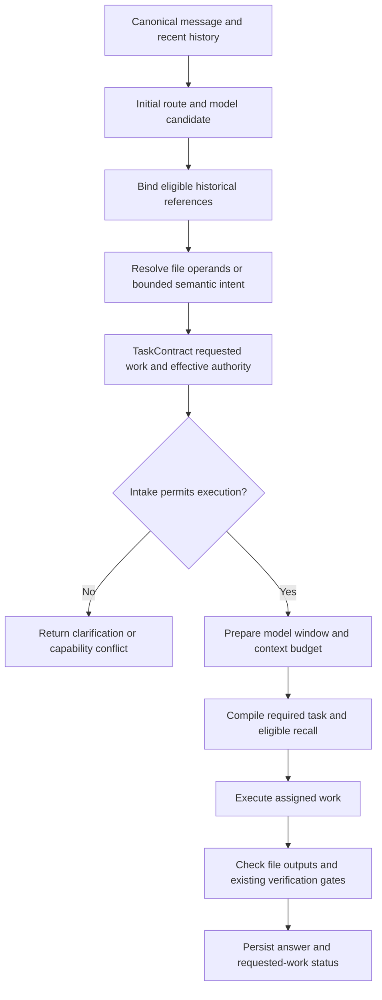

# Request resolution and execution

Implementation update, 2026-11-06, against integrated main `067470e` (v0.6.16). Both source bundles were compiled; no new installer/release or installed-app replacement is implied.

## Design decision

Keep one task contract and the existing execution workflow. Do not introduce another coordinator agent, task database, or general task-graph scheduler to fix request interpretation. Use deterministic reference resolution for explicit file requests, retain the requested outcome separately from effective permissions, and check observable outputs.

The broader [architecture review](../reviews/2026-11-06-router-architecture-review.md) contains proposed future architecture as well as defects. This implementation addresses the immediate routing, execution, handoff and completion failures. It does not implement every proposed work package or certify model quality on real hardware.

## Request lifecycle

1. Load canonical recent history and calculate the initial route using existing policy.
2. Bind historical recommendation/file-proposal references before semantic inference. Source eligibility, project identity and remote disclosure restrictions remain enforced by the existing binder.
3. Resolve explicit file-creation operands with the pure `resolveFileRequest` helper. Equivalent wording such as “generate those files here in the project” does not require a classification model. Multiple recent file lists remain ambiguous. An unavailable durable binding cannot fall back to incidental prose.
4. Use the semantic resolver for remaining ambiguous language under its existing deadline. Preserve explicit destination-bound work when the conservative fallback would replace it with a plan. Ordinary general advice still receives an answer without clarification.
5. Create the task with `requested` metadata independent of effective authority. Legacy tasks omit the field and retain their compatibility behavior. An unresolved requested operation cannot grant write, execution or external authority.
6. Prepare model windows only after references and scope are resolved. Generic questions without a workspace can still prepare their selected model. The initial model candidate is still selected before this stage; task-capability ranking is a separate future improvement.
7. Execute using the scoped contract. The executor no longer uses its former improve/review/launch phrase scanner to decide whether workspace tools are necessary.
8. Check the required file set against actual filesystem state and observed reads/mutations, then run the existing verification and outcome gates.
9. Persist the requested work and actual result. A read-only response does not mark requested edits as completed in durable task state.

## Requested work and effective work

The additive field on the existing version-2 contract is:

```ts
requested?: {
  intent: ChatIntent
  artifact: RequestedArtifact
  destination: ArtifactDestination
  targetFiles: string[]
  evidence?: 'source-read'
  state: 'resolved' | 'needs-reference' | 'needs-clarification'
}
```

`TaskContract.requested` records intent, artifact, destination, required file paths and resolution state. It grants no authority. `TaskContract.authority` remains the effect ceiling enforced by the gateway. The existing `deliverable` and `interpretation` describe the effective response and remain backward compatible.

Ask mode may inspect and describe a change. It must not repeatedly retry a write it cannot perform. Its effective answer may finish while the requested patch remains incomplete in stored task state. In Agent mode, a requested patch assigned to a read-only worker returns a clear capability conflict before inference instead of spending recovery calls on an impossible assignment.

The model-facing task schema is `model-task/6`. It includes the compact requested-work record. The full task remains in the ledger. Requested file paths are operands, not proof of filesystem state and not permission to escape the project.

The model-facing schema is independent of saved `TaskContract.version` (currently 2). The optional requested evidence requirement survives role selection and is enforced by the host. Supplied-code and generic reviews do not acquire a workspace source-read requirement merely because an editor is open.

The following projection is checked against a compiled source-review fixture by `tests/model-task-documentation.test.ts`. Changing the model-facing schema or requested record requires updating this example and the canonical architecture guide together.

<!-- model-task-example:start -->
```json
{
  "schema": "model-task/6",
  "requested": {
    "evidence": "source-read",
    "intent": "review",
    "artifact": "review",
    "destination": "chat",
    "targetFiles": [],
    "state": "resolved"
  }
}
```
<!-- model-task-example:end -->


### State behavior

- `resolved`: intake has an executable interpretation or an allowed conversational response. Authority still limits all effects.
- `needs-reference`: an explicit file reference is missing/ambiguous, or historical reference binding is unavailable/conflicting. Authority is removed and the loop returns clarification. It does not run a model to invent the missing list.
- `needs-clarification`: a destination-bound request fell back from edit/run to a different intent. Preserve the requested operation and ask whether to apply it or explain it. Ordinary general advice is not automatically put into this state.
- Resolved patch with read-only authority in Agent mode: return a capability-conflict explanation before inference. Selecting a different model alone cannot grant edit permission.
- Resolved patch in Ask mode: inspection/explanation may run. `completeChatTurnTask` stores the requested patch as incomplete even when the effective conversational answer finished.

`taskIntakeBlocked` is shared by `chat-turn.ts`, desktop `chat-stream.ts`, and Eris-Dev `capture.ts`. It avoids preparation for blocked intake; it does not replace scope validation or the per-tool authorization gateway.

### Implemented sequence



General RAM recall occurs after task resolution. Historical reference binding occurs before it. The diagram intentionally keeps initial model selection before complete intake, matching the source; moving all selection after a new compiler is still a proposal.

## References and RAM

Use existing canonical history, recommendation catalog, task persistence and evidence validation. File proposals beginning with create/generate/write now enter the existing proposal representation when offered in a plan or review. This avoids a parallel file-proposal store with a different privacy lifecycle.

The pure recent-history fallback considers at most six messages and only assistant prose that describes proposed files. Code fences and blockquotes are excluded. Distinct lists produce an unresolved reference rather than selecting one arbitrarily. The fallback is bounded to 100 paths. Durable binding has priority and retains deletion, exclusion, project and destination checks.

This is not a comprehensive natural-language antecedent resolver. If a proposal is unavailable, clarification is preferable to generating unrelated files. More RAM or a larger model window does not remove that requirement.

## Delegation

Inline child intent comes from the assignment. A writable specialist no longer turns an answer-only assignment into an edit. A read-only specialist no longer changes an edit assignment into a review. Child authority still intersects with the parent, and each child gets its own requested-work metadata instead of inheriting the parent's file set.

“Check whether …” is classified as inspection at intake, independent of the specialist's name. Existing versioned handoff packets, evidence lineage, context-origin capabilities, task-tree limits and child receipts remain in place.

## Completion evidence

For explicit file-generation requests, every required file must be present, nonempty, inside the selected project and observed in this run. A file with the same basename elsewhere cannot satisfy it. A removed file no longer counts even if an earlier mutation receipt named it. Reads of already-correct files can establish presence without gratuitous writes; semantic correctness remains subject to the existing verification and semantic checks.

This file-set gate supplements the general workflow. It does not claim that nonempty files are functionally correct, nor that every path mentioned in an arbitrary request is an output. General edits, deletions and recommendations retain their existing acceptance logic.

## Outcome assessment

The semantic reviewer uses the same hard-deadline iterator primitive as intake. A transport that ignores abort cannot hold terminal delivery indefinitely. Output-limit failures also close the iterator. The result distinguishes timeout, transport error, malformed JSON, invalid schema, unavailable reference and response-limit failures.

An unavailable evaluator still produces an unresolved assessment, and that assessment is stored with the reply. Since #500 it no longer changes the run's status: timeout, transport error, malformed JSON, invalid schema and response-limit failures mean the reviewer produced no judgement, so the run keeps the status its own execution and verification earned. In live testing the 15-second deadline expired on every local-model review, which marked correct work incomplete. An unavailable reference stays conservative and still marks the run incomplete, as does a real `partial` or `unsupported` verdict.

The verdict is not written into the answer text (#502). The chat panel shows it under the reply from `contextResult.completion.assessment`, and model history drops host status paragraphs, including the "Outcome check: …" lines that older builds stored in the body, so a later turn does not repeat them as its own findings.

## Regression coverage

- Exact reported file-generation wording and destination-suffix variants.
- Cold native and automatic remote classifier skips without changing explicit file intent.
- Missing, competing and unavailable references.
- Quoted instructions, explicit chat examples and no-edit constraints.
- Persistence of requested work and loading legacy tasks.
- Read-only explanations versus requested edits.
- Child explanations without inherited parent outputs.
- Every required file, empty outputs, duplicate basenames, removed files and existing inspected outputs.
- Full chat intake to real temporary-workspace writes for three requested files, with simulated inference and verification.
- Evaluator timeout with an abort-ignoring adapter and distinct malformed-output diagnostics.

`requested-work.test.ts` belongs to the agent qualification profile used before builds. Eris-Dev shares the same turn/compiler/executor code. Capture-only corpus results remain distinct from actual model execution.

## Remaining review proposals

Task graphs, calibrated semantic interpretation, rich resumable clarification UI, task-capability/cost model ranking, a generalized durable artifact catalog, per-obligation child result assignment and packaged multi-model performance qualification remain separate proposals. Existing obligations, bounded recovery and context provenance are retained rather than replaced speculatively. Complete those based on independent conversation fixtures and measured failure evidence, not by adding more prompt layers.

## Implementation status against the review

The original R01–R12 identifiers refer to the [pre-change architecture review](../reviews/2026-11-06-router-architecture-review.md). Status here describes this implementation, not release certification.

- **R01, fallback changes requested work — addressed for explicit file creation and destination-bound ambiguity.** File operands bypass classifier failure; unresolved operands block without becoming a plan. General natural-language interpretation is still heuristic/semantic.
- **R02, permissions redefine outcomes — addressed with an additive requested/effective split.** Existing consumers retain compatible effective fields. A wholesale replacement of task schemas is not required for this fix.
- **R03, late/multiple reference paths — partially addressed.** Historical binding precedes classification; proposed files reuse the recommendation representation. A general typed artifact catalog and universal antecedent resolution remain proposed.
- **R04, compound requests — retained existing obligations.** No new graph scheduler was added. Independent node scheduling and per-obligation execution receipts remain proposed.
- **R05, child intent follows role — addressed.** Inline dispatch retains assignment intent, and child requested work is distinct from parent outputs.
- **R06, executor reinterprets language — addressed for the workspace-tool safety-net scanner.** The executor consumes scope/authority for this decision. Other specialized execution heuristics still exist.
- **R07, completion inherits routing errors — strengthened.** Requested file sets receive actual scoped output checks; blocked patches remain incomplete in durable task state. General semantic correctness and exhaustive arbitrary-edit acceptance are not solved by file existence.
- **R08, evaluator failure ambiguity — addressed for hard deadlines and failure diagnostics.** The overall incomplete policy remains conservative. Separate renderer status dimensions are still proposed.
- **R09, recovery repeats an intake mistake — partially addressed.** Explicit unresolved/permission-conflicting work stops before execution recovery. A general typed failure-diagnosis and audited contract-revision engine remains proposed.
- **R10, early model selection — partially addressed through deferred preparation.** Ranking policy is unchanged; compiled capability/cost ranking remains proposed.
- **R11, RAM versus working state — reused existing durable task and recommendation state.** Requested work now survives task persistence. No new RAM subsystem or generalized working-state projection was added.
- **R12, orchestration complexity — reduced selected duplication.** File-reference compilation and file-set evidence checks are separate small modules. A complete decomposition of the agent loop remains future refactoring.

## Source and executable specification map

- [file-request.ts](../../src/shared/file-request.ts): pure bounded file-operand detection and reference resolution.
- [chat-turn.ts](../../electron/main/services/chat-turn.ts): binding/classification ordering, task creation, model-window preparation and durable result status.
- [task-resolver.ts](../../electron/main/services/task-resolver.ts): deterministic bypass, unavailable-reference guard and bounded semantic fallback.
- [task-contract.ts](../../src/shared/task-contract.ts), [task-intake.ts](../../electron/main/services/task-intake.ts), [evidence-schemas.ts](../../electron/main/services/evidence-schemas.ts): requested/effective representation, child assignments, validation and backward compatibility.
- [context-compiler.ts](../../electron/main/services/agent/context-compiler.ts): required `model-task/6` representation.
- [loop.ts](../../electron/main/services/agent/loop.ts): early clarification/capability conflict, scoped execution and child dispatch.
- [workflow.ts](../../electron/main/services/agent/workflow.ts), [requested-files.ts](../../electron/main/services/agent/requested-files.ts): output presence/identity checks and integration with existing completion gates.
- [task-outcome.ts](../../electron/main/services/task-outcome.ts), [task-deadline.ts](../../electron/main/services/task-deadline.ts): hard-deadline evaluation, typed failures and iterator cleanup.
- [chat-stream.ts](../../electron/main/ipc/chat-stream.ts), [capture.ts](../../electron/dev/capture.ts): shared desktop/Eris-Dev model preparation guards.
- [requested-work.test.ts](../../tests/requested-work.test.ts), [task-meaning.test.ts](../../tests/task-meaning.test.ts), [agent-request-coherence.test.ts](../../tests/agent-request-coherence.test.ts), [chat-agent-smoke.test.ts](../../tests/chat-agent-smoke.test.ts): deterministic intake, persistence, negative cases, timeout behavior and real temporary-workspace writes.

## Validation of this implementation

- Complete Vitest suite: 174 files, 2,171 tests passed.
- Agent prebuild qualification: 119 files, 1,795 tests passed.
- Eris-Dev prebuild qualification: seven files, 133 tests passed.
- Both production and Eris-Dev bundles compiled successfully.
- Node and renderer TypeScript checks passed. Build-info files were redirected to temporary storage because the worktree output directory requires additional write permission.
- ESLint completed with zero errors and 11 pre-existing warnings outside the changed implementation.
- The 10,000-question boundary test is simulated intake/capture coverage, not 10,000 live-model answers. The new three-file smoke test executes real filesystem tools against a temporary workspace using scripted model output and a simulated verification result.

No version bump, installer packaging, installed-app replacement, Git commit or PR is included in this source change.
