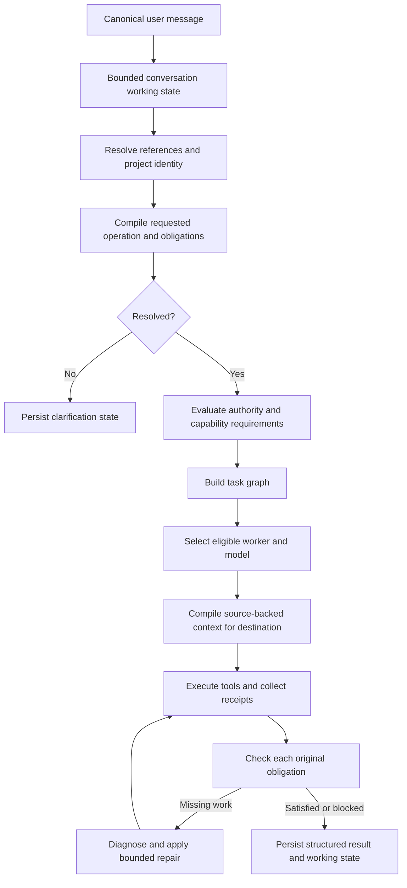

# Eris chat routing and agent architecture review

Reviewed 2026-11-06 against local commit `7975140dc074a21ce7da4c6df4d28131eb842949`, package `0.6.16`.

This is a source review and redesign proposal. It does not claim a fresh remote fetch, packaged Windows reproduction, or live-model qualification. Source locations below are repository-relative. Findings distinguish observed implementation from proposed behavior. The preceding investigation of issue #413 provides the motivating incident, not proof of every possible failure path on that machine.

## 1. Assessment

Eris has substantial execution infrastructure. The recurring failures are consistent with a control-plane problem: several stages infer overlapping aspects of the request, and later stages judge success against the interpretation produced by those same stages. A routing error can change the work definition before execution starts.

The highest-value redesign is to resolve the user's requested operation, references, destination, and obligations before selecting an execution strategy. Permissions determine whether work may proceed. They should not redefine what the user requested. Agent names and model residency should not determine the meaning of a message.

This does not justify removing existing safety gates or replacing everything with an unconstrained coordinator model. Preserve the tool gateway, authoritative task contract, source-backed context, model-transition safeguards, mutation receipts, and bounded recovery. Refactor their ownership and inputs.

## 2. Current request path

1. `electron/main/ipc/chat-stream.ts` validates submission and loads canonical history. Routing admission uses up to 20 recent messages (`ROUTING_HISTORY_MESSAGES`).
2. `planInitialChatTurn` in `services/chat-turn.ts` calls `planChatTurn` with `skipModelRouter: true`. The initial route still selects intent, agent, tool ceiling, and models.
3. `resolveChatTurnContract` chooses the initially selected chat/tool model for semantic resolution. Cold native models skip classifier inference. Automatic remote destinations also skip it. Otherwise `resolveTaskDecision` may call the model.
4. `task-resolver.ts` accepts `{intent, confidence}`. The deadline is 1,500 ms and the minimum self-reported confidence is 0.8. Classification sees at most six recent messages. The exact referenced-file fast path checks only the last two.
5. A different semantic intent triggers another `planChatTurn`. The route can move from edit to plan before canonical reference binding.
6. The code prepares model windows, then binds historical recommendations using `bindTaskReferences`, then builds `TaskContract` through `createTaskContract`.
7. `task-intake.ts` derives effective authority, feasible deliverable, interpretation, scope and acceptance criteria. The artifact calculation receives the already-resolved intent and edit capability.
8. Chat selects general RAM/archive recall after task resolution. The agent compiles task, instructions and evidence into destination-specific messages.
9. `agent/loop.ts` chooses answer-only versus tool execution, runs tools, delegates, evaluates progress and may change model or role.
10. `AgentWorkflow` checks deterministic evidence. Some turns additionally receive `reviewTaskOutcome`. A non-supported semantic verdict marks the turn incomplete and appends a message. That check does not restart intake.

The separate history limits are not intrinsically wrong. The problem is that the narrower stages can settle meaning before the richer structured reference state is consulted.

## 3. Confirmed architectural weaknesses

### R01 — Resolver fallback changes the requested work

**Priority P1.** `task-resolver.ts:180–225, 390–425`; `chat-turn.ts:115–165`.

The initial heuristic recognizes edit wording such as `generate`. The deterministic referenced-file exception only matches `generate those/these/the listed files` with optional punctuation. It does not match `generate those files here in the project`. General imperative bypass expressions omit `generate`.

If inference is skipped or fails, `conservativeFallback` can convert edit to plan. This makes an operational condition—model readiness, deadline, malformed JSON or transport error—affect the user's requested deliverable. The prior #413 investigation reproduced this distinction for the short and extended wording. The issue export does not establish which fallback occurred on the user's Windows machine.

**Redesign:** Preserve `requested.operation = create-files` and the requested destination. Represent uncertainty independently. A resolved explicit request proceeds within its authority. Missing referents produce `needs-reference`. Classifier failure produces a diagnostic, not an invented request for a plan.

**Acceptance:** Equivalent destination suffixes preserve the operation across cold/warm, timeout, malformed and low-confidence cases. Ask mode and explicit no-edit constraints still block mutation. Ambiguous references remain blocked.

### R02 — Artifact meaning depends on the route and permission result

**Priority P1.** `task-intake.ts:395–435, 551–580`; `src/shared/task-interpretation.ts:345–385`.

`feasibleDeliverable` converts an unauthorized patch to an answer. `artifactDecision` returns a workspace patch only for edit intent with edit authority, and plan intent normally produces a chat plan. This is useful for limiting execution but loses the distinction between requested work and permitted work. The raw original text survives, yet downstream structured consumers receive the adapted deliverable.

**Redesign:** Keep three records: requested outcome, authorization decision and executable plan. An edit request in Ask mode remains a requested edit with read-only authorization and an explicit mode conflict. It may receive an explanation, but must not be marked as fulfilled by that explanation.

**Acceptance:** No change to mode, worker, model, or tool availability can mutate the requested artifact. Every adaptation records whether the requested outcome remains unmet.

### R03 — References are resolved too late and through different mechanisms

**Priority P1.** `chat-turn.ts:174–215`; `reference-binding.ts:12–137`; `task-intake.ts:291–395`.

The resolver has its own recent-file check. Intake separately inherits project scope, extracts prior recommendations and selects items. Historical binding has stronger source identity and eligibility checks but happens after intent resolution. Its catalog is recommendation-oriented, whereas users also refer to proposed files, plans, failed tasks and previous code blocks.

**Redesign:** Resolve typed antecedents before final interpretation. Generalize the existing catalog into `ConversationArtifact` records for recommendation batches, proposed file sets, implementation plans and execution results. Store source IDs, project, revision and status. Prefer the explicit active artifact when uniquely compatible. Multiple valid alternatives require clarification. Do not guess from the nearest filename alone.

Split local reference resolution from destination disclosure. Determine what an ID refers to locally, record its disclosure requirements, then choose an eligible model. Revalidate before serialization. Do not disclose private reference content to a classifier merely to choose a model.

**Acceptance:** Follow-ups work after intervening discussion, compaction and restart. Deleted, excluded or cross-project sources cannot regain eligibility through a summary.

### R04 — A single intent label collapses compound requests

**Priority P1.** `chat-router.ts` intent rules; `task-interpretation.ts` obligations; `task-intake.ts` acceptance construction.

The implementation already tracks obligations, which is valuable. However initial worker selection and execution policy still center on one `ChatIntent`. Requests such as “review the booking flow, fix the defects, and add regression tests” combine discovery, mutation and verification. A role label alone cannot describe their dependency order or completion requirements.

**Redesign:** Compile a bounded task graph. Nodes have operations, inputs, required capabilities, scope, dependencies and acceptance predicates. Use the same worker across nodes when practical. Delegation is optional scheduling, not a mandatory extra model call.

**Acceptance:** Review findings can feed implementation nodes. Test failure leaves the relevant node incomplete. “Review and recommend, do not edit” produces no write node. Every requested item has a terminal status.

### R05 — Agent role can influence child intent

**Priority P1.** `agent/loop.ts:3835–3865`.

In inline delegation, a child route with no tool-requiring intent can be coerced to edit for a writable specialist or explore for a read-only specialist. Parent authority intersection still protects the ceiling. The architectural concern is semantic: the specialist's ability to edit is used to infer what the assigned subtask should do.

**Redesign:** Parent assigns an explicit operation or task-node ID. Child capabilities are checked against the assignment. A Coder asked to explain a function receives an explanation assignment. An unavailable capability returns a structured mismatch for rescheduling, without changing the assignment.

**Acceptance:** Swapping a specialist's name or tool ceiling does not change the child deliverable. Child assignments cannot exceed parent authority or claim unassigned obligations.

### R06 — Execution contains another request interpretation layer

**Priority P2.** `agent/loop.ts:590–624`.

`forceWorkspaceTools` scans original wording for improve, review, launch and related terms to avoid inappropriate answer-only execution. It is a useful defensive patch, but it means the executor is still interpreting language after the contract exists.

**Redesign:** Move these decisions into request compilation. The executor should dispatch from explicit required capabilities and applicability. Keep a validation assertion at the boundary, reporting `contract-invalid`, rather than another phrase classifier.

**Acceptance:** Every execution branch can be explained from the compiled contract without rescanning the user text. A generic story or coding example needs no workspace inspection.

### R07 — Completion gates inherit routing mistakes

**Priority P1.** `agent/workflow.ts:48–75, 125–174`; `task-outcome.ts`; `ipc/chat-stream.ts:1227–1267`.

The workflow requires mutation when the finalized task is a patch with edit authority. A misclassified plan is therefore not required to create files. The semantic checker receives original text, but also the adapted deliverable and obligations, so it is not a deterministic independent safeguard against bad intake.

The deterministic named-file check requires at least one matching target to change. Other obligation and semantic checks can catch omissions, but this predicate alone cannot prove that all requested files were created. Suffix matching in `sameFile` is also weaker than canonical scoped file identity.

**Redesign:** Verify the original requested outcomes against explicit artifact predicates. For a requested file set, require each expected path to exist with a valid receipt or a verified pre-existing implementation. Do not force gratuitous edits to already-correct files. Track modifications, unchanged-satisfied items, failures and omissions separately.

**Acceptance:** Producing code fences cannot complete a file-creation request. Creating one of three files cannot complete all three. A same-basename file in a different subproject does not count.

### R08 — Semantic checking mixes execution status with evaluator availability

**Priority P2.** `task-outcome.ts:23–137`; `chat-stream.ts:1227–1253`.

The reviewer has a 15-second abort timer. Invalid JSON, transport failures and several other failure paths converge on the same unresolved message. Chat then marks the run incomplete. This obscures whether implementation failed, evidence was insufficient, or the optional evaluator was unavailable. Unlike the intent resolver, this function uses an ordinary async iteration rather than the hard-stop `drainUntilStopped` wrapper. Whether a transport exceeds the timer depends on its cancellation behavior and needs a fault test.

**Redesign:** Separate execution status, deterministic verification and semantic assessment. Retain conservative behavior when semantic evidence is necessary, while reporting exactly which gate is unresolved. Reuse the bounded iterator primitive and record structured stop reasons. Permit one evidence-directed repair only when the task and permissions remain valid.

**Acceptance:** Timeout, malformed reply, missing evidence, unsupported claim and partial implementation have distinct codes. An evaluator cannot hang terminal delivery when its adapter ignores abort.

### R09 — Recovery is better at changing workers than repairing intake

**Priority P1.** `agent/mid-run-adapt.ts`; `agent/loop.ts:1370–1545`.

Current recovery excludes attempted models, preserves the task, prevents authority loss, and bounds adaptations. These are strengths. However changing a worker while preserving an incorrect plan contract cannot fix a requested edit classified as planning.

**Redesign:** Diagnose failures by layer. Invalid protocol gets protocol repair or a compatible worker. Missing evidence gets targeted retrieval. Scope/reference ambiguity gets clarification. Capacity failure gets context/admission handling. Contradictory intake gets contract revalidation against the original request. Permission denials and safety refusals remain terminal for that action.

Contract correction must be host-validated, versioned and explicit. Model output cannot expand authority. After mutation, preserve receipts and re-evaluate remaining work rather than replaying writes.

**Acceptance:** A failed read-only plan for an explicit edit is identified as intake mismatch, not retried on another model with the same contract. Recovery records a hypothesis, action and observable result.

### R10 — Model selection occurs before complete task requirements

**Priority P2.** `chat-turn.ts`; `auto-model-policy.ts:57–235`.

Auto selection already filters locality and readiness before scoring, uses observed outcomes where available, and includes limited short-answer latency ranking. Do not replace these with another Lite-first shortcut. The remaining limitation is its coarse input, chiefly `ChatIntent`. It cannot fully rank against a compiled task's context requirement, tool protocol complexity, expected output or multi-step verification needs.

**Redesign:** Select after compiling required capabilities. Estimate load, prefill, decode, tool-turn and verification costs separately. Preserve hard locality, privacy and memory admission constraints. Rank only eligible candidates using measured task-family performance, with uncertainty and sample counts visible. Fixed selection stays fixed unless the user changes it.

**Acceptance:** A fast answer model and a reliable tool worker may differ. A model unable to fit required task context is excluded explicitly. An unknown capacity estimate is not represented as measured fitness.

### R11 — RAM recall does not substitute for task working state

**Priority P1.** `chat-turn.ts`, `task-intake.ts`, `context-memory.ts`, `context-origin.ts`, `agent/context-compiler.ts`.

More historical tokens cannot reliably repair an already-wrong task contract. Existing memory namespaces, evidence leases, source revisions and context-origin mappings are useful foundations. The missing integration is a single bounded working-state input to intake that identifies the active task, proposed artifacts, accepted decisions, completed obligations and unresolved questions.

**Redesign:** Persist a typed working-state projection in durable storage and cache it in RAM. Validate it against canonical source/control revisions. Keep it separate from optional relevance-ranked excerpts. Resolve references from that projection first, retrieve detailed evidence only when required, and revalidate after deletion or rewind. Never promote an assistant's proposal into an observed fact.

**Acceptance:** Restart, RAM eviction and compaction preserve active task identity. A new request can supersede it. Cross-project state never silently becomes the current task.

### R12 — Large orchestration modules make policy interactions hard to audit

**Priority P2.** Current line counts: `agent/loop.ts` 4,654, `chat-router.ts` 972, `task-intake.ts` 768, `ipc/chat-stream.ts` 1,432.

Size is not itself a correctness defect. Here these modules combine language interpretation, authority, scheduling, prompts, transitions and output handling, making behavior difficult to isolate.

**Redesign:** Extract pure request compilation, authorization, reference selection, execution planning and completion evaluation. Keep effectful model/tool operations behind adapters. Move one behavior at a time with equivalence tests. Do not duplicate the production implementation inside Eris-Dev.

**Acceptance:** Given the same versioned input snapshot, compilation is deterministic without loading a model. Every effectful stage has cancellation and lifecycle ownership.

## 4. Proposed target contracts

These are illustrative new contracts, not existing exports. Evolve `TaskContract` through an explicit schema migration rather than casting old records to new types.

```ts
type RequestedWork = {
  requestId: string
  sourceMessageId: string
  operation: 'answer' | 'inspect' | 'review' | 'create-files' | 'modify' | 'execute'
  artifact: 'prose' | 'code-example' | 'findings' | 'file-set' | 'patch' | 'run-report'
  destination: 'chat' | 'workspace' | 'new-project'
  referenceIds: string[]
  obligations: RequestedObligation[]
  constraints: EffectConstraint[]
  supportingSpans: SourceSpan[]
}

type IntakeResult =
  | { state: 'resolved'; requested: RequestedWork; binding: BoundContext }
  | { state: 'needs-reference'; requested: Partial<RequestedWork>; choices: ReferenceChoice[] }
  | { state: 'needs-scope'; requested: RequestedWork; choices: ProjectChoice[] }
  | { state: 'needs-clarification'; question: string; alternatives: Interpretation[] }

type ExecutionDecision = {
  requestedWorkId: string
  authorization: AuthorizationDecision
  state: 'ready' | 'blocked-by-mode' | 'blocked-by-policy' | 'blocked-by-capability'
  nodes: TaskNode[]
  selectedWorker?: WorkerSelection
}

type Completion = {
  requestedWorkId: string
  execution: 'complete' | 'partial' | 'blocked' | 'cancelled' | 'failed'
  obligations: ObligationReceipt[]
  verification: 'passed' | 'failed' | 'not-run' | 'not-applicable'
  semanticAssessment: 'supported' | 'partial' | 'unresolved' | 'not-required'
}
```

`RequestedWork` is immutable after acceptance. A user correction creates a new revision with provenance. Clarification is a resumable state, not a plan artifact. Every tool request carries task/node/attempt IDs and is checked against the authorization snapshot plus current revocations.

## 5. Proposed execution sequence



There may be an optional semantic interpreter between reference resolution and compilation, but only for genuinely unresolved language. Its output must name alternatives and source spans. Numeric confidence alone is not evidence of correctness. Use offline calibration and measured accuracy by request family to decide when inference helps.

## 6. Agent-to-agent and agent-to-model redesign

### Typed assignments and receipts

Retain the current bounded/versioned handoff packet, `HandoffEvidence`, `ContextOrigin`, `ChildOutcome`, inherited constraints and task-tree budgets. Add task-node and obligation IDs to assignments and returned receipts. A child reports which assigned predicates it satisfied and cites actual effects/checks. The parent verifies integration before marking its own obligations complete.

Avoid copying an entire conversation into every child. Supply required constraints, scoped artifact references, relevant source-backed evidence and bounded pull access. Budget across the root task, including tokens, wall time and model switches. Enforce dependency completion before a child runs against another child's output.

### Stable model-facing instructions

Keep one required current task block. Agent personality can change presentation and workflow hints, not requested work or permission. Carry a compact execution state with completed work, last meaningful evidence, failed attempts and next unresolved obligation. Optional recall should compete for remaining space after required task/tool state.

Use the existing model-protocol and context-dispatch boundaries to record actual serialized context. Validate that required obligations and prohibitions survived packing. Measure irrelevant or contradictory prompt content through request captures before changing templates.

### Resource-aware scheduling

Do not wake a large native model solely to classify an obvious request. Avoid preparatory model loads for unresolved references. Keep one resident worker across adjacent task nodes when it meets requirements. Model changes must preserve evidence, journal handles and completed mutation receipts, with revalidation for destination privacy and measured capacity.

## 7. Documentation corrections required

The architecture overview and handoff guide declare a 2026-11-01 / v0.6.10 baseline while the reviewed code is v0.6.16. The overview has a scoped #385 addendum, so it should not be interpreted as a fully refreshed architecture.

Concrete drift to correct:

- `docs/ARCHITECTURE.md` says persistent handoff lineage, context-origin mapping, bounded/versioned envelopes, aggregate task-tree limits and source-backed result receipts are missing. Current source includes `HandoffEvidence`, `HANDOFF_VERSION`, `ContextOriginSchema`, `TASK_TREE_LIMITS`, background enforcement, and `ChildOutcomeSchema`. These should be documented as implemented foundations with remaining qualification limits, not listed wholesale as absent.
- `docs/design/AGENT-HANDOFF-AND-RAM-CONTEXT.md` shows an older packet without evidence metadata. Update the type excerpt and lifecycle explanation.
- The overview describes automatic semantic intake potentially using ready Lite. The inspected `resolveChatTurnContract` chooses the initially selected execution destination and skips cold native/automatic remote classification. Explain that exact path and distinguish legacy/coordinator paths.
- RAM target section 13 correctly calls for typed reference binding before task creation and current-message authorization. The actual resolver/reference ordering does not fully realize that intent. Record this as a tracked implementation gap.
- Keep source architecture, proposed architecture and historical incident reports separate. Every assertion of implementation should cite a symbol, test and reviewed commit. A test proves its scenario, not hardware certification.

## 8. Evaluation and debugging redesign

### Four independent qualification layers

1. **Interpretation tests:** labeled request plus conversation snapshot produces the expected operation, destination, references, scope, authority and obligations. Golden labels must be independent of the router's own output.
2. **Production-pipeline simulations:** scripted model responses run through real intake, executor, tool gateway and completion logic in temporary workspaces. Assert actual filesystem results and receipts, not just advertised `write_file` availability.
3. **Fault and lifecycle tests:** classifier timeout/invalid JSON, cancelled load, missing model, unknown capacity, stale memory, deleted source, unresolved project, restart, failed write receipt and ignored abort. Check cleanup and terminal state.
4. **Live qualification:** a curated subset on Windows/macOS and representative native/provider models. Compare cold/warm runs and fixed/automatic policy. Save immutable inputs, model identity, runtime configuration, wire manifests, output, effects and timings.

### Mandatory scenario families

- “Generate those files” and “generate those files here in the project” with a valid proposed file set.
- Same requests without antecedents, with multiple plausible batches, or after source deletion.
- “Write a story,” “write a Python example,” and “save that story to story.md.”
- “Review and recommend” versus “review and implement.”
- “Fix it,” “continue,” “only do 2 and 4,” and “all except authentication.”
- Named subproject versus unrelated open project and duplicate basenames.
- Agent mode versus Ask, manual Reviewer/Coder versus Auto, fixed versus automatic models.
- No-edit/no-run constraints and quoted instructions that are merely data.
- Child explanation assigned to a writable specialist.
- One of three files created, all files already correct, stale verification and failed verification.
- Correct routing with a poor model response, separated from incorrect routing with a plausible response.
- Classifier cold/warm/timeout/malformed output without unintended semantic changes.

Use metamorphic tests for paraphrases and unrelated history insertions, with explicit exceptions for meaningful constraints and changes of scope. The 10,000-question corpus is useful for breadth but cannot replace multistep conversations and actual-effect assertions. Avoid training all routing rules against the same evaluation phrases.

### Trace and UX

Extend the existing `route-decision` event rather than inventing another unrelated log. Include compiler version, source snapshot revision, requested artifact, bound IDs, uncertainty reasons, authority restrictions, selected node, worker/model admission reasons and completion predicates. Redact private text and use digests where content is unnecessary.

Expose a short user-facing activity state: understanding references, waiting for model load, inspecting files, editing, verifying, or waiting for clarification. Distinguish first visible status from first useful model output. Record intake, history, admission, load, prefill, generation, tools and verification durations independently.

Proposed release gates, to be calibrated on measured hardware: zero unauthorized mutations in deterministic suites, all critical routing golden cases passing, all mandatory artifact predicates enforced, no cold/warm semantic drift in explicit requests, and no regression in measured p95 pre-model orchestration overhead. Do not promise an absolute generation latency independent of model size and hardware.

## 9. Delivery order

**Phase A — Stop semantic loss.** Fix the #413 phrase family with scoped tests, introduce explicit unresolved-reference state, preserve requested-versus-effective outcome, and add exact transcript execution fixtures. Do not relax Ask, quoting, scope or effect boundaries.

**Phase B — Compile requests before scheduling.** Build a pure compiler using typed reference/working-state inputs. Run it in shadow mode without executing its proposed effects. Compare against labeled corpora and production traces. Switch routing only after differences are reviewed.

**Phase C — Structured multi-step work.** Introduce task nodes and per-obligation receipts. Assign children explicit operations. Replace downstream phrase safety nets once equivalent boundary assertions and regression coverage exist.

**Phase D — Scheduling and recovery.** Use compiled capability requirements in model selection, typed fault diagnoses, destination-aware context and bounded repair. Measure model load and token costs before adding coordinator calls.

**Phase E — Qualification and documentation.** Publish versioned scenario reports, refresh architecture against the merged commit, and run packaged platform tests. Keep a rollback switch for the new compiler. Old saved task records require conservative migration with explicit unknown fields, not inferred permissions.

## 10. Implementation work packages

Each package should have a separate reviewable change and tests.

1. Referenced-file phrase coverage and correct missing-reference behavior.
2. Requested/effective outcome split in task schemas and persistence migration.
3. Typed file-set and plan artifacts extending the existing recommendation catalog.
4. Reference-first intake and model-disclosure eligibility separation.
5. Pure request compiler and source-span evidence for decisions.
6. Explicit resumable clarification/mode-conflict states in chat UI and persistence.
7. Compound task graph with bounded nodes and dependencies.
8. Agent-independent child assignments and capability mismatch reporting.
9. Per-artifact completion predicates with canonical project-relative identity.
10. Structured execution, verification and evaluator statuses.
11. Hard-deadline outcome checking with typed failure codes.
12. Failure-directed recovery and audited contract revisions.
13. Model selection using task capabilities and measured cost components.
14. Durable active-task working-state projection with bounded RAM cache.
15. Per-obligation handoff receipts using existing evidence/origin infrastructure.
16. Executor extraction and removal of duplicate natural-language interpretation.
17. Full route/context/effect trace export with privacy-aware replay snapshots.
18. Stateful, paraphrase and fault suites exercising actual workspace effects.
19. Packaged Windows/macOS live-model qualification and latency breakdowns.
20. Architecture reconciliation and executable documentation ownership.

## 11. Validation performed for this review

Source was read at the commit above. 274 tests passed across 11 existing suites:

- `agent-request-coherence` — 39 tests.
- `chat-router`, `task-meaning`, `agent-interpretation`, `auto-model-policy`, `chat-agent-smoke` — 146 tests.
- `handoff-envelope`, `handoff-replay`, `context-origin`, `task-tree-budget`, `handoff-constraints` — 89 tests.

The initial handoff group had one sandbox-only failure writing `out/qualification/handoff-replay.json`. Rerunning the 14-test replay suite with write permission passed. Two additional requested filenames (`task-resolver.test.ts`, `task-intake.test.ts`) were not present and did not contribute tests. This is focused regression validation, not the full check/build gate or live-model testing.

No application implementation change is part of this review. Green existing tests do not disprove the architectural weaknesses, particularly missing phrase variants and mismatches between requested work and the finalized contract.
