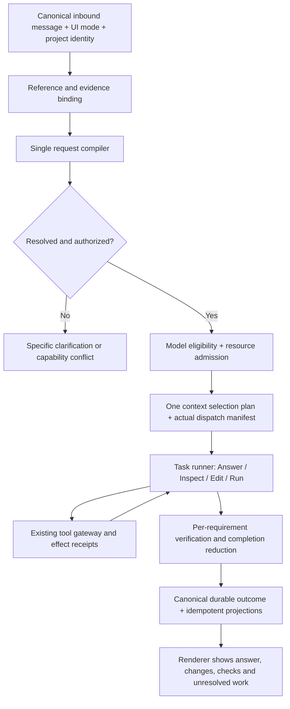

# Eris chat reliability and architecture simplification review

Reviewed: 2026-11-08. Source: `main` `73fe58a32bf010a1fda72fd42560395cc4bef02e`. Source package: **0.6.17**. Review branch: `codex/chat-reliability-review-2026-11-08`.

## Publication note

This document preserves the review of `73fe58a` and its original observations. Subsequent implementation work is tracked by [the 48-item issue tracker #435](https://github.com/EricServices-Repo/Eris/issues/435); these baseline findings are not an assertion that every item remains unfixed on current main. Consult the linked issues and PRs for current status.

The adjacent JSON retains the observations and an embedded reproduction probe. Its imports have been normalized for extraction to `tests/eris-reliability-review.test.ts` in a disposable checkout of the reviewed commit. Run that probe with the repository Vitest configuration and remove it afterward. It intentionally records historical behavior; do not use its bad-outcome assertions as a current build qualification gate. No historical model run or test result was regenerated for this documentation publication.

## Executive assessment

Eris has valuable foundations, but too many stages participate in deciding what the user meant and whether the work is finished. The highest-value change is to make **one resolved request contract, one execution owner and one evidence-backed outcome** authoritative. More specialist agents, larger context windows and more retries will not repair a request that enters the runner without edit permission.

This review contains **48 actionable findings and improvements**, grouped into six areas. They are not 48 proven runtime defects. Five entries are marked reproduced (including documentation drift); other entries are explicitly source-confirmed limitations, design proposals or qualification gaps. The reproduction scope matters: classifier/capture counterexamples prove bad task preparation; the workflow counterexample proves one deterministic gate accepts a no-mutation result. Neither is represented as a completed live-model failure.

The clearest defects are:

1. Ordinary short requests such as **Add pagination** become tool-free answers.
2. **Review the files and improve the layout** becomes a read-only review.
3. **Review this code sample** can bind supplied code to the unrelated open workspace.
4. An explicit named-file patch can pass the workflow gate after a read and passing check, with **zero mutations**.
5. Current design guides still describe `model-task/5`, while source sends `model-task/6` and supports source-read evidence.

The first four directly affect the reported experience: no code written, recommendations instead of implementation, irrelevant inspection, or weak completion evidence. They deserve priority before further orchestration features.

## Scope and evidence boundaries

Reviewed production intake/routing, request contracts, reference handling, agent workflow/loop, tool recovery, file artifact checks, verification, task outcome review, model selection/transition, prompt/context compilation, RAM/history documentation, desktop streaming/persistence, Eris-Dev capture/live boundaries, packaged smoke and qualification design.

Read current architecture, request execution, context memory, handoff/RAM, recommendations, Eris-Dev and release-checklist documentation. This is an intensive review of the chat/agent path, **not a certification of every IDE subsystem**. Editor/LSP, extensions, updater, sync, image generation and all platform integrations were not exhaustively tested here.

New checks in this review: **3 temporary Vitest tests passed**, comprising **18 classifier observations**, **4 capture-path observations**, and **1 workflow counterexample**. These tests assert/record present behavior; their green status does **not** mean the product behavior is correct. No provider or native inference was run. No 10,000-question live run, Windows installed-app test, GPU benchmark or new full-suite qualification was performed. Existing historical green results must not be attributed to this review's source without their own report.

The temporary checks were run with:

```sh
node_modules/.bin/vitest run --config /private/tmp/eris-reliability-review.config.mjs
```

The normalized evidence is preserved in the adjacent review JSON. Temporary fixtures used their own directories and did not alter product source. No application fixes, commits, PRs or releases are part of this report.

## Existing safeguards to preserve

Recent code already distinguishes requested work from effective authority, validates project scope, binds historical references, blocks incompatible intake, requires source reads for explicit workspace inspection, records applied mutations, checks named artifacts, separates execution/verification/assessment/persistence, bounds elapsed runs, supports guarded local-model switches, measures token versus visible-text latency and has scripted packaged regressions. RAM is not absent: canonical history, bounded RAM recall, source-backed summaries, facts and fresh dispatch eligibility exist. Eris-Dev already supports capture, opt-in live models, resumable batches and separate quality status.

The recommendations below extend or consolidate those foundations. Removing permission checks, read-before-edit, resource admission, privacy revalidation or truthful partial outcomes would make reliability worse.

## How the current design creates the reported symptoms

### A request can lose implementation intent before the model sees it

The classifier's ordered English rules determine a candidate intent. The semantic resolver, reference binder and task interpreter then refine it. Roles and tool ceilings are applied, and the runner enforces the resulting authority. If the host decides Add pagination is a generic answer, it sends no tools. If a combined request becomes a Reviewer task, the model is not allowed to implement it. This is host orchestration behavior, not evidence that the chosen model is inherently incapable.

### Successful activity is not equivalent to satisfying the request

Directory listings, arbitrary reads, existing named files, successful typechecks and long code files each demonstrate something useful. None alone establishes that the requested behavior was implemented. Current gates improve on trusting DONE text, but aggregate booleans can still accept the wrong evidence. Completion should be a reduction over requested obligations and observed effects.

### Multiple recovery paths make stalls harder to explain

The runtime separately counts steps, no-progress streaks, duplicate calls, verification failures and goal rejections. Final answer repair and semantic outcome review can add inference after visible work. A user sees repeated continuing messages while different subsystems consume their own budgets. Preserve bounded recovery, but give it one task-owned accounting model and a precise terminal reason.

### Large RAM history does not guarantee useful model context

Stored history, intake history, reference fallback, retrieved evidence, prompt packing and native KV have different purposes. Intake and execution can see different bounded projections. More RAM cannot recover a referent that was never selected, and a larger window does not give a read-only task permission to edit. The target is consistent, relevant, source-backed context rather than maximum prompt size.

## Evidence classification and priority

**Reproduced:** exercised directly by the review checks, or an exact source/document mismatch. **Source-confirmed:** behavior/structure visible in the cited owner; broader user impact may still need a fault or live test. **Design proposal:** a recommended architectural improvement, not proof of a missing feature. **Qualification gap:** required acceptance that this review did not establish, not a claim that all existing tests are absent.

**P1:** prioritize because it affects core task correctness, trustworthy completion, latency diagnosis or release evidence. **P2:** important simplification, robustness or usability work. **P3:** optional optimization after correctness. These are proposed priorities, not changes to GitHub issue labels. Avoid creating duplicates without reconciling existing issues and merged fixes.

## Detailed findings and implementation briefs

### Intake

#### ER-01 — Recognize ordinary short implementation requests

**P1 · Reproduced**

**Evidence:** Production classifyIntentTraced returns answer/default-answer for Add pagination, Add search, Add login and logout, Add tests for this, Remove the debug banner, Change the button to blue, and Save this as README.md. Capture confirms Add pagination becomes an Explainer task with tools:none and edit:false. [S01](https://github.com/EricServices-Repo/Eris/blob/73fe58a32bf010a1fda72fd42560395cc4bef02e/electron/main/services/chat-router.ts#L123) [S02](https://github.com/EricServices-Repo/Eris/blob/73fe58a32bf010a1fda72fd42560395cc4bef02e/src/shared/agent-contract.ts#L277) [S27](https://github.com/EricServices-Repo/Eris/blob/73fe58a32bf010a1fda72fd42560395cc4bef02e/electron/dev/capture.ts#L96)

**Why it matters:** The worker cannot implement the request because the host has already removed its tools. A stronger model cannot repair the task authority.

**Implementation:** Resolve leading imperative operation independently of feature-name vocabulary. Bind destination from an explicit path or the active, applicable project. If either target or meaning is genuinely ambiguous, ask one bounded clarification; never silently substitute an explanation. Keep creative writing and quoted instructions as non-workspace cases.

**Acceptance:** Add permanent tests for all seven examples, both with and without an open project, plus advice, creative-writing and do-not-edit counterexamples. Capture must retain a requested patch or a truthful unresolved state, never an unexplained tool-free answer.

#### ER-02 — Preserve the edit clause in combined review-and-change requests

**P1 · Reproduced**

**Evidence:** Review the files and improve the layout, Review the files and refactor booking.php, and Review the files and remove the debug banner all classify as workspace-inspection/review. The earlier inspection branch recognizes fix but omits improve, refactor and remove; it returns before later edit rules. Capture confirms the first becomes a read-only Reviewer. [S01](https://github.com/EricServices-Repo/Eris/blob/73fe58a32bf010a1fda72fd42560395cc4bef02e/electron/main/services/chat-router.ts#L234) [S02](https://github.com/EricServices-Repo/Eris/blob/73fe58a32bf010a1fda72fd42560395cc4bef02e/src/shared/agent-contract.ts#L336)

**Why it matters:** Normal requests that explicitly ask for changes turn into recommendations. This closely matches the reported product failure.

**Implementation:** Parse the request into operations before selecting the execution strategy. Preserve inspection plus authorized mutation as ordered obligations. As an immediate repair, share the action vocabulary and compound-clause parser rather than maintaining a second smaller verb list.

**Acceptance:** Parameterize and/then/also, modal and polite forms, punctuation, improve/refactor/remove/delete/rename, and a negative pair such as review and recommend improvements. Assert actual permitted tool execution and resulting fixture diffs, not only route labels.

#### ER-03 — Treat supplied code as its own evidence destination

**P1 · Reproduced**

**Evidence:** Review this code sample followed by a JavaScript code block triggers asksForWorkspaceInspection. Capture binds it to selected-project, requests source-read and exposes workspace read/verification tools. [S02](https://github.com/EricServices-Repo/Eris/blob/73fe58a32bf010a1fda72fd42560395cc4bef02e/src/shared/agent-contract.ts#L336) [S04](https://github.com/EricServices-Repo/Eris/blob/73fe58a32bf010a1fda72fd42560395cc4bef02e/electron/main/services/task-intake.ts#L220) [S27](https://github.com/EricServices-Repo/Eris/blob/73fe58a32bf010a1fda72fd42560395cc4bef02e/electron/dev/capture.ts#L96)

**Why it matters:** A question about pasted code can inspect an unrelated open project and spend time collecting evidence that the user already supplied.

**Implementation:** Introduce explicit evidence operands for inline source, attachments, selected editor ranges and workspace files. A code-sample reference should bind to the provided content before generic workspace inference. Preserve separate authority for any requested application of the example.

**Acceptance:** With an unrelated project open, review a pasted buggy sum function and answer from its content without workspace reads or commands. A contrasting request to apply the fix to src/math.ts must bind that file and preserve edit intent.

#### ER-04 — Eliminate disagreement between initial intent and resolved intent

**P2 · Source-confirmed**

**Evidence:** Explain how to implement authentication initially classifies as edit, but the capture path resolves it to an answer. The later correction is useful; it also demonstrates that different stages assign different meanings to one request. [S01](https://github.com/EricServices-Repo/Eris/blob/73fe58a32bf010a1fda72fd42560395cc4bef02e/electron/main/services/chat-router.ts#L123) [S03](https://github.com/EricServices-Repo/Eris/blob/73fe58a32bf010a1fda72fd42560395cc4bef02e/electron/main/services/task-resolver.ts#L69) [S27](https://github.com/EricServices-Repo/Eris/blob/73fe58a32bf010a1fda72fd42560395cc4bef02e/electron/dev/capture.ts#L96)

**Why it matters:** Intermediate edit intent can influence candidate selection and preparation even when the eventual answer is conversational. Debugging a single route label conceals this disagreement.

**Implementation:** Separate lexical candidates from an authoritative resolved operation. No candidate may grant effects or drive expensive model preparation. Store why the final operation differs from the candidate, and use one compiled task everywhere after resolution.

**Acceptance:** Advice, examples and implementation requests produce one final contract. Tests prove candidate labels do not load a different model or grant mutation before the contract is resolved.

#### ER-05 — Make one request compiler own meaning

**P1 · Design proposal**

**Evidence:** Routing helpers, bounded semantic resolution, reference binding, task interpretation, learned corrections and runtime workflow checks all participate in the path. Existing requested/effective separation is a good foundation, but authority and meaning are still assembled across services. [S01](https://github.com/EricServices-Repo/Eris/blob/73fe58a32bf010a1fda72fd42560395cc4bef02e/electron/main/services/chat-router.ts#L123) [S03](https://github.com/EricServices-Repo/Eris/blob/73fe58a32bf010a1fda72fd42560395cc4bef02e/electron/main/services/task-resolver.ts#L69) [S04](https://github.com/EricServices-Repo/Eris/blob/73fe58a32bf010a1fda72fd42560395cc4bef02e/electron/main/services/task-intake.ts#L205) [S05](https://github.com/EricServices-Repo/Eris/blob/73fe58a32bf010a1fda72fd42560395cc4bef02e/src/shared/task-contract.ts#L129) [S09](https://github.com/EricServices-Repo/Eris/blob/73fe58a32bf010a1fda72fd42560395cc4bef02e/electron/main/services/agent/loop.ts#L177)

**Why it matters:** Local fixes can disagree about whether a task is advice, review, file creation or an edit. More routing branches increase the number of interactions to test.

**Implementation:** Create one pure compiler over canonical message, explicit UI mode, applicable project and bound references. Output operation, evidence operands, output destination, obligations, requested effects, allowed effects and unresolved questions. Reuse TaskContract and authority enforcement; do not add another competing planner.

**Acceptance:** Desktop, inline handoff and Eris-Dev consume the same resolved contract. Compiler fixtures prove paraphrase consistency, conservative authority and explicit unresolved cases. No downstream role selection may rewrite the requested operation.

#### ER-06 — Bind follow-ups to stable proposal and requirement identities

**P2 · Design proposal**

**Evidence:** The execution guide documents a bounded six-message/100-path fallback for proposed files, while durable task and recommendation binding already exist. Generic recent prose remains a limited fallback. [S31](https://github.com/EricServices-Repo/Eris/blob/73fe58a32bf010a1fda72fd42560395cc4bef02e/docs/design/REQUEST-EXECUTION.md#L75) [S15](https://github.com/EricServices-Repo/Eris/blob/73fe58a32bf010a1fda72fd42560395cc4bef02e/electron/main/services/task-store.ts#L14) [S36](https://github.com/EricServices-Repo/Eris/blob/73fe58a32bf010a1fda72fd42560395cc4bef02e/electron/main/services/thread-working-state.ts#L1)

**Why it matters:** Add those improvements and do the second one depend on the accepted proposal, not whichever list happens to survive a shortened prompt.

**Implementation:** Extend existing proposal/task records with stable requirement IDs, originating message IDs, project identity and selection state. Resolve ordinals and those against that record. Keep privacy controls and exclusions authoritative; do not infer deleted proposals from stale RAM.

**Acceptance:** Run review→edit, two competing lists, reordered lists, excluded proposal, reopened chat and cross-project tests. Ambiguity asks a specific question without invoking an edit worker.

#### ER-07 — Resolve generic reviews before assuming existing-project evidence

**P2 · Source-confirmed**

**Evidence:** scopeApplicability treats review artifacts as unverified existing-code work before its later hypothetical-project check. What features should we add to a news site? classifies as review even though it names no current workspace. This ordering is a source risk; a full wrong-project execution was not reproduced. [S04](https://github.com/EricServices-Repo/Eris/blob/73fe58a32bf010a1fda72fd42560395cc4bef02e/electron/main/services/task-intake.ts#L229) [S02](https://github.com/EricServices-Repo/Eris/blob/73fe58a32bf010a1fda72fd42560395cc4bef02e/src/shared/agent-contract.ts#L341)

**Why it matters:** General product-design questions may incur unnecessary workspace inspection or inherit unrelated project context.

**Implementation:** Classify evidence source and referent before deciding whether the artifact requires existing code. A review of an idea is different from a review of this repository. Keep unverified only for genuine unresolved references.

**Acceptance:** Contrast hypothetical product advice, this website, an attached specification and an explicit sibling project. Assert context-origin and tool admission, not just the final prose.

#### ER-08 — Make unsupported language and ambiguous phrasing visible

**P2 · Design proposal**

**Evidence:** The deterministic helpers are predominantly anchored English regular expressions; the semantic resolver has a 1,500 ms default and a self-reported confidence threshold of 0.8. [S01](https://github.com/EricServices-Repo/Eris/blob/73fe58a32bf010a1fda72fd42560395cc4bef02e/electron/main/services/chat-router.ts#L123) [S02](https://github.com/EricServices-Repo/Eris/blob/73fe58a32bf010a1fda72fd42560395cc4bef02e/src/shared/agent-contract.ts#L277) [S03](https://github.com/EricServices-Repo/Eris/blob/73fe58a32bf010a1fda72fd42560395cc4bef02e/electron/main/services/task-resolver.ts#L48)

**Why it matters:** Minor wording changes, multilingual requests and cold local startup can determine whether a request receives tools.

**Implementation:** Keep deterministic safety constraints, but use structured ambiguity rather than silent default-answer for an unresolved imperative. Measure semantic resolver accuracy and coverage on representative language sets; self-reported confidence alone is not calibrated reliability.

**Acceptance:** Create paraphrase and multilingual datasets with human-defined operation/effect labels. Report abstention, false-edit and missed-edit rates separately for cold, warm and unavailable resolvers.

### Execution

#### ER-09 — Require a real mutation or verified no-op for explicit patch tasks

**P1 · Reproduced**

**Evidence:** A direct AgentWorkflow counterexample used an existing valid index.ts, requested patch authority and targetFiles:[index.ts]. noteTool recorded read_file, verification passed, workspaceMutated:false and filesTouched:[]; evaluateOutcome returned {ok:true}. The mutation gate is skipped when requested target files are present. [S06](https://github.com/EricServices-Repo/Eris/blob/73fe58a32bf010a1fda72fd42560395cc4bef02e/electron/main/services/agent/workflow.ts#L139) [S07](https://github.com/EricServices-Repo/Eris/blob/73fe58a32bf010a1fda72fd42560395cc4bef02e/electron/main/services/agent/requested-files.ts#L7)

**Why it matters:** The deterministic gate can accept inspected pre-existing files as an implementation. A later semantic reviewer might catch it, but the primary gate must not depend on that possibility.

**Implementation:** Track whether the operation is create, modify, delete or verify-no-op. For modify, require an applied mutation receipt for a relevant target, or an explicit no-op proof that the requested behavior already exists. File existence and successful reads are evidence, not changes.

**Acceptance:** Make this counterexample fail. Add separate acceptance for legitimate already-correct code, requested file generation, deletion, rename and partial multi-file edits. Test the complete completion pipeline as well as the pure gate.

#### ER-10 — Require relevant source evidence rather than any successful read

**P2 · Source-confirmed**

**Evidence:** AgentWorkflow increments sourceReads for any successful non-.eris read_file/notebook_read. Outcome checks require a count, without establishing that the read supports the requested feature or files. [S06](https://github.com/EricServices-Repo/Eris/blob/73fe58a32bf010a1fda72fd42560395cc4bef02e/electron/main/services/agent/workflow.ts#L105)

**Why it matters:** Reading an unrelated source file can satisfy grounding while the actual target remains uninspected.

**Implementation:** Associate reads with requirement IDs, canonical paths, content hashes and source ranges. Keep a bounded coverage rule: direct target read or documented discovery evidence identifying why another file implements the behavior. Avoid demanding a full-repository scan.

**Acceptance:** A booking review that reads only an unrelated calculator fails coverage. A relevant router→handler discovery succeeds. Failed, excluded, stale and wrong-project reads cannot count.

#### ER-11 — Separate verification success from verification relevance

**P1 · Source-confirmed**

**Evidence:** detectVerifyCommand chooses the first available typecheck/type-check/tsc/test/lint script. CRA verification allows passWithNoTests. A zero exit code therefore establishes only that this chosen check passed. [S08](https://github.com/EricServices-Repo/Eris/blob/73fe58a32bf010a1fda72fd42560395cc4bef02e/electron/main/services/verify.ts#L113) [S06](https://github.com/EricServices-Repo/Eris/blob/73fe58a32bf010a1fda72fd42560395cc4bef02e/electron/main/services/agent/workflow.ts#L139)

**Why it matters:** A UI change can pass typecheck without rendering correctly; an empty suite can pass without testing any requested behavior.

**Implementation:** Represent checks by kind, command, scope, revision, test count and supported requirements. Keep cheap checks useful, but never label them behavioral verification. Select additional checks from the affected project and task, with clear unavailable/skipped semantics.

**Acceptance:** Fixtures cover zero tests, unrelated tests, typecheck-only projects, failed behavioral checks and a successful requirement-specific oracle. Completion wording must distinguish syntax, type, test and UI evidence.

#### ER-12 — Replace byte-size stub detection with structural evidence

**P2 · Source-confirmed**

**Evidence:** productFilesAreTinyStubs uses a 250-byte threshold and a recent subset of product files. [S09](https://github.com/EricServices-Repo/Eris/blob/73fe58a32bf010a1fda72fd42560395cc4bef02e/electron/main/services/agent/loop.ts#L1166)

**Why it matters:** A correct small utility can look like a stub while a long placeholder passes the size heuristic.

**Implementation:** Use task obligations, parsed structure and executable checks to identify missing implementation. Retain file size only as a diagnostic hint. Prefer explicit placeholder patterns with corroboration rather than a blanket tiny-file condition.

**Acceptance:** A complete 80-byte helper is accepted after its behavior test; a multi-kilobyte TODO implementation fails. Include legitimate short CSS, JSON and configuration files.

#### ER-13 — Consolidate progress and recovery budgets

**P1 · Design proposal**

**Evidence:** The loop has separate no-progress, no-new-evidence, goal-rejection, duplicate-call, verification and maximum-step limits. MAX_NO_PROGRESS=8 and MAX_STEPS_WITHOUT_EVIDENCE=6 are distinct triggers. [S09](https://github.com/EricServices-Repo/Eris/blob/73fe58a32bf010a1fda72fd42560395cc4bef02e/electron/main/services/agent/loop.ts#L177) [S09](https://github.com/EricServices-Repo/Eris/blob/73fe58a32bf010a1fda72fd42560395cc4bef02e/electron/main/services/agent/loop.ts#L2105)

**Why it matters:** The user sees stopped-after-six-steps failures even when the task budget appears larger. Recovery paths are difficult to reason about as one system.

**Implementation:** Introduce one task-owned budget ledger with wall time, inference calls, tool calls and requirement progress. Let each recovery consume a named bounded allowance. Count a failed retry separately from new evidence and from a verified mutation.

**Acceptance:** A scripted no-progress run terminates with one precise reason and counters. A legitimate long read→edit sequence remains within budget. Nested work cannot reset or multiply the parent allowance.

#### ER-14 — Use typed tool failures as recovery inputs

**P2 · Source-confirmed**

**Evidence:** Recovery classifies permission, missing-file, malformed-input, timeout and network failures from regular-expression matches over error text. These messages are useful guidance but are not a stable machine protocol. [S10](https://github.com/EricServices-Repo/Eris/blob/73fe58a32bf010a1fda72fd42560395cc4bef02e/electron/main/services/agent/recovery.ts#L1)

**Why it matters:** Different providers, operating systems and translated messages can select the wrong recovery, causing repeated failed calls or premature termination.

**Implementation:** Extend existing tool receipts with a bounded error enum, retriable flag, effect-applied flag, path and operation identity. Use text only for presentation and unknown-failure fallback. Preserve refusal/permission boundaries across model changes.

**Acceptance:** Windows and macOS representations of the same failure choose identical safe actions. An applied-but-unacknowledged write is never blindly retried. Permission denial cannot turn into model-shopping.

#### ER-15 — Preserve partial text when a stream errors

**P1 · Source-confirmed**

**Evidence:** The renderer onChatError clears thinking and answer buffers and persists an assistant record only in the image-assets branch. Main-process failure handling may preserve other state, but this renderer path does not itself retain streamed text. End-to-end loss depends on the preceding terminal/persistence path and needs a fault test. [S11](https://github.com/EricServices-Repo/Eris/blob/73fe58a32bf010a1fda72fd42560395cc4bef02e/src/hooks/useChatSession.ts#L1065) [S13](https://github.com/EricServices-Repo/Eris/blob/73fe58a32bf010a1fda72fd42560395cc4bef02e/electron/main/ipc/chat-stream.ts#L203)

**Why it matters:** A user can watch useful output disappear into a generic error, reinforcing the impression that the message was never answered.

**Implementation:** Snapshot partial visible text and typed failure outcome before clearing UI buffers. Make main the canonical writer and let the renderer reconcile by request ID. Render partial answers with changed-file receipts and failure reason.

**Acceptance:** Inject disconnects after several text chunks, after an edit and during final persistence. Reload the chat and recover the partial answer and accurate status without duplicate assistant records.

#### ER-16 — Give queued user messages a durable thread-bound identity

**P2 · Source-confirmed**

**Evidence:** The renderer owns a max-three FIFO in useState/useRef and drains it with sendMessage(next.text,next.attachments,next.skillIds), without an explicit thread argument. newChat clears it. Main also has its own durable admission/job layer. [S12](https://github.com/EricServices-Repo/Eris/blob/73fe58a32bf010a1fda72fd42560395cc4bef02e/src/hooks/useChatSession.ts#L702) [S14](https://github.com/EricServices-Repo/Eris/blob/73fe58a32bf010a1fda72fd42560395cc4bef02e/electron/main/services/chat-job-controller.ts#L142) [S38](https://github.com/EricServices-Repo/Eris/blob/73fe58a32bf010a1fda72fd42560395cc4bef02e/electron/main/services/foreground-tasks.ts#L12)

**Why it matters:** Pre-admission messages have weaker durability and explicit affinity than admitted jobs. Reload, chat switching and stop behavior need separate qualification.

**Implementation:** Queue a request envelope containing request/thread/project IDs, revision, attachments and selected policy. Transfer it to main admission promptly and show queued/stopped state from that owner. Define explicit cancel-versus-defer semantics.

**Acceptance:** Queue messages, switch chats, stop the active task, reload the renderer and remove an attachment. Each message runs in its original destination or is explicitly cancelled; no silent disappearance or cross-thread dispatch.

### Completion

#### ER-17 — Make one owner persist the terminal assistant result

**P1 · Design proposal**

**Evidence:** Main persistReply appends the canonical assistant message, while onChatDone in the renderer constructs and appends another message with the same request-derived identity. Idempotency is intended, but two owners serialize different metadata. [S13](https://github.com/EricServices-Repo/Eris/blob/73fe58a32bf010a1fda72fd42560395cc4bef02e/electron/main/ipc/chat-stream.ts#L203) [S11](https://github.com/EricServices-Repo/Eris/blob/73fe58a32bf010a1fda72fd42560395cc4bef02e/src/hooks/useChatSession.ts#L997)

**Why it matters:** Even when deduplication works, ordering and metadata preservation become extra correctness obligations, especially around storage errors and reloads.

**Implementation:** Make main own a canonical TaskOutcome and assistant append. The terminal event carries its durable revision or a retrievable result handle. Renderer only acknowledges and reconciles optimistic state. Preserve the existing idempotent identity as defense in depth.

**Acceptance:** Deliver duplicate/out-of-order terminal events and crash/reload at every boundary. Exactly one canonical assistant result retains completion, contextResult, delegations and assets.

#### ER-18 — Reconcile task, transcript and job persistence as one outcome

**P1 · Design proposal**

**Evidence:** Task state, chat-job state, run records, transcript reply and ledger flushes are separate services/steps. Recent code correctly marks a failed task save as incomplete, but projection coordination remains distributed. [S13](https://github.com/EricServices-Repo/Eris/blob/73fe58a32bf010a1fda72fd42560395cc4bef02e/electron/main/ipc/chat-stream.ts#L1235) [S14](https://github.com/EricServices-Repo/Eris/blob/73fe58a32bf010a1fda72fd42560395cc4bef02e/electron/main/services/chat-job-controller.ts#L142) [S15](https://github.com/EricServices-Repo/Eris/blob/73fe58a32bf010a1fda72fd42560395cc4bef02e/electron/main/services/task-store.ts#L14)

**Why it matters:** A storage failure can leave different screens or the next turn with different views of whether work completed.

**Implementation:** Use an authoritative task outcome revision with an idempotent outbox/projection reconciler, or a transaction where stores share a database. Keep applied filesystem effects separate from durable acknowledgements. Do not introduce a second transcript database.

**Acceptance:** Fault-inject each save/flush boundary and restart. Projections converge to the same outcome; applied changes remain visible; no recovery claims that an unpersisted completion was durable.

#### ER-19 — Track completion per requested requirement

**P1 · Design proposal**

**Evidence:** The task carries obligations and the semantic outcome review sees them, but deterministic workflow completion still uses aggregate mutation/read/verification signals. [S05](https://github.com/EricServices-Repo/Eris/blob/73fe58a32bf010a1fda72fd42560395cc4bef02e/src/shared/task-contract.ts#L129) [S06](https://github.com/EricServices-Repo/Eris/blob/73fe58a32bf010a1fda72fd42560395cc4bef02e/electron/main/services/agent/workflow.ts#L105) [S17](https://github.com/EricServices-Repo/Eris/blob/73fe58a32bf010a1fda72fd42560395cc4bef02e/electron/main/services/task-outcome.ts#L15)

**Why it matters:** One successful file edit can obscure that authentication, search and confirmation were requested together and only one was delivered.

**Implementation:** Extend existing obligation records with satisfied/partial/blocked/not-attempted states and evidence handles. A deterministic result assembles these states; semantic review can challenge coverage but cannot invent effects.

**Acceptance:** A three-feature fixture with one missing feature reports partial with the exact remaining obligation. The next turn resumes that obligation without repeating completed mutations.

#### ER-20 — Bound answer repair and preserve evidence-specific truth

**P2 · Source-confirmed**

**Evidence:** finalizeAnswer may re-answer protocol-leaking output, continue truncated code and repair unsupported IDE-only creative refusals. Its generic repair instruction permits assumptions/general guidance when source evidence is unavailable. [S16](https://github.com/EricServices-Repo/Eris/blob/73fe58a32bf010a1fda72fd42560395cc4bef02e/electron/main/services/agent/final-answer.ts#L86)

**Why it matters:** Repairs add latency and may turn an evidence-dependent task into plausible generic prose unless the original task requirements remain authoritative.

**Implementation:** Make repairs consume the shared budget and reuse the exact artifact/evidence contract. A source-required repair must remain grounded or explicitly partial. Record repaired text separately from raw model output, as the existing audit already begins to do.

**Acceptance:** Protocol corruption after an edit yields a grounded summary or partial outcome. Repair cannot claim new edits, remove unresolved obligations, or exceed the parent deadline.

#### ER-21 — Resume from receipts and unresolved work at safe boundaries

**P2 · Design proposal**

**Evidence:** The current loop reports preserved changes and has journals/checkpoints, but a stop note can still tell the user to start a new request. Re-running an original instruction is different from continuing a known task state. [S09](https://github.com/EricServices-Repo/Eris/blob/73fe58a32bf010a1fda72fd42560395cc4bef02e/electron/main/services/agent/loop.ts#L2110) [S14](https://github.com/EricServices-Repo/Eris/blob/73fe58a32bf010a1fda72fd42560395cc4bef02e/electron/main/services/chat-job-controller.ts#L142) [S36](https://github.com/EricServices-Repo/Eris/blob/73fe58a32bf010a1fda72fd42560395cc4bef02e/electron/main/services/thread-working-state.ts#L1)

**Why it matters:** Users repeatedly retry and risk duplicate work, while models spend tokens rediscovering what already happened.

**Implementation:** Offer continuation of a durable task at a tool/model boundary. Revalidate permissions, project identity, changed-file hashes and model policy before resuming. Keep cancellation terminal until an explicit continuation is requested.

**Acceptance:** Cancel after the first of three writes, restart and continue. Exactly the remaining two outputs are applied. External modifications trigger reinspection, not an overwrite from a stale checkpoint.

#### ER-22 — Protect against external edits between read and write

**P2 · Design proposal**

**Evidence:** Read-before-edit and canonical project write scheduling protect important boundaries. The scheduler serializes Eris writers; it does not itself establish that an editor, Git operation or another process has not changed a previously read file. [S18](https://github.com/EricServices-Repo/Eris/blob/73fe58a32bf010a1fda72fd42560395cc4bef02e/electron/main/services/agent/task-scheduler.ts#L1) [S09](https://github.com/EricServices-Repo/Eris/blob/73fe58a32bf010a1fda72fd42560395cc4bef02e/electron/main/services/agent/loop.ts#L1150)

**Why it matters:** A valid agent read can become stale before a later overwrite, even without two Eris tasks running concurrently.

**Implementation:** Carry expected content revision/hash in edit receipts and use compare-and-apply semantics. On mismatch, re-read and regenerate a patch. Keep whole-file writes explicit for newly created files and approved replacements.

**Acceptance:** Modify a target externally after read_file and before search_replace/write_file. The stale operation conflicts visibly and preserves the external change.

#### ER-23 — Explain already-correct and intentionally unchanged outcomes

**P2 · Design proposal**

**Evidence:** The current edit gate requires mutation in many paths, while named-target paths can bypass it. Neither a blanket mutation requirement nor blanket existence acceptance captures a legitimate no-op. [S06](https://github.com/EricServices-Repo/Eris/blob/73fe58a32bf010a1fda72fd42560395cc4bef02e/electron/main/services/agent/workflow.ts#L166) [S07](https://github.com/EricServices-Repo/Eris/blob/73fe58a32bf010a1fda72fd42560395cc4bef02e/electron/main/services/agent/requested-files.ts#L7)

**Why it matters:** An agent may make cosmetic changes just to pass a mutation gate, or claim success without demonstrating that the requested behavior exists.

**Implementation:** Add an explicit verified-no-op disposition supported by relevant source and a requirement-specific check. Show already satisfied rather than changed. This complements ER-09; it is a separate result type, not an exception that silently weakens edit evidence.

**Acceptance:** Request an already-present validation rule. The model inspects and verifies it, reports no changes needed, and does not touch file timestamps or claim a patch.

#### ER-24 — Qualify commands that outlive the chat stream

**P2 · Qualification gap**

**Evidence:** Run execution, task-owned cleanup, cancellation and project scheduling already exist. Correctness still needs acceptance for child processes and external effects crossing terminal boundaries. This is a test obligation, not proof that all commands currently leak. [S09](https://github.com/EricServices-Repo/Eris/blob/73fe58a32bf010a1fda72fd42560395cc4bef02e/electron/main/services/agent/loop.ts#L177) [S18](https://github.com/EricServices-Repo/Eris/blob/73fe58a32bf010a1fda72fd42560395cc4bef02e/electron/main/services/agent/task-scheduler.ts#L1) [S38](https://github.com/EricServices-Repo/Eris/blob/73fe58a32bf010a1fda72fd42560395cc4bef02e/electron/main/services/foreground-tasks.ts#L12)

**Why it matters:** A cancelled chat can otherwise appear stopped while a process still changes files or holds resources.

**Implementation:** Track process-tree identity and command effect receipts; define which long-running tasks may be detached and who owns them. Reconcile process termination before final status, or show an explicit still-running external task.

**Acceptance:** Exercise a long-running writer, spawned child process, server command, timeout and app quit on both platforms. Assert resource release and truthful final task ownership.

### Models and context

#### ER-25 — Choose the execution model after the task is resolved

**P1 · Design proposal**

**Evidence:** The current request execution guide explicitly places initial route/model candidate selection before complete intake. Resource-admitted transitions are already implemented and must be retained. [S31](https://github.com/EricServices-Repo/Eris/blob/73fe58a32bf010a1fda72fd42560395cc4bef02e/docs/design/REQUEST-EXECUTION.md#L59) [S19](https://github.com/EricServices-Repo/Eris/blob/73fe58a32bf010a1fda72fd42560395cc4bef02e/electron/main/services/auto-model-policy.ts#L55) [S20](https://github.com/EricServices-Repo/Eris/blob/73fe58a32bf010a1fda72fd42560395cc4bef02e/electron/main/services/agent/model-transition.ts#L17)

**Why it matters:** An early answer/review candidate can be inappropriate after reference resolution reveals a multi-file implementation task. Repeated selection/preparation can waste cold-load time.

**Implementation:** Allow only cheap catalog eligibility before resolution. Select and prepare the actual worker from the final operation, evidence volume, tool protocol and local/remote policy. On later changes, use the existing guarded model-transition service.

**Acceptance:** A review→implement follow-up selects an edit-capable eligible model once. No remote model is selected under Local policy. Instrument load counts and compare cold/warm end-to-end latency.

#### ER-26 — Expose capability and policy; keep agent roles secondary

**P2 · Design proposal**

**Evidence:** The system has intent, role, tool ceiling, fixed/auto-local/auto-any policy and model capability selection. These are distinct concerns already represented in source. [S01](https://github.com/EricServices-Repo/Eris/blob/73fe58a32bf010a1fda72fd42560395cc4bef02e/electron/main/services/chat-router.ts#L123) [S05](https://github.com/EricServices-Repo/Eris/blob/73fe58a32bf010a1fda72fd42560395cc4bef02e/src/shared/task-contract.ts#L129) [S19](https://github.com/EricServices-Repo/Eris/blob/73fe58a32bf010a1fda72fd42560395cc4bef02e/electron/main/services/auto-model-policy.ts#L55)

**Why it matters:** Users interpret Auto or Composer as a promise to implement, while a hidden read-only contract may prevent it.

**Implementation:** Make primary controls describe output behavior and execution policy: Answer, Inspect, Edit, Run; Fixed, Auto-local, Auto-any. Treat Reviewer/Coder as optional specialist profiles. An edit request with incompatible profile should show a capability conflict or select a compatible profile within existing authority.

**Acceptance:** A user can predict whether files may change and where inference runs before sending. Explicit Ask/Local limits remain intact. Model switching never expands authority.

#### ER-27 — Use one context selection plan with different projections

**P2 · Source-confirmed**

**Evidence:** Semantic intake reads six messages with each content capped at 1,200 characters; chat prompt history has separate compaction; agent context has its own compiler and budgets. Different stages see different conversation projections. [S03](https://github.com/EricServices-Repo/Eris/blob/73fe58a32bf010a1fda72fd42560395cc4bef02e/electron/main/services/task-resolver.ts#L262) [S22](https://github.com/EricServices-Repo/Eris/blob/73fe58a32bf010a1fda72fd42560395cc4bef02e/electron/main/services/chat-prompt.ts#L56) [S21](https://github.com/EricServices-Repo/Eris/blob/73fe58a32bf010a1fda72fd42560395cc4bef02e/electron/main/services/agent/context-compiler.ts#L60)

**Why it matters:** A referent can be visible during execution but absent during intent resolution, or vice versa. This is a selection-coherence problem, not simply insufficient RAM.

**Implementation:** Create one versioned context selection plan listing canonical current request, bound references, active obligations and optional evidence. Derive bounded intake and execution projections with explicit omission reasons. Keep the current task and permissions required in every projection.

**Acceptance:** Long-history follow-ups bind the same proposal before and after compaction. Tests inspect source IDs and omission manifests across stages, including a small measured context allocation.

#### ER-28 — Reserve context for active requirements before historical detail

**P2 · Design proposal**

**Evidence:** Context budgeting and required task blocks already exist; memory retention is intentionally larger than model input. The memory guide documents separate recall/history shares. [S21](https://github.com/EricServices-Repo/Eris/blob/73fe58a32bf010a1fda72fd42560395cc4bef02e/electron/main/services/agent/context-compiler.ts#L60) [S33](https://github.com/EricServices-Repo/Eris/blob/73fe58a32bf010a1fda72fd42560395cc4bef02e/docs/CONTEXT-MEMORY.md#L3)

**Why it matters:** Increasing retained history alone can increase retrieval noise and delay while the decisive active requirement is still missing from a projection.

**Implementation:** Prioritize current message, accepted constraints, active requirement state, relevant source excerpts and unresolved decisions. Retrieve older detail on demand from existing stores. Measure requirement coverage per admitted token instead of treating maximum context use as success.

**Acceptance:** On long chats, the next prompt retains all active constraints and the exact requested file list while excluding irrelevant older exchanges. Compare correctness and latency against the current selector using a fixed corpus.

#### ER-29 — Prove memory revocation and summary lineage across active runs

**P2 · Qualification gap**

**Evidence:** Dispatch revalidation, source-backed summaries, facts and evidence-origin controls are implemented. Historical documents still discuss additional qualification and original target limitations. [S23](https://github.com/EricServices-Repo/Eris/blob/73fe58a32bf010a1fda72fd42560395cc4bef02e/electron/main/services/context-dispatch.ts#L79) [S24](https://github.com/EricServices-Repo/Eris/blob/73fe58a32bf010a1fda72fd42560395cc4bef02e/electron/main/services/context-thread-summary.ts#L1) [S33](https://github.com/EricServices-Repo/Eris/blob/73fe58a32bf010a1fda72fd42560395cc4bef02e/docs/CONTEXT-MEMORY.md#L3) [S34](https://github.com/EricServices-Repo/Eris/blob/73fe58a32bf010a1fda72fd42560395cc4bef02e/docs/design/AGENT-HANDOFF-AND-RAM-CONTEXT.md#L431)

**Why it matters:** Memory improvements need to preserve deletion/exclusion semantics during queued dispatch, model transition and child handoff; an existing service is not end-to-end proof.

**Implementation:** Extend fault/state-transition tests around revoked facts, deleted messages, excluded attachments and summaries derived from those sources. Reuse the existing fresh-dispatch validation rather than adding another memory cache.

**Acceptance:** Revoke between snapshot and dispatch, between parent and child, and during a model switch. Actual serialized prompts and regenerated summaries contain no ineligible source content.

#### ER-30 — Evaluate safe cross-turn KV reuse only after correctness fixes

**P3 · Source-confirmed**

**Evidence:** The native GGUF session is keyed by job ID and released at the end of the run; current code supports within-run reuse, not a durable conversation KV identity. [S25](https://github.com/EricServices-Repo/Eris/blob/73fe58a32bf010a1fda72fd42560395cc4bef02e/electron/main/services/agent/loop.ts#L784) [S09](https://github.com/EricServices-Repo/Eris/blob/73fe58a32bf010a1fda72fd42560395cc4bef02e/electron/main/services/agent/loop.ts#L4693)

**Why it matters:** Repeated turns may reprocess common prefixes. This is a performance opportunity, not evidence that RAM history is absent.

**Implementation:** Benchmark exact-prefix reuse against fresh reseeding. If beneficial, add a bounded session cache keyed by model identity, tokenizer/template, canonical prompt prefix and privacy/control revisions. Evict on pressure, model switch and source revocation.

**Acceptance:** Measure warm-turn latency and memory on real target hardware. Any changed policy, excluded source or incompatible prefix forces reseeding. No correctness or privacy regression is acceptable for a speedup.

#### ER-31 — Make the actual dispatched prompt inspectable

**P2 · Design proposal**

**Evidence:** Context manifests and diagnostic seams already distinguish common-seam capture from actual post-allocation serialization. The distinction is documented but easy to miss. [S21](https://github.com/EricServices-Repo/Eris/blob/73fe58a32bf010a1fda72fd42560395cc4bef02e/electron/main/services/agent/context-compiler.ts#L60) [S27](https://github.com/EricServices-Repo/Eris/blob/73fe58a32bf010a1fda72fd42560395cc4bef02e/electron/dev/capture.ts#L96) [S30](https://github.com/EricServices-Repo/Eris/blob/73fe58a32bf010a1fda72fd42560395cc4bef02e/docs/ERIS-DEV.md#L38)

**Why it matters:** A good-looking captured request may not be the final payload a model receives after adapter conversion and native allocation.

**Implementation:** Link each visible task to final-dispatch operation, model, tokenizer, admitted input/output budget, source IDs, dropped blocks and tool-schema version. Expose redacted actual-dispatch data through the existing diagnostics export.

**Acceptance:** For a forced smaller allocation, compare capture, final serialized payload and displayed manifest. Required instructions survive or the run blocks explicitly; the inspector must not present estimates as actual token counts.

#### ER-32 — Measure user-visible latency across the whole request

**P1 · Design proposal**

**Evidence:** Native firstTokenMs and firstTextMs are now separate. Chat-stream also measures prompt build and first output. These improvements should be extended, not reimplemented. [S26](https://github.com/EricServices-Repo/Eris/blob/73fe58a32bf010a1fda72fd42560395cc4bef02e/electron/main/llama-worker.ts#L340) [S13](https://github.com/EricServices-Repo/Eris/blob/73fe58a32bf010a1fda72fd42560395cc4bef02e/electron/main/ipc/chat-stream.ts#L315)

**Why it matters:** A slow chat can spend time queued, loading a model, retrieving evidence, reasoning privately, repairing output or reviewing completion. One tokens-per-second figure cannot identify the cause.

**Implementation:** Use one trace ID across admission, intake, retrieval, model load, prefill, first visible text, tools, verification, semantic review and persistence. Report p50/p95 by cold/warm state, model and task type. Display the current phase and elapsed time.

**Acceptance:** Synthetic injected delays are attributed to the correct phase. Real hardware runs report both first token and first visible answer, plus total time. Establish thresholds from measured baselines rather than inventing universal limits.

### Evaluation

#### ER-33 — Turn the reproduced failures into permanent regression cases

**P1 · Design proposal**

**Evidence:** This review ran 18 classifier examples, four capture-path examples and one deterministic workflow counterexample. Existing suites passed previously but did not prevent these cases. [S01](https://github.com/EricServices-Repo/Eris/blob/73fe58a32bf010a1fda72fd42560395cc4bef02e/electron/main/services/chat-router.ts#L123) [S06](https://github.com/EricServices-Repo/Eris/blob/73fe58a32bf010a1fda72fd42560395cc4bef02e/electron/main/services/agent/workflow.ts#L105) [S27](https://github.com/EricServices-Repo/Eris/blob/73fe58a32bf010a1fda72fd42560395cc4bef02e/electron/dev/capture.ts#L96)

**Why it matters:** High assertion counts do not guarantee that the short messages users actually type receive correct behavior.

**Implementation:** Add these exact cases to permanent production-seam tests. Assert intended artifact, scope, authority, tools and fixture effects. Preserve negative pairs and explicit ambiguity cases to avoid fixing missed edits by enabling unintended edits.

**Acceptance:** Each reproduced defect has a failing regression before its fix and passing evidence after. Run the cases through desktop admission, shared intake, agent execution and terminal persistence where applicable.

#### ER-34 — Generate compositional tests instead of isolated keyword fixtures

**P2 · Design proposal**

**Evidence:** ER-02 is a rule-order/vocabulary interaction; ER-01 is a short-feature vocabulary gap. Individual happy-path examples under-sample these dimensions. [S01](https://github.com/EricServices-Repo/Eris/blob/73fe58a32bf010a1fda72fd42560395cc4bef02e/electron/main/services/chat-router.ts#L123) [S02](https://github.com/EricServices-Repo/Eris/blob/73fe58a32bf010a1fda72fd42560395cc4bef02e/src/shared/agent-contract.ts#L277)

**Why it matters:** New keyword patches can make one sentence work while closely related phrasing still fails.

**Implementation:** Generate bounded combinations of operation verb, project reference, conjunction, negation, quoted content, follow-up and UI mode. Use metamorphic properties: adding please does not change authority; adding do not edit removes edit effects; changing a feature noun does not change operation.

**Acceptance:** Report coverage by dimension and preserve minimized counterexamples. Tests must include both edit→read-only regressions and accidental read-only→edit escalation.

#### ER-35 — Report what the 10,000-question corpus actually exercised

**P1 · Design proposal**

**Evidence:** Eris-Dev distinguishes capture-only, live inference and independently evaluated answer quality. Capture stops before generation; a live answer is not automatically a correct artifact. [S27](https://github.com/EricServices-Repo/Eris/blob/73fe58a32bf010a1fda72fd42560395cc4bef02e/electron/dev/capture.ts#L96) [S30](https://github.com/EricServices-Repo/Eris/blob/73fe58a32bf010a1fda72fd42560395cc4bef02e/docs/ERIS-DEV.md#L19)

**Why it matters:** A run can process every imported question while testing no real model output or no actual file behavior.

**Implementation:** Export separate counts for imported, admitted, contract-captured, actual-dispatched, answered, mutated, verified, independently graded and failed/aborted. Keep resumable batches of ten and stable IDs. Never collapse these states into one passed counter.

**Acceptance:** A capture-only 10,000-question run reports zero live answers. A resumed live run has no duplicate coverage. Missing responses and ungraded artifacts remain visible in denominators.

#### ER-36 — Add a small repeatable live-model release benchmark

**P1 · Qualification gap**

**Evidence:** Packaged scripted smoke deliberately avoids provider calls and uses fixture oracles. Eris-Dev can execute real selected models. Neither mode alone certifies arbitrary model quality. [S28](https://github.com/EricServices-Repo/Eris/blob/73fe58a32bf010a1fda72fd42560395cc4bef02e/checks/bad-answer-smoke.ts#L1) [S27](https://github.com/EricServices-Repo/Eris/blob/73fe58a32bf010a1fda72fd42560395cc4bef02e/electron/dev/capture.ts#L96) [S30](https://github.com/EricServices-Repo/Eris/blob/73fe58a32bf010a1fda72fd42560395cc4bef02e/docs/ERIS-DEV.md#L10)

**Why it matters:** Protocol tests can pass while an installed local model emits unusable tool calls or takes unacceptable time on real requests.

**Implementation:** Define a compact representative live suite for supported small local models and one configured API path, on actual supported hardware. Include review→edit, short edits, multi-file creation, no-op, tool error and long-history cases. Keep it separate from deterministic PR checks.

**Acceptance:** A report records model artifact/hash, template, quantization, allocated context, hardware, actual call count, elapsed stages and independent artifact grade. Unrun hardware remains explicitly unqualified.

#### ER-37 — Grade generated artifacts independently of the generating model

**P1 · Design proposal**

**Evidence:** The packaged regression already uses independent expected JSON fields. Live corpus records appropriately leave answerQuality not-evaluated until an oracle exists. [S28](https://github.com/EricServices-Repo/Eris/blob/73fe58a32bf010a1fda72fd42560395cc4bef02e/checks/bad-answer-smoke.ts#L1) [S30](https://github.com/EricServices-Repo/Eris/blob/73fe58a32bf010a1fda72fd42560395cc4bef02e/docs/ERIS-DEV.md#L30)

**Why it matters:** DONE prose and plausible code can hide missing routes, broken imports, empty handlers or a feature implemented in the wrong project.

**Implementation:** Expand fixture oracles to compile/typecheck, route reachability, schema constraints, state transitions and browser interaction where relevant. Optional model-based grading supplements deterministic evidence and must use a separate rubric and recorded judge identity.

**Acceptance:** Deliberately plausible but broken artifacts fail. A correct alternate implementation passes. Wrong-directory edits and partial feature delivery are detected without relying on the assistant summary.

#### ER-38 — Qualify each tool protocol and final serializer

**P2 · Qualification gap**

**Evidence:** Native grammar, text-tool envelopes and provider-specific representations are adapted after common prompt capture. The model-facing schema is now model-task/6. [S21](https://github.com/EricServices-Repo/Eris/blob/73fe58a32bf010a1fda72fd42560395cc4bef02e/electron/main/services/agent/context-compiler.ts#L60) [S27](https://github.com/EricServices-Repo/Eris/blob/73fe58a32bf010a1fda72fd42560395cc4bef02e/electron/dev/capture.ts#L96) [S30](https://github.com/EricServices-Repo/Eris/blob/73fe58a32bf010a1fda72fd42560395cc4bef02e/docs/ERIS-DEV.md#L38)

**Why it matters:** Correct task routing does not establish that a particular model/template understands the emitted tool protocol.

**Implementation:** Maintain golden serialized fixtures and bounded live contract probes for native structured calls, text tools and supported API protocols. Include call IDs, multi-call results, malformed arguments, reasoning-only output and empty visible response.

**Acceptance:** Each supported protocol completes a read→edit→verify fixture and recovers safely from one malformed call. Final dispatched constraints and tool visibility match the canonical contract.

#### ER-39 — Exercise failures between effects and acknowledgements

**P1 · Qualification gap**

**Evidence:** Durable mutation receipts, incomplete outcomes and recovery runbooks have been added. They need systematic acceptance across the same production path used by chat. [S13](https://github.com/EricServices-Repo/Eris/blob/73fe58a32bf010a1fda72fd42560395cc4bef02e/electron/main/ipc/chat-stream.ts#L203) [S14](https://github.com/EricServices-Repo/Eris/blob/73fe58a32bf010a1fda72fd42560395cc4bef02e/electron/main/services/chat-job-controller.ts#L142) [S35](https://github.com/EricServices-Repo/Eris/blob/73fe58a32bf010a1fda72fd42560395cc4bef02e/docs/V1.0.1-RELEASE-CHECKLIST.md#L1)

**Why it matters:** The most damaging failures occur after a file changed but before the user or the next turn receives a durable result.

**Implementation:** Build a fault matrix covering tool applied→receipt, receipt→task save, task save→transcript, transcript→terminal event, model crash, disk-full, cancellation, renderer reload and app restart. Treat receipts as the basis for safe reconciliation.

**Acceptance:** Every injected failure preserves applied effects, prevents duplicate writes and exposes a durable partial/failed outcome. The next turn neither denies a real change nor assumes an unverified one succeeded.

#### ER-40 — Bind qualification to immutable source and build identities

**P2 · Design proposal**

**Evidence:** Qualification evidence tooling already exists. Source, packaged scripted smoke, live hardware and installed-app checks remain distinct evidence classes. [S29](https://github.com/EricServices-Repo/Eris/blob/73fe58a32bf010a1fda72fd42560395cc4bef02e/scripts/qualification-evidence.mjs#L1) [S35](https://github.com/EricServices-Repo/Eris/blob/73fe58a32bf010a1fda72fd42560395cc4bef02e/docs/V1.0.1-RELEASE-CHECKLIST.md#L1) [S37](https://github.com/EricServices-Repo/Eris/blob/73fe58a32bf010a1fda72fd42560395cc4bef02e/package.json#L1)

**Why it matters:** A passing source test from one checkout can be incorrectly treated as proof of an installed app from another build.

**Implementation:** Include commit, source-tree digest/dirty state, lockfile digest, generated-bundle digest, platform, model configuration, fixture version and command identity in every qualification record. Release aggregation should reject incompatible evidence rather than silently combine it.

**Acceptance:** Reports from an older bundle or changed lockfile cannot qualify the new release. Rebuild-generated temporary files are handled explicitly in provenance rather than obscuring whether actual source was dirty.

### Maintainability

#### ER-41 — Split the execution loop by responsibility, not by more agents

**P2 · Design proposal**

**Evidence:** loop.ts is 4,695 lines; chat-stream.ts 1,462; useChatSession.ts 1,192; chat-router.ts 979; task-intake.ts 806 at this baseline. Size alone is not a defect, but these files contain interacting policy and lifecycle decisions. [S09](https://github.com/EricServices-Repo/Eris/blob/73fe58a32bf010a1fda72fd42560395cc4bef02e/electron/main/services/agent/loop.ts#L177) [S13](https://github.com/EricServices-Repo/Eris/blob/73fe58a32bf010a1fda72fd42560395cc4bef02e/electron/main/ipc/chat-stream.ts#L203) [S11](https://github.com/EricServices-Repo/Eris/blob/73fe58a32bf010a1fda72fd42560395cc4bef02e/src/hooks/useChatSession.ts#L997) [S01](https://github.com/EricServices-Repo/Eris/blob/73fe58a32bf010a1fda72fd42560395cc4bef02e/electron/main/services/chat-router.ts#L123) [S04](https://github.com/EricServices-Repo/Eris/blob/73fe58a32bf010a1fda72fd42560395cc4bef02e/electron/main/services/task-intake.ts#L205)

**Why it matters:** Small behavior changes require understanding many unrelated recovery and persistence paths, making regressions harder to isolate.

**Implementation:** Extract pure task compilation, run-state transitions, progress accounting, effect application and completion reduction behind existing contracts. Keep one runner and one gateway. Use characterization tests before moving code; avoid a simultaneous rewrite of routing, persistence and model transport.

**Acceptance:** The same trace fixtures produce identical observable behavior after extraction. Policy decisions have one owner and pure unit tests; orchestration code primarily coordinates typed transitions.

#### ER-42 — Replace renderer stream refs with a request reducer

**P2 · Design proposal**

**Evidence:** useChatSession coordinates mutable request IDs, active/last IDs, text accumulators, assets, delegations, queues and multiple terminal callbacks. [S11](https://github.com/EricServices-Repo/Eris/blob/73fe58a32bf010a1fda72fd42560395cc4bef02e/src/hooks/useChatSession.ts#L997) [S12](https://github.com/EricServices-Repo/Eris/blob/73fe58a32bf010a1fda72fd42560395cc4bef02e/src/hooks/useChatSession.ts#L702)

**Why it matters:** Out-of-order events and thread switches become difficult to reason about, especially while persistence is asynchronous.

**Implementation:** Use a keyed request-state reducer with explicit queued/running/awaiting-user/partial/terminal states and event sequence/revision checks. Render the selected thread from those projections. Keep frame batching as a presentation optimization.

**Acceptance:** Replay duplicate chunks, late errors, stale terminal events, reload and chat switches deterministically. A terminal request cannot resume accidentally and another chat never receives its answer.

### Product UX

#### ER-43 — Show the resolved action and destination before expensive work

**P1 · Design proposal**

**Evidence:** The user sees agent/model route metadata, but those names do not explain requested artifact, allowed effects or project applicability. The captured failures demonstrate why that distinction matters. [S01](https://github.com/EricServices-Repo/Eris/blob/73fe58a32bf010a1fda72fd42560395cc4bef02e/electron/main/services/chat-router.ts#L123) [S05](https://github.com/EricServices-Repo/Eris/blob/73fe58a32bf010a1fda72fd42560395cc4bef02e/src/shared/task-contract.ts#L129) [S27](https://github.com/EricServices-Repo/Eris/blob/73fe58a32bf010a1fda72fd42560395cc4bef02e/electron/dev/capture.ts#L96)

**Why it matters:** Users discover a task was read-only only after waiting for a recommendation instead of a patch.

**Implementation:** Display a concise summary such as Edit selected project · 3 requirements · Auto-local, or Review pasted code · no file changes. For ambiguity, show a specific target/mode question immediately. Keep details expandable and avoid adding routine approval clicks.

**Acceptance:** Usability tests show users can distinguish review, edit and missing-target states before first inference. The display is derived from the same contract the gateway enforces.

#### ER-44 — Replace repetitive status prose with evidence-based progress

**P2 · Design proposal**

**Evidence:** The loop emits continuing, recovery, reroute and stop messages from several branches. These are useful internal events but do not directly communicate completed requirements. [S09](https://github.com/EricServices-Repo/Eris/blob/73fe58a32bf010a1fda72fd42560395cc4bef02e/electron/main/services/agent/loop.ts#L177) [S13](https://github.com/EricServices-Repo/Eris/blob/73fe58a32bf010a1fda72fd42560395cc4bef02e/electron/main/ipc/chat-stream.ts#L203)

**Why it matters:** Repeated Not done yet or Running 1 tool messages make activity look like progress even when the task is stalled.

**Implementation:** Show one current phase, elapsed time, last successful evidence, completed requirements, actual changed files and a precise blocker. Keep verbose trace in an expandable log. A final partial result should offer safe continuation or a concrete corrective action.

**Acceptance:** A stalled scripted run shows no fake progress percentage and identifies the repeated failure. Successful edits show files and checks; a source-only answer never displays invented changes.

### Documentation

#### ER-45 — Publish one current architecture instead of stacked historical snapshots

**P2 · Source-confirmed**

**Evidence:** CONTEXT-MEMORY begins with a current reconciliation, then older 0.6.10 and 0.6.11 snapshots. The handoff guide preserves original findings and partially implemented targets with caveats. Those caveats are good, but readers must reconcile multiple layers. [S33](https://github.com/EricServices-Repo/Eris/blob/73fe58a32bf010a1fda72fd42560395cc4bef02e/docs/CONTEXT-MEMORY.md#L3) [S34](https://github.com/EricServices-Repo/Eris/blob/73fe58a32bf010a1fda72fd42560395cc4bef02e/docs/design/AGENT-HANDOFF-AND-RAM-CONTEXT.md#L431)

**Why it matters:** Future models can implement duplicate services or report already-fixed limitations by reading an older section in isolation.

**Implementation:** Move historical reviews into dated archive documents. Keep the canonical guide limited to current behavior, explicit remaining gaps and links to history. Put reviewed commit and evidence scope at the top of each current guide.

**Acceptance:** A documentation audit finds no historical limitation presented as current. Every major subsystem has one canonical owner document, with archived target designs linked as proposals.

#### ER-46 — Update and automatically check model-facing schema documentation

**P2 · Reproduced**

**Evidence:** Current context-compiler exports MODEL_FACING_TASK_SCHEMA=model-task/6. ARCHITECTURE and REQUEST-EXECUTION still describe model-task/5, and the documented requested block omits evidence:source-read. [S21](https://github.com/EricServices-Repo/Eris/blob/73fe58a32bf010a1fda72fd42560395cc4bef02e/electron/main/services/agent/context-compiler.ts#L60) [S31](https://github.com/EricServices-Repo/Eris/blob/73fe58a32bf010a1fda72fd42560395cc4bef02e/docs/design/REQUEST-EXECUTION.md#L25) [S32](https://github.com/EricServices-Repo/Eris/blob/73fe58a32bf010a1fda72fd42560395cc4bef02e/docs/ARCHITECTURE.md#L52)

**Why it matters:** Implementation work based on the guide can drop the source-read contract or serialize the wrong schema.

**Implementation:** Generate contract examples from shared types or tested fixtures, and add documentation consistency checks for current schema identifiers and required fields. Clearly distinguish additive saved-task compatibility from current model-facing wire format.

**Acceptance:** Docs show model-task/6 and the optional evidence requirement. A deliberate schema-version change without documentation/example update fails the documentation check.

#### ER-47 — Turn broad recommendations into an evidence-linked acceptance backlog

**P2 · Design proposal**

**Evidence:** RECOMMENDATIONS, the v1.0.1 checklist, architecture targets and GitHub issues overlap. Many foundations are already implemented while hardware or installed acceptance remains open. [S35](https://github.com/EricServices-Repo/Eris/blob/73fe58a32bf010a1fda72fd42560395cc4bef02e/docs/V1.0.1-RELEASE-CHECKLIST.md#L1) [S33](https://github.com/EricServices-Repo/Eris/blob/73fe58a32bf010a1fda72fd42560395cc4bef02e/docs/CONTEXT-MEMORY.md#L3) [S34](https://github.com/EricServices-Repo/Eris/blob/73fe58a32bf010a1fda72fd42560395cc4bef02e/docs/design/AGENT-HANDOFF-AND-RAM-CONTEXT.md#L431)

**Why it matters:** A large open issue can be mistaken for missing code, while a merged PR can be mistaken for complete release qualification.

**Implementation:** For each requirement record implementation status, current owner/source, remaining acceptance, test/report link, relevant issue and superseding PR. Keep this review as a dated assessment, not another permanent source of truth. Reconcile existing issues before creating duplicates.

**Acceptance:** An implementer can identify exactly what code or acceptance remains without reading historical chat. Source-complete, tested, packaged, installed and released statuses are separate.

#### ER-48 — Make installed build identity visible in every feedback export

**P2 · Design proposal**

**Evidence:** This review examines main 73fe58a with package 0.6.17; a separate rebuild branch/app can have a different version. Runtime behavior cannot be inferred from the latest repository merge alone. [S37](https://github.com/EricServices-Repo/Eris/blob/73fe58a32bf010a1fda72fd42560395cc4bef02e/package.json#L1) [S29](https://github.com/EricServices-Repo/Eris/blob/73fe58a32bf010a1fda72fd42560395cc4bef02e/scripts/qualification-evidence.mjs#L1)

**Why it matters:** Reports of a regression may actually come from an older app, the wrong Eris/Eris-Dev bundle or a build missing the relevant merged fix.

**Implementation:** Expose app role, version, commit, bundle/build ID, architecture, active project, effective model/policy and diagnostic trace ID in About and feedback. Include a privacy-safe machine-readable export with actual runtime identity.

**Acceptance:** A feedback report can be traced to the exact bundle and matching source evidence. Rebuilding without installing cannot make the app claim the newer runtime identity.

## Proposed simpler target architecture

This is an incremental refactoring target. Reuse the existing contracts, memory store, model transport, tool gateway and persistence; do not create a parallel agent framework.



### Contract ownership

The request compiler owns meaning, not permissions. It records the user-requested operation, artifact destination, evidence operands, accepted proposal/requirement IDs and unresolved questions. Policy grants an intersected effect ceiling. Role selection supplies an instruction/capability profile; it cannot reinterpret a review as permission to write or an edit as a review. Model selection chooses an eligible execution resource after the task is known.

Retain the existing requested/effective distinction. The result should explain a legitimate mismatch, such as Ask mode completing an explanation while a requested patch remains unapplied. Do not collapse that distinction into a single success boolean.

### Execution ownership

One runner owns the task state and budget ledger. Answer and Inspect are direct strategies; Edit and Run expose permitted effects through the existing gateway. Delegation is optional for bounded independent work, not the default way to interpret every chat. Every child inherits a bounded subset of authority, evidence eligibility and parent budgets; its outcome must be integrated against the parent's requirements.

Do not add an extra model coordinator in front of short questions. Do not route every message through Lite, a planner, a coder and a reviewer before answering. Existing model switching must remain policy- and resource-admitted, and fixed selection must remain fixed.

### Evidence and completion ownership

An effect receipt states what actually happened: operation ID, canonical project/path, before/after revision, changed or no-op disposition, verification status and durable acknowledgement. Requirement satisfaction references receipts and source evidence. A passing generic check is labeled as such; it is not promoted into proof of a feature.

One terminal outcome records answer status, requested-work coverage, actual changes, verification, assessment, persistence and recoverability. Transcript, task list, telemetry and renderer are projections. If a projection fails, retain a truthful pending/incomplete persistence state and reconcile idempotently.

### Context ownership

SQLite remains canonical durable history. Bounded RAM accelerates eligible recall. Thread working state and accepted requirement records represent active work. Context compilation selects a model-sized projection with required instructions and provenance. Native KV remains a disposable optimization. Share source identities and eligibility rules across these layers rather than duplicating ownership or keeping unbounded copies.

### Suggested module boundaries

- **Request compiler:** pure input interpretation and explicit unresolved states; reuse TaskContract.
- **Execution admission:** policy intersection, model eligibility, project write scheduling and resource allocation.
- **Context plan/compiler:** one selection plan, bounded projections and final serialization manifest.
- **Task runner:** typed state transitions and one budget ledger; orchestrates existing adapters.
- **Effect gateway:** authorization, validation, compare-and-apply, tool receipts and process ownership.
- **Outcome reducer:** per-requirement evidence and explicit no-op/partial/blocked dispositions.
- **Outcome persistence:** one writer and idempotent projection reconciliation.
- **Renderer projection:** event reducer and concise user-facing state, with verbose trace on demand.

These are ownership boundaries, not necessarily eight new services or packages. Extract only where the boundary eliminates duplicate policy or creates a testable pure component.

## Recommended implementation order

### First: stop losing the user's request

1. ER-01 and ER-02: fix short imperatives and combined review/edit clauses with negative pairs.
2. ER-03: bind supplied source independently of the workspace.
3. ER-09 and ER-23: require real mutation evidence or verified no-op for a patch.
4. ER-15 and ER-17: preserve partial answers and settle canonical outcome ownership.
5. ER-33: promote these counterexamples into permanent production-path regressions.

Keep these as small independently reviewable changes with shared contract invariants. A grammar patch can be an immediate repair, but the single compiler is the medium-term simplification.

### Next: make completion and stalls explainable

Implement per-requirement evidence (ER-19), relevant verification (ER-11), one budget ledger (ER-13), typed failures (ER-14), durable queue affinity (ER-16) and phase latency traces (ER-32). Add the effect/acknowledgement fault matrix (ER-39). Preserve existing run limits while replacing their ownership, rather than just raising thresholds.

### Then: consolidate architecture and qualify real models

Extract the request compiler and loop boundaries (ER-05/41), align context projections (ER-27), delay expensive model preparation until resolution (ER-25), implement the renderer reducer (ER-42), and run the independent live suite (ER-36/37/38). Benchmark KV optimization (ER-30) only once prompt identity and privacy invalidation are stable.

### Documentation and release work in parallel

Update the model-task schema examples immediately (ER-46). Reconcile current guides and archived targets (ER-45/47). Surface exact runtime identity (ER-48). Bind qualification evidence to the source and bundle being released (ER-40). A merged fix is source completion; it does not by itself prove the installed app contains it.

## Release acceptance measures

The following are proposed measures, not claims about current performance:

- **Request fidelity:** accepted operation, destination and effect ceiling match labeled representative tasks; report missed edits and accidental edits separately.
- **Patch delivery:** requested requirements have relevant applied receipts or verified-no-op evidence; wrong-project and zero-evidence success cases are release blockers.
- **Answer delivery:** every admitted request ends in a durable answer, useful partial outcome, specific clarification or explicit cancellation/error. No silent terminal state.
- **Latency:** measure queue→first visible answer and queue→durable completion by cold/warm model and task class. Set limits from measured supported-device baselines.
- **Recovery:** injected faults preserve effects, avoid duplicate mutations and yield consistent transcript/task/job state after restart.
- **Context:** required instructions, bound references and active obligations survive final admitted serialization or fail explicitly; privacy revocations hold across dispatch and handoff.
- **Evaluation accounting:** processed, captured, dispatched, answered, changed, verified and independently graded counts are separate. A 10,000-record capture is not a 10,000-answer correctness result.
- **Platform qualification:** macOS and Windows installed behavior, native models and API transports have distinct evidence. Mark unrun combinations as unqualified.

## Reproduction notes

### Routing observations

Seven terse examples returned answer/default-answer. Three combined review-and-change examples returned review/workspace-inspection. A contrasting Review the files and fix the layout returned edit/inspection-and-edit. Add pagination to index.php returned edit/named-destination. Improve the search form returned edit/improvement-wording. Write a story about a robot correctly returned answer/creative-writing.

This demonstrates lexical/rule-order sensitivity. It does not justify granting edit effects to every occurrence of add or improve: recommendation questions, supplied quoted content and explicit read-only constraints must remain safe.

### Capture observations

CaptureQuestion exercised production preparation with a disposable project and no live provider. Add pagination yielded requested explanation/chat and no tools. Review the files and improve the layout yielded review/chat, source-read and edit:false. The pasted-code review yielded selected-project rather than inline evidence. Explain how to implement authentication resolved to an answer despite its initial edit candidate; that case is recorded as a correction, not a proven unauthorized edit.

The capture detail explicitly says no agent response was generated. These are host task-preparation observations, not model answer grades.

### Workflow counterexample

The isolated workflow test uses a resolved edit contract with requested artifact patch, workspace destination, targetFiles:[index.ts] and edit:true. The file already exists and contains valid TypeScript. The workflow records a successful read and a passing check, then evaluates:

```ts
workflow.evaluateOutcome({
  workspaceMutated: false,
  codeMutated: false,
  verifyPassed: true,
  filesTouched: []
})
// Observed: { ok: true }
```

This test directly exercises the deterministic workflow gate. It does not claim that the entire live completion stack, including semantic review, produced a supported verdict. The defect is that the deterministic guard accepts insufficient evidence for a requested patch.

## Source index

All source links below are pinned to the reviewed commit so later changes do not silently alter the evidence. Line-specific references in entries identify relevant owner branches; proposals can span more than the cited excerpt.

- [S01: electron/main/services/chat-router.ts](https://github.com/EricServices-Repo/Eris/blob/73fe58a32bf010a1fda72fd42560395cc4bef02e/electron/main/services/chat-router.ts#L123) — Deterministic routing, rule order and combined inspection/edit requests.
- [S02: src/shared/agent-contract.ts](https://github.com/EricServices-Repo/Eris/blob/73fe58a32bf010a1fda72fd42560395cc4bef02e/src/shared/agent-contract.ts#L277) — Destination, inspection and recommendation language helpers.
- [S03: electron/main/services/task-resolver.ts](https://github.com/EricServices-Repo/Eris/blob/73fe58a32bf010a1fda72fd42560395cc4bef02e/electron/main/services/task-resolver.ts#L69) — Resolver bypasses, fallback, history and semantic inference.
- [S04: electron/main/services/task-intake.ts](https://github.com/EricServices-Repo/Eris/blob/73fe58a32bf010a1fda72fd42560395cc4bef02e/electron/main/services/task-intake.ts#L205) — Project applicability and task construction.
- [S05: src/shared/task-contract.ts](https://github.com/EricServices-Repo/Eris/blob/73fe58a32bf010a1fda72fd42560395cc4bef02e/src/shared/task-contract.ts#L129) — Requested work, interpretation, scope and authority contracts.
- [S06: electron/main/services/agent/workflow.ts](https://github.com/EricServices-Repo/Eris/blob/73fe58a32bf010a1fda72fd42560395cc4bef02e/electron/main/services/agent/workflow.ts#L105) — Observed tools and deterministic outcome gates.
- [S07: electron/main/services/agent/requested-files.ts](https://github.com/EricServices-Repo/Eris/blob/73fe58a32bf010a1fda72fd42560395cc4bef02e/electron/main/services/agent/requested-files.ts#L7) — Required file identities and bounded syntax checks.
- [S08: electron/main/services/verify.ts](https://github.com/EricServices-Repo/Eris/blob/73fe58a32bf010a1fda72fd42560395cc4bef02e/electron/main/services/verify.ts#L113) — Automatic project verification selection.
- [S09: electron/main/services/agent/loop.ts](https://github.com/EricServices-Repo/Eris/blob/73fe58a32bf010a1fda72fd42560395cc4bef02e/electron/main/services/agent/loop.ts#L177) — Run budgets, progress, tool execution and recovery.
- [S10: electron/main/services/agent/recovery.ts](https://github.com/EricServices-Repo/Eris/blob/73fe58a32bf010a1fda72fd42560395cc4bef02e/electron/main/services/agent/recovery.ts#L1) — Text-derived recovery guidance and refusal recognition.
- [S11: src/hooks/useChatSession.ts](https://github.com/EricServices-Repo/Eris/blob/73fe58a32bf010a1fda72fd42560395cc4bef02e/src/hooks/useChatSession.ts#L997) — Renderer completion/error persistence and stream cleanup.
- [S12: src/hooks/useChatSession.ts](https://github.com/EricServices-Repo/Eris/blob/73fe58a32bf010a1fda72fd42560395cc4bef02e/src/hooks/useChatSession.ts#L702) — Renderer-owned outgoing message queue.
- [S13: electron/main/ipc/chat-stream.ts](https://github.com/EricServices-Repo/Eris/blob/73fe58a32bf010a1fda72fd42560395cc4bef02e/electron/main/ipc/chat-stream.ts#L203) — Main-process reply persistence and completion projection.
- [S14: electron/main/services/chat-job-controller.ts](https://github.com/EricServices-Repo/Eris/blob/73fe58a32bf010a1fda72fd42560395cc4bef02e/electron/main/services/chat-job-controller.ts#L142) — Durable admission and job lifecycle.
- [S15: electron/main/services/task-store.ts](https://github.com/EricServices-Repo/Eris/blob/73fe58a32bf010a1fda72fd42560395cc4bef02e/electron/main/services/task-store.ts#L14) — Thread-associated task persistence.
- [S16: electron/main/services/agent/final-answer.ts](https://github.com/EricServices-Repo/Eris/blob/73fe58a32bf010a1fda72fd42560395cc4bef02e/electron/main/services/agent/final-answer.ts#L86) — Answer repair, continuation and presentation audit.
- [S17: electron/main/services/task-outcome.ts](https://github.com/EricServices-Repo/Eris/blob/73fe58a32bf010a1fda72fd42560395cc4bef02e/electron/main/services/task-outcome.ts#L15) — Bounded semantic outcome review.
- [S18: electron/main/services/agent/task-scheduler.ts](https://github.com/EricServices-Repo/Eris/blob/73fe58a32bf010a1fda72fd42560395cc4bef02e/electron/main/services/agent/task-scheduler.ts#L1) — Canonical overlapping-project write scheduling.
- [S19: electron/main/services/auto-model-policy.ts](https://github.com/EricServices-Repo/Eris/blob/73fe58a32bf010a1fda72fd42560395cc4bef02e/electron/main/services/auto-model-policy.ts#L55) — Model eligibility, ranking and selection evidence.
- [S20: electron/main/services/agent/model-transition.ts](https://github.com/EricServices-Repo/Eris/blob/73fe58a32bf010a1fda72fd42560395cc4bef02e/electron/main/services/agent/model-transition.ts#L17) — Eligibility/resource-admitted worker transitions.
- [S21: electron/main/services/agent/context-compiler.ts](https://github.com/EricServices-Repo/Eris/blob/73fe58a32bf010a1fda72fd42560395cc4bef02e/electron/main/services/agent/context-compiler.ts#L60) — Model-facing task schema, required blocks and context manifest.
- [S22: electron/main/services/chat-prompt.ts](https://github.com/EricServices-Repo/Eris/blob/73fe58a32bf010a1fda72fd42560395cc4bef02e/electron/main/services/chat-prompt.ts#L56) — Conversation history compaction and prompt assembly.
- [S23: electron/main/services/context-dispatch.ts](https://github.com/EricServices-Repo/Eris/blob/73fe58a32bf010a1fda72fd42560395cc4bef02e/electron/main/services/context-dispatch.ts#L79) — Fresh dispatch eligibility and revocation boundary.
- [S24: electron/main/services/context-thread-summary.ts](https://github.com/EricServices-Repo/Eris/blob/73fe58a32bf010a1fda72fd42560395cc4bef02e/electron/main/services/context-thread-summary.ts#L1) — Source-backed thread summaries.
- [S25: electron/main/services/agent/loop.ts](https://github.com/EricServices-Repo/Eris/blob/73fe58a32bf010a1fda72fd42560395cc4bef02e/electron/main/services/agent/loop.ts#L784) — Per-run native KV session identity.
- [S26: electron/main/llama-worker.ts](https://github.com/EricServices-Repo/Eris/blob/73fe58a32bf010a1fda72fd42560395cc4bef02e/electron/main/llama-worker.ts#L340) — First-token and first-visible-text measurements.
- [S27: electron/dev/capture.ts](https://github.com/EricServices-Repo/Eris/blob/73fe58a32bf010a1fda72fd42560395cc4bef02e/electron/dev/capture.ts#L96) — Shared capture and live-model diagnostics seam.
- [S28: checks/bad-answer-smoke.ts](https://github.com/EricServices-Repo/Eris/blob/73fe58a32bf010a1fda72fd42560395cc4bef02e/checks/bad-answer-smoke.ts#L1) — Scripted packaged regression scenarios and fixture oracles.
- [S29: scripts/qualification-evidence.mjs](https://github.com/EricServices-Repo/Eris/blob/73fe58a32bf010a1fda72fd42560395cc4bef02e/scripts/qualification-evidence.mjs#L1) — Source-bound qualification evidence.
- [S30: docs/ERIS-DEV.md](https://github.com/EricServices-Repo/Eris/blob/73fe58a32bf010a1fda72fd42560395cc4bef02e/docs/ERIS-DEV.md#L10) — Capture, live, Auto-local and qualification boundaries.
- [S31: docs/design/REQUEST-EXECUTION.md](https://github.com/EricServices-Repo/Eris/blob/73fe58a32bf010a1fda72fd42560395cc4bef02e/docs/design/REQUEST-EXECUTION.md#L25) — Documented requested/effective execution contract.
- [S32: docs/ARCHITECTURE.md](https://github.com/EricServices-Repo/Eris/blob/73fe58a32bf010a1fda72fd42560395cc4bef02e/docs/ARCHITECTURE.md#L52) — Architecture schema description.
- [S33: docs/CONTEXT-MEMORY.md](https://github.com/EricServices-Repo/Eris/blob/73fe58a32bf010a1fda72fd42560395cc4bef02e/docs/CONTEXT-MEMORY.md#L3) — Multiple dated memory reconciliation layers.
- [S34: docs/design/AGENT-HANDOFF-AND-RAM-CONTEXT.md](https://github.com/EricServices-Repo/Eris/blob/73fe58a32bf010a1fda72fd42560395cc4bef02e/docs/design/AGENT-HANDOFF-AND-RAM-CONTEXT.md#L431) — Historical findings and partially implemented target design.
- [S35: docs/V1.0.1-RELEASE-CHECKLIST.md](https://github.com/EricServices-Repo/Eris/blob/73fe58a32bf010a1fda72fd42560395cc4bef02e/docs/V1.0.1-RELEASE-CHECKLIST.md#L1) — Release qualification checklist.
- [S36: electron/main/services/thread-working-state.ts](https://github.com/EricServices-Repo/Eris/blob/73fe58a32bf010a1fda72fd42560395cc4bef02e/electron/main/services/thread-working-state.ts#L1) — Structured active-thread working state.
- [S37: package.json](https://github.com/EricServices-Repo/Eris/blob/73fe58a32bf010a1fda72fd42560395cc4bef02e/package.json#L1) — Source package version and build/test commands.
- [S38: electron/main/services/foreground-tasks.ts](https://github.com/EricServices-Repo/Eris/blob/73fe58a32bf010a1fda72fd42560395cc4bef02e/electron/main/services/foreground-tasks.ts#L12) — Main FIFO admission and task-owned cleanup.
